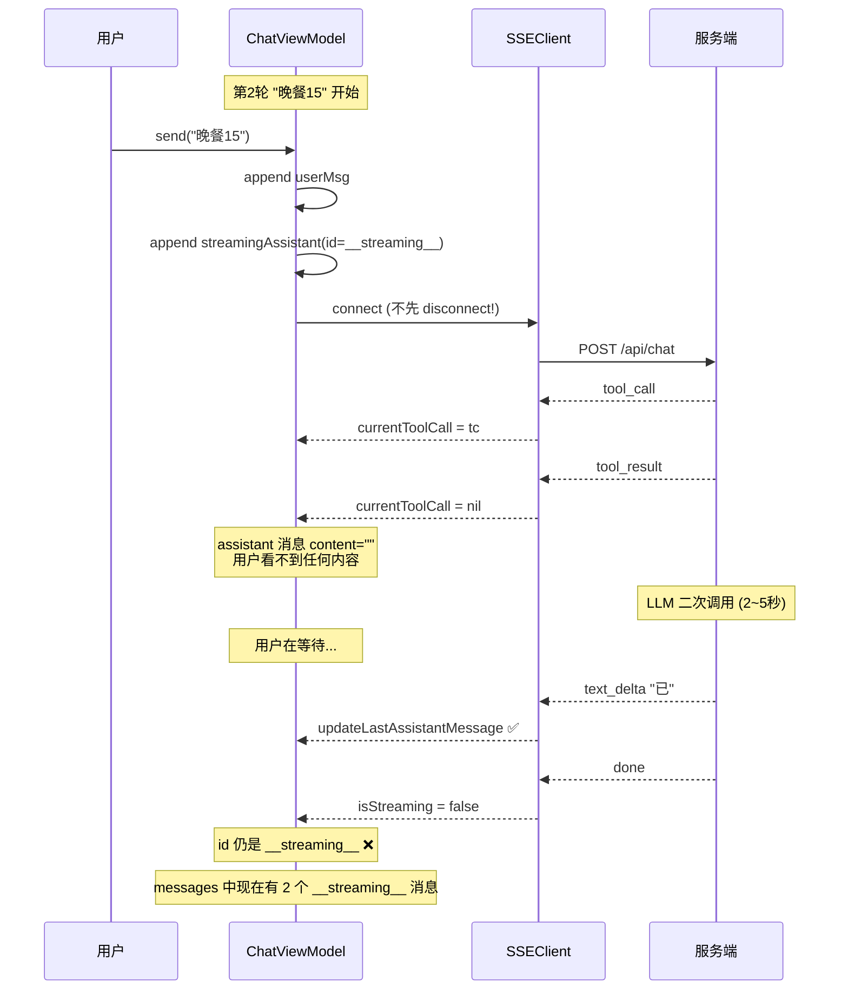

# Bug #001 — 多轮对话中消息渲染错乱

> 发现日期: 2026-05-01 | 严重程度: P0（核心流程阻塞） | 状态: 待修复

---

## 问题表现

三轮对话后消息列表严重错乱：

| 轮次 | 用户发送 | 预期 | 实际 |
|------|----------|------|------|
| 1 | "nihao" | 显示 "你好" | ✅ 正常 |
| 2 | "晚餐15" | 显示记账确认文本 | ❌ tool 卡片闪过，**无任何文本展示** |
| 3 | "你好" | 显示新的聊天回复 | ❌ **第1轮的回复位置**被替换成第2轮的内容 |

---

## 根因分析

### 根因一：done 事件未回传 assistant message ID

**后端** (`controller/chat.go:96-106`)：done 时 `msgRepo.Create()` 生成了真实 UUID，但 done 事件的 SSE data 只包含 `conversation_id`，没包含 `message_id`：

```go
// 服务端已入库真实 ID
msgRepo.Create(c.Request.Context(), &model.Message{
    ID: uuid.New().String(),   // ← 真实 UUID，但没发给客户端
    ...
})
// done 事件没带回
view.WriteSSE(w, flusher, "done",
    `{"conversation_id":"`+conv.ID+`"}`)  // ← 缺 message_id
```

**客户端** (`ChatViewModel.swift:92-96`)：done 事件处理只提取了 `conversation_id`，`__streaming__` 占位 ID 永不替换。多轮对话后，messages 数组里会累积多个 `id == "__streaming__"` 的消息。

```swift
// 客户端 done 处理 — 不替换 streaming ID
case .done:
    isStreaming = false
    if let cid = parseConversationIdFromDone(event.data) {
        conversationId = cid
    }
    // 问题：assistant 消息 id 仍然是 "__streaming__"
```

### 根因二：`__streaming__` 作为 ForEach 标识导致 SwiftUI 渲染错乱

`ChatView.swift` 用 `ForEach(viewModel.messages)` 渲染列表，SwiftUI 靠 `Identifiable.id` 区分每条消息。当两轮对话后数组中出现多个相同 ID：

```
messages = [
    user:"nihao"       (id=uuid-1),
    assistant:"你好"    (id=__streaming__),  ← 第1个
    user:"晚餐15"       (id=uuid-2),
    assistant:"晚餐回复" (id=__streaming__),  ← 第2个 (同ID!)
    user:"你好"         (id=uuid-3),
    assistant:""       (id=__streaming__),  ← 第3个 (同ID!)
]
```

`updateLastAssistantMessage` 通过 `messages.last` 定位，始终更新最后一个 `__streaming__`，这在第2轮时是对的。但当第3轮开始并追加新的 `__streaming__` 消息后，旧的 `__streaming__` 消息在 SwiftUI diff 时行为不可预知——可能渲染到错误位置。

### 根因三：SSE 旧连接未清理

`setupSSE` 每次发送新消息时重新设置 `onEvent`/`onError` 闭包，但**不调用 `disconnect()`** 终止上一次的 `URLSessionDataTask`。如果上一轮 SSE 连接尚未完全结束（done 事件延迟），新的 SSE 事件可能触发旧的闭包，导致文本错位写入。

```swift
private func setupSSE(...) {
    sseClient.onEvent = { ... }  // 覆盖闭包，但旧 task 可能在途
    sseClient.onError = { ... }
    sseClient.connect(...)       // 发起新连接
    // 问题：未调用 disconnect() 清理上一轮连接
}
```

### 根因四：tool_call → tool_result 之间的空窗期

"晚餐15" 触发 `create_bill`，SSE 事件顺序为：

```
1. tool_call   → 显示橙色工具卡片
2. tool_result → 隐藏工具卡片
3. (2~5 秒等待 LLM 二次调用)
4. text_delta  → 文本开始逐字出现
```

步骤 2 到步骤 4 之间，消息列表中 assistant 气泡是**空文本**（`streamingAssistant` 创建时 content=""，`tool_result` 处理未更新内容）。空文本气泡可能被 SwiftUI 折叠为不可见，用户感知就是"发完消息什么都没有"。

---

## 时序对比



---

## 修复方案

### 修复 1（后端）：done 事件携带 message_id

`controller/chat.go` done 分支，生成 ID 后塞进 done 事件 JSON：

```go
case "done":
    if fullContent.Len() > 0 {
        msgID := uuid.New().String()
        msgRepo.Create(c.Request.Context(), &model.Message{
            ID:             msgID,
            ConversationID: conv.ID,
            Role:           "assistant",
            Content:        fullContent.String(),
        })
        view.WriteSSE(w, flusher, "done",
            `{"conversation_id":"`+conv.ID+`","message_id":"`+msgID+`"}`)
    } else {
        view.WriteSSE(w, flusher, "done",
            `{"conversation_id":"`+conv.ID+`"}`)
    }
```

### 修复 2（客户端）：done 时替换 __streaming__ 为真实 ID

`ChatViewModel.swift` done 处理：

```swift
case .done:
    isStreaming = false
    if let cid = parseConversationIdFromDone(event.data) {
        conversationId = cid
    }
    if let msgID = parseMessageIdFromDone(event.data) {
        replaceStreamingMessageID(with: msgID)
    }
```

新增方法：

```swift
private func replaceStreamingMessageID(with msgID: String) {
    guard let index = messages.lastIndex(where: { $0.id == "__streaming__" }) else { return }
    var msg = messages[index]
    messages.remove(at: index)
    msg = Message(
        id: msgID,
        conversationId: msg.conversationId,
        role: msg.role,
        content: msg.content,
        toolCallsJSON: nil,
        createdAt: msg.createdAt
    )
    messages.insert(msg, at: index)
}
```

### 修复 3（客户端）：发送新消息前断开旧 SSE

```swift
private func setupSSE(...) {
    sseClient.disconnect()   // ← 新增：先断再连
    sseClient.onEvent = { ... }
    sseClient.onError = { ... }
    sseClient.connect(...)
}
```

### 修复 4（客户端）：tool_result 不隐藏卡片，done 时才隐藏

不做 `currentToolCall = nil`，让工具卡片保持在屏幕上直到 done。增加中间态"正在等待回复"的展示。

```swift
case .toolResult:
    // 不做 currentToolCall = nil
    // 卡片保持可见，直到 done
    // 可加一个轻量状态提示 "工具执行完成，正在生成回复..."

case .done:
    currentToolCall = nil   // ← 移到 done 时清除
    ...
```

---

## 影响范围

| 文件 | 改动 |
|------|------|
| `server/internal/controller/chat.go` | done 事件增加 message_id |
| `client/.../ViewModels/ChatViewModel.swift` | 修复 2 + 修复 3 + 修复 4 |
| `client/.../Services/SSEClient.swift` | 无（已有 disconnect 方法） |

改动量：约 20 行。
