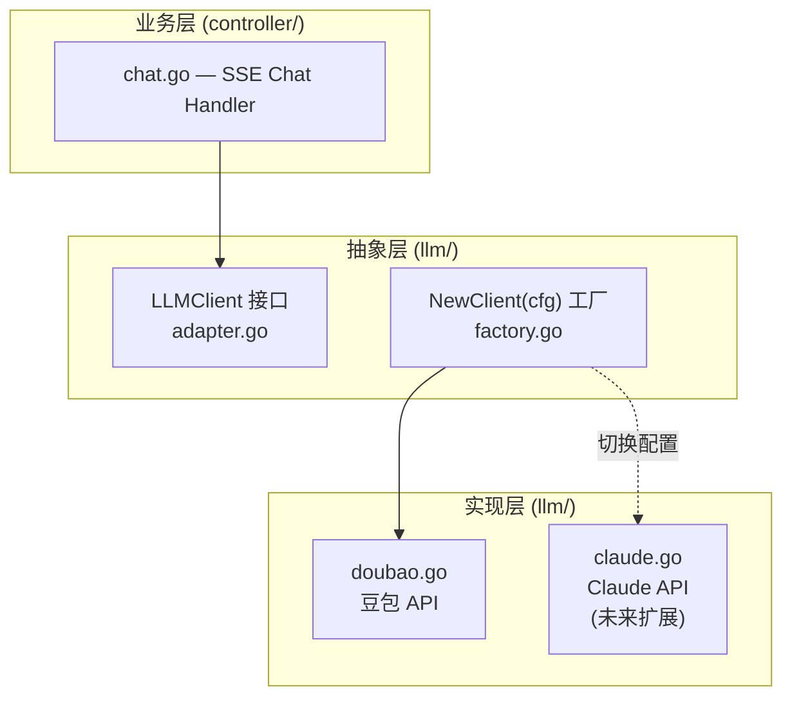
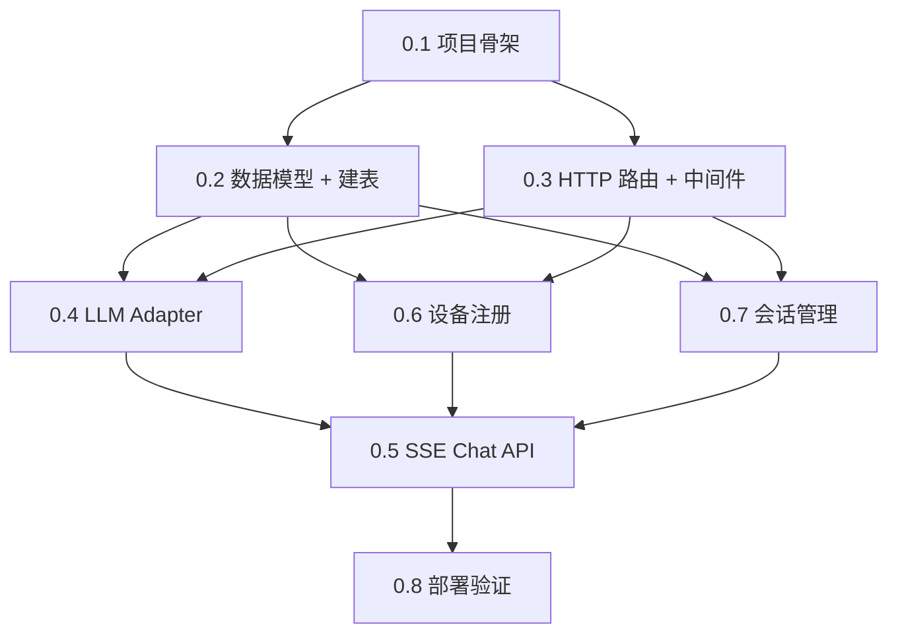

# P0 — 项目骨架 + 基础对话 · 详细计划

> 版本: v0.1  
> 日期: 2026-04-30  
> 状态: 计划阶段，等待确认后编码

---

## 目标

跑通整个链路：Go 服务启动 → 豆包 API 接入 → SSE 流式对话

验证标准：`curl` 发消息，收到豆包的流式回复

---

## 任务清单

| # | 任务 | 涉及包 |
|---|------|--------|
| 0.1 | 项目骨架 | `cmd/`, `conf/`, `config/`, `go.mod` |
| 0.2 | Model 层 — 数据模型 + DB 访问 | `model/`, `service/` |
| 0.3 | Controller + Middleware | `controller/`, `middleware/` |
| 0.4 | LLM 抽象层 | `llm/` |
| 0.5 | View 层 — SSE / JSON 渲染 | `view/` |
| 0.6 | SSE Chat Controller | `controller/chat.go` |
| 0.7 | 设备注册 + 会话管理 Controller | `controller/devices.go`, `conversations.go` |
| 0.8 | 部署脚本 | systemd unit, nginx config |

---

## 0.1 项目骨架

### 总体目录结构

```
xhanHelper/                        # 项目总目录
├── server/                        # Go 后端 (MVC)
│   ├── cmd/
│   │   └── xhan-helper/
│   │       └── main.go            # 入口：加载配置 → 连 DB → 注册路由 → 启动
│   ├── conf/
│   │   ├── config.yaml            # 基础配置
│   │   ├── config.dev.yaml        # 开发覆盖
│   │   └── config.prod.yaml       # 生产覆盖
│   ├── internal/
│   │   ├── config/
│   │   │   └── config.go          # 配置结构 + YAML 加载 + 环境合并
│   │   ├── model/                 # M: 数据模型 (GORM)
│   │   │   ├── device.go
│   │   │   ├── conversation.go
│   │   │   ├── message.go
│   │   │   └── bill.go
│   │   ├── service/               # M 的 DB 访问层 (store/repository)
│   │   │   ├── db.go              # GORM 连接池
│   │   │   ├── device_repo.go
│   │   │   ├── conversation_repo.go
│   │   │   └── message_repo.go
│   │   ├── controller/            # C: Gin handlers
│   │   │   ├── router.go          # 路由注册
│   │   │   ├── chat.go            # POST /api/chat (SSE)
│   │   │   ├── devices.go         # POST /api/devices/register
│   │   │   └── conversations.go   # GET /api/conversations, /:id/messages
│   │   ├── view/                  # V: 响应渲染
│   │   │   └── render.go          # writeSSE(), jsonOK(), jsonError()
│   │   ├── llm/                   # LLM 抽象层
│   │   │   ├── adapter.go         # LLMClient 接口 + 公共类型
│   │   │   ├── factory.go         # NewClient(cfg) 工厂
│   │   │   ├── doubao.go          # 豆包实现
│   │   │   └── claude.go          # Claude 占位
│   │   └── middleware/
│   │       └── auth.go            # Device Token 认证
│   ├── migrations/
│   │   └── 001_init.sql
│   ├── go.mod
│   └── go.sum
├── client/                        # SwiftUI 客户端 (iOS + macOS, P2 阶段)
│   └── xhanHelper.xcodeproj
└── README.md
```

### MVC 职责划分

| 层 | 目录 | 职责 | 不做什么 |
|----|------|------|----------|
| **Model** | `model/` + `service/` | 数据结构定义 + DB CRUD | 不碰 HTTP 请求/响应 |
| **View** | `view/` | SSE 推送、JSON 响应格式化 | 不含业务逻辑 |
| **Controller** | `controller/` | 解析请求 → 调用 service → 调用 view 渲染 | 不直接写 SQL，不拼 SSE 字符串 |

### 配置文件设计

**三层加载机制：**

```
conf/config.yaml          基础配置，所有环境共享
      ↓ 合并覆盖
conf/config.{env}.yaml    环境特定覆盖（dev / prod）
      ↓ 变量替换
os.Getenv(...)            解析 ${DB_PASSWORD} 等占位符
      ↓
Config struct             最终使用的配置
```

**conf/config.yaml — 基础配置：**

```yaml
server:
  port: 8080
  mode: debug          # debug | release（gin 模式）

db:
  host: 127.0.0.1
  port: 3306
  database: xhan_helper
  user: root
  password: ${DB_PASSWORD}      # 从环境变量解析
  charset: utf8mb4

llm:
  api_key: ${LLM_API_KEY}       # 从环境变量解析
  model: doubao-pro-32k
  base_url: https://ark.cn-beijing.volces.com/api/v3
```

**conf/config.dev.yaml — 开发环境（Mac 本地）：**

```yaml
server:
  mode: debug

db:
  host: 127.0.0.1
  database: xhan_helper_dev     # 本地用独立库
```

**conf/config.prod.yaml — 生产环境（阿里云）：**

```yaml
server:
  mode: release

db:
  host: 127.0.0.1               # 阿里云本地 MySQL
  database: xhan_helper
```

### 配置加载逻辑 (config.go)

```go
package config

import (
    "fmt"
    "os"

    "gopkg.in/yaml.v3"
)

// Config — 顶层配置结构
type Config struct {
    Server ServerConfig `yaml:"server"`
    DB     DBConfig     `yaml:"db"`
    LLM    LLMConfig    `yaml:"llm"`
}

type ServerConfig struct {
    Port int    `yaml:"port"`
    Mode string `yaml:"mode"` // debug | release
}

type DBConfig struct {
    Host     string `yaml:"host"`
    Port     int    `yaml:"port"`
    Database string `yaml:"database"`
    User     string `yaml:"user"`
    Password string `yaml:"password"` // 已从 ${DB_PASSWORD} 解析
    Charset  string `yaml:"charset"`
}

// DSN 返回 MySQL 连接串
func (d DBConfig) DSN() string {
    return fmt.Sprintf("%s:%s@tcp(%s:%d)/%s?charset=%s&parseTime=true",
        d.User, d.Password, d.Host, d.Port, d.Database, d.Charset)
}

type LLMConfig struct {
    Provider string `yaml:"provider"` // doubao | claude | deepseek
    APIKey   string `yaml:"api_key"`  // 已从 ${LLM_API_KEY} 解析
    Model    string `yaml:"model"`
    BaseURL  string `yaml:"base_url"`
}

// Load 加载配置：base YAML + env YAML 合并 → 环境变量替换
func Load() (*Config, error) {
    env := os.Getenv("APP_ENV")
    if env == "" {
        env = "dev"
    }

    // 1. 加载基础配置
    cfg, err := loadFile("conf/config.yaml")
    if err != nil {
        return nil, fmt.Errorf("load config.yaml: %w", err)
    }

    // 2. 加载环境特定配置并合并
    envPath := fmt.Sprintf("conf/config.%s.yaml", env)
    if envCfg, err := loadFile(envPath); err == nil {
        merge(cfg, envCfg)
    } else if !os.IsNotExist(err) {
        return nil, fmt.Errorf("load %s: %w", envPath, err)
    }

    // 3. 解析 ${ENV_VAR} 占位符
    resolveEnvVars(cfg)

    // 4. 校验必填项
    if err := validate(cfg); err != nil {
        return nil, err
    }

    return cfg, nil
}

// loadFile 读取 YAML 并展开环境变量占位符，返回一个零值的 *Config
func loadFile(path string) (*Config, error) {
    data, err := os.ReadFile(path)
    if err != nil {
        return nil, err
    }
    // 先做 ${VAR} 展开再反序列化
    expanded := os.Expand(string(data), func(key string) string {
        return os.Getenv(key)
    })

    var cfg Config
    if err := yaml.Unmarshal([]byte(expanded), &cfg); err != nil {
        return nil, err
    }
    return &cfg, nil
}

// merge 将 src 中的非零值覆盖到 dst（浅层合并）
func merge(dst, src *Config) {
    if src.Server.Port != 0 {
        dst.Server.Port = src.Server.Port
    }
    if src.Server.Mode != "" {
        dst.Server.Mode = src.Server.Mode
    }
    // DB
    if src.DB.Host != "" {
        dst.DB.Host = src.DB.Host
    }
    if src.DB.Port != 0 {
        dst.DB.Port = src.DB.Port
    }
    if src.DB.Database != "" {
        dst.DB.Database = src.DB.Database
    }
    if src.DB.User != "" {
        dst.DB.User = src.DB.User
    }
    if src.DB.Password != "" {
        dst.DB.Password = src.DB.Password
    }
    if src.DB.Charset != "" {
        dst.DB.Charset = src.DB.Charset
    }
    // LLM
    if src.LLM.Provider != "" {
        dst.LLM.Provider = src.LLM.Provider
    }
    if src.LLM.APIKey != "" {
        dst.LLM.APIKey = src.LLM.APIKey
    }
    if src.LLM.Model != "" {
        dst.LLM.Model = src.LLM.Model
    }
    if src.LLM.BaseURL != "" {
        dst.LLM.BaseURL = src.LLM.BaseURL
    }
}

// resolveEnvVars 对已加载的 cfg 中所有字符串字段做 ${VAR} 展开
func resolveEnvVars(cfg *Config) {
    cfg.DB.Password = os.ExpandEnv(cfg.DB.Password)
    cfg.LLM.APIKey  = os.ExpandEnv(cfg.LLM.APIKey)
}

func validate(cfg *Config) error {
    if cfg.DB.Host == "" {
        return fmt.Errorf("db.host is required")
    }
    if cfg.LLM.APIKey == "" {
        return fmt.Errorf("llm.api_key is required (set LLM_API_KEY env var)")
    }
    return nil
}
```

**设计要点：**

1. **敏感数据不落 YAML**：`password` 和 `api_key` 在 YAML 中写 `${DB_PASSWORD}` / `${LLM_API_KEY}`，实际值通过环境变量注入
2. **环境选择**：通过 `APP_ENV` 环境变量控制（`dev` / `prod`），不设置默认 `dev`
3. **合并规则**：base YAML 加载后，env YAML 中非零值覆盖，不允许 env YAML 新增 base 中不存在的字段
4. **双重展开**：`loadFile` 时展开一次（处理 YAML 值中引用环境变量的场景），`resolveEnvVars` 再展开一次（处理 env YAML 覆盖后可能引入的新占位符）

### main.go 启动流程

```go
func main() {
    cfg, err := config.Load()
    if err != nil {
        log.Fatal("load config:", err)
    }

    gin.SetMode(cfg.Server.Mode)

    db := service.NewMySQL(cfg.DB)
    sqlDB, _ := db.DB()
    defer sqlDB.Close()

    db.AutoMigrate(&model.Device{}, &model.Conversation{}, &model.Message{},
        &model.Bill{}, &model.UserMemory{}, &model.ScheduledTask{})

    llmClient, err := llm.NewClient(cfg.LLM)
    if err != nil {
        log.Fatal("create llm client:", err)
    }
    devRepo   := service.NewDeviceRepo(db)
    convRepo  := service.NewConversationRepo(db)
    msgRepo   := service.NewMessageRepo(db)

    r := controller.NewRouter(cfg, llmClient, devRepo, convRepo, msgRepo)

    srv := &http.Server{Addr: ":" + strconv.Itoa(cfg.Server.Port), Handler: r}
    // graceful shutdown with os.Signal...
    srv.ListenAndServe()
}
```

### 依赖项 (go.mod)

```
module xhan-helper

require (
    github.com/gin-gonic/gin        // HTTP 框架
    github.com/gin-contrib/cors      // CORS 中间件
    github.com/google/uuid           // UUID 生成
    gopkg.in/yaml.v3                 // YAML 解析
    gorm.io/gorm                     // ORM
    gorm.io/driver/mysql             // GORM MySQL 驱动
)
```

---

## 0.2 Model 层 — 数据模型 + DB 访问

### 职责

- `model/` — 纯数据结构（GORM tag 标注），不包含任何业务逻辑
- `service/` — DB CRUD 封装（每个 model 对应一个 Repo），Controller 只调 service，不直接碰 `*gorm.DB`

### Go Model 定义

```go
// model/device.go — M: 设备
type Device struct {
    ID         string    `gorm:"primaryKey;size:36"`
    Token      string    `gorm:"uniqueIndex;size:64;not null"`
    Name       string    `gorm:"size:100"`
    Platform   string    `gorm:"size:20;not null"` // "ios" | "macos"
    CreatedAt  time.Time `gorm:"autoCreateTime"`
    LastSeenAt time.Time `gorm:"autoUpdateTime"`
    Conversations []Conversation `gorm:"foreignKey:DeviceID"`
    Bills         []Bill         `gorm:"foreignKey:DeviceID"`
}

// model/conversation.go
type Conversation struct {
    ID        string    `gorm:"primaryKey;size:36"`
    DeviceID  string    `gorm:"size:36;not null;index"`
    Title     string    `gorm:"size:200;default:新对话"`
    CreatedAt time.Time `gorm:"autoCreateTime"`
    UpdatedAt time.Time `gorm:"autoUpdateTime"`
    Messages []Message `gorm:"foreignKey:ConversationID"`
}

// model/message.go
type Message struct {
    ID             string    `gorm:"primaryKey;size:36"`
    ConversationID string    `gorm:"size:36;not null;index"`
    Role           string    `gorm:"size:20;not null"` // "user" | "assistant" | "tool"
    Content        string    `gorm:"type:text"`
    ToolCallsJSON  *string   `gorm:"type:json;column:tool_calls_json"`
    ToolCallID     *string   `gorm:"size:36;column:tool_call_id"`
    CreatedAt      time.Time `gorm:"autoCreateTime"`
}
```

### Service 层 — DB 访问 (Repo)

```go
// service/db.go
func NewMySQL(cfg config.DBConfig) *gorm.DB {
    db, err := gorm.Open(mysql.Open(cfg.DSN()), &gorm.Config{})
    if err != nil {
        log.Fatal("failed to connect database:", err)
    }
    return db
}

// service/device_repo.go
type DeviceRepo struct { db *gorm.DB }
func NewDeviceRepo(db *gorm.DB) *DeviceRepo { return &DeviceRepo{db} }
func (r *DeviceRepo) Create(ctx context.Context, d *model.Device) error {
    return r.db.WithContext(ctx).Create(d).Error
}
func (r *DeviceRepo) FindByToken(ctx context.Context, token string) (*model.Device, error) {
    var d model.Device
    err := r.db.WithContext(ctx).Where("device_token = ?", token).First(&d).Error
    if errors.Is(err, gorm.ErrRecordNotFound) {
        return nil, nil
    }
    return &d, err
}

// service/conversation_repo.go
type ConversationRepo struct { db *gorm.DB }
func NewConversationRepo(db *gorm.DB) *ConversationRepo { return &ConversationRepo{db} }
func (r *ConversationRepo) Create(ctx context.Context, c *model.Conversation) error {
    return r.db.WithContext(ctx).Create(c).Error
}
func (r *ConversationRepo) FindByID(ctx context.Context, id string) (*model.Conversation, error) {
    var c model.Conversation
    err := r.db.WithContext(ctx).Where("id = ?", id).First(&c).Error
    if errors.Is(err, gorm.ErrRecordNotFound) {
        return nil, nil
    }
    return &c, err
}
func (r *ConversationRepo) ListByDevice(ctx context.Context, deviceID string, limit int) ([]model.Conversation, error) {
    var list []model.Conversation
    err := r.db.WithContext(ctx).
        Where("device_id = ?", deviceID).
        Order("updated_at DESC").Limit(limit).
        Find(&list).Error
    return list, err
}

// service/message_repo.go
type MessageRepo struct { db *gorm.DB }
func NewMessageRepo(db *gorm.DB) *MessageRepo { return &MessageRepo{db} }
func (r *MessageRepo) Create(ctx context.Context, m *model.Message) error {
    return r.db.WithContext(ctx).Create(m).Error
}
func (r *MessageRepo) ListByConversation(ctx context.Context, convID string, limit int) ([]model.Message, error) {
    var list []model.Message
    err := r.db.WithContext(ctx).
        Where("conversation_id = ?", convID).
        Order("created_at ASC").Limit(limit).
        Find(&list).Error
    return list, err
}
```

### 建表

P0 阶段用 GORM `AutoMigrate` 自动建表，后续版本引入正式 migration。

`messages.tool_calls_json` 和 `messages.tool_call_id` 使用 `*string` 以支持 NULL。

---

## 0.3 Controller + Middleware

### 路由注册 (controller/router.go)

```go
package controller

import (
    "github.com/gin-gonic/gin"
    "github.com/gin-contrib/cors"
    "xhan-helper/internal/llm"
    "xhan-helper/internal/service"
    "xhan-helper/internal/middleware"
    "xhan-helper/internal/view"
)

func NewRouter(cfg *config.Config, llmClient llm.LLMClient,
    devRepo *service.DeviceRepo, convRepo *service.ConversationRepo,
    msgRepo *service.MessageRepo) *gin.Engine {

    r := gin.Default()

    r.Use(cors.New(cors.Config{
        AllowOrigins: []string{"*"},
        AllowMethods: []string{"GET", "POST", "OPTIONS"},
        AllowHeaders: []string{"Authorization", "Content-Type"},
    }))

    // 无需认证
    r.POST("/api/devices/register", registerDevice(devRepo))

    // 需要认证
    auth := r.Group("/api")
    auth.Use(middleware.Auth(devRepo))
    {
        auth.POST("/chat", chat(llmClient, convRepo, msgRepo))
        auth.GET("/conversations", listConversations(convRepo))
        auth.GET("/conversations/:id/messages", getMessages(convRepo, msgRepo))
    }

    return r
}
```

### 认证中间件 (middleware/auth.go)

```go
package middleware

func Auth(devRepo *service.DeviceRepo) gin.HandlerFunc {
    return func(c *gin.Context) {
        token := strings.TrimPrefix(c.GetHeader("Authorization"), "Bearer ")
        if token == "" {
            view.JSONError(c, 401, "missing token")
            return
        }
        device, err := devRepo.FindByToken(c.Request.Context(), token)
        if err != nil || device == nil {
            view.JSONError(c, 401, "invalid token")
            return
        }
        c.Set("device", device)
        c.Next()
    }
}
```

Gin 自带 Logger / Recovery（`gin.Default()`），无需手写。

---

## 0.4 LLM 抽象层

### 设计目标

通过接口 + 工厂模式解耦业务逻辑与具体模型厂商。切换模型只需改 YAML 配置一行，无需动业务代码。

### 架构



### 目录结构

```
internal/llm/
├── adapter.go       # LLMClient 接口 + 公共类型（ChatRequest, StreamEvent 等）
├── factory.go       # NewClient(cfg) 工厂——根据配置创建具体实现
├── doubao.go        # 豆包实现
└── claude.go        # Claude 实现（P0 占位，后续实现）
```

### 接口定义 (adapter.go)

```go
package llm

import "context"

// LLMClient — 所有 LLM 厂商必须实现此接口
type LLMClient interface {
    // Chat 流式对话，返回事件 channel。适合前端 SSE 推送场景
    Chat(ctx context.Context, req *ChatRequest) (<-chan *StreamEvent, error)

    // ChatSync 非流式对话，等待完整回复后返回。适合后台任务（记忆提取、标题生成等）
    ChatSync(ctx context.Context, req *ChatRequest) (string, error)
}

type ChatRequest struct {
    SystemPrompt string           // 系统提示词
    Messages     []Message        // 对话历史（不含 system）
    Tools        []ToolDefinition // 工具定义（P0 为空，P1 启用）
}

type Message struct {
    Role    string // "user" | "assistant" | "tool"
    Content string
}

type ToolDefinition struct {
    Name        string
    Description string
    Parameters  map[string]interface{} // JSON Schema
}

type StreamEvent struct {
    Type    string // "text_delta" | "done" | "error"
    Content string // 增量文本（Type=text_delta 时）
    Error   string // 错误信息（Type=error 时）
}
```

### 工厂函数 (factory.go)

```go
package llm

import "fmt"

// NewClient 根据配置创建对应的 LLM 客户端
func NewClient(cfg LLMConfig) (LLMClient, error) {
    switch cfg.Provider {
    case "doubao":
        return NewDoubao(cfg), nil
    case "claude":
        return NewClaude(cfg), nil
    default:
        return nil, fmt.Errorf("unsupported llm provider: %s", cfg.Provider)
    }
}
```

### 豆包实现 (doubao.go)

```go
type DoubaoClient struct {
    apiKey     string
    model      string
    baseURL    string
    httpClient *http.Client
}

func NewDoubao(cfg LLMConfig) *DoubaoClient {
    return &DoubaoClient{
        apiKey:     cfg.APIKey,
        model:      cfg.Model,
        baseURL:    cfg.BaseURL,
        httpClient: &http.Client{Timeout: 120 * time.Second},
    }
}

func (c *DoubaoClient) Chat(ctx context.Context, req *ChatRequest) (<-chan *StreamEvent, error) {
    // 1. 构造豆包 API 请求体（兼容 OpenAI chat/completions 格式）
    // 2. 发起 HTTP POST，设置 stream: true
    // 3. 在 goroutine 中读取 SSE 响应流
    // 4. 解析每个 chunk，写入 events channel
    // 5. 读取完毕或 ctx 取消时 close(events)
    // 6. 返回 events channel 给调用方
}

func (c *DoubaoClient) ChatSync(ctx context.Context, req *ChatRequest) (string, error) {
    // 默认实现：复用 Chat 流式接口，拼接所有 text_delta
    events, err := c.Chat(ctx, req)
    if err != nil {
        return "", err
    }
    var buf strings.Builder
    for evt := range events {
        if evt.Type == "error" {
            return "", fmt.Errorf("llm error: %s", evt.Error)
        }
        if evt.Type == "text_delta" {
            buf.WriteString(evt.Content)
        }
    }
    return buf.String(), nil
}
```

### Claude 实现占位 (claude.go)

```go
// P0 阶段预留，结构参照 DoubaoClient，实现 LLMClient 接口
// Claude API 同样兼容 OpenAI chat/completions 格式，只需调整：
//   - baseURL: https://api.anthropic.com/v1/messages
//   - 请求头: x-api-key 替代 Authorization: Bearer
//   - 响应格式略有差异（content block），适配层处理
type ClaudeClient struct { ... }
func NewClaude(cfg LLMConfig) *ClaudeClient { ... }
func (c *ClaudeClient) Chat(ctx context.Context, req *ChatRequest) (<-chan *StreamEvent, error) { ... }
```

### 新增 Provider 的标准步骤

以未来接入"DeepSeek"为例，只需 3 步：

```
1. 新建 llm/deepseek.go
     └── type DeepSeekClient struct { ... }
     └── func (c *DeepSeekClient) Chat(...) 实现接口

2. factory.go 的 switch 加一个分支
     └── case "deepseek": return NewDeepSeek(cfg), nil

3. conf/config.yaml 改一行
     └── llm.provider: deepseek
```

业务代码（chat.go、router.go、main.go）零改动。

### 配置文件适配

```yaml
# conf/config.yaml
llm:
  provider: doubao        # ← 选择厂商：doubao | claude | deepseek
  api_key: ${LLM_API_KEY}
  model: doubao-pro-32k
  base_url: https://ark.cn-beijing.volces.com/api/v3
```

### main.go 变化

```go
// 之前：直接调具体实现
llmClient := llm.NewDoubao(cfg.LLM)

// 现在：通过工厂创建
llmClient, err := llm.NewClient(cfg.LLM)
if err != nil {
    log.Fatal("create llm client:", err)
}
```

### 豆包 API 请求体（假设兼容 OpenAI 格式）

```json
{
    "model": "doubao-pro-32k",
    "messages": [
        {"role": "system", "content": "<见下方 System Prompt>"},
        {"role": "user", "content": "你好"}
    ],
    "stream": true
}
```

### System Prompt

```
你是 xhanHelper，一个个人 AI 助手。你的职责是帮助用户高效完成任务。

核心原则：
1. 简洁回复：用最少的字把事说清楚
2. 诚实：不知道就说不知道，不要编造
3. 主动：如果用户意图不明确，追问关键信息

当前没有启用的工具。在后续版本中，你将能够调用工具来执行实际操作。
```

### SSE 解析

豆包流式响应一般是这种格式：

```
data: {"choices":[{"delta":{"content":"你"}}]}

data: {"choices":[{"delta":{"content":"好"}}]}

data: [DONE]
```

解析逻辑：

```go
func (c *DoubaoClient) streamParse(body io.Reader, events chan<- *StreamEvent) {
    scanner := bufio.NewScanner(body)
    for scanner.Scan() {
        line := scanner.Text()
        if !strings.HasPrefix(line, "data: ") {
            continue
        }
        data := strings.TrimPrefix(line, "data: ")
        if data == "[DONE]" {
            events <- &StreamEvent{Type: "done"}
            break
        }
        var chunk struct { Choices []struct { Delta struct { Content string } } }
        json.Unmarshal([]byte(data), &chunk)
        if content := chunk.Choices[0].Delta.Content; content != "" {
            events <- &StreamEvent{Type: "text_delta", Content: content}
        }
    }
    close(events)
}
```

---

## 0.4 View 层 — 响应渲染

Controller 不直接拼 SSE 字符串或构造 JSON map。统一通过 `view/` 包的函数渲染。

### view/render.go

```go
package view

import (
    "encoding/json"
    "fmt"
    "io"
    "net/http"

    "github.com/gin-gonic/gin"
)

// --- SSE ---

func WriteSSE(w io.Writer, flusher http.Flusher, event, data string) {
    fmt.Fprintf(w, "event: %s\ndata: %s\n\n", event, data)
    flusher.Flush()
}

// --- JSON ---

func JSONOK(c *gin.Context, data interface{}) {
    c.JSON(200, data)
}

func JSONError(c *gin.Context, code int, msg string) {
    c.JSON(code, gin.H{"error": msg})
    c.Abort()
}

// --- 工具函数 ---

func EscapeJSON(s string) string {
    b, _ := json.Marshal(s)
    return string(b[1 : len(b)-1])
}
```

---

## 0.5 Controller — SSE Chat

```
POST /api/chat
  ↓
1. 解析请求 → 获取当前设备
2. 获取或创建会话 (convRepo)
3. 保存用户消息 (msgRepo)
4. 加载历史消息（最近 20 条）
5. 调用 llmClient.Chat(ctx, req)
6. view.WriteSSE 流式输出
7. done → 保存 assistant 消息
```

### controller/chat.go

```go
func chat(llmClient llm.LLMClient, convRepo *service.ConversationRepo,
    msgRepo *service.MessageRepo) gin.HandlerFunc {
    return func(c *gin.Context) {
        var req struct {
            ConversationID *string `json:"conversation_id"`
            Message        string  `json:"message"`
        }
        if err := c.ShouldBindJSON(&req); err != nil {
            view.JSONError(c, 400, "invalid request")
            return
        }

        dev, _ := c.Get("device")
        device := dev.(*model.Device)

        // 获取或创建会话
        var conv *model.Conversation
        if req.ConversationID != nil {
            conv, _ = convRepo.FindByID(c.Request.Context(), *req.ConversationID)
        }
        if conv == nil {
            conv = &model.Conversation{ID: uuid.New().String(), DeviceID: device.ID}
            convRepo.Create(c.Request.Context(), conv)
        }

        // 保存用户消息
        msgRepo.Create(c.Request.Context(), &model.Message{
            ConversationID: conv.ID, Role: "user", Content: req.Message,
        })

        // 加载历史
        history, _ := msgRepo.ListByConversation(c.Request.Context(), conv.ID, 20)

        // SSE headers
        w := c.Writer
        w.Header().Set("Content-Type", "text/event-stream")
        w.Header().Set("Cache-Control", "no-cache")
        w.Header().Set("Connection", "keep-alive")
        flusher, ok := w.(http.Flusher)
        if !ok {
            view.JSONError(c, 500, "streaming not supported")
            return
        }

        events, err := llmClient.Chat(c.Request.Context(), &llm.ChatRequest{
            Messages: buildLLMMessages(history),
        })
        if err != nil {
            view.WriteSSE(w, flusher, "error", err.Error())
            return
        }

        var fullContent strings.Builder
        for evt := range events {
            select {
            case <-c.Request.Context().Done():
                return
            default:
            }
            switch evt.Type {
            case "text_delta":
                fullContent.WriteString(evt.Content)
                view.WriteSSE(w, flusher, "message",
                    `{"delta":"`+view.EscapeJSON(evt.Content)+`"}`)
            case "done":
                msgRepo.Create(c.Request.Context(), &model.Message{
                    ConversationID: conv.ID, Role: "assistant", Content: fullContent.String(),
                })
                view.WriteSSE(w, flusher, "done",
                    `{"conversation_id":"`+conv.ID+`"}`)
            case "error":
                view.WriteSSE(w, flusher, "error", evt.Error)
            }
        }
    }
}

func buildLLMMessages(history []model.Message) []llm.Message {
    msgs := make([]llm.Message, 0, len(history))
    for _, m := range history {
        msgs = append(msgs, llm.Message{Role: m.Role, Content: m.Content})
    }
    return msgs
}
```

---

## 0.6 Controller — 设备注册

```go
// controller/devices.go
func registerDevice(devRepo *service.DeviceRepo) gin.HandlerFunc {
    return func(c *gin.Context) {
        var req struct {
            DeviceName string `json:"device_name"`
            Platform   string `json:"platform"`
        }
        if err := c.ShouldBindJSON(&req); err != nil {
            view.JSONError(c, 400, "invalid request")
            return
        }
        device := &model.Device{
            ID:       uuid.New().String(),
            Token:    uuid.New().String(), // device_token
            Name:     req.DeviceName,
            Platform: req.Platform,
        }
        if err := devRepo.Create(c.Request.Context(), device); err != nil {
            view.JSONError(c, 500, "create device failed")
            return
        }
        view.JSONOK(c, gin.H{
            "device_token": device.Token,
            "device_id":    device.ID,
        })
    }
}
```

---

## 0.7 Controller — 会话管理

```go
// controller/conversations.go
func listConversations(convRepo *service.ConversationRepo) gin.HandlerFunc {
    return func(c *gin.Context) {
        dev, _ := c.Get("device")
        device := dev.(*model.Device)
        list, err := convRepo.ListByDevice(c.Request.Context(), device.ID, 50)
        if err != nil {
            view.JSONError(c, 500, "query conversations failed")
            return
        }
        view.JSONOK(c, list)
    }
}

func getMessages(convRepo *service.ConversationRepo,
    msgRepo *service.MessageRepo) gin.HandlerFunc {
    return func(c *gin.Context) {
        convID := c.Param("id")
        conv, err := convRepo.FindByID(c.Request.Context(), convID)
        if err != nil || conv == nil {
            view.JSONError(c, 404, "conversation not found")
            return
        }
        dev, _ := c.Get("device")
        if conv.DeviceID != dev.(*model.Device).ID {
            view.JSONError(c, 403, "access denied")
            return
        }
        msgs, err := msgRepo.ListByConversation(c.Request.Context(), convID, 100)
        if err != nil {
            view.JSONError(c, 500, "query messages failed")
            return
        }
        view.JSONOK(c, msgs)
    }
}
```

---

## 0.8 部署

### SSE 配置要点

SSE 是一条长连接 HTTP 响应。要让流式输出正常工作，整个链路**每一层都不能缓冲**。

**Go 服务端：**
- 设置 `Content-Type: text/event-stream`
- 设置 `Cache-Control: no-cache`
- 每次 `fmt.Fprintf` 后立即调用 `flusher.Flush()`
- 传入 `ctx`，监听 `ctx.Done()` 以检测客户端断开

**Nginx（关键）：**
- `proxy_buffering off` — 必须关，否则 Nginx 会把响应攒满缓冲区才发给客户端
- `proxy_cache off` — 不缓存 SSE
- `proxy_http_version 1.1` — HTTP/1.1 才支持 chunked transfer
- `proxy_set_header Connection ""` — 清空 Connection header，让 Nginx 自行管理
- `proxy_read_timeout 120s` — LLM 回复可能较长，适当增加超时

**客户端（SwiftUI 后续）：**
- 使用 `URLSession` 流式读取，不要设置 `timeoutIntervalForResource` 太短
- 断线后自动重连，携带 `Last-Event-ID`

### 编译

```bash
GOOS=linux GOARCH=amd64 go build -o xhan-helper ./cmd/xhan-helper/
scp xhan-helper aliyun:/opt/xhan-helper/
```

### systemd unit

```ini
[Unit]
Description=xhanHelper Server
After=network.target

[Service]
Type=simple
User=www
WorkingDirectory=/opt/xhan-helper
Environment="APP_ENV=prod"
Environment="DB_PASSWORD=<生产数据库密码>"
Environment="LLM_API_KEY=<豆包 API Key>"
ExecStart=/opt/xhan-helper/xhan-helper
Restart=always

[Install]
WantedBy=multi-user.target
```

只有 3 个环境变量：`APP_ENV` 选配置文件，两个敏感值注入。其余配置全部在 `conf/config.yaml` + `conf/config.prod.yaml` 中。

### 部署文件清单

```
/opt/xhan-helper/
├── xhan-helper              # 编译后的二进制
├── conf/
│   ├── config.yaml           # 基础配置
│   └── config.prod.yaml      # 生产覆盖
└── logs/                     # 日志目录
```

### Nginx 完整配置

```nginx
server {
    listen 443 ssl;
    server_name your-domain.com;

    ssl_certificate     /etc/ssl/certs/your-domain.pem;
    ssl_certificate_key /etc/ssl/private/your-domain.key;

    location /api/ {
        proxy_pass http://127.0.0.1:8080;
        proxy_http_version 1.1;
        proxy_set_header Connection "";
        proxy_set_header Host $host;
        proxy_set_header X-Real-IP $remote_addr;
        proxy_set_header X-Forwarded-For $proxy_add_x_forwarded_for;

        # SSE 必须配置
        proxy_buffering off;
        proxy_cache off;
        proxy_read_timeout 120s;
        chunked_transfer_encoding on;
    }
}
```

### 验证部署

```bash
# 1. 注册设备
curl -X POST https://your-domain.com/api/devices/register \
  -H "Content-Type: application/json" \
  -d '{"device_name":"test","platform":"ios"}'

# 2. SSE 聊天（-N 禁用 curl 自身缓冲）
curl -N -X POST https://your-domain.com/api/chat \
  -H "Authorization: Bearer <token>" \
  -H "Content-Type: application/json" \
  -d '{"message":"你好"}'
# 预期：逐字流式输出豆包回复
```

---

## 执行顺序与依赖



0.2、0.3 可并行（HTTP 路由定义时不需要 DB 就绪）；0.6、0.7 可并行。

---

## P0 不包含的内容

- Tool 接口和 Registry（P1）
- 记账工具（P1）
- ReAct 循环（P1）
- Memory Manager（P4）
- Scheduler（P4）
- SwiftUI 客户端（P2）

P0 只做一件事：**用户发消息 → Go 服务 → 豆包 API → SSE 流式回复**。
