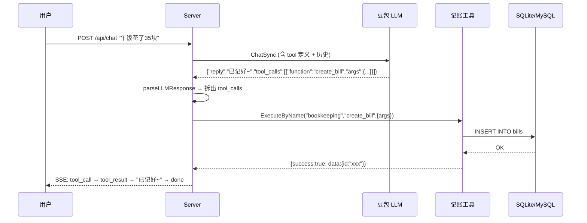
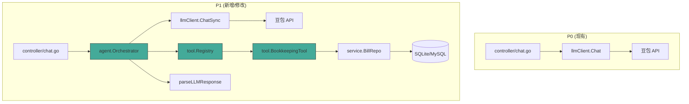
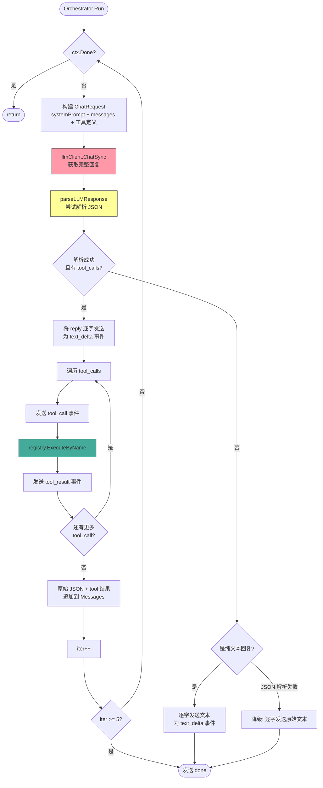
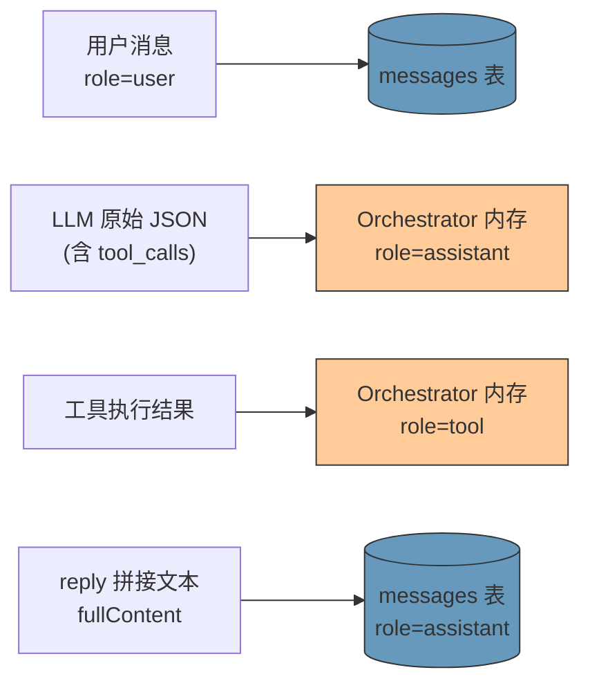
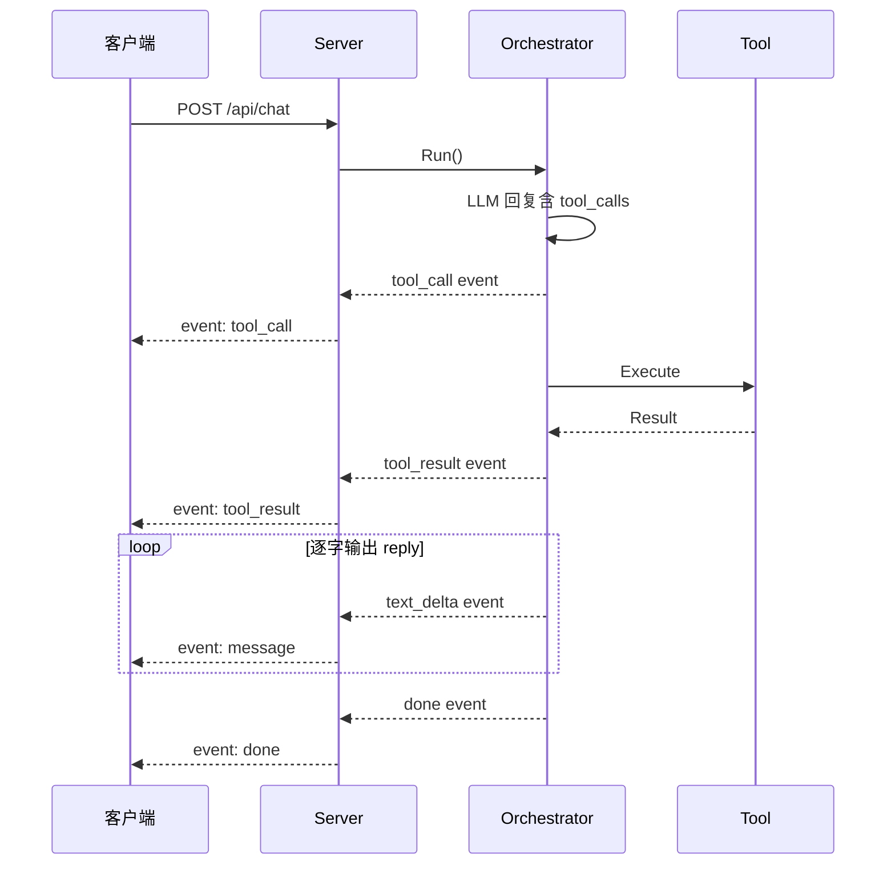
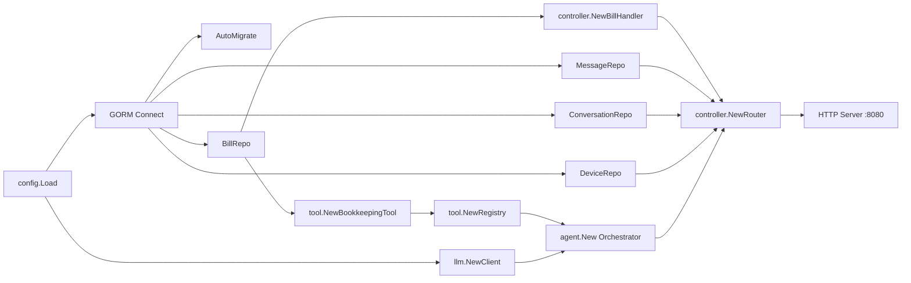
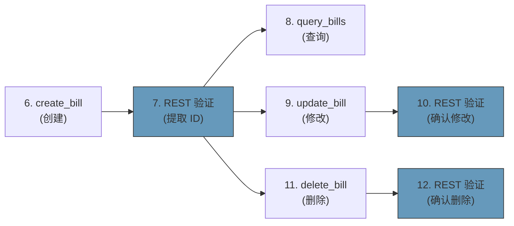
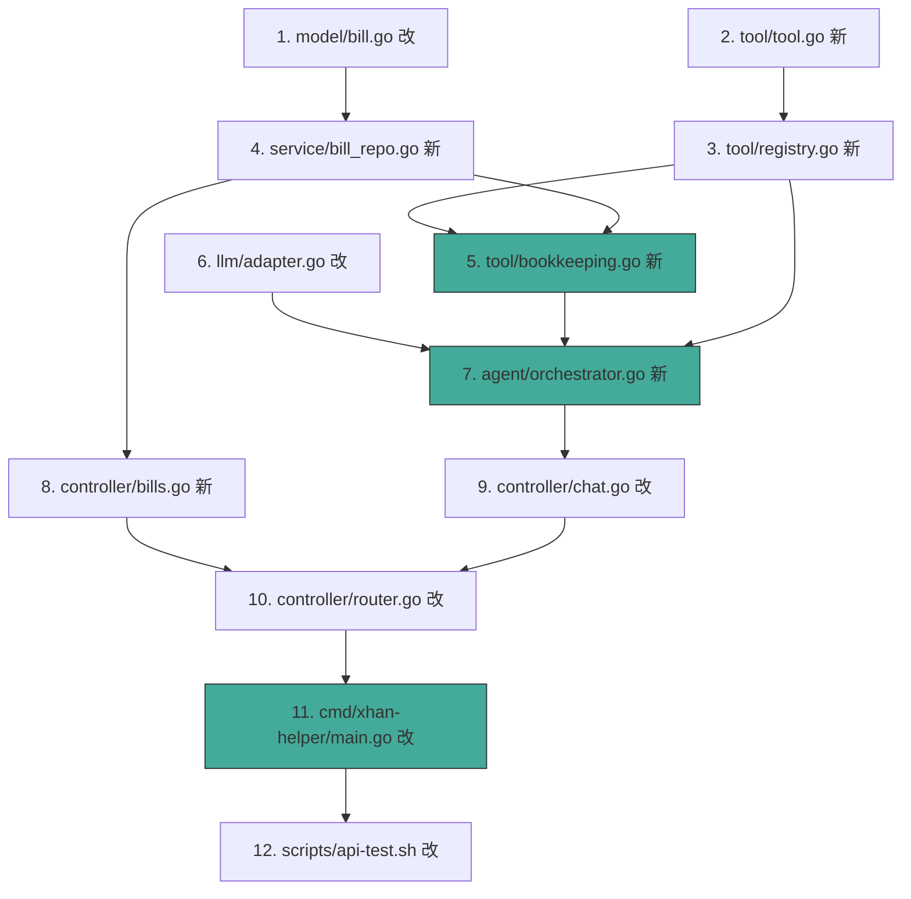

# P1 Plan — Agent 工具系统 + 记账

> 版本: v2  
> 日期: 2026-04-30  
> 状态: 设计阶段，等待确认后编码  
> 参考: bill-assistant-server 的 LLM prompt / Bill 模型 / 业务逻辑

---

## 一、问题与目标

**P0 现状**：一条直线——用户消息 → LLM 返回纯文本 → 流式推送。LLM 只有"嘴"没有"手"。

**P1 解决三个问题：**

1. **LLM 只有"嘴"没有"手"** → 加入 Tool Registry，让 LLM 能调用工具操作数据库
2. **对话与行动割裂** → ReAct 循环把 Thought → Action → Observation 串起来
3. **豆包 `/responses` API 不支持原生 function calling** → 参考现有记账助手：LLM 返回结构化 JSON，Go 侧解析执行后循环

**P1 完成后效果：**



---

## 二、架构变化



---

## 三、文件清单

| 操作 | 文件 | 说明 |
|------|------|------|
| 修改 | `internal/model/bill.go` | Bill 字段对齐账单助手（二级分类/消费类型/支付方式等） |
| 新增 | `internal/tool/tool.go` | Tool 接口 + Result/FuncSchema/ExecuteContext |
| 新增 | `internal/tool/registry.go` | 注册表 + GeneratePrompt + ExecuteByName |
| 新增 | `internal/tool/bookkeeping.go` | 记账工具: create/update/delete/query + LLM prompt |
| 新增 | `internal/agent/orchestrator.go` | ReAct 循环 + JSON 解析 + tool_calls 执行 |
| 新增 | `internal/service/bill_repo.go` | 账单 CRUD |
| 修改 | `internal/llm/adapter.go` | StreamEvent 增加 tool_call/tool_result 类型 |
| 修改 | `internal/controller/chat.go` | llmClient.Chat() → orchestrator.Run() |
| 新增 | `internal/controller/bills.go` | GET /api/bills |
| 修改 | `internal/controller/router.go` | 注册 /api/bills，NewRouter 参数调整 |
| 修改 | `cmd/xhan-helper/main.go` | 组装 tool.Registry + agent.Orchestrator + BillRepo |
| 修改 | `scripts/api-test.sh` | 新增 3 组记账测试 |

---

## 四、核心设计

### 4.1 Bill 模型（对齐 bill-assistant-server）

```go
// model/bill.go
type Bill struct {
    ID          string    `gorm:"primaryKey;size:36" json:"id"`
    DeviceID    string    `gorm:"size:36;not null;index" json:"device_id"`
    Item        string    `gorm:"size:100;not null" json:"item"`           // 项目名
    Amount      float64   `gorm:"type:decimal(10,2);not null" json:"amount"`
    Category1   string    `gorm:"size:50;not null" json:"category1"`      // 一级分类
    Category2   string    `gorm:"size:50;not null" json:"category2"`      // 二级分类
    ConsumeType string    `gorm:"size:20;not null" json:"consume_type"`   // 长期/一次性/周期
    Date        string    `gorm:"size:20;not null" json:"date"`           // YYYY-MM-DD
    PayType     string    `gorm:"size:20;not null" json:"pay_type"`       // 现金/公积金
    Owner       string    `gorm:"size:50;not null" json:"owner"`
    Remark      string    `gorm:"size:200" json:"remark"`
    Status      int       `gorm:"default:1" json:"status"`              // 1=正常 2=已作废
    CreatedAt   time.Time `gorm:"autoCreateTime" json:"created_at"`
    UpdatedAt   time.Time `gorm:"autoUpdateTime" json:"updated_at"`
}
```

**分类枚举：**

```go
var Category1List = []string{"餐饮","服装","交通","居住","旅游","美容","人情","日用","数码","学习","医疗","娱乐"}

var Category2List = []string{"保险","餐饮","厨房用具","床上用品","打车","地铁","电影","订阅","房租","服务费","服装","机票","纪念品","驾照培训","交通","聚会","咖啡奶茶","老家","零食","买菜","买药","女性日用","朋友","啤酒","漂染头发","日用","日用耗材","日用小家电","社会","生活用品","市内短途","数码配件","数码设备","水电费","堂食","堂食（伴侣）","堂食（请客）","体检","外卖","玩具","箱包","休闲","医疗","医疗器械","饮料","饮用水","长途（火车）","住宿"}

var ConsumeTypeList = []string{"长期", "一次性", "周期"}
var PayTypeList     = []string{"现金", "公积金"}

const (
    BillStatusNormal = 1
    BillStatusCancel = 2
)
```

### 4.2 Tool 接口 + Registry

```go
// tool/tool.go
type Result struct {
    Success bool            `json:"success"`
    Data    json.RawMessage `json:"data,omitempty"`
    Error   string          `json:"error,omitempty"`
}

type FuncSchema struct {
    Name        string                   `json:"name"`
    Description string                   `json:"description"`
    Parameters  map[string]interface{}   `json:"parameters"` // JSON Schema
}

type ExecuteContext struct {
    Ctx      context.Context
    DeviceID string // 从 auth 中间件注入
}

type Tool interface {
    Name()        string
    Description() string
    Functions()   []FuncSchema
    Execute(ec *ExecuteContext, funcName string, args json.RawMessage) *Result
}
```

```go
// tool/registry.go
type Registry struct {
    tools map[string]Tool
}

func NewRegistry() *Registry
func (r *Registry) Register(t Tool)
func (r *Registry) GeneratePrompt() string    // 生成工具定义文本
func (r *Registry) ExecuteByName(ec *ExecuteContext, toolName, funcName string, args json.RawMessage) *Result
```

### 4.3 记账工具

**4 个函数：**

| 函数 | 说明 | 关键参数 |
|------|------|----------|
| `create_bill` | 创建账单 | item, amount, category1, category2, consume_type, date, pay_type, owner, remark |
| `update_bill` | 修改账单 | id (必填) + 要修改的字段 |
| `delete_bill` | 作废账单 | id (必填)，软删除（status=2） |
| `query_bills` | 查询账单 | 无参数，返回当前设备所有正常状态账单 |

**Prompt 参考 bill-assistant-server 风格：**

```
===== 记账工具使用说明 =====

你可以使用记账工具来管理账单。当用户提到消费、记账、修改账单、删除账单时，请在回复中输出以下格式的 JSON：

{
    "reply": "给用户的自然语言回复",
    "tool_calls": [
        {
            "tool": "bookkeeping",
            "function": "create_bill",
            "args": {
                "item": "午饭",
                "amount": 30.00,
                "category1": "餐饮",
                "category2": "堂食",
                "consume_type": "一次性",
                "date": "2026-04-30",
                "pay_type": "现金",
                "owner": "小明",
                "remark": ""
            }
        }
    ]
}

【操作类型】
- create_bill: 新增账单
- update_bill: 修改已有账单（args.id 必填）
- delete_bill: 删除已有账单（args.id 必填）
- query_bills: 查询当前所有账单

【重要规则】
- 纯聊天、不确定分类时 → tool_calls 为空数组 []
- 不确定分类时不要瞎猜！在 reply 里列出选项让用户选择
- 修改/删除账单前需要知道 id。如果不确定，先调用 query_bills

【字段约束】
- category1: 餐饮/服装/交通/居住/旅游/美容/人情/日用/数码/学习/医疗/娱乐
- category2: 保险/餐饮/厨房用具/床上用品/打车/地铁/电影/订阅/房租/服务费/服装/机票/纪念品/驾照培训/交通/聚会/咖啡奶茶/老家/零食/买菜/买药/女性日用/朋友/啤酒/漂染头发/日用/日用耗材/日用小家电/社会/生活用品/市内短途/数码配件/数码设备/水电费/堂食/堂食（伴侣）/堂食（请客）/体检/外卖/玩具/箱包/休闲/医疗/医疗器械/饮料/饮用水/长途（火车）/住宿
- consume_type: 长期/一次性/周期
- pay_type: 现金/公积金（默认现金，仅房租场景自动设为公积金）
- date: YYYY-MM-DD
```

### 4.4 ReAct 循环



**关键设计决策：**

| 决策 | 选择 | 理由 |
|------|------|------|
| LLM 调用方式 | ChatSync（非流式） | 需拿到完整回复才能解析 JSON |
| LLM 输出格式 | 结构化 JSON `{reply, tool_calls}` | 参考 bill-assistant-server，比标记解析更可靠 |
| JSON 解析失败 | 降级为文本直接输出 | 不中断用户体验 |
| 最大迭代次数 | 5 | 防止无限循环 + 控制 API 成本 |
| 客户端断开 | 每次迭代前 `ctx.Done()` | 立即终止，不浪费 API 调用 |
| done 后的消息存储 | 只存 `fullContent`（reply 拼接） | 不存原始 JSON/tool 调用细节到 messages 表 |

### 4.5 消息持久化策略



用户消息和最终 assistant 回复存入 DB，LLM 的原始 JSON 和 tool 结果仅在内存中传递（不回存到 messages 表）。

### 4.6 System Prompt 结构

```
你是 xhanHelper，一个个人 AI 助手。你的职责是帮助用户高效完成任务。

核心原则：
1. 简洁回复：用最少的字把事说清楚
2. 诚实：不知道就说不知道，不要编造
3. 主动：如果用户意图不明确，追问关键信息


===== 工具使用 =====

当你需要执行操作时，在回复中输出 JSON：

{
    "reply": "给用户的回复（纯文本）",
    "tool_calls": [
        {
            "tool": "工具名",
            "function": "函数名",
            "args": { /* 参数 */ }
        }
    ]
}

如果不需要使用工具（纯聊天），可以：
- 直接回复纯文本（不需要 JSON）
- 或者 tool_calls 为空数组: {"reply":"...", "tool_calls":[]}

一条回复中 tool_calls 可以包含多个工具调用，按顺序执行。
工具执行结果会追加到对话中，你可以据此继续回复用户。


[工具具体定义由 registry.GeneratePrompt() 生成]
```

### 4.7 SSE 事件协议



| SSE event | data 内容 | 触发时机 |
|-----------|-----------|----------|
| `tool_call` | `{"tool":"bookkeeping","function":"create_bill","args":{...}}` | 检测到工具调用 |
| `tool_result` | `{"success":true,"data":{...}}` | 工具执行完成 |
| `message` | `{"delta":"已"}` | reply 文本逐字输出 |
| `done` | `{"conversation_id":"xxx"}` | 循环结束 |
| `error` | `"错误信息"` | 异常 |

注意：tool 事件在 text 之前（先做事再说话）。

---

## 五、Bill API + Service

### service/bill_repo.go

```go
type BillRepo struct { db *gorm.DB }

func (r *BillRepo) Create(ctx, bill) error
func (r *BillRepo) Update(ctx, bill) error                        // 全量 Save
func (r *BillRepo) SoftDelete(ctx, id string) error               // status=2
func (r *BillRepo) FindByID(ctx, id string) (*Bill, error)
func (r *BillRepo) ListByDevice(ctx, deviceID string) ([]Bill, error) // status=1
```

### controller/bills.go

```
GET  /api/bills  →  返回当前设备所有正常状态账单 (JSON 数组)
```

---

## 六、main.go 组装



```go
// 组装代码
billRepo := service.NewBillRepo(db)

reg := tool.NewRegistry()
reg.Register(tool.NewBookkeepingTool(billRepo))

orch := agent.New(llmClient, reg)

billHandler := controller.NewBillHandler(billRepo)

router := controller.NewRouter(cfg, orch, devRepo, convRepo, msgRepo, billHandler)
```

---

## 七、controller/chat.go 改动

核心变化只有一处：`llmClient.Chat()` → `orch.Run()`

StreamEvent 处理新增两个 case：

```go
case "tool_call":
    view.WriteSSE(w, flusher, "tool_call", evt.Content)
case "tool_result":
    view.WriteSSE(w, flusher, "tool_result", evt.Content)
```

done 时保存 `fullContent`（所有 reply 文本拼接）到 messages 表。

---

## 八、测试计划

在现有 `scripts/api-test.sh` 的 5 组测试后增加 7 组，覆盖记账工具全部 4 个 function。

```
【6 /12】create_bill — 创建账单
  → curl POST /api/chat -d '{"message":"午饭花了35块钱"}'
  → assert SSE 包含 tool_call 事件
  → assert tool_call JSON 中 function = "create_bill"
  → assert tool_call JSON 中 args.amount = 35
  → assert SSE 包含 tool_result 事件（success=true）
  → assert SSE 包含 text_delta 回复

【7 /12】create_bill — 通过 REST API 确认入库
  → curl GET /api/bills
  → assert 返回 JSON 数组
  → assert 数组中包含 item="午饭"、amount=35 的账单
  → 提取该账单的 id 供后续测试使用

【8 /12】query_bills — 通过对话查询账单
  → curl POST /api/chat -d '{"message":"帮我查一下最近的账单"}'
  → assert SSE 包含 tool_call 事件
  → assert tool_call JSON 中 function = "query_bills"
  → assert SSE 包含 tool_result 事件（success=true）

【9 /12】update_bill — 修改账单金额
  → curl POST /api/chat -d '{"message":"刚才那笔午饭改成40块"}'
  → assert SSE 包含 tool_call 事件
  → assert tool_call JSON 中 function = "update_bill"
  → assert tool_call JSON 中 args.id 等于步骤7提取的 id
  → assert SSE 包含 tool_result 事件（success=true）

【10/12】update_bill — 通过 REST API 确认修改
  → curl GET /api/bills
  → assert 同一 id 的账单 amount 已变为 40

【11/12】delete_bill — 删除账单
  → curl POST /api/chat -d '{"message":"把那笔午饭删了吧"}'
  → assert SSE 包含 tool_call 事件
  → assert tool_call JSON 中 function = "delete_bill"
  → assert tool_call JSON 中 args.id 等于步骤7提取的 id
  → assert SSE 包含 tool_result 事件（success=true）

【12/12】delete_bill — 通过 REST API 确认已删除
  → curl GET /api/bills
  → assert 数组中不再包含已删除的账单
```

`make test` 输出从 `5/5` 升级为 `12/12`，全部通过才返回成功。

**测试依赖链：**



REST API 验证点（步骤 7/10/12）是关键的桥接步骤——提取 bill id 后传给后续测试，确保 update/delete 操作的是同一笔账单。

---

## 九、实施顺序



步骤 1-6 无运行时依赖，可批量产出；步骤 7 是核心逻辑；步骤 8-11 是组装层；步骤 12 是验证收尾。

---

## 十、风险与缓解

| 风险 | 缓解 |
|------|------|
| LLM 不输出 JSON 而是纯文本 | `parseLLMResponse` 解析失败时降级为纯文本输出，不中断 |
| LLM 输出的 JSON 格式错误 | 清理 markdown 围栏后重试；仍失败则降级 |
| LLM 不确定分类时瞎猜 | Prompt 明令"不确定时反问用户" |
| 无限 ReAct 循环 | 硬限制 5 轮 + `ctx.Done()` 客户端断开检测 |
| 修改/删除时拿不到 bill id | Prompt 要求先 `query_bills` 获取 id，或从历史上下文中推断 |
