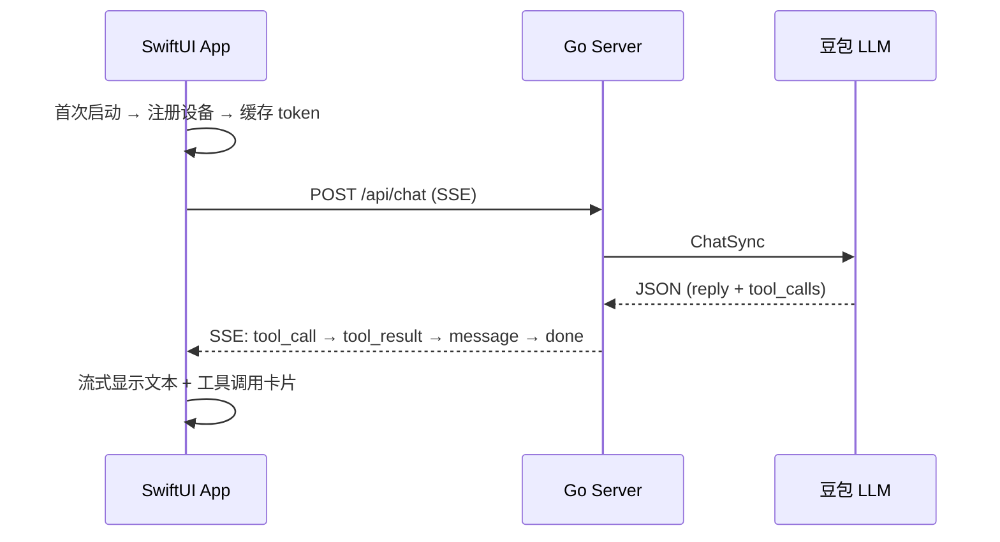
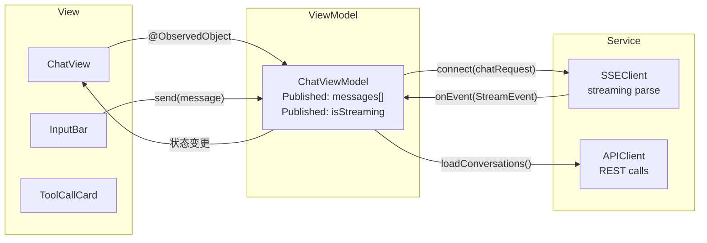
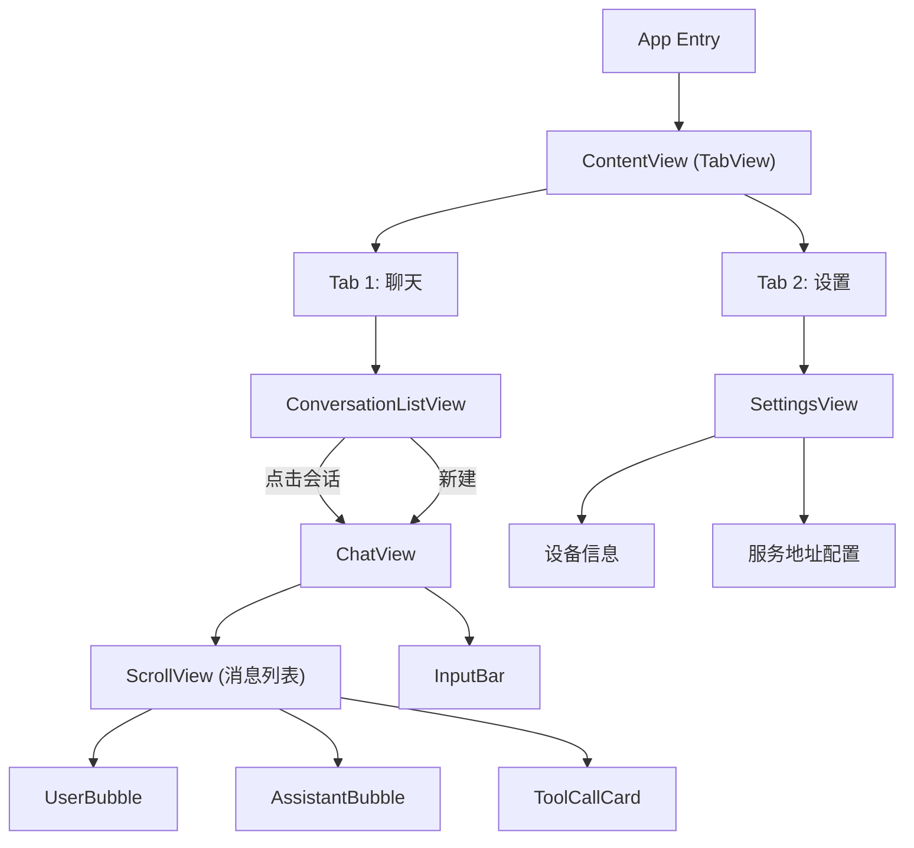
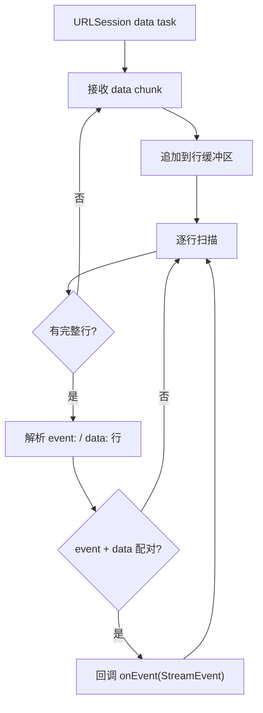
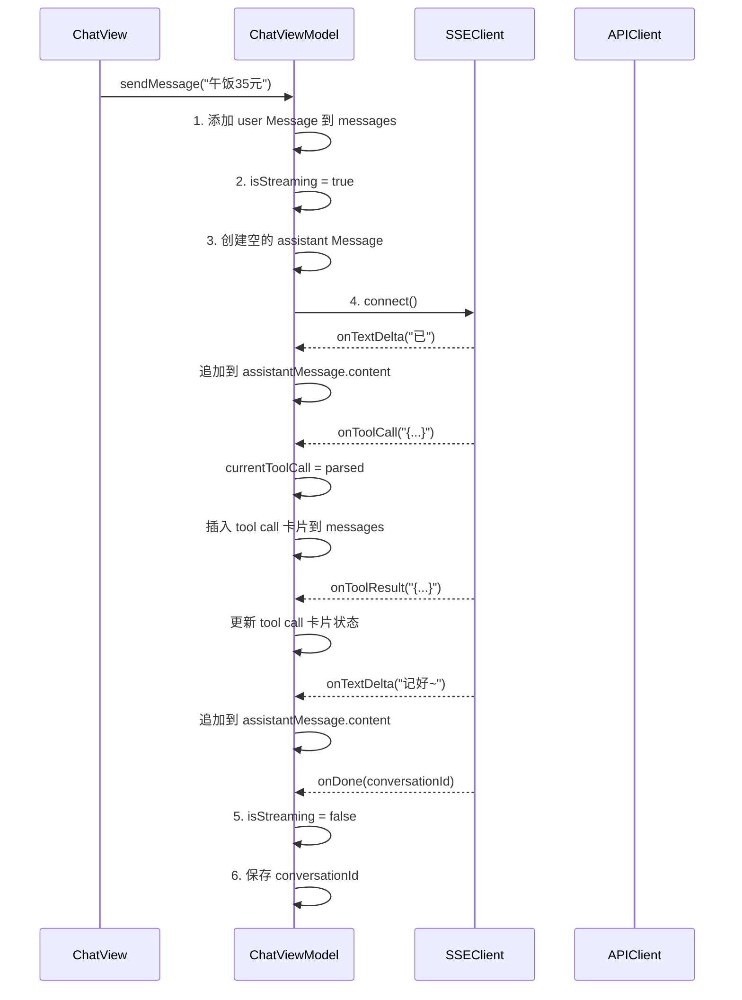
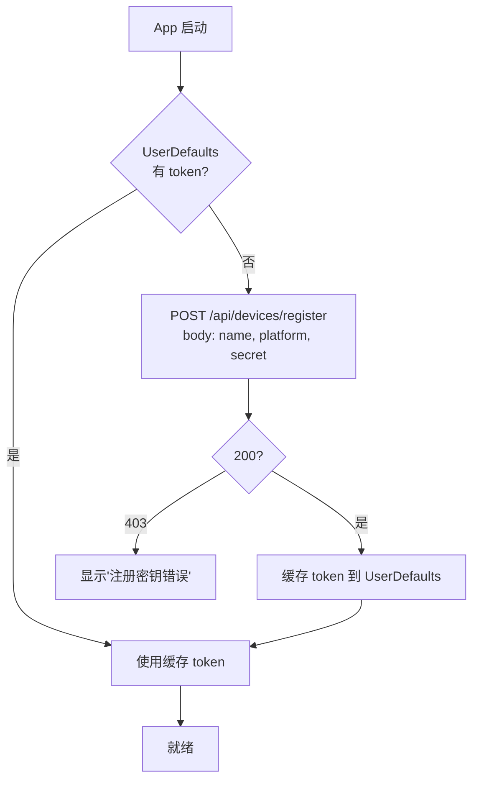
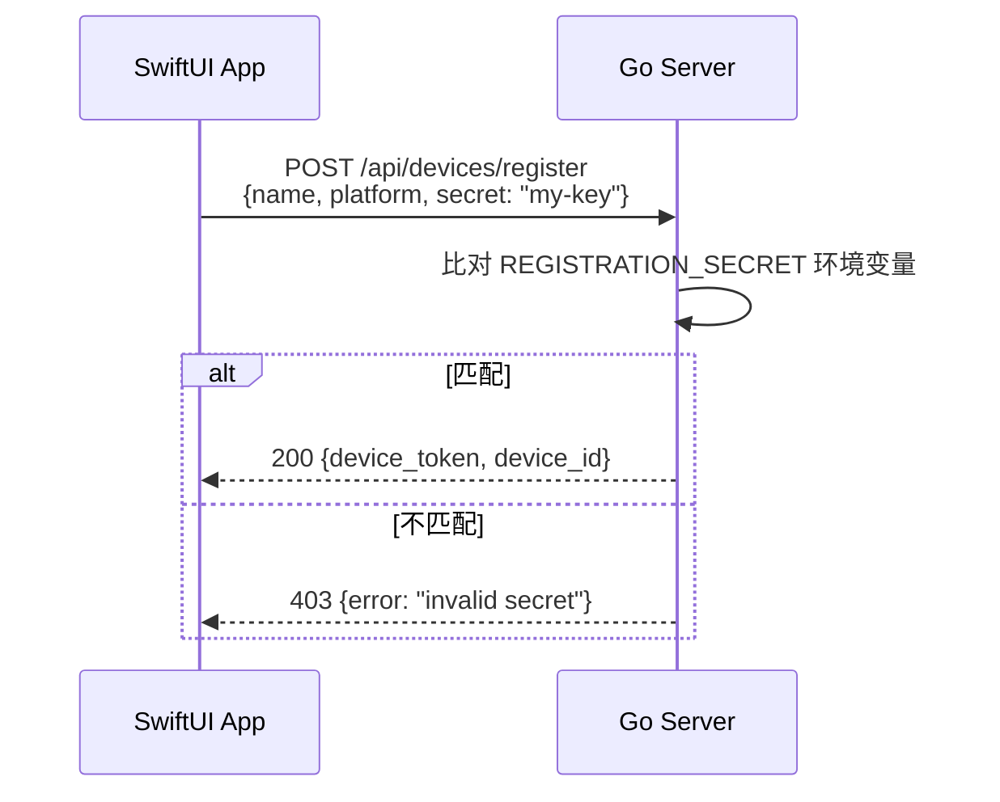

# P2 Plan — SwiftUI 客户端 MVP

> 日期: 2026-04-30 | 状态: 设计阶段

---

## 一、目标

在 iPhone 和 Mac 上拥有可用的聊天 App，能流式对话、显示工具调用状态、管理会话。

**P2 完成效果：**



---

## 二、技术栈

| 层 | 技术 |
|------|------|
| UI 框架 | SwiftUI |
| 架构模式 | MVVM |
| 网络层 | URLSession (SSE 流式 + HTTP REST) |
| 数据持久化 | UserDefaults (token) + 服务端 (消息/会话) |
| 最低系统 | iOS 17+ / macOS 14+ |
| 依赖 | 零第三方依赖，纯 Apple 框架 |

---

## 三、项目结构

### 后端 P2 改动（安全加固）

| 文件 | 改动 |
|------|------|
| `internal/config/config.go` | ServerConfig 新增 RegistrationSecret |
| `controller/devices.go` | 注册时校验 secret |
| `conf/config.yaml` | 新增 registration_secret |

### SwiftUI 客户端

```
xhanHelper/
├── client/
│   └── xhanHelper.xcodeproj
│       ├── Shared/                      # iOS + macOS 共享代码
│       │   ├── Models/
│       │   │   ├── Message.swift         # 聊天消息模型
│       │   │   ├── Conversation.swift    # 会话模型
│       │   │   └── StreamEvent.swift     # SSE 事件模型
│       │   ├── Services/
│       │   │   ├── APIClient.swift       # HTTP REST 请求
│       │   │   ├── SSEClient.swift       # SSE 流处理
│       │   │   └── DeviceManager.swift   # 设备注册 + token 管理
│       │   ├── ViewModels/
│       │   │   ├── ChatViewModel.swift   # 聊天状态管理
│       │   │   └── ConversationListViewModel.swift
│       │   └── Views/
│       │       ├── ChatView.swift        # 主聊天界面
│       │       ├── ChatBubble.swift      # 消息气泡
│       │       ├── ToolCallCard.swift    # 工具调用卡片
│       │       ├── InputBar.swift        # 输入框 + 发送按钮
│       │       ├── ConversationListView.swift
│       │       └── SettingsView.swift
│       ├── iOS/
│       │   └── iOSApp.swift              # iOS 入口
│       └── macOS/
│           └── macOSApp.swift            # macOS 入口
```

---

## 四、MVVM 数据流



- View 只负责渲染，通过 `@ObservedObject` 观察 ViewModel
- ViewModel 持有 `@Published` 状态，驱动 UI 刷新
- Service 层封装网络细节，不依赖 SwiftUI

---

## 五、核心模块设计

### 5.1 数据模型

```swift
// Models/Message.swift
struct Message: Identifiable, Codable {
    let id: String
    let conversationId: String
    let role: String         // "user" | "assistant"
    let content: String
    let createdAt: String

    // 本地状态（不从服务端返回）
    var toolCalls: [ToolCallData]?  // 临时，仅当前流式过程中存在
}

// Models/Conversation.swift
struct Conversation: Identifiable, Codable {
    let id: String
    let title: String
    let updatedAt: String
}

// Models/StreamEvent.swift
enum StreamEventType: String {
    case message      // text_delta
    case toolCall     // tool_call
    case toolResult   // tool_result
    case done
    case error
}

struct StreamEvent {
    let type: StreamEventType
    let data: String        // JSON string，按 type 解析
}

struct ToolCallData: Codable {
    let tool: String
    let function: String
    let args: [String: AnyCodable]?
}

struct ToolResultData: Codable {
    let success: Bool
    let data: [String: AnyCodable]?
    let error: String?
}
```

### 5.2 视图层级



### 5.3 SSE Client

```swift
// Services/SSEClient.swift
class SSEClient {
    private var task: URLSessionDataTask?

    func connect(
        url: URL,
        token: String,
        body: Data,
        onEvent: @escaping (StreamEvent) -> Void,
        onError: @escaping (Error) -> Void
    )

    func disconnect()
}
```

**SSE 解析逻辑：**



- `event:` 和 `data:` 交替出现
- 完整事件 = 一对 event + data
- 行缓冲处理 TCP 分片导致的半行问题

### 5.4 ChatViewModel

```swift
// ViewModels/ChatViewModel.swift
@MainActor
class ChatViewModel: ObservableObject {
    @Published var messages: [Message] = []
    @Published var isStreaming = false
    @Published var currentToolCall: ToolCallData?
    @Published var errorMessage: String?

    private let apiClient: APIClient
    private let sseClient: SSEClient
    private var streamingContent: String = ""

    func loadConversation(_ id: String)        // 加载历史消息
    func sendMessage(_ text: String)           // 发送消息 → 连接 SSE
    func startNewChat()                         // 新建会话

    // SSE 事件处理 (内部)
    private func onTextDelta(_ delta: String)
    private func onToolCall(_ json: String)
    private func onToolResult(_ json: String)
    private func onDone(_ conversationId: String)
    private func onError(_ error: String)
}
```

**sendMessage 流程：**



### 5.5 设备注册（含注册密钥）

首次启动自动注册设备，携带预共享密钥：



`DeviceManager` 负责：
- 首次启动调用 `/api/devices/register`，附带 `secret` 字段
- token 缓存到 `UserDefaults`
- 提供 `token` 属性给 APIClient/SSEClient

### 5.6 APIClient

```swift
// Services/APIClient.swift
class APIClient {
    let baseURL: String
    let token: String

    func registerDevice(name: String, platform: String) async throws -> DeviceRegistration
    func listConversations() async throws -> [Conversation]
    func getMessages(conversationId: String) async throws -> [Message]
    func getBills() async throws -> [Bill]            // P3 使用
}
```

---

## 六、UI 设计要点

### ChatBubble

| 角色 | 对齐 | 颜色 | 形状 |
|------|------|------|------|
| user | 右 | 蓝色背景白色字 | 圆角矩形 |
| assistant | 左 | 灰色背景黑色字 | 圆角矩形 |
| tool_call | 居中 | 橙色边框 | 圆角卡片，显示图标+函数名 |
| tool_result | 居中 | 绿色边框(成功)/红色边框(失败) | 圆角卡片 |

### ToolCallCard

```
┌─────────────────────────────────┐
│ 🔧 正在记账...                   │
│ function: create_bill            │
│ 金额: 35元  分类: 餐饮            │
│                        ✅ 完成   │
└─────────────────────────────────┘
```

- 工具调用开始时显示旋转进度
- 收到 tool_result 后更新为成功/失败状态
- 不占消息气泡位置，单独渲染为卡片

### InputBar

- TextField + 发送按钮
- 流式过程中发送按钮变为停止按钮
- 键盘自适应（iOS）

---

## 七、安全加固 — 注册密钥

### 问题

`POST /api/devices/register` 当前无任何保护，知道 URL 的人都能注册设备、获取 token、调用 API。

### 方案

增加预共享密钥 (Pre-shared Key) 校验。服务端设 `REGISTRATION_SECRET` 环境变量，注册时客户端必须携带正确的 secret。



### 涉及改动

**后端 (2 个文件)：**

| 文件 | 改动 |
|------|------|
| `internal/config/config.go` | `ServerConfig` 新增 `RegistrationSecret` 字段 |
| `controller/devices.go` | 注册时校验 `req.Secret == cfg.Server.RegistrationSecret` |

`config.yaml`:
```yaml
server:
  port: 8080
  mode: debug
  registration_secret: ${REGISTRATION_SECRET}
```

systemd 或 shell 增加环境变量 `REGISTRATION_SECRET`。

**客户端 (1 个文件)：**

| 文件 | 改动 |
|------|------|
| `Services/DeviceManager.swift` | 注册请求 body 中附带 `"secret": DeviceManager.registrationSecret` |

`DeviceManager` 中硬编码一个常量（编译进 App），与服务器环境变量一致即可。

```swift
class DeviceManager {
    static let registrationSecret = "my-pre-shared-secret"  // 与服务器 REGISTRATION_SECRET 一致
    // ...
    func register() async throws {
        let body: [String: String] = [
            "device_name": deviceName,
            "platform": platform,
            "secret": Self.registrationSecret,
        ]
        // POST /api/devices/register
    }
}
```

### 安全级别

- 不是企业级安全方案，但对个人助手足够：挡住所有不知道密钥的外部请求
- 密钥通过编译嵌入 App，IPA 解包可泄露——但攻击者需要先拿到你的 IPA
- 如需加强：后续可换用一次性邀请码 + 设备白名单

---

## 八、实施顺序

| 步骤 | 内容 | 验证方式 |
|------|------|----------|
| 0 | 后端安全加固 (config + devices.go + registration_secret) | curl 注册被拒/通过 |
| 1 | Xcode 项目创建 (iOS + macOS target, Shared group) | 编译通过 |
| 2 | Models (Message, Conversation, StreamEvent) | 编译通过 |
| 3 | DeviceManager (注册 + token 缓存 + secret) | 启动后 token 已缓存 |
| 4 | APIClient (REST calls) | 能获取会话列表 |
| 5 | SSEClient (流式解析) | 能收到 SSE 事件回调 |
| 6 | ChatViewModel | 状态驱动 UI |
| 7 | ChatView + ChatBubble + InputBar | 能看到消息气泡 |
| 8 | ToolCallCard | 能看到工具调用卡片 |
| 9 | ConversationListView | 会话列表 + 新建/切换 |
| 10 | SettingsView | 显示设备信息 |
| 11 | 端到端测试 | iPhone 模拟器记账全流程 |

---

## 九、P2 不包含的内容

- 账单列表/统计页面（P3）
- 推送通知
- 离线缓存
- App Icon 和启动画面
- iPad 适配
- macOS 独立优化（P2 用 iOS 在 Mac 上跑的兼容模式即可）

---

## 十、关键决策

| 决策 | 选择 | 理由 |
|------|------|------|
| 架构 | MVVM | SwiftUI 原生模式，数据流清晰 |
| 跨平台 | iOS + macOS 两个 target，共享 Shared/ 代码 | View 层 90% 复用 |
| SSE 实现 | URLSession data task | 原生 API，无需第三方库 |
| 网络层 | async/await (REST) + callback (SSE) | REST 用现代并发，SSE 流式不适合 async/await |
| 最低系统 | iOS 17+ / macOS 14+ | SwiftUI 最新 API (Observable macro 等)，无历史包袱 |
