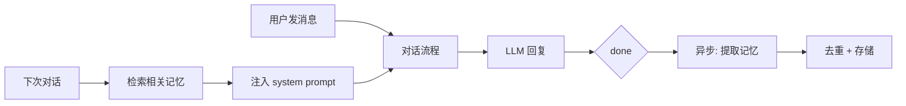

# P4.1 — Memory 记忆系统 设计方案

> 日期: 2026-05-02 | 状态: 讨论中

---

## 一、要解决的问题

现在 Agent 每次对话都是**失忆的**——不知道你是谁、有什么习惯、之前聊过什么。比如：

- 你说了 10 次"午饭花 30-50"，Agent 每次记账都像第一次见到你
- 你告诉过它"我每月餐饮预算 1500"，下次问它能不能超预算，它不知道

## 二、记忆长什么样

不是存原始对话，而是从对话中**提取精炼的事实和偏好**：

```
原始对话: "午饭花了35"
提取记忆: "用户午餐消费通常在30-50元"

原始对话: "这个月房租2500，快顶不住了"
提取记忆: "用户每月房租2500元，感觉负担重"

原始对话: "周末一般都去子午路张记吃"
提取记忆: "用户周末常去子午路张记就餐"
```

每条记忆就是一个 key-value：
```
{ "key": "午餐消费", "value": "用户午餐通常在30-50元" }
{ "key": "每月房租", "value": "2500元，用户觉得贵" }
{ "key": "周末习惯", "value": "常去子午路张记" }
```

## 三、两个时机



**时机 1 — 写入**：后台定时任务（如每 10 分钟）扫描所有会话，找出**超过 N 小时无新消息**的会话（N 可配置，默认 1 小时），认为该会话已"静默终结"，从中提取记忆。提取后标记为已处理，不重复提取。

**时机 2 — 读取**：每次新对话开始时，检索相关记忆注入 system prompt。

## 四、写入流程（增量提取）

```
conversations 表加两个字段:
  last_extracted_msg_id  ← 上次提取到的最后一条消息 ID
  last_extracted_at       ← 提取时间

定时任务（每10分钟）
  │
  ▼
扫描 conversations 表
  → 找 updated_at < now - 1小时（已静默）
  → 且 (last_extracted_msg_id IS NULL       ← 从未提取)
     或 (该会话有比 last_extracted_msg_id 更新的消息)
  │
  ▼
把完整会话历史传给 LLM（提供全局视角)
同时标记: 上次提取到第 N 条，请关注后面的新信息
  │
  ▼
LLM 返回: "用户午餐消费通常在30-50元"
          "用户周末常去子午路张记"
  │
  ▼
和已有记忆比对 → 相似度 >80% 且值不同 → 版本化（追加不覆盖）
                → 相似度 >80% 且值相同 → 跳过
                → 不相似 → 新增
  │
  ▼
存入 user_memories 表
  → 更新 last_extracted_msg_id 和 last_extracted_at
```

**为什么是增量但传完整历史？** 只关注新消息，但 LLM 有完整上下文才能准确理解。比如前面聊过垃圾分类，新消息说"周末吃饺子"，LLM 知道这条信息的上下文是饮食而非环保。

## 五、检索流程

```
新对话开始
  │
  ▼
把当前用户消息 + 已有所有记忆列表发给 LLM
"从以下记忆中选择和当前对话相关的条目，返回编号"
  │
  ▼
把选中的记忆注入 system prompt:
"关于用户的信息：
 - 用户午餐消费通常在30-50元
 - 用户周末常去子午路张记"
  │
  ▼
正常对话流程
```

**为什么不用向量检索？** 个人数据量小（几十条），LLM 直接选最准。后续量大了再换 embedding + 余弦相似度。

## 六、触发策略

不是每次对话都提取——太频繁，闲聊不值得。采用**静默会话检测**：

```
定时任务（可配间隔，默认 10 分钟）
  → 扫描所有 last_extracted_at = NULL 的会话
  → 且 updated_at < now - 静默阈值（可配，默认 1 小时）
  → 说明用户已经"说完话了"，可以安全提取
  → 提取后设 last_extracted_at，不再重复处理
```

**为什么不做天级？** 用户可能在一天内聊好几个完全不同的主题（记账、闲聊、查账单），每个会话维度不一样，分会话提取更精准。

## 七、效果示例

```
用户: "午饭花了45"

system prompt:
  ...
  关于用户的信息:
  - 用户午餐消费通常在30-50元

Agent: "已记录午餐45元（和平时午饭消费范围一致）"
```

```
用户: "这个月餐饮总体怎么样"

system prompt:
  ...
  关于用户的信息:
  - 用户午餐消费通常在30-50元
  - 用户每月餐饮预算1500元

Agent: [调 query_bills 查本月餐饮] → "本月餐饮累计980元，
  在你的1500预算内，不到月底应该不会超"
```

## 八、API 不变

- UI 不改——记忆是隐形的，用户在聊天中自然感受到"Agent 记得我"
- 后端新增 `agent/memory.go`，orchestrator 前后各加一次 LLM 调用

## 九、会话删除后的记忆处理

**保留，不删除。** 记忆是用户级的知识，不是会话级的附属品。用户删除会话只删消息，不从记忆中删除已提取的知识。如需清除特定记忆，后续可通过对话指令实现。

---

## 十、对后续 P4.2 的价值

Memory 是 ReAct Agent 的**上下文基础**。真正的 ReAct 里，LLM 在 Thought 阶段需要背景信息才能做正确决策。

```
Thought: "用户问有没有超预算" → 需要知道预算是多少
  → Memory 检索 → "用户每月餐饮预算 1500"
  → 才能准确判断
```

Memory 先跑通，P4.2 ReAct 的 Thought 才有料可思考。

---

## 十一、冲突处理

当新提取的记忆和已有记忆相似但内容冲突时，不覆盖，而是**版本化**：

```
已有: "晚餐习惯: 晚上一般吃包子 (2026-03)"
新提取: "晚餐习惯: 晚上最近吃饺子 (2026-05)"

→ 保留两条，形成版本链
→ 检索时取最新的：饺子
→ 也可以在对话中体现变化："你以前晚上吃包子，最近改饺子了"
```

实现上：去重时发现相似 key（LLM 判断 >80%），但 value 不同 → 追加新记录而非覆盖，`created_at` 就是版本时间戳。检索时按 `created_at DESC` 取最新。

## 十二、冷启动与稀疏数据

### 问题

产品刚上线时几乎没有对话数据，头几条对话恰巧都是聊饺子的，系统就以为"用户爱吃饺子"。积累一段时间后发现根本不是——但那条早期记忆可能还在误导 Agent。

### 方案：记忆衰减 + LLM 自行判断

**衰减机制**：每条记忆有一个隐式的"新鲜度"。被后续对话多次印证的记忆（如"午餐 30-50"被确认 10 次）权重高；只出现过一次且很久没再出现的（如"爱吃饺子"）自然降低。

实现上不搞复杂的置信度算法，而是让 LLM 检索时自行判断：

```
检索 prompt:
"以下是关于用户的历史记忆（按时间倒序，最新的排最前）。
 请选出和当前对话相关的条目。
 如果某条记忆看起来已经过时或和更多新记忆矛盾，忽略它。
 - 用户午餐消费通常在30-50元 (2026-04-20, 已确认5次)
 - 用户爱吃饺子 (2026-03-01, 仅1次)"
```

LLM 自己就能分辨"仅 1 次且 2 个月前"的饺子记忆不如"已确认 5 次的午餐习惯"可靠。**让 LLM 做判断，不用我们定义规则。**

### 导入数据作为记忆来源

任何批量导入的数据（CSV 账单、未来的爬虫数据、RSS 等）都可以作为记忆来源。但**是否提取记忆由用户决定**——不是自动的，而是要显式选择。

**API 控制**：

```
POST /api/bills/import?extract_memories=true
  → 导入账单 + 批量提取聚合记忆

POST /api/bills/import
  → 只导入账单，不提取记忆
```

`extract_memories` 参数默认为 `false`，默认不提取。用户想从历史账单中建立消费画像时，主动加 `?extract_memories=true`。

**提取逻辑**：

```
导入数据 → 按格式解析 → 写入 bills 表
  │
  └─ extract_memories=true?
       │
       ▼
     把全部导入数据发给 LLM:
     "以下是用户过去4个月的账单记录，请提取用户的消费习惯、偏好和规律。
      关注: 常去的地点、消费水平、分类偏好、周期性的规律、变化趋势。"
       │
       ▼
     LLM 返回聚合洞察:
     "用户月均餐饮消费约1800元"
     "常去子午路张记(23次)、瑞幸咖啡(15次)"
     ...
       │
       ▼
     存入 user_memories (source="csv_import")
```

**通用性**：`extract_memories` 是一个**通用参数**，不限定于账单导入。未来任何批量数据导入接口都使用相同的参数名和语义。这些聚合记忆用 `source` 字段标注来源（`"csv_import"` / `"crawler_import"` 等）。

聚合记忆比零散的对话记忆更宏观、更可靠，构成记忆系统的**基线**。

## 十三、向量化扩展预留

### 当前方案（MVP）

LLM 检索：把所有记忆列表 + 当前消息发给 LLM，让它选相关条目。优点是不引入任何新依赖，缺点是不规模化——记忆上百条时 token 爆炸。

### 向量化方案（未来）

```
写入: 每条记忆 → embedding 模型 → 向量 → 存向量库
检索: 当前消息 → embedding → 向量相似度搜索 → Top K 相关记忆
```

**向量检索的优势：**

| | LLM 选择 | 向量检索 |
|------|---------|---------|
| 规模 | 几十条，再多 token 爆 | 上千条无压力 |
| 语义 | 理解文本含义 | 理解语义相似度 |
| 速度 | 多一次 LLM 调用 | 毫秒级 |
| 关联 | 只能精准匹配 | 能发现"软关联"（"饺子"↔"饮食"↔"消费习惯"） |

### 现在能提前做什么

**1. 接口抽象——MemoryStore**

```go
type MemoryStore interface {
    // 检索与当前消息相关的记忆（今天用 LLM 实现，未来用向量实现）
    GetRelevant(ctx, deviceID, currentMessage string) ([]Memory, error)
    // 写入记忆（附带 source 和 confirm_count）
    Store(ctx, memory Memory) error
    // 按 key 查找已有记忆（去重用）
    FindSimilar(ctx, deviceID, key string) (*Memory, error)
}
```

今天的实现是 `LLMMemoryStore`，用 LLM 做检索和去重。未来加一个 `VectorMemoryStore`，实现在里面换掉即可，**调用方代码不用改一行**。

**2. 表结构预留**

`user_memories` 表加一个可空的 `embedding_id` 字段——现在全是 NULL，不参与任何逻辑。未来切到向量方案时：

```sql
ALTER TABLE user_memories ADD COLUMN embedding_id VARCHAR(36);
```

存向量库中对应的 ID，这样 MySQL 中的记忆元数据（source, confirm_count, created_at）和向量库中的 embedding 可以通过这个 ID 关联。

**3. 触发时机不变**

无论 LLM 检索还是向量检索，**写入时机（静默会话检测）和提取流程（增量 + 完整历史）完全不变**。变化的只有 `GetRelevant` 的内部实现。

### 迁移路径

```
MVP:  LLMMemoryStore (LLM 选记忆)
  ↓
Step1: 加 embedding_id 字段（现在）
  ↓
Step2: 选一个向量方案（pgvector/本地 sqlite-vec）
  ↓
Step3: 实现 VectorMemoryStore，实现 MemoryStore 接口
  ↓
Step4: 配置切换，零代码改动
```

## 十四、冷启动

新用户没有记忆时，就正常对话。记忆系统是完全增量的——第一条记忆提取后才会注入。不会出现 "关于用户的信息：无" 这种尴尬提示。导入 CSV 后立即有一批聚合记忆，冷启动问题大幅缓解。

## 十五、风险和缓解

| 风险 | 缓解 |
|------|------|
| 记忆提取不准确 | 异步执行，错了不影响主流程；后续可以手动编辑 |
| 去重判断不稳定 | 阈值设低（80%相似就合并），宁滥勿缺 |
| 检索选太多记忆 | 限制最多 5 条，token 成本可控 |
| 记忆提取 LLM 调用成本 | 只在"新对话"场景触发，闲聊不提取 |
