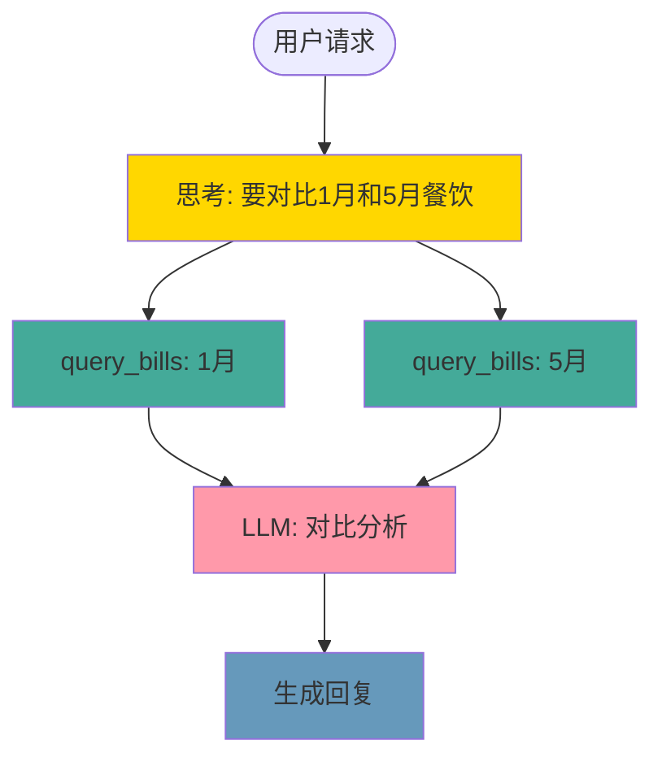

# P4.3 — 多轮自主 DAG Agent 设计方案

> 日期: 2026-05-02 | 状态: 讨论中

---

## 一、当前 vs 目标

### 当前（单轮 ReAct）

```
用户消息 → LLM(1次) → 检测tool_call → 执行 → 回传 → LLM(2次) → done
```

同一次 HTTP 请求内完成，SSE 流式输出。LLM 不能"歇一会儿想想再做下一步"。

### 目标（多轮自主 DAG Agent）

```
用户消息 → LLM 生成 Plan（图）→ 提交给 DAG 引擎
引擎异步执行节点（并行、串行、条件分支）
执行过程中 LLM 可以修改图（加新节点、调整依赖）
客户端实时看到图的变化
```

## 二、概念模型

### 2.1 图的构成



**节点类型**：

| 类型 | 说明 | 谁执行 |
|------|------|--------|
| `thought` | 思考/规划节点 | LLM |
| `tool_call` | 调用工具 | Go 代码 |
| `llm` | LLM 推理/总结 | LLM |
| `reply` | 生成用户可见回复 | LLM |

**边 = 依赖关系**：Q1 和 Q2 都完成 → 才能执行 Compare。

### 2.2 图的动态性

图不是一成不变的——执行过程中 LLM 可以修改：

```
初始图: Thought → Q1 → Reply

执行到 Q1 时:
  Q1 失败 → LLM 添加新节点: Q1_failed → Retry → Reply
  或
  Q1 结果异常 → LLM 添加: Q1 → Verify → Q1b → Reply
```

引擎需要支持"图在执行中变化"。

## 三、引擎设计

### 3.1 核心接口

```go
// Plan — LLM 生成的执行计划
type Plan struct {
    ID    string
    Nodes []PlanNode
    Edges []PlanEdge
}

type PlanNode struct {
    ID       string
    Type     string // thought | tool_call | llm | reply
    Label    string // 显示名称 "查询1月账单"
    Tool     string // tool_call 时用
    Function string
    Args     map[string]interface{}
    Status   string // pending | running | done | failed
}

type PlanEdge struct {
    From string
    To   string
}
```

### 3.2 引擎运行流程

```go
type DAGEngine struct {
    plans    map[string]*Plan
    llm      llm.LLMClient
    registry *tool.Registry
    events   chan PlanEvent  // 状态变更事件
}

func (e *DAGEngine) Submit(plan *Plan) <-chan PlanEvent

// 内部:
// 1. 找到所有入度为0的节点 → 执行
// 2. 节点完成后 → 检查依赖 → 解锁下一个节点
// 3. 执行 LLM 节点时 → 可能修改图 → 重新分析依赖
// 4. 所有节点完成 → 发 done
```

### 3.3 PlanEvent — 图状态变更事件

```go
type PlanEvent struct {
    Type      string // node_started | node_done | node_failed | graph_updated | plan_done
    PlanID    string
    NodeID    string
    NodeLabel string
    Data      map[string]interface{}
}
```

## 四、API 设计

### 新接口：POST /api/chat/plan

```
POST /api/chat/plan
Authorization: Bearer <token>
Body: {"message": "帮我对比一下1月和5月的餐饮消费"}

返回: SSE 流

SSE 事件:
event: graph
data: {"plan_id":"xxx", "nodes":[{id,label,type,status: pending},...], "edges":[{from,to},...]}

event: node_started
data: {"plan_id":"xxx", "node_id":"q1", "label":"查询1月账单"}

event: node_done
data: {"plan_id":"xxx", "node_id":"q1"}

event: message
data: {"delta":"好"}

event: plan_done
data: {"plan_id":"xxx"}
```

### 图的变化通知

```
event: graph_updated
data: {"plan_id":"xxx", "new_nodes":[...], "new_edges":[...]}
```

## 五、客户端设计

### 5.1 图的可视化

不是画拓扑图（手机上太难），而是**清晰的状态列表**：

```
┌──────────────────────────────┐
│ 📋 执行计划                    │
│                               │
│ ✅ 查询1月账单 (2.3s)          │
│ ✅ 查询5月账单 (1.8s)          │
│ 🔄 分析对比...                 │
│ ⏳ 生成回复                    │
└──────────────────────────────┘
```

每个节点一行：
- `✅ 绿色` — 已完成
- `🔄 蓝色旋转` — 执行中
- `⏳ 灰色` — 等待
- `❌ 红色` — 失败

### 5.2 交互

- 点击节点 → 展开详情（Tool args / 结果）
- 长按节点 → 节点名称 + 耗时
- 整个 plan 完成后收缩为一行"已完成"

## 六、这是否需要 DAG 引擎

当前场景下，LLM 生成的 plan 通常是简单 DAG：

```
绝大多数情况: 最多 2-3 个并行 tool_call + 1 个 LLM 总结
```

**结论：暂时不需要完整的图引擎。** 用 goroutine + WaitGroup 就能覆盖 95% 场景。图引擎等到真正需要动态修改图的场景出现时再做——过早抽象是最大浪费。

但接口设计（PlanEvent, SSE 格式, 客户端组件）应该从现在就用面向未来的方式写——加节点类型、加 graph 事件、加状态机。这样将来升级引擎时客户端不用改。

## 七、渐进实施

| 阶段 | 内容 | 改动 |
|------|------|------|
| **P4.3a** — Plan + 可视化 | LLM 生成 plan，并发执行，客户端显示节点状态 | 中 |
| **P4.3b** — 动态修改图 | 执行中 LLM 可加/改节点 | 大 |
| **P4.3c** — 完整 DAG 引擎 | 独立的执行引擎，支持复杂依赖 | 大 |

## 八、和当前 ReAct 的共存

`POST /api/chat/plan` 是一个新接口，不影响现有的 `POST /api/chat`。简单记账仍然走旧接口（一次 LLM 调用搞定），复杂查询才走 plan 接口——让 LLM 自己判断用哪个。
