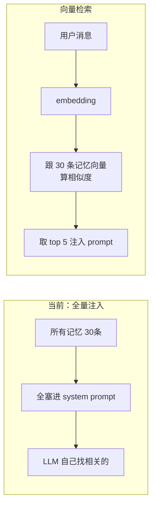
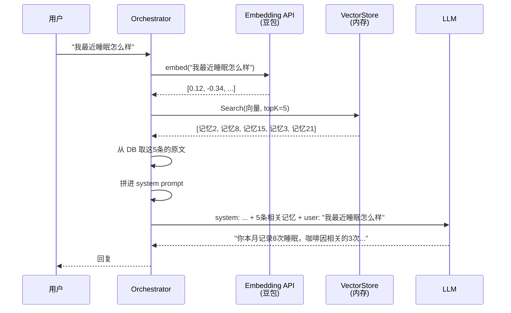
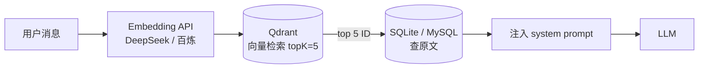
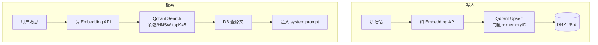
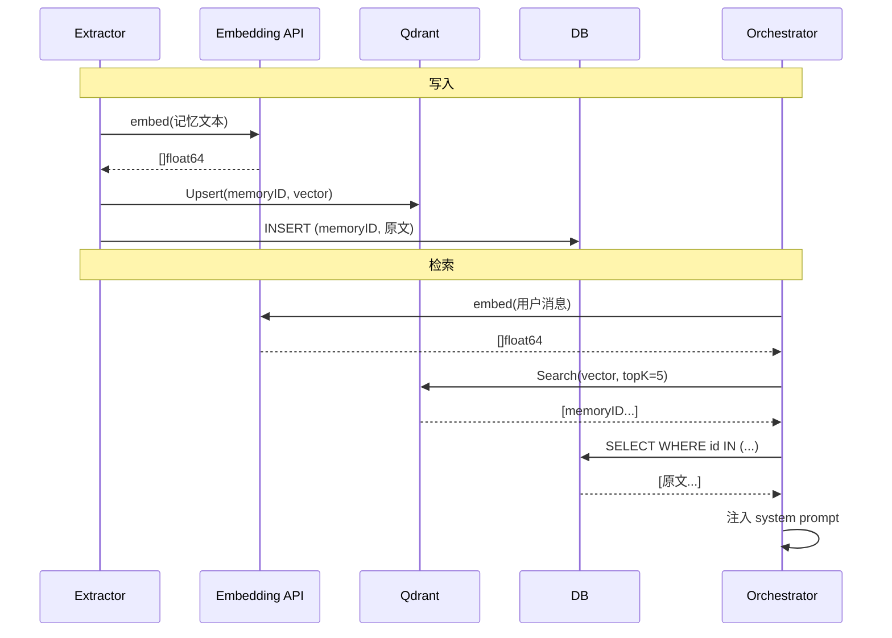
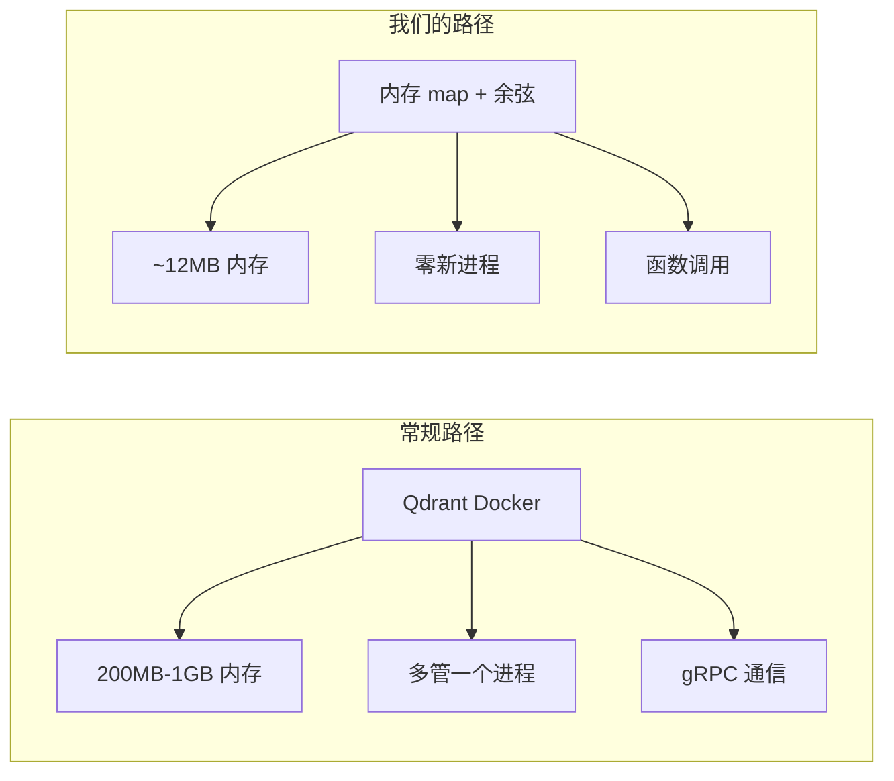
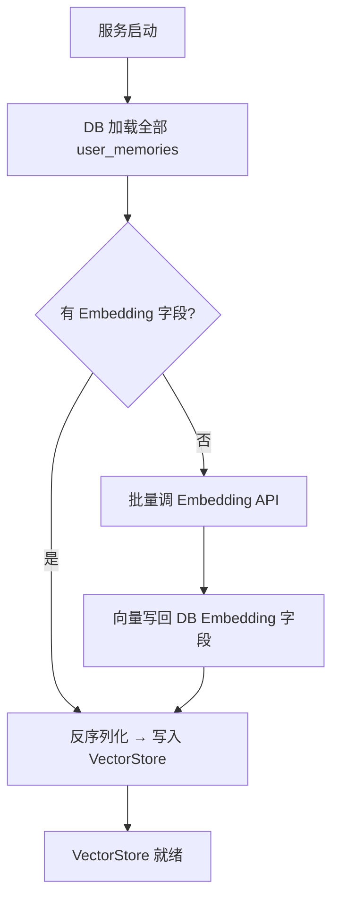
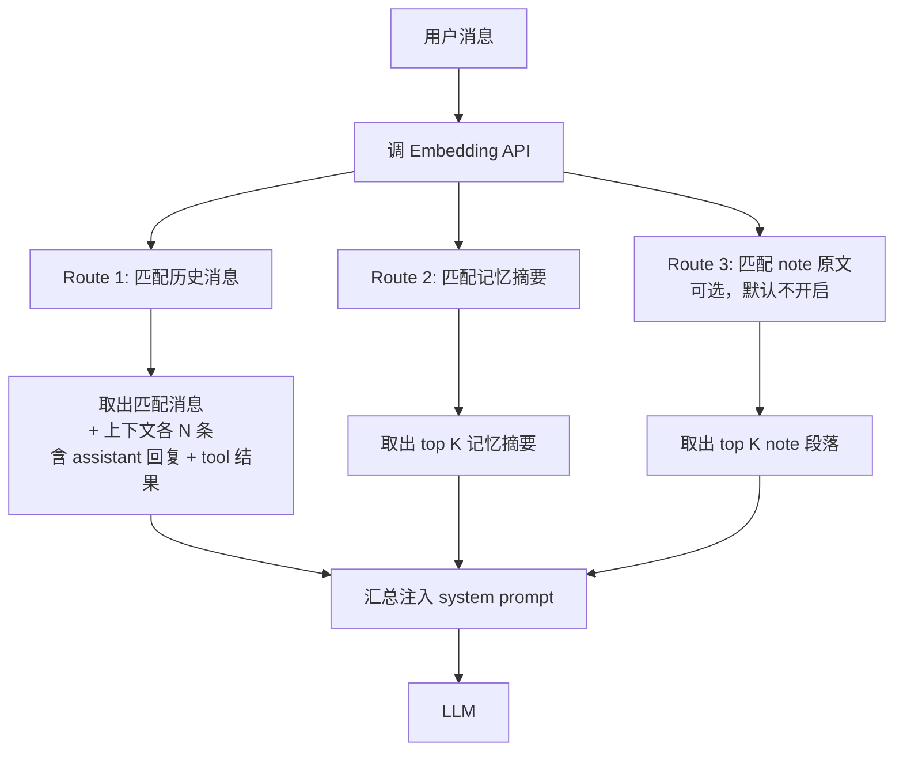
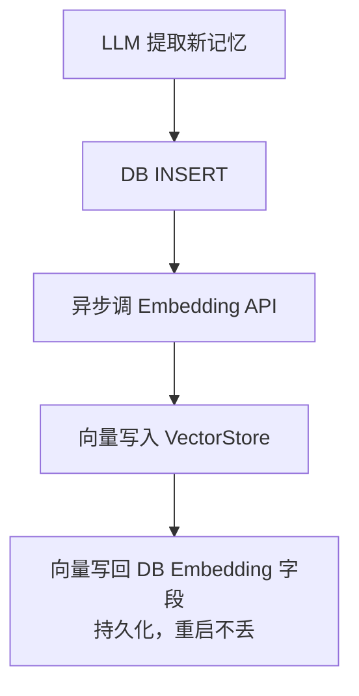

# P6-3 — 记忆增强（向量检索）技术方案

> 日期: 2026-05-03 | 状态: 方案评审

---

## 一、目标

从"全量注入 system prompt"升级为"语义检索 top K 注入"。让 agent 在几千条记忆中精准找到相关的，而不是全塞进去。

---

## 二、Embedding 是什么，在系统里起什么作用

### 2.1 一句话解释

Embedding 把一段文本变成一串数字（向量）。语义相近的文本，向量也相近。

```
"昨晚失眠了"    → [0.12, -0.34, 0.78, ..., 0.05]
"睡不着好难受"  → [0.13, -0.31, 0.75, ..., 0.04]  ← 跟上面接近
"今天午饭35块"  → [-0.45, 0.22, -0.13, ..., 0.67] ← 离上面很远
```

这就是 embedding 做的一件：**把"意思差不多"变成"数字差不多"**。

### 2.2 当前记忆检索 vs 向量检索



**当前的问题**：30 条全塞进去，token 浪费，而且真正需要的可能就 3 条。

**向量的好处**：每条消息只取最相关的 5 条。1000 条记忆也能毫秒级出结果。

### 2.3 在对话流程中的位置



**就多了一步**：调 LLM 之前，先调 embedding API 找相关记忆。100ms 的代价。

### 2.4 具体例子：为什么语义 > 关键词

假设你存了这些记忆：

| id | key | value |
|------|-----|-------|
| 1 | 咖啡 | 下午喝咖啡会导致晚上睡不着 |
| 2 | 睡眠 | 12:30入睡时通常睡不好 |
| 3 | 睡眠 | 换了遮光窗帘后质量有改善 |
| 4 | 消费 | 餐饮主要支出是外卖 |
| 5 | 运动 | 跑步后有疲劳感但睡眠更好 |

然后你问：**"我睡不着的时候该怎么办"**

```
关键词匹配（topic=睡眠）:
  → 查到记忆 2、3
  → 漏了记忆 1（咖啡）和记忆 5（运动后睡眠更好）

向量检索:
  → 查到的顺序: 记忆 2(0.92), 记忆 1(0.87), 记忆 5(0.81), 记忆 3(0.79), 记忆 4(0.31)
  → top 5 包含了咖啡、运动两个关键词匹配不到的关联
  → LLM 看到完整画面: "你睡不着的时候，试试不喝咖啡+戴耳塞+运动"
```

这就是 embedding 的核心价值：**不只是找"同一主题"，而是找"同一语义"**。

---

## 三、常规向量数据库方案（参考）

如果不考虑资源限制，标准做法是引入独立向量数据库。以 Qdrant 为例：

### 架构



### 模块关系



### 怎么引入系统



### Qdrant Go SDK 示例

```go
import qdrant "github.com/qdrant/go-client/qdrant"

// 写入
client.Upsert(ctx, &qdrant.UpsertPoints{
    CollectionName: "memories",
    Points: []*qdrant.PointStruct{{
        Id:      qdrant.NewIDUUID(memoryID),
        Vector:  qdrant.NewVector(embedding...),
    }},
})

// 检索
results, _ := client.Search(ctx, &qdrant.SearchPoints{
    CollectionName: "memories",
    Vector:         queryEmbedding,
    Limit:          ptr(5),
})
```

### 主流选项对比

| 方案 | 部署方式 | 内存占用 | 适用规模 | Go SDK |
|------|---------|---------|---------|--------|
| **Qdrant** | Docker / 二进制 | 200MB-1GB | 万-亿级 | ✅ 官方 |
| **Chroma** | Docker / pip | 200MB+ | 千-百万级 | ❌ 社区 |
| **Milvus** | Docker Compose / K8s | 1GB+ | 百万-十亿级 | ✅ 官方 |
| **pgvector** | PG 插件 | 跟随 PG | 万-百万级 | 直接用 SQL |
| **Weaviate** | Docker | 500MB+ | 万-亿级 | ✅ 官方 |

### 为什么我们现在不引入



本质做的同一件事。Qdrant 用 HNSW 近似索引应对百万级向量，我们几千条暴力余弦就够了。等数据量上去了，把 `VectorStore` 替换成 Qdrant client 即可。

---

## 四、性能约束 & 设计原则

服务器 2C4G，不上本地模型、不上外部向量数据库。

| 约束 | 方案 |
|------|------|
| 不能跑本地 embedding 模型 | 调豆包 embedding API（OpenAI 兼容，已有账号 + 免费额度） |
| 不能用 Chroma/Qdrant | 内存存向量，几千条以下够用（~6MB） |
| 不能每次请求都扫全量 | 余弦相似度 O(n)，n<5000 时毫秒级 |
| SQLite 别太复杂 | 向量存内存，DB 只做持久化备份 |

## 五、我们的实现（轻量版）

### 5.1 Embedding API

豆包提供 OpenAI 兼容的 `/embeddings` 端点，已有账号 + 50万免费 token。

调用 `/chat/completions` 用的是 ARK API Key，调 `/embeddings` 可能要用火山引擎 embedding 端点。需要验证。

```go
// internal/llm/embedding.go

func Embed(ctx context.Context, text string) ([]float64, error) {
    // POST https://ark.cn-beijing.volces.com/api/v3/embeddings
    // body: {"model":"doubao-embedding","input":text}
    // response: {"data":[{"embedding":[...]}]}
}
```

成本：[0.0005 元/千 token](https://www.volcengine.com/docs/82379/1541193)，每天 ~5,300 token，月开销约 ¥0.08。

### 5.2 向量存储（内存）

```go
// internal/agent/vector_store.go

type VectorStore struct {
    mu       sync.RWMutex
    vectors  map[string][]float64  // memoryID → embedding
}

func (vs *VectorStore) Search(query []float64, topK int) []string {
    // 余弦相似度，返回 top K 的 memoryID
}
```

内存占用估算：1000 条 × 1536 维 × 8 bytes/float64 = ~12MB，2C4G 完全无压力。

### 5.3 流程

#### 启动加载



#### 检索（每次对话）—— 三路并行



三路各有分工：

| 路 | 匹配对象 | 返回什么 | 用途 |
|------|------|------|------|
| Route 1 | 历史用户消息 | 匹配消息 + 上下文各 N 条（含 assistant、tool） | 唤起相似讨论场景 |
| Route 2 | 记忆摘要 | top K 条 key:value | 注入已知用户事实 |
| Route 3 | note 原文段落 | top K 段原文 | 深度分析时检索原始资料 |

Route 1 的"上下文各 N 条"：命中某条历史用户消息后，从 messages 表中取它前后各 N 条消息（包含同轮的 assistant 回复、tool 调用结果等）。这样 LLM 能看到完整的讨论上下文，而不是孤立的一句话。

Route 3 默认不开启——只在 deep_mode 或者用户明确说"帮我查一下之前的笔记"时才触发，控制 token 消耗。

#### 新记忆写入



### 5.4 向量持久化策略（重要）

向量是花钱调 API 生成的，**绝对不能丢**。

```
user_memories 表加 Embedding 字段 (TEXT / JSON)

存储时:
  []float64 → json.Marshal → "[0.12,-0.34,0.78,...]" → 写 DB

加载时:
  DB 读 "[0.12,-0.34,0.78,...]" → json.Unmarshal → []float64 → VectorStore

第一次 embedding 后立即写回 DB，后续启动直接从 DB 加载，不重复调 API。
只在 memory 内容变更时才重新 embedding。
```

### 5.5 改动文件

| 文件 | 操作 | 说明 |
|------|------|------|
| `model/message.go` | 改 | 加 `Embedding *string` 字段（用户消息向量持久化） |
| `model/user_memory.go` | 改 | 加 `Embedding *string` 字段（记忆摘要向量持久化） |
| `model/note.go` | 改 | 加 `Embedding *string` 字段（note 段落向量持久化） |
| `llm/doubao.go` | 改 | 加 `Embed()` 方法 |
| `agent/vector_store.go` | 新 | 内存向量存储 + 余弦检索，前缀区分 msg/mem/note |
| `agent/memory.go` | 改 | GetRelevant 改为三路向量检索 |
| `agent/extractor.go` | 改 | 新记忆自动 embedding |
| `agent/orchestrator.go` | 改 | 用户消息自动 embedding + 检索日志 + token 统计 |
| `cmd/main.go` | 改 | 启动时初始化 VectorStore + 批量 embedding 未入库的向量 |

### 5.6 效果评估

没有自动化评估框架，靠两层机制人工判断：

#### 检索质量日志

每次检索打一条详细日志，`score` 是余弦相似度（0~1），越高越相关：

```
[memory] search: query="我睡不着怎么办", topK=5
  1. score=0.92 | 下午喝咖啡导致晚上睡不着
  2. score=0.87 | 12:30入睡时质量差
  3. score=0.81 | 跑步后睡眠更深
  4. score=0.73 | 换了遮光窗帘有改善
  5. score=0.45 | 餐饮主要是外卖
```

阈值建议：`score < 0.5` 的不注入，避免噪音。topK 默认 5，可配置。

#### Token 消耗统计

在 orchestrator 的日志里加 token 统计，每次对话结束输出：

```
[orch] done: round=1, prompt_tokens=1234, completion_tokens=180, total=1414
  memory_injected=5, memory_tokens=85
```

更进一步，可以在 `done` SSE 事件中携带 token 数，客户端展示：

```json
{
  "conversation_id": "xxx",
  "message_id": "yyy",
  "usage": {"prompt_tokens": 1234, "completion_tokens": 180}
}
```

DeepSeek API 响应中已包含 `usage` 字段，直接从 `parseDeepSeekResponse` 提取即可。

### 5.7 不引入外部依赖

全部 Go 标准库实现：
- 余弦相似度：`math` 十几行
- 向量存储：`map[string][]float64` + `sync.RWMutex`
- API 调用：复用 `baseClient.httpClient`

---

## 六、实施顺序

| 步骤 | 内容 |
|------|------|
| 1 | `model/user_memory.go` 加 `Embedding *string` 字段 |
| 2 | `llm/doubao.go` 加 `Embed()` 方法 |
| 3 | `agent/vector_store.go` 内存存储 + 余弦检索 |
| 4 | `agent/memory.go` GetRelevant 改为向量检索 |
| 5 | `agent/extractor.go` 新记忆自动 embedding |
| 6 | `cmd/main.go` 启动时批量 embedding + 加载 |
| 7 | orchestrator 加检索质量日志（score + 记忆原文） |
| 8 | `llm/deepseek.go` 解析 `usage` 字段，orchestrator 输出 token 统计 |
| 9 | done SSE 事件携带 token 数，客户端展示 |
| 10 | `make test` 验证 |
