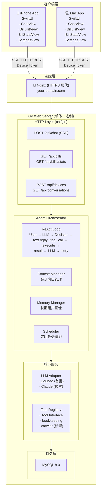
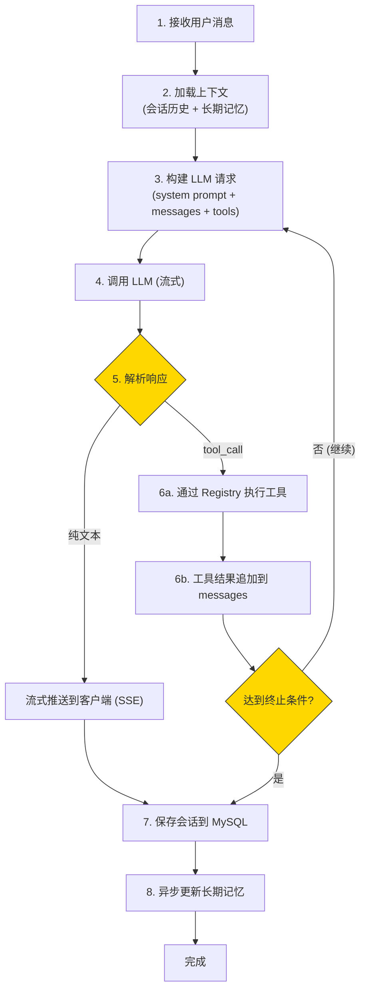
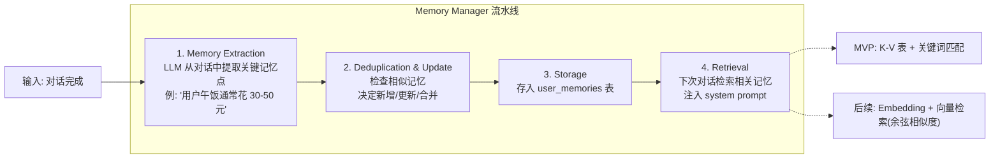
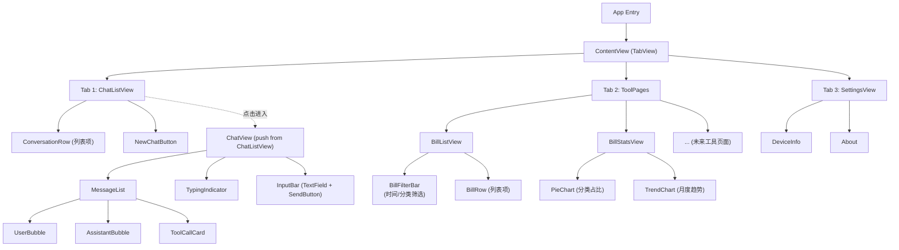
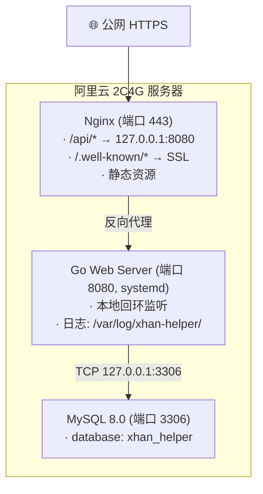
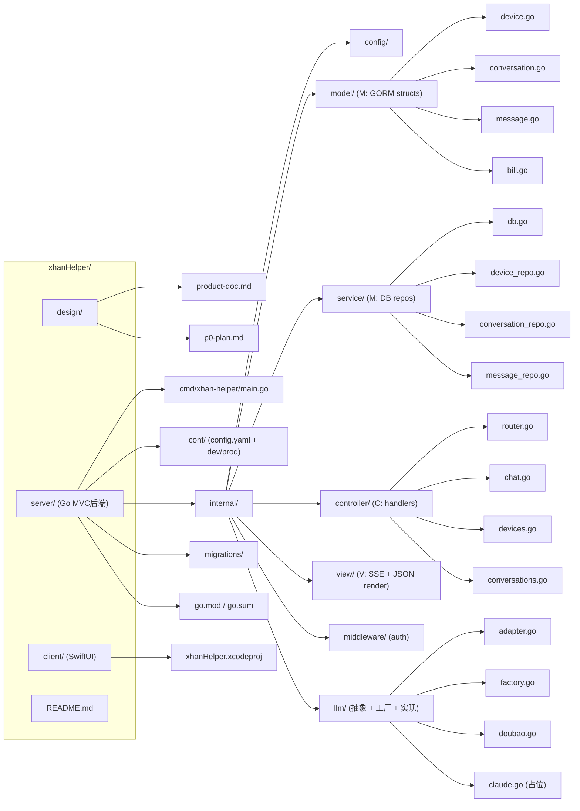

# xhanHelper — 个人 AI Agent 助手 · 产品文档

> 版本: v0.1-draft  
> 日期: 2026-04-30  
> 状态: 设计阶段，尚未开始编码

---

## 1. 产品概述

### 1.1 一句话定义

xhanHelper 是一个**以聊天为主要交互方式**的个人 AI Agent 助手，能够理解用户意图、自主调用工具完成任务，并支持持续扩展新工具。

### 1.2 核心价值

| 传统 App | xhanHelper |
|----------|------------|
| 用户操作固定 UI | 用户说话，Agent 理解意图并行动 |
| 每个工具独立打开 | 一个聊天入口，背后多个工具 |
| 数据相互隔离 | Agent 可串联多个工具完成复杂任务 |
| 无记忆 | 长期记忆，越用越懂你 |

### 1.3 目标用户

用户本人（个人助手场景，不涉及多租户）

### 1.4 终端覆盖

| 平台 | 形态 | 优先级 |
|------|------|--------|
| iPhone | SwiftUI Native App | P0（主力使用） |
| Mac | SwiftUI Native Desktop App | P1（辅助编辑/查看） |
| 阿里云 | Go Web Server | P0（后端核心） |

---

## 2. 功能规划

### 2.1 MVP 功能（v1.0）

**记账工具（完整闭环）**
- 聊天中自然语言记账："今天午饭花了 45"
- Agent 自动识别意图 → 提取金额/分类 → 调用记账工具
- 独立的账单列表页（按时间、分类筛选）
- 统计图表页（分类饼图、月度趋势）

**聊天框架**
- 流式对话体验（逐字输出）
- 工具调用状态展示（"正在记账..."）
- 多轮对话上下文保持

**Agent 基础能力**
- ReAct 循环（思考 → 行动 → 观察 → 回复）
- 工具注册与调用
- 会话管理

### 2.2 后续版本

**v1.1 — 长期记忆**
- 用户偏好学习（"我一般午饭花 30-50"）
- 历史行为回顾（"上个月餐饮花了多少"）

**v1.2 — 爬虫工具集成**
- 迁移现有新房网签爬虫
- 通过对话触发数据采集
- 数据变化的主动推送通知

**v1.3 — 定时任务编排**
- 定时触发工具执行（如每天爬取数据）
- 条件触发（如"餐饮超预算时提醒我"）

**v1.4+ — 多工具串联**
- "查一下这周花了多少，如果餐饮超预算就提醒我"
- Tool DSL 体系（低代码接入新工具）

---

## 3. 技术架构

### 3.1 总体架构图



### 3.2 技术选型总览

| 层次 | 技术 | 理由 |
|------|------|------|
| 客户端 UI | SwiftUI | Apple 原生，iOS+macOS 代码共享 |
| 后端框架 | Go + chi 或 gin | 主力语言，单体部署简单 |
| 数据库 | MySQL 8.0（已有） | 复用现有基础设施 |
| AI 模型 | 豆包 API（首批） | 已使用，成本低，国产 |
| 模型抽象 | 自建 LLM Adapter 层 | 预留切换能力，解耦业务逻辑 |
| 实时通信 | SSE (Server-Sent Events) | 流式输出天然适配，实现简单 |
| 认证 | Device Token | 个人使用，轻量足够 |
| Agent 框架 | 自建 ReAct Loop | 深入理解 Agent 原理，无重依赖 |
| 长期记忆 | 自建（参考 mem0 思路） | 理解记忆机制，可控 |

### 3.3 关键设计决策

**决策 1：Go 单体而非微服务**

原因：
- 只有一台 2C4G 服务器，容器化增加资源开销
- 个人工具，不需要独立扩缩容
- Go 编译为单一二进制，部署和运维成本极低
- 通过清晰的包结构实现模块隔离，未来需要时可拆分

**决策 2：自建 Agent 框架**

原因：
- 核心目标之一是"实操理解 Agent"
- ReAct 模式原理清晰，自建约 300-500 行 Go 代码
- 避免引入不成熟第三方依赖
- 对豆包 API 的适配也可以完全自主控制

**决策 3：工具接口合同先行**

即使 MVP 只有一个记账工具 + 硬编码注册，Tool 接口也要从第一天就定义好，确保后续添加新工具时只需实现接口。

---

## 4. 核心模块设计

### 4.1 Agent Orchestrator（ReAct 循环）



**循环终止条件：**
- LLM 返回纯文本（无 tool_call）
- 达到最大迭代次数（默认 5 轮）
- 用户中断

**SSE 事件协议：**

| event | data | 说明 |
|-------|------|------|
| `message` | `{"delta": "好"}` | 文本增量 |
| `tool_call` | `{"tool": "bookkeeping", "action": "正在记账..."}` | 开始工具调用 |
| `tool_result` | `{"tool": "bookkeeping", "summary": "已记录 45 元"}` | 工具执行结果 |
| `done` | `{"conversation_id": "xxx"}` | 本次响应完成 |
| `error` | `{"code": "xxx", "message": "..."}` | 错误信息 |

### 4.2 Tool Registry（工具系统）

```go
// 核心接口 — 任何工具都实现此接口
type Tool interface {
    // 元信息
    Name()        string   // 唯一标识，如 "bookkeeping"
    Description() string   // 给 LLM 看的功能描述
    
    // Function Calling Schema
    // 返回 JSON Schema，描述此工具支持的函数和参数
    Functions() []FunctionDefinition
    
    // 执行
    Execute(ctx context.Context, functionName string, 
            args map[string]interface{}) (*ToolResult, error)
}

type FunctionDefinition struct {
    Name        string                 // "create_bill"
    Description string                 // "记录一笔账单"
    Parameters  map[string]interface{} // JSON Schema
}

type ToolResult struct {
    Success bool
    Summary string      // 给 LLM 的文本摘要
    Data    interface{} // 给前端展示的结构化数据
    Error   string
}
```

**记账工具暴露的函数：**

| 函数名 | 用途 | 关键参数 |
|--------|------|----------|
| `create_bill` | 记录账单 | amount, category, description, date |
| `query_bills` | 查询账单 | start_date, end_date, category, limit |
| `get_stats` | 统计汇总 | start_date, end_date, group_by |

**LLM 看到的 Function Schema 示例（create_bill）：**

```json
{
  "name": "create_bill",
  "description": "记录一笔消费账单。当用户提到花钱、消费、支出时调用。",
  "parameters": {
    "type": "object",
    "properties": {
      "amount": {"type": "number", "description": "消费金额（元）"},
      "category": {"type": "string", "enum": ["餐饮", "交通", "购物", "娱乐", "居住", "其他"]},
      "description": {"type": "string", "description": "消费描述"},
      "date": {"type": "string", "description": "消费日期，格式 YYYY-MM-DD，默认今天"}
    },
    "required": ["amount"]
  }
}
```

### 4.3 LLM Adapter（模型适配层）

```go
// 统一的 LLM 客户端接口
type LLMClient interface {
    Chat(ctx context.Context, req *ChatRequest) (<-chan *StreamEvent, error)
}

type ChatRequest struct {
    Model       string
    SystemPrompt string
    Messages    []Message
    Tools       []ToolDefinition  // 可用的工具定义
    Temperature float64
    MaxTokens   int
}

type Message struct {
    Role       string     // "user" | "assistant" | "tool"
    Content    string
    ToolCalls  []ToolCall // assistant 的工具调用
    ToolCallID string     // tool 角色的调用 ID
}

type StreamEvent struct {
    Type      string     // "text_delta" | "tool_call" | "done" | "error"
    Content   string     // 增量文本
    ToolCalls []ToolCall // 完整工具调用（一次性）
}
```

**豆包适配策略：**

- **情况 A：豆包支持原生 function calling** → 直接对接，传递 tools 参数，解析 tool_calls 响应
- **情况 B：豆包不支持** → Adapter 内部模拟：
  1. 将 tool definitions 注入 system prompt
  2. LLM 返回特定格式文本时，正则解析出函数调用意图
  3. 外部接口不变，`StreamEvent.Type` 仍为 `tool_call`

```go
// llm/doubao.go — 示意
func (d *DoubaoClient) Chat(ctx context.Context, req *ChatRequest) (<-chan *StreamEvent, error) {
    if d.supportsNativeFunctionCalling {
        return d.chatWithTools(ctx, req)
    }
    return d.chatWithPromptInjection(ctx, req)  // 模拟方案
}
```

### 4.4 Memory Manager（长期记忆）

参考 mem0 的核心思路，自建实现：



**MVP 阶段简化：**
- 每个对话结束后，异步提取 1-3 条记忆（调用 LLM 低成本模型）
- 存储为 K-V 形式：`{"key": "lunch_budget", "value": "用户午饭通常花 30-50 元"}`
- 检索：新对话开始时，全量注入 system prompt（个人数据量小，够用）

### 4.5 Scheduler（定时任务）

```go
// 轻量级 cron 调度器
type Scheduler struct {
    tasks   map[string]*ScheduledTask
    cron    *cron.Cron
}

type ScheduledTask struct {
    ID        string
    ToolName  string
    FuncName  string
    Params    map[string]interface{}
    CronExpr  string
    Enabled   bool
}
```

MVP 阶段 Scheduler 只是占位框架，不要求有实际定时任务。

---

## 5. 数据模型

### 5.1 MySQL 表结构

```sql
-- 设备认证表
CREATE TABLE devices (
    id          VARCHAR(36) PRIMARY KEY,
    device_token VARCHAR(64) NOT NULL UNIQUE,
    device_name VARCHAR(100),
    platform    VARCHAR(20) NOT NULL,  -- 'ios' | 'macos'
    created_at  TIMESTAMP DEFAULT CURRENT_TIMESTAMP,
    last_seen_at TIMESTAMP DEFAULT CURRENT_TIMESTAMP ON UPDATE CURRENT_TIMESTAMP
);

-- 会话表
CREATE TABLE conversations (
    id          VARCHAR(36) PRIMARY KEY,
    device_id   VARCHAR(36) NOT NULL,
    title       VARCHAR(200) DEFAULT '新对话',
    created_at  TIMESTAMP DEFAULT CURRENT_TIMESTAMP,
    updated_at  TIMESTAMP DEFAULT CURRENT_TIMESTAMP ON UPDATE CURRENT_TIMESTAMP,
    FOREIGN KEY (device_id) REFERENCES devices(id)
);

-- 消息表（包含工具调用）
CREATE TABLE messages (
    id              VARCHAR(36) PRIMARY KEY,
    conversation_id VARCHAR(36) NOT NULL,
    role            VARCHAR(20) NOT NULL,  -- 'user' | 'assistant' | 'tool'
    content         TEXT,
    tool_calls_json JSON,                  -- assistant 的工具调用记录
    tool_call_id    VARCHAR(36),           -- tool 角色的调用 ID
    created_at      TIMESTAMP DEFAULT CURRENT_TIMESTAMP,
    FOREIGN KEY (conversation_id) REFERENCES conversations(id)
);

-- 账单表（记账工具核心数据）
CREATE TABLE bills (
    id          VARCHAR(36) PRIMARY KEY,
    device_id   VARCHAR(36) NOT NULL,
    amount      DECIMAL(10,2) NOT NULL,
    category    VARCHAR(50) NOT NULL,
    description VARCHAR(500),
    bill_date   DATE NOT NULL,
    created_at  TIMESTAMP DEFAULT CURRENT_TIMESTAMP,
    FOREIGN KEY (device_id) REFERENCES devices(id),
    INDEX idx_device_date (device_id, bill_date),
    INDEX idx_device_category (device_id, category)
);

-- 长期记忆 K-V 表
CREATE TABLE user_memories (
    id          VARCHAR(36) PRIMARY KEY,
    device_id   VARCHAR(36) NOT NULL,
    memory_key  VARCHAR(200) NOT NULL,
    memory_value TEXT NOT NULL,
    created_at  TIMESTAMP DEFAULT CURRENT_TIMESTAMP,
    updated_at  TIMESTAMP DEFAULT CURRENT_TIMESTAMP ON UPDATE CURRENT_TIMESTAMP,
    FOREIGN KEY (device_id) REFERENCES devices(id),
    UNIQUE KEY uk_device_key (device_id, memory_key)
);

-- 定时任务表
CREATE TABLE scheduled_tasks (
    id          VARCHAR(36) PRIMARY KEY,
    device_id   VARCHAR(36) NOT NULL,
    tool_name   VARCHAR(50) NOT NULL,
    func_name   VARCHAR(50) NOT NULL,
    params_json JSON,
    cron_expr   VARCHAR(50) NOT NULL,
    enabled     TINYINT DEFAULT 1,
    created_at  TIMESTAMP DEFAULT CURRENT_TIMESTAMP,
    FOREIGN KEY (device_id) REFERENCES devices(id)
);
```

---

## 6. API 设计

### 6.1 Chat API（核心）

```
POST /api/chat
Content-Type: application/json
Accept: text/event-stream
Authorization: Bearer <device_token>

Request:
{
    "conversation_id": "uuid",   // 可选，新对话则自动创建
    "message": "今天午饭花了45元",
    "stream": true
}

Response (SSE):
event: message
data: {"delta": "已"}

event: message
data: {"delta": "记录"}

event: tool_call
data: {"tool": "bookkeeping", "function": "create_bill", "action": "正在记账..."}

event: tool_result
data: {"tool": "bookkeeping", "function": "create_bill", "summary": "已记录：午餐 45 元"}

event: message
data: {"delta": "：今天午餐 45 元，已记入餐饮分类。"}

event: done
data: {"conversation_id": "uuid-xxx"}
```

### 6.2 工具数据 API

```
# 账单
GET  /api/bills?start_date=2026-04-01&end_date=2026-04-30&category=餐饮
GET  /api/bills/stats?start_date=2026-04-01&end_date=2026-04-30&group_by=category

# 会话
GET  /api/conversations
GET  /api/conversations/:id/messages

# 设备管理
POST /api/devices/register
Body: {"device_name": "iPhone 16", "platform": "ios"}
Response: {"device_token": "xxx"}
```

---

## 7. SwiftUI 客户端

### 7.1 视图结构



### 7.2 SSE 客户端要点

- 使用 `URLSession` 的 streaming 模式接收 SSE
- 逐行解析 `event:` 和 `data:` 字段
- 在主线程更新 `@Published` 属性驱动 UI 刷新
- 网络中断时自动重连（携带 last_event_id）

---

## 8. 部署架构



---

## 9. MVP 里程碑与路线图

### P0 — 项目骨架 + 基础对话（预计先行）

**目标**：跑通整个链路，能对话

- Go 项目初始化（模块结构、配置、HTTP 路由）
- MySQL 建表 + migration
- LLM Adapter 层（豆宝接入，含 function calling 探测）
- SSE Chat API（纯对话，暂不接工具）
- Device Token 认证中间件
- 会话管理（创建/列表/历史消息）

### P1 — 工具系统 + 记账

**目标**：Agent 能调用工具完成记账

- Tool Interface + Registry 实现
- 记账工具实现（create_bill / query_bills / get_stats）
- ReAct Loop 接入 Tool Registry
- 工具执行结果反馈给 LLM
- 账单数据 API

### P2 — 客户端 MVP

**目标**：手机上能聊天记账

- SwiftUI 项目搭建（iOS + macOS target）
- SSE Client 实现
- ChatView（消息列表 + 流式展示 + 工具调用卡片）
- InputBar + 发送消息
- 设备注册流程

### P3 — 工具页面 + 完善

**目标**：独立工具页面可用

- BillListView（筛选、分页）
- BillStatsView（饼图、趋势图）
- 记账工具端到端测试
- Bug 修复 + 体验优化

### P4 — 智能增强

**目标**：Agent 更懂你

- Memory Manager（记忆提取、存储、检索）
- 用户画像注入 system prompt
- Scheduler 框架（占位，暂不接入实际任务）

---

## 10. 风险与已知限制

| 风险 | 影响 | 缓解措施 |
|------|------|----------|
| 豆包不支持 function calling | Agent 工具调用准确率下降 | Adapter 层模拟（prompt injection + 输出解析），架构预留切换 |
| 2C4G 服务器资源有限 | 模型推理不可能本地跑 | 全部走云端 API，服务器只做编排 |
| Go SSE 长连接内存开销 | 大量连接时内存压力 | 个人使用，连接数可控（通常 <5） |
| SwiftUI 学习曲线 | 客户端开发速度慢 | Claude 辅助生成代码 |

---

## 附录 A：目录结构规划



---

> **下一步**：讨论路线图与实现优先级，确认后逐阶段编码。
