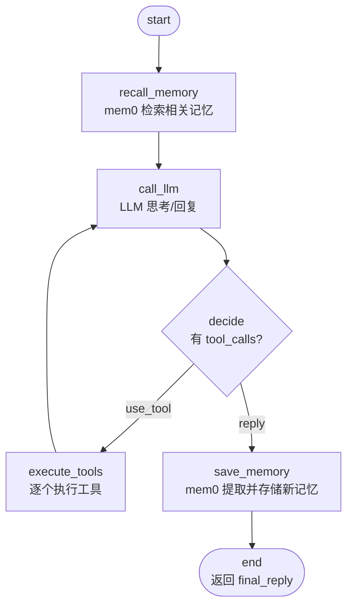

# Python 后端迁移方案 — LangGraph + mem0

> 日期: 2026-05-01 | 状态: 方案已定，待开发

---

## 一、技术选型（已定）

| 层 | 选型 | 理由 |
|------|------|------|
| Web 框架 | **FastAPI** + uvicorn | 原生 async，SSE 原生支持 |
| Agent 编排 | **LangGraph** StateGraph | 图状态机拟合 ReAct，可自由扩展节点 |
| 长期记忆 | **mem0** 本地模式 | SQLite 存向量，零云依赖，一行接入 |
| ORM | **SQLAlchemy 2.0** async | Python ORM 标准 |
| 迁移 | **Alembic** | 数据库版本管理 |
| LLM 调用 | **httpx** async | FastAPI 标配，不引入重 HTTP 客户端 |
| 配置 | **pydantic-settings** | .env 自动加载 + 类型校验 |
| 数据库 | **MySQL**（复用现有库名） | 阿里云已有 MySQL，新建表 |
| 部署 | **直接 Python 进程** | 不容器化，systemd + nohup |

---

## 二、目录结构

```
server-py/
├── app/
│   ├── __init__.py
│   ├── main.py                  # FastAPI 入口
│   ├── config.py                # pydantic-settings
│   ├── api/
│   │   ├── __init__.py
│   │   ├── deps.py              # 依赖注入 (get_db, get_device)
│   │   ├── router.py            # 路由注册
│   │   ├── chat.py              # POST /api/chat (SSE)
│   │   ├── devices.py           # POST /api/devices/register
│   │   ├── conversations.py     # GET /api/conversations, /:id/messages
│   │   └── bills.py             # GET /api/bills, POST /api/bills/import
│   ├── agent/
│   │   ├── __init__.py
│   │   ├── state.py             # AgentState TypedDict
│   │   ├── graph.py             # LangGraph 图构建
│   │   ├── nodes.py             # 节点函数 (call_llm, execute_tools, memory)
│   │   └── memory.py            # mem0 封装
│   ├── tools/
│   │   ├── __init__.py
│   │   ├── base.py              # Tool 基类 + Result
│   │   ├── registry.py          # 工具注册表 + prompt 生成
│   │   └── bookkeeping.py       # 记账工具
│   ├── models/                   # SQLAlchemy ORM
│   │   ├── __init__.py
│   │   ├── base.py              # declarative base
│   │   ├── device.py
│   │   ├── conversation.py
│   │   ├── message.py
│   │   └── bill.py
│   ├── schemas/                  # Pydantic 请求/响应
│   │   ├── __init__.py
│   │   ├── chat.py
│   │   ├── device.py
│   │   └── bill.py
│   └── db/
│       ├── __init__.py
│       └── session.py            # async session factory
├── alembic/
├── venv/
├── requirements.txt
├── .env                          # 不提交
└── .gitignore
```

---

## 三、核心模块设计

### 3.1 Agent State

```python
# agent/state.py
from typing import TypedDict, Annotated
from langgraph.graph.message import add_messages
from langchain_core.messages import BaseMessage

class AgentState(TypedDict):
    messages: Annotated[list[BaseMessage], add_messages]  # 对话历史，自动追加
    device_id: str
    pending_tool_calls: list[dict] | None                  # 待执行的工具调用
    final_reply: str | None                                # 最终文本回复
    recalled_memories: str | None                          # mem0 检索到的记忆
```

### 3.2 LangGraph 图结构



**5 个节点：**

| 节点 | 函数 | 职责 |
|------|------|------|
| `recall_memory` | 从 mem0 搜索与当前对话相关的记忆 | 注入 system prompt |
| `call_llm` | 构建 system prompt + 历史 → 调用豆包 | 返回文本或 tool_calls |
| `execute_tools` | 遍历 tool_calls → 调用对应工具 | 返回 tool_results |
| `save_memory` | 从本轮对话中提取关键信息 → 存 mem0 | 异步，不阻塞回复 |
| `decide` | 条件边：有 tool_calls → execute，否则 → save_memory |

### 3.3 图构建代码

```python
# agent/graph.py
from langgraph.graph import StateGraph, END
from langgraph.checkpoint.memory import MemorySaver
from .state import AgentState
from .nodes import recall_memory, call_llm, execute_tools, save_memory

def build_agent_graph(tools: list, llm, mem0_client):
    workflow = StateGraph(AgentState)

    workflow.add_node("recall_memory", recall_memory)
    workflow.add_node("call_llm", call_llm)
    workflow.add_node("execute_tools", execute_tools)
    workflow.add_node("save_memory", save_memory)

    workflow.set_entry_point("recall_memory")
    workflow.add_edge("recall_memory", "call_llm")
    workflow.add_conditional_edges("call_llm", decide, {
        "use_tool": "execute_tools",
        "reply":    "save_memory",
    })
    workflow.add_edge("execute_tools", "call_llm")
    workflow.add_edge("save_memory", END)

    return workflow.compile(checkpointer=MemorySaver())

def decide(state: AgentState) -> str:
    if state.get("pending_tool_calls"):
        return "use_tool"
    return "reply"
```

### 3.4 节点函数

```python
# agent/nodes.py
from langchain_core.messages import SystemMessage, HumanMessage, AIMessage, ToolMessage

SYSTEM_PROMPT = """你是 xhanHelper，个人 AI 助手...（与 Go 版相同）"""

async def recall_memory(state: AgentState, config: RunnableConfig):
    """从 mem0 检索相关记忆"""
    memories = mem0_client.search(state["messages"][-1].content, user_id=state["device_id"])
    if memories:
        memory_text = "用户的相关信息:\n" + "\n".join(m["memory"] for m in memories)
        state["recalled_memories"] = memory_text
    return state

async def call_llm(state: AgentState, config: RunnableConfig):
    """调用 LLM，包含 system prompt + 工具定义 + 记忆"""
    system_parts = [SYSTEM_PROMPT, tool_prompt]
    if state.get("recalled_memories"):
        system_parts.append(state["recalled_memories"])

    messages = [SystemMessage("\n\n".join(system_parts))] + state["messages"]
    response = await llm.ainvoke(messages)  # LangChain ChatModel 统一接口

    if hasattr(response, "tool_calls") and response.tool_calls:
        state["pending_tool_calls"] = response.tool_calls
    else:
        state["final_reply"] = response.content
        state["pending_tool_calls"] = None
    return state

async def execute_tools(state: AgentState, config: RunnableConfig):
    """逐个执行工具调用，结果作为 ToolMessage 追加到消息列表"""
    for tc in state["pending_tool_calls"]:
        result = await registry.execute(tc["name"], tc["args"], state["device_id"])
        state["messages"].append(ToolMessage(content=str(result), tool_call_id=tc["id"]))
    state["pending_tool_calls"] = None
    return state

async def save_memory(state: AgentState, config: RunnableConfig):
    """从本轮对话提取记忆，存入 mem0（异步，不阻塞）"""
    mem0_client.add(state["messages"], user_id=state["device_id"])
    return state
```

### 3.5 流式输出

LangGraph 原生支持 token-level streaming。FastAPI SSE 端：

```python
# api/chat.py
from fastapi import APIRouter
from sse_starlette.sse import EventSourceResponse

@router.post("/chat")
async def chat(req: ChatRequest, ...):
    async def event_stream():
        async for event in agent_graph.astream_events(
            {"messages": [HumanMessage(content=req.message)], "device_id": device.id},
            version="v2"
        ):
            if event["event"] == "on_chat_model_stream":
                yield {"event": "message", "data": json.dumps({"delta": event["data"]["chunk"].content})}
            elif event["event"] == "on_tool_start":
                yield {"event": "tool_call", "data": json.dumps({...})}
            elif event["event"] == "on_tool_end":
                yield {"event": "tool_result", "data": json.dumps({...})}

    return EventSourceResponse(event_stream())
```

---

## 四、mem0 本地模式

```python
# agent/memory.py
from mem0 import Memory

memory = Memory()  # 默认本地模式，数据存 ~/.mem0/

# 存入记忆（在 save_memory 节点调用）
memory.add("用户午饭一般花30-50元", user_id="device-uuid")

# 检索记忆（在 recall_memory 节点调用）
results = memory.search("午饭花了45", user_id="device-uuid")
# → [{"memory": "用户午饭一般花30-50元", "score": 0.89}, ...]
```

无需 API key，零网络调用。底层用本地 embedding 模型 + SQLite 存向量。

---

## 五、工具系统

```python
# tools/base.py
from pydantic import BaseModel
from abc import ABC, abstractmethod
from typing import Any

class ToolResult(BaseModel):
    success: bool
    data: dict[str, Any] | None = None
    error: str | None = None

class BaseTool(ABC):
    @property
    @abstractmethod
    def name(self) -> str: ...

    @property
    @abstractmethod
    def description(self) -> str: ...

    @abstractmethod
    def functions(self) -> list[dict]: ...
        # 返回 JSON Schema 列表，与 Go 版完全相同

    @abstractmethod
    async def execute(self, device_id: str, func_name: str, args: dict) -> ToolResult: ...

# tools/bookkeeping.py — 与 Go 版逻辑完全相同
# create_bill / update_bill / delete_bill / query_bills
# 分类枚举、字段校验、日期默认值 —— 全部照搬
```

---

## 六、API 兼容性

**与 Go 版完全相同的契约**，客户端零改动：

| 方法 | 路径 | SSE 事件 |
|------|------|----------|
| POST | /api/devices/register | — |
| POST | /api/chat | message, tool_call, tool_result, done, error |
| GET | /api/conversations | — |
| GET | /api/conversations/:id/messages | — |
| GET | /api/bills | — |
| POST | /api/bills/import | — |

---

## 七、部署

与 Go 版相同的模式——systemd + control 脚本：

```bash
# 安装 Python 3.12
sudo dnf install python3.12

# 部署
make deploy
```

`requirements.txt`：
```
fastapi==0.115.*
uvicorn[standard]==0.34.*
sqlalchemy[asyncio]==2.0.*
aiomysql==0.2.*
httpx==0.28.*
pydantic-settings==2.*
sse-starlette==2.*
langgraph==0.2.*
langchain-core==0.3.*
langchain-community==0.3.*
mem0ai==0.1.*
```

---

## 八、实施顺序

| 阶段 | 内容 | 可独立验证 |
|------|------|-----------|
| 1 | 项目骨架 + FastAPI + SQLAlchemy + Alembic 建表 | `uvicorn app.main:app` 启动 |
| 2 | 设备注册 + 会话管理 + 账单 API（纯 CRUD） | curl 调通 |
| 3 | 豆包 LLM 调用 (httpx + /responses endpoint) | 手动调通 |
| 4 | LangGraph Agent 图 + 记账工具 | "午饭35元" → 记账成功 |
| 5 | mem0 记忆集成 | 多轮对话验证记忆 |
| 6 | SSE 流式推送 | curl -N 流式接收 |
| 7 | CSV 导入 | 导入后查账单 |
| 8 | 部署脚本 + control 脚本 | `make deploy` |

每阶段完成后都可以 curl 验证，不依赖上一阶段全部完成。
