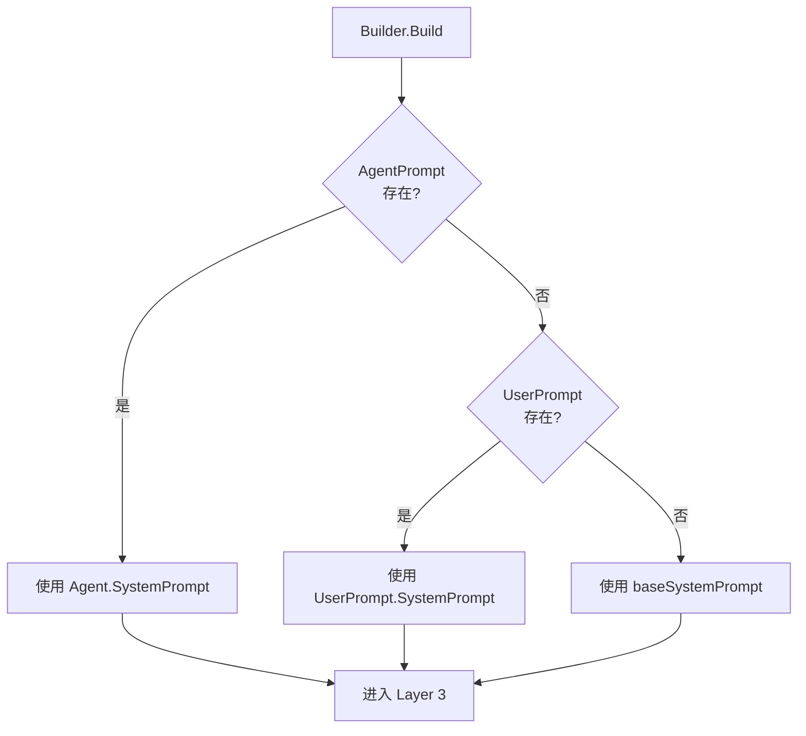
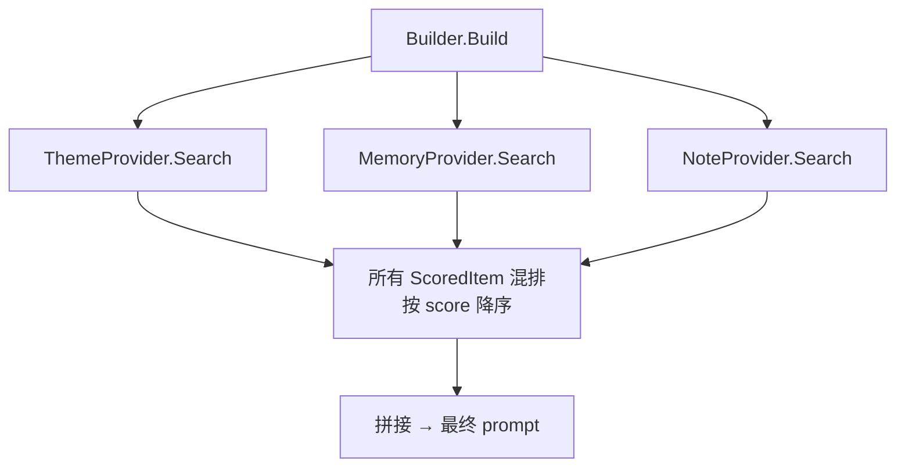
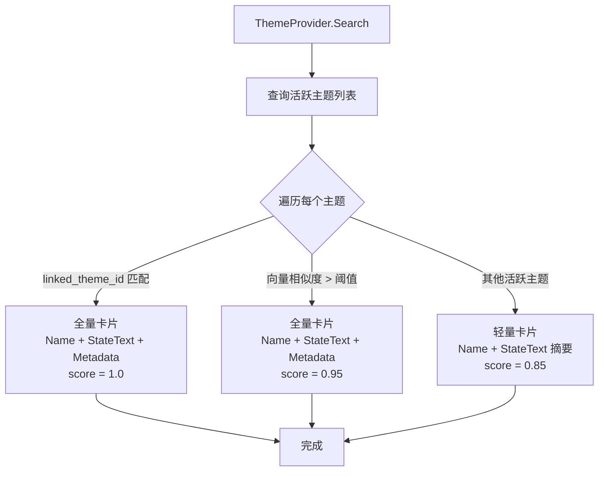
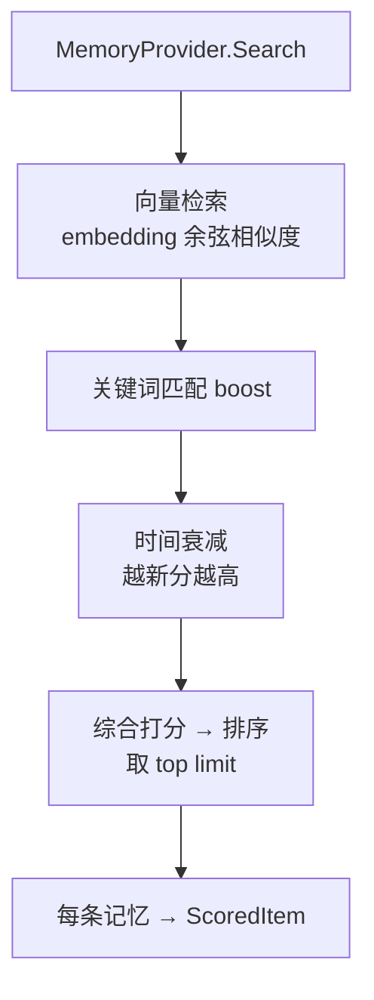
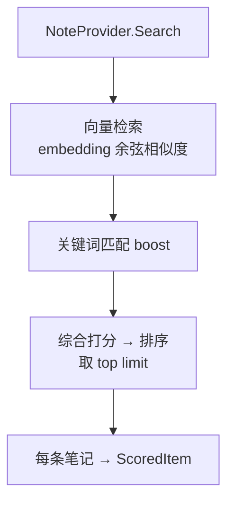

# 008 — SystemPromptBuilder 重构

## 背景

当前 system prompt 的组装逻辑散落在多处，层次不清，难以维护和扩展。

### 现状问题

| 问题 | 说明 |
|------|------|
| **规则散落** | 核心原则、JSON 格式规则、时间戳禁止分散在 `baseSystemPrompt`、`registry.writePromptFooter`、`llm.BuildSystemPrompt` 三处 |
| **自定义 agent 绕过公共规则** | `AgentSystemPrompt` 直接替换 `baseSystemPrompt`，自定义 agent 看不到核心原则和 JSON/时间戳规则 |
| **buildSysPrompt 职责过重** | 一个函数干了 agent 选择、时间注入、工具定义、主题注入、记忆检索、记忆格式化 6 件事 |
| **无总量控制** | 所有内容一股脑塞进 system prompt，无优先级、无截断 |
| **扩展困难** | 未来要加人物关系、事件时间线等上下文时，需要改 `buildSysPrompt` 内部逻辑 |

### 目标

- 所有 agent（默认/自定义/离线任务）共享一组不可覆盖的公共规则
- 动态上下文（主题/记忆/笔记）通过可插拔的 Provider 机制注入
- orchestrator 不感知 Provider 内部实现，只拿到最终的 prompt + 元数据
- 新增上下文类型时只需实现 Provider 接口并注册

---

## 上下文工程设计原理

重构前，先梳理清楚当前系统里「可以塞进上下文的都是什么」。它们是一个逐步逼近用户现实概念的抽象层级：

### 层级 1：对话历史

当前会话的消息记录，直接放入请求体 `messages` 数组，不进 system prompt。因为允许 1M 上下文，最大携带 200 条历史消息。

这是最底层的信息 — 未经加工的原始对话。

### 层级 2：记忆 & 笔记

**记忆**：会话结束后，LLM 从会话中提取的一句话洞察，通常是关于用户的偏好、决定、行为模式。例如「用户决定 5 月 21 日起严格不吃外卖」「用户已离职，进入全职求职阶段」。

**笔记**：会话过程中，LLM 判断某段内容有长期追踪价值，摘抄记录的原文片段。例如一次睡眠数据的记录、一笔账单、一条购房原则。

记忆和笔记都带 `topic` 和 `tags`，具备初步的结构化。但它们仍是碎片化的 — 一条记忆讲求职、一条记忆讲睡眠，彼此独立。

### 层级 3：主题

主题是对记忆和笔记按 `topic` + `tags` 做聚类和统计分析后得到的**高层次抽象**。它在现实中对应的是用户长期关注、多次讨论、值得持续追踪的事情。

比如这个系统从用户身上发现的主题：求职、睡眠追踪、个人助手设计 — 这些都是用户真实在做的事。

每个主题携带：
- **StateText**：LLM 维护的自由文本状态摘要，描述这个事情的最新进展
- **Facts**：支撑主题进展的底层记忆和笔记（通过 `get_topic_detail` 工具检索）

主题数量控制在 10 个以内，保持克制。

### 三层在上下文中的角色

```
对话历史  → 原始会话，进 messages 数组（不进 system prompt）
记忆&笔记 → 主题形成前的碎片化信息，覆盖「还没形成主题」的讨论
主题      → 最高优先级的上下文，代表已结构化的现实追踪事件
```

核心原则：**如果用户在讨论一个已有主题的事，把主题的 StateText 注入 system prompt 让 LLM 了解前因后果；如果讨论的内容还没有主题，靠记忆和笔记提供碎片化的上下文。主题本身就对应一批记忆，注主题 = 注一批支撑事实。**

---

## 架构

### 三层模型

```
SystemPromptBuilder.Build(opts) → BuildResult

Layer 1: 公共规则（StaticProvider，跨 agent 不可覆盖）
├── 核心原则（简洁/诚实/追问/记录/诤友）
├── 工具调用规则 + JSON 输出格式
├── 工具函数定义（registry 渲染）
└── 当前时间

Layer 2: 角色定义（可覆盖，优先级：UserPrompt > AgentPrompt > Default）
├── 默认 baseSystemPrompt（"你是 xhanHelper..."）
├── 或 Agent.SystemPrompt（自定义智能体）
└── 或 UserPrompt.SystemPrompt（用户自定义）

Layer 3: 动态上下文（SearchProvider，按 score 排序注入）
├── ThemeProvider      → 关联主题全量，其他活跃主题轻量
├── MemoryProvider     → 向量 + 关键词 + 新鲜度综合打分
└── NoteProvider       → 向量打分（同框架，无新鲜度衰减）
```

### Provider 接口

```go
// StaticProvider — Layer 1/2 使用，直接返回文本，不需要检索
type StaticProvider interface {
    Name() string
    Render(ctx context.Context) string
}

// ScoredItem — SearchProvider 返回的单项
type ScoredItem struct {
    Content string
    Score   float64  // 0~1
    Source  string   // provider 名称，调试用
    Meta    any      // provider 自定义元数据
}

// SearchProvider — Layer 3 使用，需要检索 + 打分
type SearchProvider interface {
    Name() string
    Search(ctx context.Context, query string) ([]ScoredItem, error)
}
```

### Provider 行为详解

#### StaticProvider（Layer 1）

StaticProvider 不需要检索，直接返回预定义的文本块。在 `Build()` 中被按注册顺序调用，结果直接拼入 prompt。


| Provider | 内容 | 说明 |
|----------|------|------|
| 核心原则 | 简洁/诚实/追问/记录/诤友 | 所有 agent 必须遵守的行为准则 |
| 工具规则 | JSON 强制输出、双引号转义、禁止时间戳、调用约束 | 从 `registry.writePromptFooter` 迁移过来 |
| 工具函数 | note + tool_retriever 完整定义 + 其他工具概览 | 委托 `registry.RenderTools()` 生成 |
| 当前时间 | `当前时间: 2026-05-23 17:30:04 Saturday` | 一行，让 LLM 知道现在时间 |

#### Layer 2：角色定义

不是 Provider，是 Builder 内部的选择逻辑。按优先级取第一个可用的：



#### SearchProvider（Layer 3）

每个 SearchProvider 内部做检索 → 打分 → 排序，返回 `[]ScoredItem`。Builder 把所有 item 混到一起按 score 降序排，依次拼接直到 prompt 末尾。



##### ThemeProvider

主题匹配采用**混合来源**策略，不依赖单一机制：

```
输入: user_id, user_message, embedding, linked_theme_id（可选）

匹配来源（按优先级）:

1. 信箱跳转关联（linked_theme_id 非空）
   → 该主题直接成为 primary，score = 1.0，全量注入
   → 来源：ConversationCtx.ThemeID（信箱投递 finding 时写入）
   → 说明：此机制使用率不高，仅信箱跳转时生效

2. 当前消息向量匹配
   → 用户消息 embedding 与每个活跃主题的 embedding 做余弦相似度
   → 相似度 > 阈值的主题也标记为 primary，score = 0.95，全量注入
   → 可以有多个 primary（用户一句话可能同时触及「求职」和「睡眠」）
   → 使用与 memory 检索同一套向量基础设施

3. 其他活跃主题
   → 既非信箱关联、也未达向量匹配阈值的剩余活跃主题
   → score = 0.85，轻量注入（Name + StateText 摘要）
   → 让 LLM 知道存在这些追踪事项，但不展开细节

输出: 每个活跃主题一个 ScoredItem
```



> **为什么不用方案一（像 agent 绑定那样等对话丰富后再绑定）？**
> 用户偶发触及其他主题时响应不足。例如前 10 轮在聊求职，突然说两句睡眠，若仍绑定求职就错过睡眠上下文。向量匹配对单条消息即可响应，更灵活。
>
> **为什么可以有多个 primary？**
> 用户一句话可能同时触及多个主题（「昨晚没睡好影响了今天的面试表现」同时命中睡眠和求职）。多 primary 的 token 成本极低（< 10 个主题），选漏的代价远大于多选的代价。

##### MemoryProvider

```
输入: user_message, embedding, threshold, limit
检索:
  1. 向量检索 → embedding 余弦相似度
  2. 关键词匹配 boost → 用户消息中的关键词在记忆文本中命中加分
  3. 时间衰减 → 越新的记忆分越高，超过 N 天开始衰减
  4. 综合打分 → 向量分 × 权重 + 关键词分 × 权重 - 时间衰减
  5. 取 top limit 条（默认 8）
输出: 每条记忆一个 ScoredItem，score = 综合打分（0~1）
```



##### NoteProvider

```
输入: user_message, embedding, threshold, limit
检索:
  1. 向量检索 → embedding 余弦相似度
  2. 关键词匹配 boost → 同上
  3. 无时间衰减 → 笔记是事实记录，不会过时
  4. 综合打分 → 向量分 + 关键词 boost
  5. 取 top limit 条
输出: 每条笔记一个 ScoredItem，score = 综合打分（0~1）
```



#### 打分与排序策略

记忆和笔记共用同一套打分框架（`retriever`），区别仅在于记忆有新鲜度衰减而笔记没有。因此 MemoryProvider 和 NoteProvider 可以委托同一个 `Retriever` 实例，只是参数不同。

主题的分数设为 1.0 / 0.95 / 0.85，天然排在记忆/笔记之前（记忆/笔记的相似度通常 0.3~0.85），确保主题永远是最高优先级。

```
排序结果示例:
  theme:求职（信箱关联）      score=1.00  ← 明确 primary
  theme:睡眠追踪（向量命中）   score=0.95  ← 向量匹配 primary
  theme:个人助手设计（其他）    score=0.85  ← 轻量注入
  theme:房地产（其他）         score=0.85
  memory:用户5月离职          score=0.78  ← 碎片信息补缺口
  memory:用户决定不吃外卖      score=0.72
  note:睡眠记录 5/20         score=0.65
  note:购房原则              score=0.58
```

### Builder 结构

```go
type BuildOptions struct {
    UserID         string
    ConversationID string
    UserMessage    string       // 用于检索的查询文本
    Embedding      []float64    // 用户消息的 embedding（外层预计算）
    AgentPrompt    string       // 自定义 agent 的 prompt（空则用默认）
    DeepMode       bool
    // 主题相关
    LinkedThemeID  string       // 会话关联的主题 ID
    // 控制开关
    SkipMemory     bool
    MemoryThreshold float64
    MemoryLimit    int
}

type BuildResult struct {
    Prompt    string   // 最终拼接的 system prompt
    MemoryIDs []string // 注入的记忆 ID（前端高亮，调试用）
    NoteIDs   []string // 注入的笔记 ID（同上）
}

type SystemPromptBuilder struct {
    basePrompt      string
    staticProviders []StaticProvider  // Layer 1
    searchProviders []SearchProvider  // Layer 3
    toolRenderer    ToolRenderer
    promptResolver  PromptResolver
    // 依赖
    embedder        Embedder
    retriever       *Retriever
    themeStateRepo  *ThemeStateRepo
}

func (b *SystemPromptBuilder) Build(ctx context.Context, opts BuildOptions) (*BuildResult, error)
```

### 集中配置

所有阈值、数量、权重收敛到一个配置结构体中，方便查找和调参。

```go
type PromptConfig struct {
    // —— 主题 ——
    ThemeVectorThreshold  float64 // 向量匹配 primary 主题的相似度阈值（默认 0.5）
    ThemeMaxCount         int     // 最多注入主题数（默认 10）

    // —— 记忆 ——
    MemoryThreshold       float64 // 记忆检索相似度阈值（默认 0.5）
    MemoryLimit           int     // 记忆检索最大条数（默认 8）
    MemoryTimeDecayDays   int     // 记忆新鲜度衰减起始天数（默认 7）

    // —— 笔记 ——
    NoteThreshold         float64 // 笔记检索相似度阈值（默认 0.5）
    NoteLimit             int     // 笔记检索最大条数（默认 5）

    // —— 构建行为 ——
    SkipMemory            bool    // 跳过记忆检索（短输入等场景）
    MaxHistoryMessages    int     // 历史消息最大携带条数（默认 200）
}
```

所有魔法数字从代码中移除，统一从此结构体取值。NewBuilder 时注入，各 Provider 从 Builder 读取自己的阈值。

### orchestrator 调用方式变化

```
现在:
  sysPrompt, memoryNote, memIDs, noteIDs, vec, packets := o.buildSysPrompt(ctx, req)
  // buildSysPrompt 内部做了所有事：agent 选择、主题、记忆检索、格式化...

将来:
  vec := o.embedder.Embed(ctx, req.UserMessageContent)  // orchestrator 仍需 embedding（存用户消息用）
  result := o.promptBuilder.Build(ctx, BuildOptions{
      UserID:         req.UserID,
      UserMessage:    req.UserMessageContent,
      Embedding:      vec,
      AgentPrompt:    req.AgentSystemPrompt,
      LinkedThemeID:  linkedThemeID,
      SkipMemory:     req.SkipMemory,
      MemoryThreshold: req.MemoryThreshold,
      MemoryLimit:    req.MemoryLimit,
  })
  // result.Prompt → 用做 system prompt
  // result.MemoryIDs, result.NoteIDs → 用做前端 done 事件
```

### 影响范围

| 文件 | 改动 |
|------|------|
| `agent/prompt_builder.go` | **新建** — Builder + Provider 接口 + 实现 |
| `agent/orchestrator.go` | `buildSysPrompt` 替换为 Builder 调用，删除内部检索/格式化逻辑 |
| `tool/registry.go` | 抽取 `RenderTools()` 方法供 Builder 的 Layer 1 StaticProvider 使用 |
| `agent/react_loop.go` | Builder 替换手动拼接，Layer 1+2 共享 |
| `agent/json_parser.go` | 无变化（已修复） |
| `agent/*_test.go` | 新增 Builder 单元测试 |

### 不在此次范围内的改动

- 人物关系 Provider — 后续 PR
- Token 预算精确控制 — 后续 PR（当前 1M 上下文够用）
- cron_runner 离线任务的 prompt 构建 — 后续 PR（目前直接使用硬编码 prompt，暂不走 Builder）

---

## 实现步骤

1. 新建 `agent/prompt_builder.go`，定义接口 + Builder 结构体
2. 新建 `agent/prompt_builder_test.go`，单元测试覆盖各层
3. 改 `orchestrator.go` — `buildSysPrompt` 替换为 Builder 调用
4. 改 `tool/registry.go` — 抽取 `RenderTools()` 方法
5. 改 `react_loop.go` — 使用 Builder 的 Layer 1+2
6. 删除 `orchestrator.go` 中不再需要的检索/格式化代码
7. `make test` 全绿
