# 活动埋点系统 · 技术方案（v1）

这是技术方案，不是讨论稿：已定部分即为定稿，未定部分单列在最后。讨论过程、调研结论、外部工具对比都在底稿 [助手活动埋点方案（v1·讨论稿）](xhanhelper://document/ebb30bcd-c483-474d-ba67-b2381b1f5725) 里（讨论稿不在本仓库，在文档库里）。**权威版本在仓库**：`docs/design/activity-events/` 下那四份（互链是相对路径）。文档库那几份是同一内容的草稿，两边若有出入，以仓库为准。

进度：**第一至第七节已定稿**（2026-09-26 按评审意见修订）。延后项：6.3.4–6.3.5 弱关联边、日报与周报。四件已定（2026-09-26）：`events.db` 纳入每日 dump；`client.input.active` 做；明细删除不与内容对象联动；不拿埋点核对自述。理由见[实施篇](./活动埋点系统 · 实施技术方案.md)第八节决策记录。部署形态已定：只采本地实例，不采云端。

## 一、要解决什么

一句话：让助手不用问，就知道你今天在这个 app 里用了什么功能、用了多久、有什么特殊细节，并且能把散在对话、文档、浏览器里的活动拼成"一件事"。

明确不采：屏幕内容与截图、剪贴板、其他 app 的窗口标题、键盘输入的具体内容（只记"有没有输入"，不记输入了什么）、手机端与离线活动。

其中"只记有没有输入"这半句是要兑现的（2026-09-26 定）：`client.input.active` 只带时长、字符量分档、是否删除过，不记任何内容，形态见[实施篇](./活动埋点系统 · 实施技术方案.md)第九节。

验收分两档，别混为一谈（2026-09-26 修订）。

**第一档 · 服务端事件，当天可验。** 用主库存量数据重建 2026-09-25 的服务端事件（消息、文档、账单、工具与 LLM 审计都在），跑派生与读取接口，再跟那天手工拼出的时间线对照。这一档是阶段 3 的出口条件。

**第二档 · 客户端事件，只能上线后盲测。** 09-25 那天客户端一个字节都没采，浏览、在场、电源全无，而**决定不做回填**（理由见实施篇决策记录：历史记录只记访问时刻、没有"谁打开的"、时间基还是 CFAbsoluteTime，回填出来的是半真数据，不抵它给事实层留下的污点）。所以客户端侧的对错只能在上线后挑一天盲测：你不告诉系统那天干了什么，让它自己拼，再对照。**那天要提前留对照物**——晚上花两分钟记几个锚点（几点起、午睡几点到几点、晚上主要做什么）就够；没有它，盲测就退化成"系统说什么就是什么"。

## 二、整体怎么走

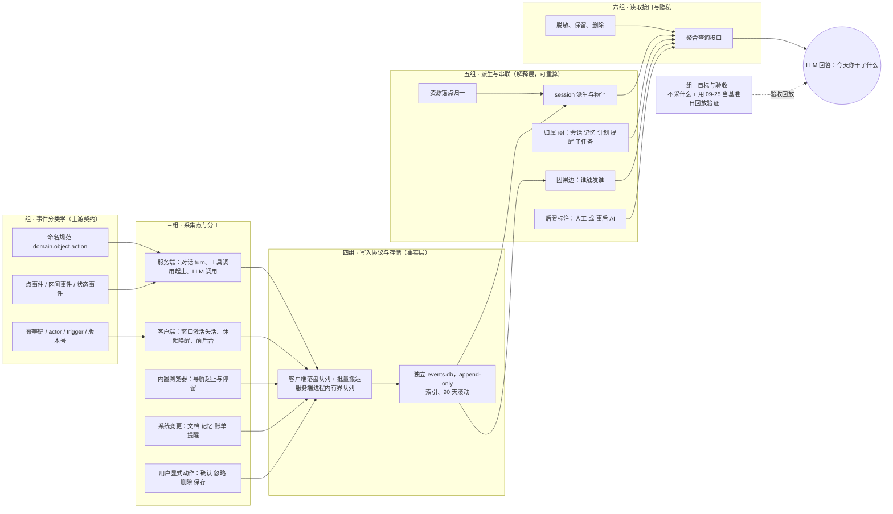

读图三点：二组在最上游，事件形状定错则后面全错；四组是事实与解释的分界线，左边只写不改、右边随便重算；六组是唯一出口，助手只看到聚合结果，看不到原始事件。

## 三、事件分类学（已定）

### 3.1 一条事件长什么样

字段形状来自 OpenTelemetry：它的 span 对应这里的区间事件，attributes 对应 attrs，baggage 那套上下文透传对应 refs 与 resources，resource 对应 actor 这类环境信息。唯一刻意不沿用的是名字：不用 trace_id，因为 OTel 的 trace 是请求作用域，而我们要的关联必须活过进程重启。它里面被漏掉、本轮补上的是两个——span 的 status 和 exception，对应下表的 outcome 与 error_type / error_msg。

| 字段 | 含义 | 为什么必须有 |
|---|---|---|
| event_id | 客户端或服务端生成的全局唯一 id | 幂等去重的依据，重试不会重复计数 |
| type | 事件类型，见 3.3 命名规范 | 唯一决定这条事件怎么被解释 |
| occurred_at | 事情发生的时间，ISO 8601 带时区、精度毫秒 | 由产生方给，不是落库时间 |
| received_at | 落库时间 | 离线补投时两者会差很远，时间线排序要靠它兜底 |
| outcome | 终态：区间事件写在结束那条、点事件也可带（默认 `completed`，失败才写 `failed`）；取值 completed / failed / interrupted / cancelled | 失败与取消不加新 type，靠它区分 |
| error_type / error_msg | 失败时的错误类型与一句短描述 | 只留类型和短描述，堆栈不进事件 |
| actor | 谁产生的：user / assistant / system | 不区分的话，自动批处理会被算成你的行为 |
| trigger | 怎么发生的：manual / batch / schedule | 同上，例：14:52 那 8 个 topic 清洗是 batch |
| parent_event_id | 触发它的那条事件 | 因果边的来源，正式设计见 6.3.3；权威名单以附表 A 为准 |
| pair_id | 区间事件的开始与结束互指 | 配对与因果是两套语义，配对**不用** parent_event_id（见 6.3.3） |
| biz_key | 业务键，只放单个全局唯一 id | 服务端可能重放的事件的第二道幂等防线（见 3.6）；客户端事件留 NULL |
| launch_id / focus_epoch_id / component_instance_id / wake_epoch_id | 采集时顺手生成的 epoch 标记 | 五层在场的归属原料，按事件类型带（见 6.2，权威名单见附表 A） |
| conversation_id / turn_id / call_id | 会话、轮次、桥接调用 id | 客户端子事件由下发 payload 带（见 4.8）；后台任务 turn_id 为空 |
| client_instance_id / client_build / os_version | 客户端身份与环境 | 仅客户端事件，区分同机多实例与版本（见 4.4） |
| refs | 归属：会话、记忆、计划、提醒、子任务 | 一串 类型+id，允许挂多个。不把主题当归属锚（见 6.3.1）；记忆用 memory_id，不用 topic（topic 会改） |
| resources | 碰到的资源：URL、文件路径、仓库、文档 id | 跨源串"一件事"靠它最结实 |
| attrs | 业务细节，JSON | 可扩展的那一格，见 3.8 的纪律 |
| schema_version | 表级版本号 | 字段演进后老数据才解释得通 |

**事件表没有 session 字段。** 五层在场归属不进事实层，由派生表 `event_session` 承担（见 6.2）；本表只列概念字段，权威 DDL 以[附表 B](./附表 B · 表结构与索引.md)为准。

原则：稳定、要频繁过滤的字段必须是真列；只做展示、试验性的细节才进 attrs。attrs 不能走索引，一旦发现某个 attrs 字段常常拿来筛，就把它提升成真列。

**这里不存算出来的东西。** `duration_ms` 和 `closed_by` 需要等区间闭合才知道，它们不属于事实层——写入时算不出、事后算的结果也不该反写进事件；session 归属同理，不进事件表。事件表只留原始的开始与结束，闭合结果放派生表 `interval_closed`（起点事件 id、终点事件 id、duration_ms、closed_by、computed_at、rule_version），随时可清空重算。

### 3.2 三种形态与终态

**点事件**：一次动作、一个瞬间，一条就够。例：收藏了书签、确认了提醒、删了一条笔记。
**区间事件**：有开始有结束，两条配对。例：一次工具调用、一次文档编辑。
**状态事件**：在场与离席这类持续状态。记法是"边界点事件 + 派生"（2026-09-26 修订）：只在边界处落一条点事件（激活、失活、休眠、唤醒、进程启停），长区间由派生层把边界串起来；结束不用主动写下，边界缺失时由 3.4 的闭合规则兜底。

**配对与心跳的取舍（已定，2026-09-26 修订）**：判据不是量级而是可靠性。**状态类不用心跳**，改走"边界点事件 + 派生"：心跳的卖点是断电、强杀也不留悬挂区间，但 3.4 的闭合规则（四档 + 重叠修复）已经覆盖了同一件事；而它的代价是实的——60 秒一次、一天在机前 16 小时就是 960 条，直接吃掉第五节约 1000–2000 条/天的整个预算；**导航停留与工具调用用配对**，它们本来就有明确的结束时刻。三种形态各归其位，不做统一。

终态规则（对应 OTel 的 span status）：区间事件在结束那条上带 `outcome`，**点事件也可以带**（默认 `completed`，失败才写 `failed`），取值 completed / failed / interrupted / cancelled。失败**不新增 type**，只改 outcome，否则 type 会爆炸、查询要 union。

失败分两类：有结束的失败（服务端返回错误、页面 404），正常写结束事件带 outcome=failed；没有结束的失败（超时、进程被杀、断网），先靠 3.4 的容错闭合，再按规则补 outcome。用户取消是第三种终态，不能算失败，否则失败率会失真。`error_type` / `error_msg` 只放错误类型和一句短描述，堆栈不进事件。

### 3.3 命名规范

格式：`domain.object.action`，全小写、点分隔。域的边界按"功能面"划，不按代码模块划。

两条纪律：

命名里不带主体。谁做的靠 actor 字段区分，不要出现 `user.createdDoc` 这种写法——同一件事由你亲手做还是助手代劳，是 actor 的差别，不是 type 的差别。
失败不新增 type，靠 outcome 表达（见 3.2）。

第一批事件：

- 对话（流式，见 3.5）：`chat.turn.started` / `chat.turn.ended` / `llm.first_token` / `llm.call.ended`
- 工具与执行：`tool.call.started` / `tool.call.ended` / `task.spawned` / `task.ended`
- 浏览：`browser.nav.started` / `browser.nav.ended` / `browser.page.dwell` / `browser.bookmark.added`
- 用户显式动作（这一组才是"功能使用"）：`user.action.confirmed` / `user.action.dismissed` / `user.action.deleted` / `user.action.saved` / `user.action.retried`
- 系统变更事件（多数由助手或批处理产生，靠 actor 与 trigger 区分是谁做的）：`doc.created` / `doc.updated` / `doc.deleted` / `memory.entity.changed` / `memory.topic.cleaned` / `bill.created` / `reminder.created` / `reminder.acknowledged`（`note.updated` 不再产生——笔记已停写；`theme.updated` 跟随 theme 存废，暂不实现）
- 在场：`client.app.launched` / `client.focus.gained` / `client.focus.lost` / `client.idle.started` / `client.input.active` / `client.input.ended` / `system.sleep` / `system.wake`
- 系统：`system.boundary`（进程启动、唤醒、开机时写，用于截断悬挂区间）

两组要分清：**系统变更事件**回答的是"这个系统里发生了什么"，它提供上下文和产出物锚点，不能当作"你用了什么功能"的统计口径——写入类动作绝大多数是助手代劳或批处理，不是你的操作。真正回答"你干了什么"的是**用户显式动作**加**触发它的那次对话**（靠 parent_event_id 连起来）。

**上面这份只是第一批示意，权威名单以 [附表 A 事件字典](./附表 A · 事件字典.md) 为准**——实施里多出来的 type（对话消息、桥接派发与执行、组件开闭、电源、读取自记等）同样算数。

### 3.4 只有开始、没有结束，怎么容

原则：**绝对不在写入端事后补写结束**。补写者不可能知道真实结束时间，硬补等于往事实层里掺假。所有闭合都发生在查询端，并且必须标明是怎么闭合的。

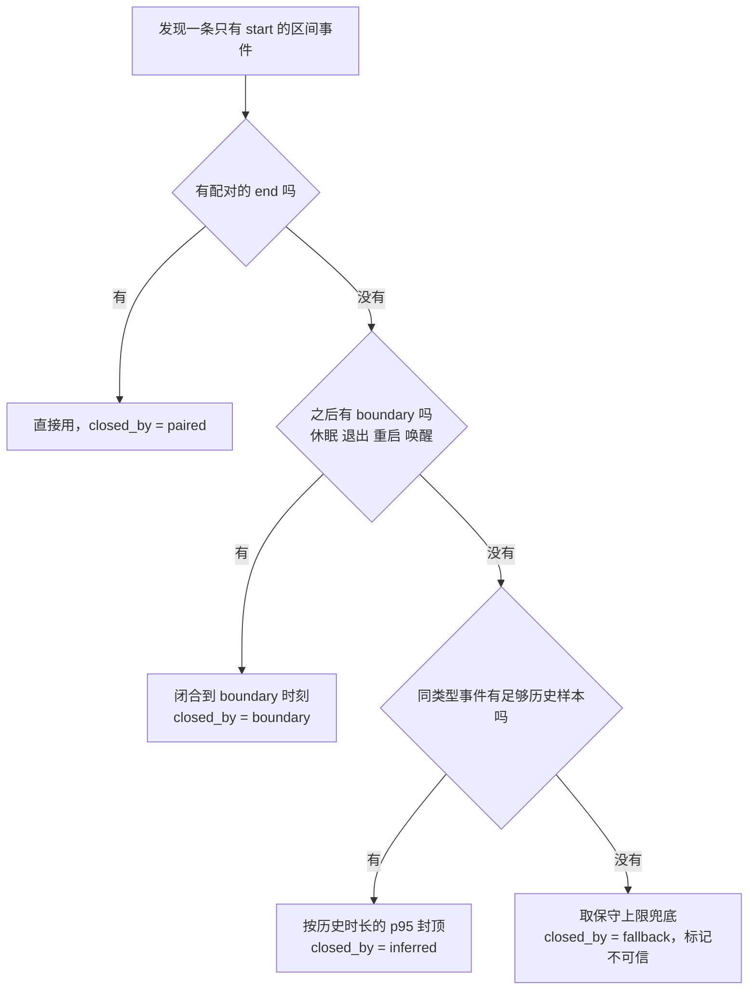

三条硬规则：

时长上限保护：任何闭合出来的区间不得超过它前面的 boundary，也不得超过 24 小时。越界就是异常，截断并打标。
重叠修复：同类型的新 start 出现在前一条 start 之后却缺 end，说明前一条被异常中断，前一条闭合到新 start 前一刻，标 `superseded`。**只在「前一条仍缺 end、靠估计闭合（inferred/fallback）」时生效；已有实据的 paired/boundary 不与后来的重叠区间互相截断**（见下方「闭合规则的取值」）。
精度如实标注：`paired` 精确、`boundary` 基本可信、`inferred` 与 `fallback` 是估的。助手用到估算值时必须说明这是估算。

两个兜底：

排序必须有 tie-break，用 `(occurred_at, received_at, event_id)` 三级排序。本地时钟回拨会让 occurred_at 乱序。
重复上报的 start 靠 event_id 去重；同一业务键出现两条不同 event_id 的 start，视为意外重复，只保留最早一条。

**闭合规则的取值（2026-09-27 定，进 `rule_version`；以后有问题再调）**：

- **`pair_id` 两套写法都要认**（服务端两端预分配 event_id 互指、客户端用一条共享 UUID），且**必须回查对端 event_id 真的在库**才算 `paired`——服务端是先把 `pair_id` 填成对端、对端可能永远不来（进程被杀），`pair_id` 非空 ≠ 有配对。
- **boundary = 只认显式 `system.boundary`**。休眠/唤醒/进程启动由客户端各补发一条 `system.boundary`（P10 已实现），生命周期事件（sleep/quit/launched…）不当边界，避免边界判定含糊。
- **inferred 门槛**：同类型已配对的区间 **≥ 5 条**才取 p95；不足走 fallback。
- **p95 窗口**：**全历史同类型 paired 区间**（events 本身 90 天滚动，实际≈近 90 天）；不另设窗口参数。
- **fallback 保守上限**：**5 分钟**。宁可低估不虚报——它已标不可信，读者知道不宜采信。
- **superseded 优先级**：**superseded 只对仍悬挂的闭合（inferred / fallback）生效**——paired / boundary 是有实据的闭合，即使与后来的同类型区间重叠（并发工具调用、后台 LLM 调用天然重叠）也不抢、不截断，否则会丢掉真实配对的 `end_event_id`。对仍悬挂的前一条，其闭合结果晚于同类型下一条 start 时改判 superseded（end = 新 start 前一刻）。
- **superseded epsilon**：**1 毫秒**（end = 新 start.start - 1ms），区间严格不重叠。

### 3.5 流式对话怎么记

助手的一次回复不是"一个点"，而是一段过程，所以不用"收到消息"这种命名：

- `chat.turn.started` / `chat.turn.ended` 表示一个来回。turn 的 duration 就是"你等我多久"，是硬指标；结束时带 outcome，区分是你打断、网络断还是正常完成。中断的 turn 正好接上"窗口打断后处理"那套设计。
- `llm.first_token` 记首字延迟；`llm.call.ended` 记整段耗时与 token 数。生成过程中的逐 token 不逐条落库，只留计数与速率。
- 发送的权威以服务端确认为准。本地乐观显示不算"聊过"；**未送达的发送不记事件**（没送出去就是没发生），只在客户端日志里留痕，统计一律以服务端确认为准（2026-09-26 定）。

### 3.6 幂等

两道防线：客户端生成的全局 event_id 做主键，冲突就忽略（`INSERT OR IGNORE`）；再加一个 `(type, biz_key)` 的部分唯一索引（`WHERE biz_key IS NOT NULL`）兜服务端可能重放的事件——客户端事件本地生成、不走重放，不给业务键，只靠 `event_id`。批量写入走事务加 WAL。

### 3.7 版本

起步整表一个 `schema_version`，读的时候按它解释老数据。同时在 attrs 里给每类事件留一个自己的 version 位，将来某一类事件要独立演进时，不用动表结构。

### 3.8 以后加新事件的三步规矩

第一步，先问能不能复用已有 type，能加属性就别加类型。
第二步，命名按 3.3 的三段式，域不存在就新开一个域，别硬塞进相近的域。
第三步，定三件事：是点还是区间、幂等键是什么、哪些字段要能被筛选（要筛的就得是真列，不能只丢进 attrs）。

这三步走完再写代码，否则事件会长成一堆没人能查的 JSON。

## 四、采集点与分工（已定）

### 4.1 准则

看这个事件是不是所有同类操作都必须记。是，就埋在执行路径的必经之处（中间件、调度器、仓储层），新功能自动带埋点；只对特定语义成立的，才埋到业务或 UI 处。

### 4.2 路线：混合 + 单一入口

中间件、调度器、仓储层负责拿骨架并自动补公共字段；业务处只补语义（会话 id、工具参数摘要、结果量）。好处是覆盖面与语义都拿得到，而且"漏埋"变成可检测的问题——中间件看到有请求却没有对应事件就是漏了。代价是要维护这套约定，靠 4.7 的规范条文约束。

所有事件必须走唯一的 emit 入口，禁止直接写事件表、禁止各模块自己拼 JSON。公共字段（actor、trigger、occurred_at、schema_version、客户端身份）由入口补，调用方不许覆盖。

### 4.3 各类事件的采集点

| 事件类别 | 采集点 | 谁权威 |
|---|---|---|
| 对话与流式 LLM（turn、首字延迟、中断、token 数） | 服务端，流式生命周期在那 | 服务端 |
| 服务端工具调用 | 服务端工具调度器统一包一层 | 服务端 |
| 客户端桥接工具调用 | 服务端调度器记"派发与返回"，客户端执行侧记"执行与结局" | 结局以执行方为准 |
| 系统变更事件（文档、记忆、账单、提醒） | 服务端仓储层包一层，不在 controller 里逐个写 | 服务端 |
| 浏览导航 | 客户端浏览器组件，复用已有的"用户打开 / 助手打开"区分 | 客户端 |
| 客户端在场（窗口失活、休眠唤醒） | 客户端 App 层，订 `NSWorkspace.shared.notificationCenter` | 客户端 |
| 输入强度（只计数：时长、字符量分档、是否删过） | 客户端 App 层，`NSEvent` 本地监听；不需要系统权限，也只覆盖本 app 窗口 | 客户端 |
| 用户显式动作（确认、忽略、删除、保存、重试） | 客户端 UI 层 | 客户端 |
| 系统 boundary | 客户端与服务端各自的进程启动、唤醒 | 各自 |

同一件事只由一方记权威：人的动作归客户端，系统执行归服务端。交叉处不算重复——你点发送时，客户端记一个动作事件、服务端记一个 turn，本来就是两件事，靠 parent_event_id 连起来。

桥接工具的两个注意点：服务端视角的耗时含排队与网络，客户端视角的才是真实执行，两者都留、不许混成一条；两边的失败判定会打架，所以命名上区分"派发与返回"和"执行与结局"，终局只认执行方。

浏览统计口径：默认只算 actor=user 的停留时长，助手替你打开的页面当上下文——那种页面你可能根本没看。若你在助手打开的页面上接手操作，那一刻已有信号可依——在该 tab 里的导航会记成 `browser.nav.started`（`owner=user`），焦点切换会记成 `component.focus.*`；不再另设字段。

### 4.4 客户端身份与环境

带 `client_instance_id`（进程启动时生成）、`client_build`（构建号）、`schema_version`，系统版本顺手带上。

构建号不引入完整的语义化版本流程，单调递增或直接用短 commit hash 都行，成本近乎为零。它只解决一个问题：将来看到一条老事件，能反推出自哪版代码、当时字段长什么样。同机多实例（dev 与 prod 并行）必须靠实例 id 区分，否则基准日回放当场翻车。

### 4.5 失败处理

写入保持 fire-and-forget：**本地写盘失败不重试**（服务端没收到不算写盘失败，那种情况由 5.2 的补投负责）。写盘失败一次就累加计数，并写一条日志，记录失败次数、最后失败原因、最后失败时间。日志单独一个文件，不混进主日志。不做界面提示。

这里有两件事别混：数据保全靠"本地小队列 + 下次启动补投"，归第五节；失败计数是监控。埋点坏了要能看见，但不需要为它做可靠性执念。

### 4.6 埋点不得做的事

不进业务事务，埋点失败不影响业务功能；敏感信息禁止进事件（URL 里的 token、剪贴板、输入内容）。

### 4.7 AGENTS.md 要写进去的条文

**条文以实施篇第九节为唯一版本，本节不再重复维护**（2026-09-26 定，免得两处清单各写各的）。那边是八条，其中"读取代码只能走读取接口"与"事件表不得添加派生列"两条是本方案新增的。

### 4.8 前置改造点（2026-09-26 核实后修正）

**结论改了：不是"改协议"，是"补两个字段"。** 桥接这条链路本来长这样——服务端 `POST /api/chat` 走 SSE 下发，客户端执行完 `POST /api/chat/tool-result` 回传；回传入参只有 call_id / result / error 三个字段。而下发的 SSE 事件外层只有 type 与 content 两个字段，**content 是一段自由 JSON**：服务端往里加字段、客户端忽略不认识的键，天然向后兼容，连版本协商都不需要。所以不存在"协议表达不了自定义字段"的问题（原判断基于"强类型 struct 不能加字段"，那个前提不成立）。

真正缺的是两个上下文：**conversation_id 与 turn_id**，在构造 `client_tool_call` 的 payload 处一并带上（那个 payload 现在是 call_id / tool_name / arguments / result_budget_bytes / timeout_secs / mode / owner 七个键）。不补这两个，客户端在全新会话的首轮拿不到会话 id（本地那个值是空字符串，要等本轮结束才回填）、也拿不到稳定的消息 id（流式期间是哨兵值 `__streaming__`），于是这一轮里所有客户端子事件都挂不上会话与轮次，事后补不回来。

两条口径：

- **只在 `client_tool_call` 里带，不铺到每条 SSE 事件。** 只有"助手派给客户端干的活"需要知道会话与轮次；用户自己点开的导航、在场心跳本来就是根事件。万一某条导航确实属于当时那场对话，靠 6.3.2 的 time_window 事后挂上。
- **turn_id 定义成"一次助手回复周期"，不是"一条用户消息"。** 助手主动搭话那一轮没有用户发言，按用户消息定义就会漏（正是 6.3.3 那个坑）。由服务端开始处理一次回复时生成。

客户端子事件上因此同时挂两个键，用途不同：**call_id 用来填 `parent_event_id`**（精确到那次工具调用），**turn_id 用来归组**（这一场对话的这一轮）。两个都要，不能只留一个。

**改造面比"加两个键"大（2026-09-26 复核修正）**：客户端的 `clientToolCaller.Call` 签名里现在既没有 conversation_id 也没有 turn_id，全库也还没有 turn 这个概念。实际要动四处——① 在服务端定义 turn（生成时机、生命周期、随什么传递）；② orchestrator 到 `Call` 的穿参链；③ payload 构造；④ 客户端解析。第 ① 处要先在设计上把边界定死：**后台任务（trigger = batch / schedule）没有 turn，那类事件的 `turn_id` 明确为空**。

**turn 规格（2026-09-26 定，补 4.8 第 ① 处的边界）：**

- **一次 turn = 一次 `/api/chat` 请求**：从入口进来到最终结果返回服务端为止；中间的多次 LLM 调用、多个工具调用全算这一轮，共享同一个 `turn_id`。
- **生成点在 agent 层，不在 HTTP handler 里**。落成 `agent.StartTurn(ctx, convID, trigger, parentEventID) *Turn`（内部生成 turn_id、发 `chat.turn.started`；返回对象带 `Finish(outcome)` 发 `chat.turn.ended`）。`/api/chat` 只是调用者之一——将来主动搭话的调度器调同一个入口，这就是不返工的全部代价。`RunRequest` 加 `TurnID` 字段，`clientToolCaller.Call` 加 `turnID` 形参，一路穿到 payload。
- **父**：`/api/chat` 这一轮的 `chat.turn.started` 父 = 入口落的那条 `chat.message.sent`；主动搭话那一轮无父，是根。
- **subagent 继承父 turn_id**；后台 worker（trigger = batch / schedule）没有 turn，`turn_id` 为空。
- **outcome 映射**：正常跑完 = `completed`；用户点停止（`/api/chat/stop`）= `cancelled`；抛错 = `failed`；`interrupted` 保留但基本用不上——**客户端断线不构成 turn 终态**，因为运行独立于请求连接（`runCtx` 不随 Request.Context 取消，断开连接不终止执行），服务端还在跑，turn 照常 `completed`。

## 五、写入协议与存储（已定）

### 5.1 量级：所有决策的地基

一天 1000–2000 条、0.5–1MB，一年 200–300MB。SQLite 足够，不分表、不引 DuckDB、不为性能做任何特殊设计。

### 5.2 两条写入路径

**客户端**：事件一产生先落本地按行追加的 jsonl 文件（崩溃安全、搬完可整段删），后台批量搬运到服务端，服务端返回确认后再删本地文件。因为 event_id 幂等，重复投递无副作用，本地再多留一天作兜底。这条路径同时承担"服务端没启动时"的离线缓冲——这也是它必须存在的原因：客户端的事件要跨进程才到得了事件库，而服务端不保证一直活着。

现成可复用一半（2026-09-26 核实）：客户端的 `LogFileWriter` 已有完整调度骨架——内存缓冲、50 条或 5 秒先到先刷、JSONL 行式追加、1 MB 轮转、保留 3 份历史、App 失活时强制刷写，抄它就行。两处不能照搬：它落在 `Caches` 目录（系统会清理），事件缓冲必须落 `Application Support`；它的条目是固定五字段的日志格式，事件要自带 schema。上传、重试、ack 三样完全没有，是全新代码。

**服务端**：事件产生在 GoServer 进程内，与事件库同进程，中间没有传输环节，直接走有界 channel 批量入库，**不做落盘搬运**。理由：给它加一层落盘只是凭空多出第二套写入路径、第二套幂等、第二套清理逻辑，换来的只有"进程崩溃时最后那一秒的事件"。想少丢就压缩崩溃窗口——队列小、刷得快（1 秒或 100 条先到先刷，一批一个事务），并在关键里程碑（turn 结束、工具调用结束、写入动作完成）立即 flush。

### 5.3 背压

队列有界。满则丢最旧的并计数，绝不阻塞业务，也不要无限队列——写到一半 OOM 更糟。

### 5.4 库的边界与独立 events.db

**模板照抄，库不共用**：仓库里已有的 `llm_call_io`（审计表）就是这个形状的现成模板——字段里已经带了 user_id / conv_id / ref_type / ref_id，索引是 created_at、category+sub_category、conv_id。**字段与索引照抄它，清理写法不要照抄**（它那条 `.Limit(n)` 被 GORM 静默忽略，见附表 B 的警告框），库也不与它共用。

**分库原则（2026-09-26 补充）**：换到 SQLite 之后，"独立库"就是一个独立文件，成本只剩连接与建表——不再是 MySQL 时代那种"要另起实例、另配权限"的事。所以"哪个表住哪个文件"从一个部署问题降级为纯物理布局，按**数据的生命周期**分即可，不按业务模块分。判据一句话：**能整体丢弃、能滚动删的进流水库；丢一个字节就出事的进主库**。

未来可以考虑搬进独立库的：`llm_call_io` 这类审计流水（含 prompt 内容，只留 7 天）、monitor 的历史快照。但**别一次拆三个库**——SQLite 多文件之后，每个文件都要单独养三件事：备份（dump 现在只认主库，已定把 `events.db` 一起纳入）、磁盘清理、连接与建表迁移。"能搬"不等于"都该搬"，判据仍是保留期与可丢弃性。本次只拆 `events.db` 一个。

顺带一条：WAL 是按库文件独立的，所以"高频 append 不争抢主库 WAL"在 SQLite 下是真正的物理隔离；MySQL 里同实例的不同库共享同一套日志与缓冲，隔离得另起实例，这是两个时代的差别。

**独立 events.db**。理由：隔离高频 append 对主库 WAL 的争抢；不拖慢每日的 iCloud dump；可单独清理或整体丢弃（丢了不伤业务数据）；schema 独立演进；权限边界清楚（物理文件独立，助手只能通过聚合接口读）。代价是不能跨库 join——但第五组的串联本来就在应用层算，不靠 SQL join。

**部署形态（2026-09-26 已定）**：只采本地实例，不采云端——`events.db` 只存在于本机（本机真实库走 `APP_ENV=local`，路径 `xhanHelper`；dev 沙盒走 `APP_ENV=local.dev`，路径 `xhanHelper-dev`），事件由本机服务端产生与落库；云端 `APP_ENV=prod`（`main` 分支 / 阿里云）在配置里把采集开关显式关掉。若将来又跑在远端，那等于换了一台采集器，历史不连续。

### 5.5 索引与幂等

主索引 `(occurred_at, type)`，因为绝大多数查询是"某天某类"；辅助 `(type, occurred_at)` 支持按类看时间分布。event_id 主键 + `(type, biz_key)` 的部分唯一索引（只对有业务键的事件生效，见 3.6 与附表 B）。refs 与 resources 是多值，走关联表 `(event_id, ref_type, ref_id)`，不许塞进 JSON 当索引使。attrs 一律不建索引。

### 5.6 批量与事务

批量 **1 秒或 100 条先到先刷，一批一个事务**（与 5.2 的队列 drain 是同一个参数）；WAL 配 `synchronous=NORMAL`；查询一律按 occurred_at 排序，不依赖自增 id 的顺序；客户端与服务端同机同钟，不做时间校准。

### 5.7 保留期

明细滚动保留 90 天，先不建聚合表——摸清实际数据量再定。注意 90 天是硬删除、不可逆，"去年同期在干什么"这类长期回顾届时查不到；若将来需要，再加按天聚合的摘要表，聚合前先确认口径够用。

### 5.8 事实与派生分离（对第三节的修正）

events 表只存原始的开始与结束，不含 `duration_ms` 与 `closed_by`；二者移入派生表 `interval_closed`（见 3.1）。派生表可随时清空重算，事件永不修改。这条同时是第五组"解释层可重算"的地基。

## 六、派生与串联（已定）

### 6.1 归一与主数据（已定）

原则：**归一在写入时做**，事件一入库就带规范 id，同时保留原始值一列。理由有三：查询时归一等于每次读都放大一遍，再叠统计基本跑不动；规则一定会变，写入时归一改规则只需重跑归一，不用动所有查询；查询端只认一个值，SQL 简单。

主数据的作用像通讯录：仓库、网页、文档、记忆、会话、主题各有一个稳定 id，别名表记录所有见过的写法。不归一的错误特点是**静默**——数字看着都正常，只是被拆成两三份，不去核对发现不了。

各域的锚：

| 域 | 规范锚 | 说明 |
|---|---|---|
| 仓库 | 优先 git remote 的规范化 URL（ssh 与 https 归一成同一形态、去 `.git` 后缀、host 与 path 小写）；没有 remote 就用仓库绝对路径（家目录前缀折叠成 `~`），并允许人工重绑 | 今天同一仓库在机器上就并存 `xhanHelper` 与 `xHelper` 两种写法 |
| 网页 | RFC 3986 的语法级归一 + 跟踪参数名单（可直接抄 ClearURLs 这类开源规则集）：小写 host、去默认端口、去 fragment、删 `utm_*` / `fbclid` / `gclid` / `xsec_token` 等、参数排序、去末尾斜杠 | 小红书链接带 `xsec_token`，不归一一条笔记会变成几十个 URL |
| 文档、记忆（笔记已并入）、会话、提醒、账单 | 直接用系统内已有 id | 标题只作别名，改名不断链。本方案不把主题（theme）当归属锚；记忆自带 topic，但 topic 可变，不当锚用（见 6.3.1） |
| 文件 | 仓库内：仓库锚 + 仓库内相对路径；仓库外：绝对路径。辅助标识可用 macOS 的文件系统标识（`fileResourceIdentifier` / `st_dev` + `st_ino`），能扛改名与同卷移动，跨卷复制会变，所以只作辅助 | 相对路径天然去掉 cwd 与机器差异 |
| 第三方实体（issue、视频、笔记） | 归一后的 URL | 与网页同规则 |

分层执行：**客户端只做最小脱敏**（剥掉 token 类参数）后上报原始值，**服务端统一归一**。理由是客户端发版成本高、规则变动频繁，归一规则只该存在一处；而脱敏必须在离开客户端之前完成，否则敏感串已经进了链路。

别名与重跑：每个规范 id 保留 raw 原始值一列，别名表记录历史写法；归一规则版本化，改规则后按版本重跑，不手工修补。

### 6.2 时间与在场（已定）

**模型：嵌套区间。**在场不是一条时间线，而是层层套叠的区间，共五层：

- L0 机器醒着——sleep / wake 是硬边界，app 还活着不代表你在。
- L1 app 进程存活——launch 到 quit。
- L2 前台窗口活跃——`didBecomeActive` / `didResignActive`，原始信号，精度最高、噪声也最大。
- L3 注意力期——切进来到切出去，L2 去抖之后那个"人能理解"的单位。
- L4 组件期——浏览器、文档、聊天面板各自的打开与失焦。

两条结构判断：

**L2 与 L3 不是两套机制，是同一套算法加一个参数**（防抖等于 0 就是 L2）。所以五层全算，成本只体现在"L2 的边界事件要不要落库"上——必须落库，它是其他层的原料，不落库就没法重算。

**同级区间允许重叠。**浏览器和聊天可以同时开着，L4 的兄弟区间会互相重叠，所以这不是严格的树，而是"区间集合 + 包含关系"。这也是"事实层允许并发"的具体体现。

**包含关系不进事实层。**事实层里必须存的边只有因果（`parent_event_id` 与 call_id 链路），因为那是真发生过的事；包含只是时间套叠，属于派生。实现上在派生时算出 `parent_id` 写进 sessions 表——查询一个 join 搞定，一天几千条的量级下重建整棵树的成本可以忽略，关键是该表所有字段都标记为可重算、可清空。

**采集端只采两条原始信号流**：前台激活与失活、组件可见性与焦点切换。五层全部由派生算出，想只算到 L2 就不算 L3，防抖阈值随时改、随时重跑。

**三个尺度分开，统一进 threshold_version：**

| 阈值 | 取值 | 管什么 | 为什么是这个数 |
|---|---|---|---|
| 焦点防抖（L3） | **上线初值 0**（等于不防抖，先收集真实分布），校准后预期落在 30 秒附近 | 一段注意力有没有被切成碎片 | 取 0 会把切出去拿外卖也算切段，一天几十个碎片；取 60 秒会把"去干别的整整一分钟"合进来，夸大专注时长 |
| 注意力断没断 | 5 分钟 | 注意力期 | 离开倒杯水不算断，趴桌上眯一会儿算断 |
| 坐下来的这一段结束没 | 15 分钟 | 在场 session | 沿用现有数值，与注意力期是两个问题 |
| 对话后处理 | 15 分钟（维持现状） | 对话层，跟上面几个不同尺度 | 已在用、体验校准过；只需登记进 threshold_version，避免以后与注意力阈值混用 |

**阈值校准不靠人工核对**：先上线收集真实分布，再用分位数定夺。派生层输出一个校准视图（切出时长的分位数），让人看数，而不是逐条对账。

**原始标记（epoch）写进事实层。**边界事件开区间，边界处顺手生成一个 epoch id 写进后续事件。这些是采集时就有的事实，不是算出来的：

- 进程启动 → `launch_id`（L1 的归属直接靠它，不必按时间推断，进程连续重启也不会串）
- 前台激活 → `focus_epoch_id`（L2 的原始区间，也是 L3 消歧的依据）
- 组件打开 → `component_instance_id`（L4 的归属）
- 唤醒 → `wake_epoch_id`（L0）

**session 归属不进事实层。**上面说的是"事实层写什么"，这里说的是"派生结果放哪里"，两根轴不冲突。三种存法：

| 做法 | 怎么实现 | 好处 | 代价 |
|---|---|---|---|
| 查询时现算 | 事件按时间与其 session 区间做包含匹配 | 事实层最干净、零冗余 | 每次查询多一次 join |
| 派生时物化映射表 | 建 `event_session(event_id, level, session_id)`，重算时整表重建 | 日常查询一个 join 搞定 | 多一张表要维护，字段必须全部标记为可重算 |
| 事件表直接加五个字段 | `l0_session_id` 到 `l4_session_id` | 查询最快 | 等于把派生结论写进事实层，阈值一改历史全错；服务端事件不知道自己属于哪个组件，只会得到一堆 NULL |

选第二种：查询端天天要用，让它快，重算成本在离线摊掉。第三种明确不采用。

**L1 的三个精度。**区间另一端经常缺（崩溃、强杀、断电都没有结束事件），所以 L1 也会有悬挂区间，靠 3.4 的规则闭合；落在 L1 里不等于你在（机器睡了进程还活着，L1 跨过去而 L0 断了），归属要按层看，一个事件同时属于 L1、L3、L4 是正常的；L1 因为有 `launch_id`，是唯一一层完全不需要时间推断的。

**另外两项属于本节的派生计算**：区间闭合——按 3.4 的规则生成 `interval_closed`（表结构见第五节）；并发度——同一时刻有几条区间处于活跃的派生指标，用来区分"很忙"和"同时干三件事"。

### 6.3 归属与因果（部分已定）

#### 6.3.1 ref 的挂法与筛选（已定）

**一条事件可以挂多个 ref，全部照挂，写入时不圈定唯一归属；筛选留给查询端。**

为什么不能只挂一个：一条事件常常同时属于两件事。今天 17:46 那条小红书浏览就是例子——它同时属于"当时那场对话"（时间窗推断）和"信息流"（域名判定），提前圈死哪个都错。

为什么也不能把"主要归属"做成字段：正确的主归属随问题变化。问"今天跟助手聊了多久"要用对话那张标签，问"今天刷了多久"要用信息流那张标签。同一份数据，分组键取决于提问。

实现：`event_refs` 允许多行（多对多），每行带 `source`（explicit / time_window / resource / semantic）与 `confidence`；不设 primary 字段。读取接口用参数指定按哪一层当分组键。

**ref 的类型与记忆的挂法（已定）**：ref_type 共五类——会话、记忆、计划、提醒、子任务。本方案不再把主题（theme）当归属锚（用户 2026-09-26 表示准备废止该对象，是否彻底废止由记忆系统那边定，见 6.4），归类职能由记忆的 topic 承担，所以挂载一律用 `memory_id`：**事件只挂 memory_id，绝不挂 topic 字符串**。理由是 topic 的合并与改名是常态（受限创建、相似即同 topic），字符串一改，历史事件全部静默断链——正是 6.1 那条"改名不断链"要防的错。topic 只在查询时沿 memory_id 反查当前值，当聚合维度用。

**要接受的代价**：同一批事件按不同维度分别统计时**不可相加**。17:46 那一分钟既算进"聊天时长"也算进"信息流时长"，两个数字各自成立，加起来会大于当日总时长。视图层必须写明这一点，否则每次对账都会以为是 bug。

**已放弃的方案**：设一个按具体度降序的 primary 字段（子任务 > 计划 > 提醒 > 会话 > 记忆）。放弃的理由是它把场景依赖的判断固化进了事实层，而且去掉它也解决不了并发时的重复计时——那本来就没有唯一解。

#### 6.3.2 绑定走法（已定）

四种来源按可信度依次出场，一个比一个弱。以今天 17:46 那条小红书浏览为例，从你点开到被问出来：

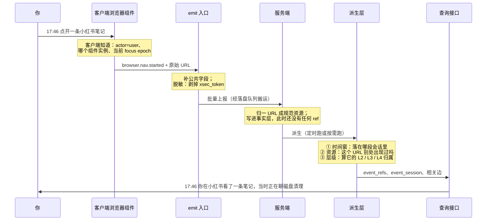

四种来源依次是：

1. **explicit**——写入端，零推测。只对"当时上下文里真的有"的东西成立：这次导航若由助手替你打开，客户端手上有那条 `tool.call` 的 id，直接填进 `parent_event_id`；你自己点开的就没有父，是根事件。
2. **time_window**——派生层第一道。17:46 落在 16:57 到 17:48 那场磁盘清理对话的活动区间里，于是贴上"这次对话"这张标签。置信度高，但切换瞬间的事件边界有歧义。
3. **resource**——派生层第二道。用归一后的资源判断共享性来建边。比时间窗硬，缺点是会漏：同一件事完全可能不共享任何资源。
4. **semantic**——派生层最后一道，唯一需要模型的一步。用语义相似去捞那些同时间、又不同资源的关联，能捞起"讨论与产出文档"这类；但误报率高，必须带 confidence，产出只能叫候选。

落库之后，这条事件在数据里的形状：

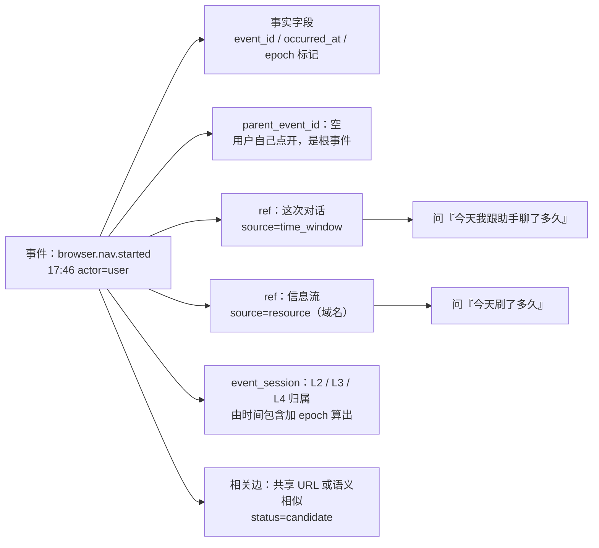

R1 与 R2 并存，谁也不压谁——这正是 6.3.1 定下的"多挂、查询时再筛"。

#### 6.3.3 parent_event_id 的必填范围（已定）

**规则**：能被某个动作直接触发的事件必须填父；其余必须为空。空的语义只有一个——"这是个根事件，天然没有父亲"，绝不表示"该填但漏了"。

**怎么让它不靠人记**，两个机制：

- emit 入口自动填。运行时维护"当前触发源"上下文：处理用户一条消息时，把那条消息的 event_id 放进去；发起一次工具调用时，把 `tool.call` 的 event_id 放进去。入口投递时看上下文有没有值，有就填、没有就空，调用方不做判断。
- 事件字典加一列。每个 type 登记时必须声明自己属于"根类型"还是"必须有父类型"，入口按表校验，违反就拒绝并计入失败计数。于是"忘了填"从静默的空变成可检测的错误。代价是每个新事件多填一格，属于 4.7 那条纪律的延伸。

**必须填父**：由某个动作直接触发的事件——工具调用、子任务、助手代劳的写入动作、助手替你打开的浏览。**助手主动发起、没有触发源的算根**（典型是助手主动搭话的那一轮 turn）。
**必须为空**：用户显式动作、你自己点开的导航、客户端在场事件、系统 boundary。

**因果与配对要用两个字段。**区间事件的"结束"那条不能用 `parent_event_id` 指向"开始"那条——因果和配对是两套语义，混用一个字段，以后每次查因果都得先按 type 过滤，迟早出错。配对归 `pair_id`，`parent_event_id` 只留给因果。

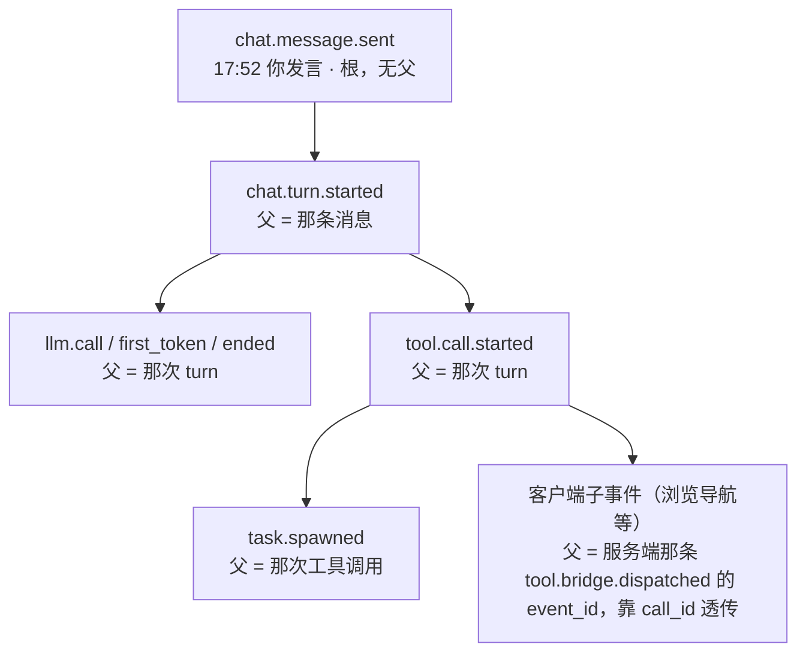

根事件那一侧是一小片森林，谁也不指向：

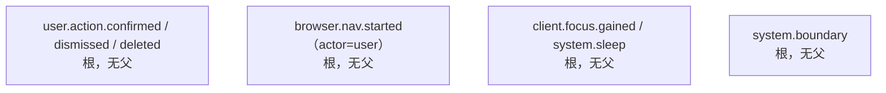

**用户发言算根（已定），推演如下。**

`parent_event_id` 只有三个用途：从产物反查源头、从源头向下展开、按父分组计数。差别只在第一个。

反查源头：文档 → 工具调用 → turn → 你那句话。"发言算根"到那句话就停住，而这正是要的答案；"挂在会话开始下"还要再爬一层到"会话开始"，那层没有任何内容、信息量为零，而且让因果链说出一句假话——会话开始触发了你的发言。
向下展开与按父分组计数：两种方案无差别，分的是第一层父。

真正的差别是结构性的：挂在会话开始下会让"会话"有两条路径可达——既在 refs 里，又在父链上，写查询的人每次都要判断该用哪条，不一致就是 bug 的温床。"发言算根"保持一条干净分工——**父链只回答因果，归属只走 refs**。

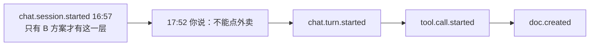

还有一个场景暴露得更彻底：助手主动搭话。那时你还没说过话，没有会话开始事件，要么造一个假的，要么让它变成孤儿。"挂在会话开始下"暗含一个假设——所有对话事件都从用户发言派生，而这个假设不成立。

代价也说清：发言算根会让树变多变小（一轮对话一棵，而不是一场会话一棵）。想要"一眼看全局"时大树确实更顺眼，但展示层可以用会话归属去折叠，不必为此污染因果语义；而且"会话开始"本身还需要定义（打开 app 算，还是第一条消息算），配上下一条 15 分钟结束规则，又是一套边界要维护。会话这个对象自己带 `started_at` 就够，不需要靠事件来定义。

**定时与批处理触发的事件**（已定）：有调度事件就挂在它下面，没有就算根。
**跨进程**：客户端子事件的父是服务端那条 `tool.bridge.dispatched` 的 event_id（call_id 就挂在它身上），靠 call_id 透传，改造面见 4.8。

#### 6.3.4 弱关联边（设计已定、实现延后）

**优先级（已定）**：这是效果优化项，不是地基。原始需求里的"跨源聚合"靠资源锚就能满足，语义相似只是加强版。三层排序——必需的是事件采集、资源归一、session 层级、按时间与资源与类型的聚合查询、因果边；值得做但可以晚的是归属 ref 的自动绑定与按 topic 归类；纯优化就是本节这套以及日报周报。往后放的两条理由：收益依赖数据积累（现在没有真实误报，阈值本质上还是拍的）；这件事可以搬到读取端现场做（助手本来就有语义能力，也知道当时问的是什么），代价只是同一问题两次结论可能不完全一致，而对"了解今天干了什么"这个用途，一致性要求不高。实现清单见 6.3.5。

**它是什么。**两条（或两组）事件之间没有谁触发谁、也没有共同的归属容器，但属于同一件事。系统只能猜，所以叫"弱"；产出只能叫候选，不能叫结论。今天几组真实场景：

- 跨时段跨源：上午 05:33–11:42 的 openmuse 调研，与晚间 18:31–20:16 的记忆主题词云。没有因果、不在同一场会话，但同属"xhanHelper 能力演进"。
- 同一天的痕迹：17:23 改 `FaviconStore.swift`，与当时顺手搜的"favicon 缓存"。谁也不触发谁，只能靠资源与语义判断在查同一个问题。
- 跨天：今天刷的小红书笔记，与三天前同一位博主的另一条，靠"持续感兴趣"连上。
- 误报长什么样：晚上刷到一条"某 AI 助手推荐"，语义上跟 openmuse 沾边，被连进上午那串，于是得出"今天在调研 AI 助手竞品"——半对半错。**连少了只是记不住，连错了会污染结论。**

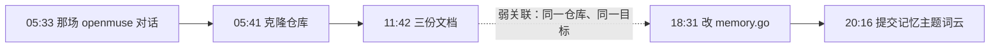

**三条路径，按成本从低到高，优先级也照这个排：**

1. **资源集合**（主力）：判断两块是否共享归一后的资源，是集合运算，零成本、零误报、不需要阈值。今天上午与晚间那两坨共享同一个仓库，这一条就够把它们连上。
2. **块比记忆**（第二位）：把事件挂到已有的长期对象上，支撑"这件事最近有什么进展"这类提问。复用记忆系统（笔记已并入记忆、自带 topic，按 topic 就能拉出相关事实列表），不新建对象。
3. **块比块**（降级为补漏）：只在"什么资源都不共享、但明显是一件事"时才用，触发条件是读取端问不出来。它要走向量与阈值，是三条里最贵、也最容易错的。

**"块"不作为持久化的表存在。**它是读取层下钻接口的现场产物加缓存，不是采集系统的职责，也不需要判断"这组事件结束了没"——需要摘要时那段早已结束。

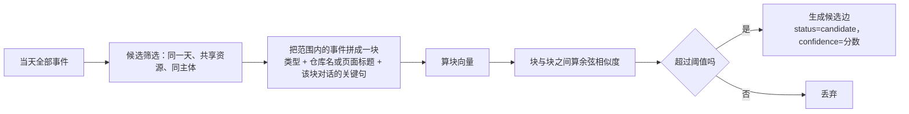

**比较对象是"块与块之间的余弦相似度"这个数字**，不是每条事件各算一个相似度。两个理由：数量级——今天约两千条事件两两比是两百万对，切成六到十个块之后只有四十几对；文本质量——心跳、焦点切换这类事件拼出来的文本算向量等于抽签，没有语义可言。短文本事件（导航、保存）不单独向量化，把它的标题与类型拼进所属块的代表文本里一起算。

**块的代表文本决定一切**：必须是"在 xhanHelper 仓库深挖源码与 issue"这种可读的东西；写成"browser.nav.started 若干条"的话，后面所有阈值都失去意义。

**阈值不拍数**：复用 2026-06 那套评测方法——在线旁路采样，把候选块对喂给裁判 LLM 标"是不是同一件事"，得到 ground truth，再看不同阈值下的准确率与误杀率，数据锁死后可重放对比。

**记否定**：每条边带 `status`（candidate / confirmed / rejected）。难点在重算——重算会重新生成候选，所以否定必须当负样本参与过滤；而且不能只记"这两条不相关"，还要覆盖相似度接近的邻居，否则同一批误报会反复出现。

**分层**：采集层只写事实，绝不调 LLM；块与边的生成属于解读层，可重算、可失败、可重跑；读取层只拿原料与筛选器，不拿系统提前定死的结论。

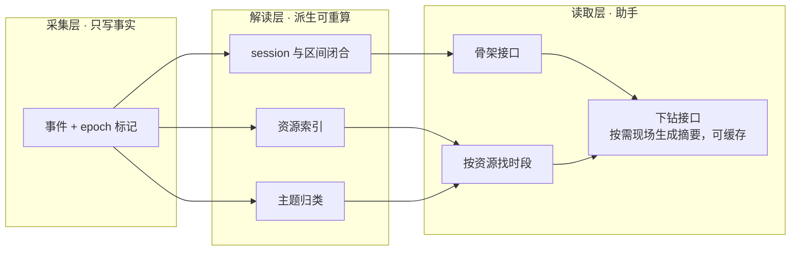

**读取端实际怎么用**（三条路径的优先级就是从这儿推出来的）：先要骨架——每小时条数、来源与类型分布、资源去重清单、session 列表；再定点下钻某一段；再按资源找时段（"xhanHelper 这个仓库今天涉及哪些时段"）。系统给原料和筛选器，不替使用者预先定死"这是一件事"——每次提问的角度不同，按问法现场聚合更准。

#### 6.3.5 未来再做

不在 v1 的实现范围内，等系统跑起来、积累真实数据之后再逐条定。

**弱关联边的实现清单（七项）**

1. **边指向什么**——块不落表则边没有两端。倾向：两端存代表事件的 `event_id`，边上冗余存时间范围与主资源；代表事件按"块里信息量最大的一条"选，规则必须定死，否则重算时边会跟着飘。
2. **自动切块规则**——倾向"主资源变化点切块，session 作为上界"。
3. **代表文本由谁写**——相似度计算只用规则拼出的确定性文本；模型生成的一句话摘要只用于展示、不参与算分，否则向量不稳定、阈值校准不可复现。
4. **共享资源的粒度**——细粒度资源（具体文件、具体 URL）共享算强证据；只共享仓库锚算弱证据，需叠加时间邻近或主题相同才算候选。
5. **向量的存放与版本**——复用现有 embeddings 表还是新建；embedding 模型版本必须与 threshold_version 并列留痕，换模型等于换向量空间。
6. **否定的存储与泛化**——否定就记在 `event_edges.status=rejected`（两端 + 时间 + 原因），重算时当负样本过滤；泛化先只做"同一对永久否"。
7. **调度与成本**——每天离线跑一次，只比对当天新增块与最近几天的块。

**日报与周报**：离线批量预生成"块"与当日叙事，日报再汇总成周报。届时再决定要不要把块落成持久化的表。

### 6.4 分组：把事件聚成"一件事"（已定）

**分组骨架只用三样：会话、资源、时间。**

- 会话：天然的分组容器，一场对话里的动作多数属于同一件事。
- 资源：跨源、跨时段合并的主要依据——同一个仓库、同一份文档、同一个 URL。
- 时间：邻近性作为合并条件与兜底。

**语义补充不写进派生规则，挪到读取端。**理由与 6.3.4 相同：派生层要保持确定性与可重算，语义打分不稳定；读取端本来就知道提问角度，现场补更准。

**分组结果不落库（已定）**：分组是读取时的现场产物，跟 6.3.4 的"块不落表"同一个道理。骨架仍只用会话、资源、时间三样，语义判断留在现场、不写进派生规则。它的形态至少包含这几样：成员（事件 id 列表）、时间范围、代表资源（归一后的仓库 / 文档 / URL）、参与方（user 还是 assistant）、置信度、以及"是哪条筛选器把它拼出来的"（会话归属 / 共享资源 / 时间邻近）。同一批事件按不同角度问会得到不同分组，这是特性不是缺陷——问"晚上刷了多久"和问"xhanHelper 今天哪些时段被碰过"，本来就该分得不一样。

**后置标注只留一个落库的东西（已定）**：你确认过或否定过，写成边（status = confirmed / rejected）。它是唯一需要跨会话记住、且重算时要当负样本过滤的东西。AI 事后分组不改库，就是现场判断。

**与记忆、计划的关系（已定）**：不新建"一件事"对象，长期归属落到记忆上。某件事值得长期追踪，就写一条记忆（自带 topic），事件用 `memory_id` 挂上去；"这件事最近有什么进展"就是先拿记忆的 ref 筛出事件、再现场分组。"一件事"永远是查询产物，记忆和计划是长期对象，两者不在一个层面上，不冲突。6.6 原列的"一件事"视图因此取消，它就是一次"分组 + 摘要"的调用。

**为什么不再需要主题那一层（已定）**：本方案不把 theme 当归属锚。它的两个职能都有现成落点——归类由 topic 承担（记忆系统已把笔记与记忆合一，并限制 topic 创建、相似即同 topic，于是按 topic 就能拉出相关事实列表），长期追踪由记忆实体承担（写一条记忆即可）。不需要另维护"主题里的事实进展"，因为进展本来就是从事实现算出来的。**注**：theme 作为对象是否彻底废止，是记忆系统的决定；本方案只声明"不拿它当锚"。若最终不废止，`ref_type` 里给它留一个位置的开销也很小。

### 6.5 物化与重算（已定）

**两个词的定义**：物化＝把算出来的结果存下来，不必每次查询重算；重算＝规则或阈值变了，把存下来的结果整体扔掉、按新规则重跑。

**三类东西，不是两类：**

- **事实**：写入即定，永不重算。
- **派生**：可整体重算。
- **主数据**：别名表这类属于历史积累，只能增量维护，不能整体重算——"我见过 xhanHelper 与 xHelper 两种写法"这件事不能被重算掉。

**逐项处置：**

| 结果 | 性质 | 处置 |
|---|---|---|
| 资源归一与别名表 | 主数据 | 物化，增量维护，可回溯 |
| `event_resources` 资源归并 | 派生 | 物化，可整表重建（见附表 B 第 3 节） |
| `interval_closed` 区间闭合 | 派生 | 物化（下游 session 依赖它），带闭合规则版本 |
| sessions（L0–L4） | 派生 | 物化，带 threshold_version |
| `event_session` 映射 | 派生 | 物化（读取最高频） |
| `event_refs` 显式部分 | 事实 | 写入即落，永不算、永不重算 |
| `event_refs` 推断部分 | 派生 | 物化，重算时只清这一部分 |
| 每日聚合视图（直方图等） | 派生 | 物化，每天跑一次；临时分析现算 |
| 相关边 | 已延后 | 见 6.3.5 |

**存还是现算，问三个问题**：算一次贵不贵（要调模型、跑大 join 就贵）；读取端是否反复问；输入稳不稳定。贵、常用、输入稳定三者具备，一定要存；便宜又不常用的，现算更省事。

**重算触发条件**：阈值变了；规则升级（闭合规则、归一规则）；数据回填（离线补投的历史事件、修正过的原始值）；主数据变化（发现两个仓库锚其实是同一个，涉及它们的事件要重新归并）；模型换版本；人工否定变了。

**五条工程规矩：**

1. **版本号写进结果**——每条派生记录带 rule_version / threshold_version，版本对不上就当作过期。
2. **整体重跑，不做增量补丁**——量级允许（一天一两千条，稳态 90 天约 13 万条，SQLite 重跑是分钟级），增量补丁最容易留下半新半旧的隐藏不一致。
3. **原子替换**——重算结果先写新表，算完一次性换过去，别让查询读到算到一半的状态。
4. **幂等可重跑**——同一输入加同一版本必须得到同一结果。与 6.3.4 里"代表文本必须确定性"是同一个要求。
5. **重算范围按可切分性决定**——session 这类按天可切的只重算受影响那天；归一这种跨天的全量重算。

**触发者（已定）**：以定时为主节拍——每晚跑一次，读到的永远是新数据；叠加版本标记——规则或阈值一变就记一个"该重算"的标记，等下次定时跑顺带带上，不单独起进程。手动触发保留口子，只当验证手段（调完规则想立刻看效果），不作为常规路径：纯手动会带来静默错误，忘了重算没人会发现。还有第四种入口留到第七节定：读取时发现结果过期（版本对不上）就顺手补跑一次。

**切片层级（已定）**：跨午夜的 session 在 00:00 当强结束切开，一天一段，日报按午夜收口。理由是切片单元必须与"一天"对齐，否则"只重算受影响那天"没有定义。代价是那晚的"坐下来干了什么"被劈成两半、两天各见半截，接受。`event_refs` 的推断部分与 `event_session` 跟随 session 同一天切，不单独切一半，避免出现"session 换了、归属还挂在旧 session 上"的半新半旧状态。

### 6.6 聚合视图（已定）

**先厘清这些视图喂给谁**：不是给人看的看板，是读取端的第一跳原料。要求是稳定、紧凑、能被直接引用；好看、能交互、能下钻是界面那一层的事，另算。助手拿它当骨架，再决定要不要下钻到原始事件或现场摘要。

**五个视图其实是三类：**

| 类 | 视图 | 本质 |
|---|---|---|
| 分布 | 每小时直方图、来源与类型分组 | 同一张计数表的不同切面 |
| 时间轴 | 会话视图、并发与切换 | `sessions` 与 `event_session` 的直接投影 |
| 体检 | 空白与异常 | 数据可信度报告，不回答"干了什么" |

（原列表里的"一件事"视图已挪回 6.4，形态定为读取端现场产物，见那节的"与记忆、计划的关系"。）

**分布类。** 物化一张表，其余视图都是它的 group by：

- 维度：小时 × 来源 × 类型 × actor。来源直接用 type 的第一段，不新造映射表，也就不会出现"事件归了类但来源没登记"的漏洞。目前的来源枚举是 chat / tool / browser / user / doc / memory / bill / reminder / llm / task / component / client / read / system，新增域时这里跟着长。
- actor 分开计数（user / assistant / system 各算一份），否则助手代劳与批处理会被算成你的操作。09-25 14:52 清洗 8 个 topic 是脚本跑的，混在一处得出"你今天干了 24 件事"就是假的。
- 跨小时归口：计数按 `occurred_at` 归到起始小时、不摊；时长按重叠时长摊到各小时。"16 点有多少条事件"和"16 点你专注了多久"是两个指标，不合成一个数。
- 只物化到小时。分钟级的需求临时从原始事件现算，不预先存。

**时间轴类。** 读 `sessions` 与 `event_session`，不新造数据：

- 会话视图：按 L0–L4 分层列出每段区间——起止、时长、闭合方式（paired / boundary / inferred / fallback，另有重叠修复的 superseded）、活跃组件、挂到的 ref。估算的必须带标记。
- 并发与切换：拆成两个数，不合成一个。**你的并发度**只算 actor=user（同一时刻你实际在几个地方）；**系统负载**只算 assistant / system（后台跑了多少）。混起来两头失真——既高估你的忙，又让我看不见自己的负载。09-25 14:52 那批 topic 清洗是你提交代码时的后台负载，不算你的并发。
- 切换频率用 L3 注意力期的边界数量与切出时长分布表示，与 6.2 的阈值校准视图共用同一份数据，不重复算。

**体检类。** 它回答的是"这份数据可不可信"，作用是在助手开口时能标明"这段是估算的"：

- 推断闭合清单：`closed_by` 为 inferred / fallback 的区间条目与占比。占比高就说明当天数据不足以支撑细节结论。
- 空白分辨：区分离机（L0 断了）与采集断流（L1 还活着却零事件）。前者是事实，后者是故障，报的时候必须分开，否则故障会被讲成"你那天下午在休息"。
- 时钟异常：`occurred_at` 乱序、超出 boundary 或 24 小时上限被截断的区间、同一业务键重复上报的 start。

## 七、读取接口与隐私（已定）

先把整条链路摆出来，看清第六节与第七节的分工——一个负责算与存，一个负责取：

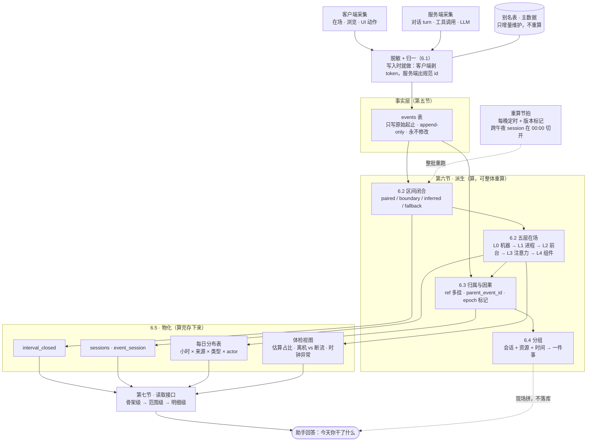

读图三处：**上下是"存"与"取"的分界**——物化层是算好放着的，读取接口是助手唯一能伸手的地方；**左右是"事实"与"解释"的分界**——events 只写不改，右边随便重算，这是重算能成立的前提；**虚线回边**是重算节拍，它只碰派生层，永远不碰 events。

一次真实调用怎么走这张图：你问"我晚上刷了多久" → 先取骨架（当晚浏览类分布，零成本）→ 见 11 条 → 范围级按资源=小红书取事件清单，每条上带着 6.3 挂的归属与 6.2 的 session → 现场拼成一块（6.4，不落库）→ 回答并附上可信度："这段属 L3 估算、闭合方式 inferred"，那句来自体检视图。

已定的东西分别落在哪：

| 定下来的事 | 在图里的位置 |
|---|---|
| 事实只写不改、派生可重算 | events 与派生层之间的分界，整套设计的地基 |
| 归一在写入时做、别名表只增量 | 脱敏与归一节点 + 别名表：在事实层入口，不在派生块里 |
| 闭合规则（四档 + superseded）、五层在场、三个阈值 | 派生层的闭合与在场，物化成 `interval_closed` 与 `sessions` |
| ref 多挂、parent_event_id、epoch 标记 | 归属与因果，同时也是读取端的分组键 |
| 分组不落库、物化清单、重算节拍、跨午夜切开 | 分组那条虚线（绕开物化直达回答）+ 物化层四个产物 + 重算节拍 |
| 三级取数、出口脱敏、读取自记、明细要卡 | 读取接口，助手唯一能碰数据的地方 |

**出口唯一。** 助手只能走这组接口，碰不到 `events.db`。接口形态是一组命名明确的小函数，参数化但不给自由查询——参数是时间范围、session、资源锚、类型与来源、actor、按什么分组。不给 SQL、不给万能 query，理由有二：通用入口等于把库直接交出去，口径会散在调用方（同一天两次问出不同的数就没人能查）；脱敏也没地方挂。

**三级取数，前两级随时取、第三级设卡：**

| 级别 | 取什么 | 门槛 |
|---|---|---|
| 骨架级 | 物化的聚合视图：分布表、sessions、event_session、体检视图 | 零成本，随时取 |
| 范围级 | 按条件取事件清单，带标题级字段（仓库名、文档标题、页面标题、工具名） | 随时取 |
| 明细级 | 原始文本摘要（工具入参摘要、页面标题全文、对话片段） | 只在范围级结果指向明确时才取；取完记一笔（谁取的、取了哪几条） |

**脱敏在出口统一做，不在调用方。** URL 的 token 在上报前就已剥掉（6.1 的客户端最小脱敏），工具入参只留摘要与长度（3.1），剪贴板从来没采过（第一节）。明细级取回的文本仍要过一遍出口检查。

**读取行为自记一条。** 事件类型是 `read.query`（read 域，来源单列一类），默认排除在"你干了什么"的统计之外（分布表按 actor 分开计数，读取事件的 actor 是 assistant）。两个用途：回答"今天问了几次今天干了什么"，以及看出哪些接口从没人用。自我指涉的噪声由"默认排除"消掉，不影响读到的内容。

**保留与删除。** 明细滚动 90 天硬删（5.7）。

下面两件已定（2026-09-26）：

1. 明细删除**不与内容对象联动**——浏览痕迹是你的行为记录，不是笔记的内容；另给一个按资源手动清的口子，保留期仍与事实同期（90 天）。
2. **不允许**用埋点核对你的自述与实际不一致（底稿第十一节第 4 条）。自述归自述，要用得你明说。

（原第三条"桥接协议能否携带自定义字段"已于 2026-09-26 核实解决：协议不用改，改成服务端在下发 payload 里补两个字段，改造面见 4.8。）
