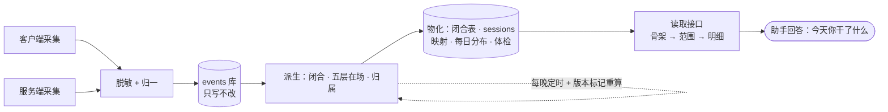
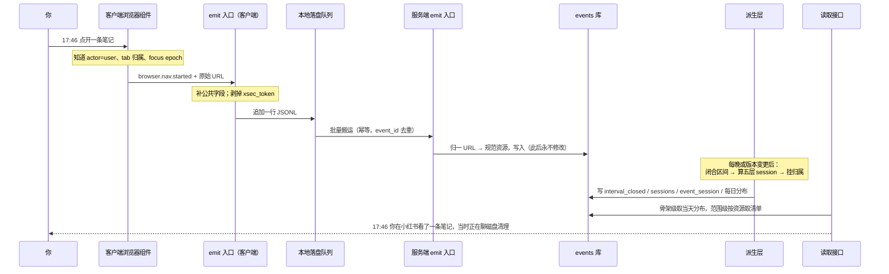
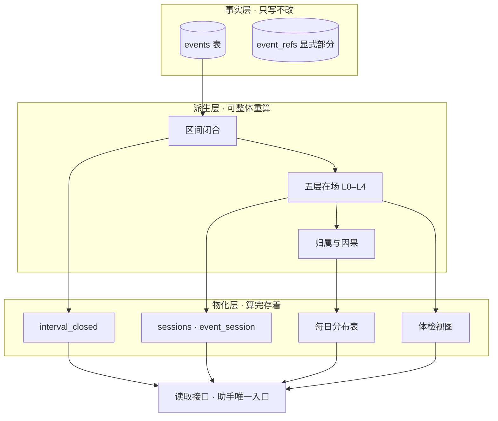
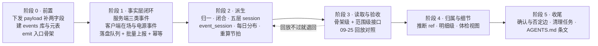
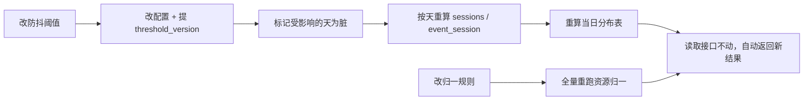

# 活动埋点系统 · 实施技术方案

> 这是**实施篇**，上游是 [活动埋点系统 · 技术方案（v1）](./活动埋点系统 · 人话版技术方案（v1）.md)（设计篇）。
> 设计篇回答"为什么这么做、哪些路被否掉了"；本篇回答"做什么、按什么顺序做、做完怎么算对、以后怎么改"。
> 细节契约在两张附表：[附表 A 事件字典](./附表 A · 事件字典.md) ｜ [附表 B 表结构与索引](./附表 B · 表结构与索引.md)。
> **权威版本在仓库** `docs/design/activity-events/`；文档库那份是草稿，有出入以仓库为准。

## 一页速览

**这是什么**：让助手不用问就知道你今天在这个 app 里用了什么功能、用了多久、有什么特殊细节，并且能把散在对话、文档、浏览器里的活动拼成"一件事"。

**怎么做**：客户端与服务端各自采事件 → 落进独立的事件库（只写不改）→ 离线算派生结果（区间闭合、五层在场、归属、归一）→ 助手通过一层只读接口取数。



**五步落地**：阶段 0 前置补字段 → 阶段 1 事实层闭环 → 阶段 2 派生 → 阶段 3 读取接口 + 基准日回放 → 阶段 4/5 归属推断与收尾。

**三条硬约束**：事件表只写不改；事件只能经唯一 emit 入口；助手只能通过读取接口碰数据，不直接读库。

**什么时候算做完**：分两档。服务端事件用 09-25 存量数据回放，与手工时间线对齐——这是阶段 3 的出口条件；客户端侧（浏览、在场、电源）当天没有数据且**不做回填**，只能上线后挑一天盲测，那天你要提前留一份手工锚点当对照物。

## 导言：这份文档有三种读法

- **想了解全貌**：读第一、二节，十五分钟。
- **要动手执行**：读第三、四、五、六节，加两张附表；遇到第十节的未定项必须停下问，不许自己拍。
- **要长期维护**：读第七、八、九节——改什么动哪里、当初为什么这么定、哪些事不许做。

## 一、要解决什么

一句话：让助手不用问，就知道你今天在这个 app 里用了什么功能、用了多久、有什么特殊细节，并且能把散在对话、文档、浏览器里的活动拼成"一件事"。

明确不采：屏幕内容与截图、剪贴板、其他 app 的窗口标题、键盘输入的具体内容（只记"有没有输入"，不记输入了什么）、手机端与离线活动。

### 1.1 基准日：2026-09-25（先说清能验到哪一档）

那天已有人工拼出的时间线，但**客户端一个字节都没采、也不做回填**，所以只有服务端事件那部分能回放。对齐不是逐分钟相等，而是"这些段能被识别出来、起止误差在可解释范围内"。

| 时段 | 人工结论 | 靠哪一层证明 | 09-25 能验到什么 |
|---|---|---|---|
| 00:27–00:57 | 编码：dev/prod 密钥与 model 分家、dev 视觉标识 | 工具调用 + 文件资源锚 | 服务端可验 |
| 05:24–08:12 | 编码主场：迁移验收、间距调整、首次配置页、克隆 openmuse；其间 05:26–06:58 浏览器深挖源码与 issue | L3 注意力期 + 资源锚 | 服务端段可验；浏览器那段要等盲测日 |
| 08:12–11:34 | 离机 | L0 断（机器睡眠）+ 零事件 | **验不了 L0**：那天没有电源事件。服务端侧最多证明"这段时间没有服务端活动"，证明不了人不在——而这恰恰是"人不在"与"采集断了"要分开报的地方 |
| 11:37–11:42 | 补 openmuse 调研（GitHub、CopilotKit、npm、Discord） | 浏览导航 + 域名资源 | 要等盲测日 |
| 12:03–14:42 | 备份恢复、topic 收紧与清洗（14:52 那批 8 个 topic 是脚本跑的） | 系统变更事件 + `trigger=batch` | 服务端可验 |
| 14:42–16:41 | 午睡 | L0 断 | 同"离机"那行，验不了 |
| 16:41–17:51 | topic 定稿、修 favicon 串味（17:23 改文件、17:51 提交）、磁盘清理 | 工具调用 + 资源锚 | 服务端可验 |
| 18:31–18:38、20:16 起 | 记忆 topic 相关代码、20:16 提交词云、20:33 起小红书/抖音/知乎 | 会话 + 资源锚 + 浏览 | 服务端段可验；浏览段等盲测日 |

**判定方式写死**：跑一遍回放脚本，输出每段自己的起止与依据，人工对照打分；对不上的逐条查，并把结论留进文档。**阶段 3 的出口条件是"服务端可验"那几段全部对上**；标着"等盲测日"和"验不了"的行属于上线后的追加验证，不阻塞阶段 3。

## 二、整体怎么走

### 2.1 白话说一遍一条事件的一生

以 09-25 17:46 你在小红书点开一条笔记为例：



每层一句话为什么：

- **采集分两侧**：人的动作只有客户端知道，系统的执行只有服务端知道，交叉处各记各的（你点发送时客户端记动作、服务端记 turn），靠 `parent_event_id` 连起来。
- **只写不改**：写进去的是"发生过什么"，不是结论。结论错了能重算，记录错了没法修。
- **归一在写入时做**：查询时归一等于每次读都放大一遍，规则一变还要动所有查询。
- **派生离线算**：算法要调参，调参要重跑，重跑必须便宜。
- **接口只读**：助手看不到原始事件，只看得到聚合与受控的明细。

### 2.2 三层与三条分界



三条分界要记牢：**上下是"存"与"取"**（物化是算好放着的，接口是唯一伸手处）；**左右是"事实"与"解释"**（左边永不修改，右边随便重算）；**重算触手只碰派生层，永远不碰事件表**。

## 三、现状事实（2026-09-26 核实）

这一节是执行的前提。方案里凡是"埋在哪"，都以这一节的核实结果为准，不靠猜。

### 3.1 代码位置

| 位置 | 说明 |
|---|---|
| 仓库根 | `/Users/you/xhanCodes/xhanHelper` |
| 服务端 | `server/`（Go + gin + gorm）；`internal/service/*_repo.go` 是按表一文件的仓储，由 `app.InitRepos` 统一装配 |
| 客户端 | `client/xHelper/`——**是 Xcode 工程**（`xHelper` 共享层 + `xHelperMac` 是 macOS 壳；`Package.swift` 只用来跑纯逻辑单测）。**注意**：`Shared/` 同时给 iOS 编，macOS 专用代码要 `#if os(macOS)` |
| 数据目录 | `~/Library/Application Support/xhanHelper/`（dev 为 `xhanHelper-dev`）：`history.json`、`bookmarks.json`、`tool_output/`；日志在 `Caches/com.xhan.xhanHelper/logs` |

### 3.2 三个可直接复用的骨架

1. **服务端统一入口**：全局中间件注入点是 `internal/appinit/router.go` 的 `ExtraMiddleware` 切片，最终在 `internal/controller/router.go` 里 `r.Use` 挂载，天然覆盖 `/api` 下所有路由；现成范例是 `middleware.RequestLogger`。
2. **服务端统一包装两个范本**：`tool.LoggingWrapper`（包住每个工具的执行并打点）、`llmcost.WrapIOAudit`（包住四个 LLM 客户端并写审计表）。
3. **客户端批量落盘调度**：`LogFileWriter` 已有完整骨架——内存缓冲、50 条或 5 秒先到先刷、JSONL 行式追加、1 MB 轮转、保留 3 份、App 失活时强制刷写。

另外 `llm_call_io` 那张审计表（迁移文件 + 仓储）是事件库的**字段与索引模板**，照抄它，但不与它共库；**清理写法恰恰不要照抄**——它那条 `.Limit(n)` 被 GORM 静默忽略（见附表 B 的警告框）。

### 3.3 六个已确认的坑

| 坑 | 事实 | 对策 |
|---|---|---|
| 客户端拿不到会话 id | 全新会话首轮期间本地 `conversationId` 是空字符串，本轮结束才回填 | 服务端在下发 payload 里带 `conversation_id`（阶段 0） |
| 客户端拿不到消息 id | 流式期间助手消息 id 是哨兵值 `__streaming__`，用户消息 id 结束时才换真的 | 同上，用服务端下发的 `turn_id` 代替 |
| 客户端本地日志目录不可用 | `LogFileWriter` 落在 `Caches`（系统会清理） | 事件缓冲另起目录，落 `Application Support` |
| 笔记只读 | `record_note` 已退役、HTTP 层只剩读与删、存量 1010 条不迁移 | 事件只挂 `memory_id`，不新增 note 类 ref |
| 主题是否存废未定 | 代码里 theme 全套还活着；用户 2026-09-26 说准备废止 | 本方案不把它当归属锚：事件不挂 topic 字符串，只挂 `memory_id`；退不退由记忆系统那边定 |
| 电源事件一行都没有 | 睡眠/唤醒/屏幕睡眠/关机全未监听，只有应用级激活失活与 scenePhase 现成 | 阶段 1 必须补，否则 L0 层无原料、基准日的"离机"判不出来 |

### 3.4 待核实（不影响开工，但影响收尾）

- 每日 dump（iCloud 备份）当前只处理主库，`events.db` 已定纳入（2026-09-26）；改造点是往 dump 任务里多加一个文件，注意 WAL 一致性——走 backup API 或先 checkpoint（见[附表 B 表结构与索引](./附表 B · 表结构与索引.md)）。
- 清理任务的调度器现状（现有清理挂在哪个定时器上），决定 events 的 90 天清理跟谁一起跑。

## 四、实施顺序

**每个阶段都必须能独立验证，验证不过不进下一阶段。**



### 阶段 0 · 前置

- **为什么先做**：它决定客户端产生的子事件能不能挂上会话与轮次；后补这两个字段会留下一段永远说不清归属的历史数据。
- **动什么**：① 先定义 turn（生成时机、生命周期、随什么传递——后台任务没有 turn，其 `turn_id` 明确为空），落成 `agent.StartTurn`，边界按设计篇 4.8 的「turn 规格」；② 把它穿到调用链上：orchestrator → `clientToolCaller.Call` 签名 → `client_tool_call` payload（现在 7 个键，加 `conversation_id` 与 `turn_id`，客户端忽略未知键天然兼容）→ 客户端解析，**共四处**；③ 建 `events.db` 与元表（`meta` 里放 `schema_version`、`rule_version`、`threshold_version`、`normalize_rule_version`、`dirty_days`）；④ 搭 emit 入口的空壳（服务端中间件 + 客户端一个 emit 函数）与 `biz_key` 的填充规则；⑤ 加采集开关 `activity.enabled`——**默认开**，但**部署环境必须自己声明**：`main` 分支的阿里云 prod 若还会跑这份代码，得在它的配置里显式写 `false`，不能靠默认值兜底（默认值只对单机本机成立）；启动时把生效值写进 `meta`（键名沿用 config 路径 `activity.enabled`）、并在启动日志里打一行，让"这台到底采没采"成为可查的事实。
- **怎么算做完**：客户端收到一次客户端工具调用时，本地日志里能打出非空的 `conversation_id` 与 `turn_id`，包括全新会话的首轮。

### 阶段 1 · 事实层闭环

- **为什么先做**：没有真实数据，后面所有派生都只能拿假数据调参。
- **动什么**：服务端三类事件（对话 turn 与 LLM、工具调用、系统变更走仓储层包装）；客户端在场事件（应用激活失活、**新写** NSWorkspace 的睡眠/唤醒/屏幕睡眠/关机、空闲、组件开闭，以及输入强度 `client.input.active`——只计数不记内容）；客户端落盘队列（抄 `LogFileWriter` 的调度，换目录与 schema）与批量上报接口（见 5.5）；幂等写入——`event_id` 主键冲突忽略，再加上按字典规则填的 `biz_key`，唯一索引只对有业务键的事件生效。
- **怎么算做完**：跑一天，`events` 表的条数落在 1000–2000 区间；**L0 的验收不能用 09-25**（那天没有电源事件），改成上线后做一次真实的合盖与唤醒，检查 `system.sleep` / `system.wake` 落库、L0 区间被正确切开与合上。

### 阶段 2 · 派生

- **为什么先做**：没有 session，"用了多久"这个核心问题答不出来。
- **动什么**：资源归一（URL 语法级归一 + 跟踪参数名单；仓库锚用 git remote 规范化）；区间闭合四档；五层 session 派生；`event_session` 映射；每日分布表；重算节拍（每晚定时 + 版本标记，跨午夜 00:00 切开 session）。
- **怎么算做完**：用阶段 1 采的那一天真实数据（服务端与客户端事件都在）验闭合与聚合——五层 session 算得出来、`event_session` 映射对得上、每日分布能出数；把防抖阈值从 0 改成 30 秒跑一次重算，输出与上一次不同且差异可解释。**09-25 基准日整体归阶段 3**（它的服务端事件要靠阶段 3 的回放脚本从主库重建，阶段 2 不许提前依赖）。

### 阶段 3 · 读取与验收

- **为什么先做**：验收是这一阶段的目的，接口是手段。
- **动什么**：骨架级接口（当天分布、session 列表、资源清单、体检摘要）与范围级接口（按资源、时段、session、类型取事件清单，带标题级字段）；服务端存量回放脚本。
- **怎么算做完**：**第一档（本阶段的出口条件）**——用主库存量数据重建 09-25 的服务端事件，跑派生与接口，把 1.1 表里标"服务端可验"的几段全部对上。**第二档（上线后追加）**——挑一天盲测客户端侧，那天浏览、在场、电源三样都是真数据，你提前留几个手工锚点当对照。第二档不阻塞阶段 3 完成，但没做完就不算整个系统验收完毕。

### 阶段 4 · 归属与细节

- **为什么后做**：它依赖真实数据量来定阈值，也依赖前面几层都稳定。
- **动什么**：归属推断（先 `time_window`，再 `resource`；`semantic` 放最后且只出候选）；明细级接口（内容文本，带取数留痕）；体检视图（推断闭合占比、离机与采集断流分开报、时钟异常）。
- **怎么算做完**：能回答"17:46 那条笔记当时属于哪场对话"，并正确区分"你人不在"与"采集断了"。

### 阶段 5 · 收尾

- **动什么**：客户端"确认/否定"动作写成边（`confirmed` / `rejected`，兼作重算负样本）；90 天滚动清理，按附表 B 第 6 节的 rowid 写法覆盖全部表，**不要照抄主库 `llm_call_io` 那条**；第九节那八条纪律真正落进 `AGENTS.md`。另外单开一条待办：修主库那条被静默忽略的清理限批（不在本方案范围）。
- **怎么算做完**：清理任务跑一次不锁库；新增一条事件改一个文件加一行字典。

## 五、契约

### 5.1 两张附表

- [附表 A 事件字典](./附表 A · 事件字典.md)：每个事件的形态、必备字段、幂等键、采集点、要不要父、attrs 约定。
- [附表 B 表结构与索引](./附表 B · 表结构与索引.md)：events.db 的全部 DDL、索引、版本列、清理策略。

### 5.2 派生算法（伪码）

**区间闭合**（输入：一条只有 start 的区间事件）

```
if 有配对 end:            closed_by = paired,      end = 配对事件时刻
else if 之后有 boundary:  closed_by = boundary,    end = boundary 时刻
else if 同类型历史样本够:  closed_by = inferred,    end = start + p95(历史时长)
else:                     closed_by = fallback,    end = start + 保守上限, 标记不可信
截断规则：end 不得超过 24 小时，也不得跨过其后的 boundary；越界截断并打标
重叠修复：同类型新 start 出现且前一条缺 end → 前一条闭合到新 start 前一刻，closed_by = superseded
```

**五层在场**（输入：前台激活/失活、组件开闭、睡眠唤醒、进程启停）

```
L0 = 机器醒着：wake → sleep（screens sleep 视为近似边界）
L1 = 进程存活：launch_id 区间
L2 = 前台活跃：focus_epoch_id 区间（原始，防抖=0）
L3 = L2 去抖（**上线初值 0**；收集真实切出时长分布后校准，预期落在 30 秒附近）
L4 = 组件实例开闭区间
切分：所有层在 00:00 强行切开，跨午夜视为强结束
包含关系：派生时算 parent_id 写进 sessions，不进事实层
```

**归属推断**（对每条事件，按顺序做）

```
1 explicit：写入端已知的直接挂（助手发起 → parent_event_id；工具调用 → call_id 对应的那条）
2 time_window：落在某场对话的活动区间内 → ref(会话)，confidence 按与边界的距离
3 resource：与某会话/文档共享归一资源 → ref，confidence 按资源具体度
4 semantic：同时间不同资源、语义相似 → 只出候选，带 confidence，status=candidate
任何一步都不覆盖前一步，多挂；读取端按参数选分组键
```

**重算节拍**

```
触发：每晚定时；或阈值/规则/模型版本变更时打脏标记，下次定时带上
范围：session 与归属按天切（跨午夜已在 00:00 切开）；归一与别名表全量
做法：算到新表 → 完成后原子替换 → 每条派生记录写入 rule_version / threshold_version
幂等：同输入同版本必须得到同结果
禁止：增量补丁、就地修改、部分替换
```

### 5.3 读取接口签名

| 函数 | 入参 | 出参 | 级别 |
|---|---|---|---|
| `day_skeleton(date)` | 日期 | 每小时计数（小时×来源×类型×actor）、session 列表、当日资源去重清单、体检摘要 | 骨架 |
| `list_sessions(from, to, level?)` | 时间范围、层级 | 区间列表：起止、时长、闭合方式、父、活跃组件、挂到的 ref | 骨架 |
| `list_events(filter, limit)` | 时段、session、资源、类型、来源、actor、分组键 | 事件清单，带标题级字段（仓库名、文档标题、页面标题、工具名） | 范围 |
| `time_ranges_by_resource(resource_id, from, to)` | 资源 + 范围 | 该资源被碰过的时段 | 范围 |
| `facts_by_memory(memory_id, limit)` | 记忆 id | 该记忆关联的最近事实（沿 ref 取，按时间倒序） | 范围 |
| `event_detail(event_ids)` | 事件 id 列表（有上限） | 内容文本摘要 | 明细，需留痕 |
| `read_log(from, to)` | 范围 | 读取行为自记的清单（actor=assistant，默认不进统计） | 元 |

**落地形态（2026-09-26 补）**：这组接口要做成**只读 tool**——进工具 registry、在 `ReadOnlyFuncs` 里声明、走 `CatalogProvider` 渐进暴露，让它天然受 plan 模式约束。不要做成 controller 上的 HTTP 接口：那样任何前端都能调、绕开 plan 模式，将来 A2A 也没有统一形态可复用。`caller` 就记在这一层，用来区分是本机助手还是别的 agent 在取数。

硬规则：不给 SQL、不给万能查询；参数固定这几个维度；明细级只在范围级结果指向明确时调用，且每次记一笔（谁取的、取了哪几条）；所有出参在出口统一过一遍脱敏。

### 5.4 示例调用

问"我晚上刷了多久"：

```
day_skeleton("2026-09-25")            → 20 点浏览类 11 条（actor=user）
list_events(时段=20:33–21:30, 资源=小红书, actor=user)
                                      → 11 条，带标题与 tab 归属
（现场分组，不落库）                    → 一块：20:33 起小红书，含 3 条抖音
答复附可信度：L3 估算、闭合方式 inferred（来自体检摘要）
```

### 5.5 客户端 → 服务端的上传接口

```
POST /api/events/batch        Authorization: Bearer <沿用现有 token>
body:   { "segment_id": "...", "events": [ ... ] }         // 每段最多 500 条或 1 MiB
返回:   { "accepted": n, "duplicate": m, "watermark": "...", "watermark_kind": "time" | "segment" }
```

三条口径：**按段落上报，不逐条 ack**——客户端本地文件按段切（每次刷写或每 500 条），服务端整段接收后返回水位，客户端才删段，省掉逐条确认；**幂等仍靠 `event_id`**，重复投递的段无副作用，只计入 `duplicate`；**失败就留着**（下次启动或下一个节拍重投），不做无限重试（写盘 fire-and-forget 见设计篇 4.5，上传重投见设计篇 5.2）。

水位是「模式 + 值」：`watermark_kind` 定义 `watermark` 怎么读，客户端按 kind 自适应（接口后续可加新模式而不破坏）。默认 `time` = 本批最大 `occurred_at`，客户端删「≤ 水位的本地段」（需两端同钟）；切成 `segment` = 回显 `segment_id`，客户端逐段删除（不依赖客户端时钟，供服务端/客户端分离时用）。模式由**服务端配置 `activity.watermark_mode`** 决定（单一事实源）。

## 六、改动点清单

| 文件/模块 | 改什么 | 阶段 |
|---|---|---|
| 服务端 client_tool_call payload 构造处 | 加 `conversation_id`、`turn_id` 两个键 | 0 |
| `agent.RunRequest` | 加 `TurnID` 字段，由 controller 填入 | 0 |
| `agent.clientToolCaller.Call` | 加 `turnID` 形参，穿到 payload | 0 |
| 新增 `agent.StartTurn` | turn 生成、生命周期、`chat.turn.started/ended` 的收尾 | 0 |
| 新增 `events.db` 初始化 | 建表、连接、`meta` 版本表 | 0 |
| 配置项 `activity.enabled` | 默认开；prod（阿里云）配置里显式 `false`；生效值写 `meta` + 启动日志打一行 | 0 |
| `internal/appinit/router.go` 的 `ExtraMiddleware` | 注册 emit 中间件 | 0 |
| `internal/middleware/` | 新增 emit 中间件（照抄 RequestLogger 的骨架） | 1 |
| 会话与 LLM 生命周期（流式处） | 发 `chat.*`、`llm.*` 事件 | 1 |
| `internal/tool/logging.go` 同类位置 | 发 `tool.call.*` | 1 |
| 各仓储层统一包装 | 发系统变更事件（`doc.*`、`memory.*`、`bill.*`、`reminder.*`） | 1 |
| `xHelperMac/App.swift`（AppDelegate） | 新写 NSWorkspace 电源通知的注册与四个 handler | 1 |
| 新增客户端事件模块 | emit 函数 + JSONL 队列（抄 `LogFileWriter` 调度，落 Application Support） | 1 |
| 客户端输入计数 | `client.input.active` / `client.input.ended`：`NSEvent` 本地监听，只覆盖本 app 窗口，只计数不记内容 | 1 |
| 每日 dump 任务 | 把 `events.db` 纳入：走 SQLite backup API 或先 checkpoint，不裸拷 WAL 态文件 | 1 |
| `Shared/Services/APIClient.swift` | 加上报接口（见 5.5）与按段搬运、水位删除 | 1 |
| 服务端新增上报路由 | `POST /api/events/batch`：鉴权、体积上限、`INSERT OR IGNORE` | 1 |
| `Shared/Tools/BrowserToolProvider.swift` | 导航钩子里发 `browser.nav.*`；落历史处补 `owner`/`isAgentTab` | 1 |
| 新增派生模块 | 归一、闭合、五层 session、映射、每日分布、重算节拍 | 2 |
| 新增读取 tool | 5.3 那张表，做成只读 tool 进 registry、在 `ReadOnlyFuncs` 里声明 | 3 |
| 新增回放脚本 | 09-25 对照 | 3 |
| 客户端 UI 层 | `user.action.*`；确认/否定写边 | 4/5 |
| `AGENTS.md` | 落第九节的纪律条文 | 5 |
| 按资源手动清的入口 | 按 `resource_id` 清该资源的明细与映射（不与内容对象联动） | 5 |

## 七、维护手册

**这一节是给未来的你的**：想改某样东西时动哪里、要不要重算。

| 想改什么 | 动哪里 | 要重算吗 | 影响面 |
|---|---|---|---|
| 焦点防抖阈值（30 秒 → 60 秒） | `meta.threshold_version` + 配置值 | 要，按天；L3/L4 相关的天 | sessions、event_session、每日分布 |
| 注意力/在场 session 阈值 | 同上 | 要，按天 | 同上 |
| 新增一个事件 | 事件字典登记 → emit 调用 → 必要时加列 | 不用 | 无 |
| 归一规则（比如新增要剥掉的跟踪参数） | 归一模块 + `normalize_rule_version` | 要，全量 | 资源锚、按资源的查询 |
| 保留期（90 天 → 30 天） | 清理任务参数 | 不用 | 历史可查范围 |
| 换 embedding 模型（弱关联边启用后） | 向量表 + 版本号 | 要，全量 | 候选边 |
| 派生结果被怀疑算错了 | 清空派生表 → 按天重跑 | 就是重算 | 读接口自动生效 |
| 改业务键规则（幂等） | 附表 A 的规则列 + emit 里 `biz_key` 的填充 | 不用 | 只影响新写入的事件 |
| 换一台机器/换一个采集来源 | `events.db` 跟着走，或不带 | 不用 | 历史不连续；等于换了一台采集器 |



**判断"要不要动结构"的尺子**：如果一个新需求能用现有事件的属性表达，就只加 attrs；只有"要按它筛选、要按它分组"时才提升为真列。事件表不许加派生列（这条是硬的）。

## 八、决策记录

| 决策 | 理由 | 被否掉的选项与理由 |
|---|---|---|
| 事实层只写不改 | 结论错了能重算，记录错了没法修 | 就地更新事件 → 历史不可复现 |
| 归一在写入时做 | 查询时归一是每次读都放大；规则一变动所有查询 | 查询时归一 → 规则变更成本高 |
| 状态类：曾定用心跳，2026-09-26 推翻，改"边界点事件 + 派生" | 悬挂区间已由闭合四档兜住；心跳 60 秒一次、一天 16 小时就是 960 条，吃掉整个日预算 | 心跳 → 量级不可接受 |
| 五层嵌套区间、同级允许重叠 | 浏览器与聊天可同时开着，不是严格树 | 单一时间线 → 表达不了并发 |
| 包含关系只在派生层物化 | 包含是时间套叠，不是发生过的事实 | 事件表加五个 session 字段 → 阈值一改历史全错 |
| ref 多挂、不设 primary | 主归属随提问变化 | 按具体度排 primary → 把场景依赖写进事实层 |
| 用户发言算根 | 父链只答因果、归属只走 refs | 挂在"会话开始"下 → 同一个"会话"有两条可达路径 |
| 因果用 `parent_event_id`、配对用 `pair_id` | 两套语义混一个字段迟早出错 | 合并一个字段 → 每次查因果先过滤 type |
| 事件只挂 `memory_id`，不挂 topic | topic 会合并改名，字符串一挂就静默断链 | 挂 topic 字符串 → 改名后历史断链 |
| 不把 theme 当归属锚 | 归类由 topic、长期追踪由记忆承担；它是否彻底存废是记忆系统的决定，本方案只声明不拿它当锚 | 保留 theme → 两套对象维护同一件事 |
| 分组不落库 | 它是读取时的现场产物，问法不同分组不同 | 落成持久对象 → 又要一套生命周期 |
| 助手不直读库、只走接口 | 出口唯一才谈得上脱敏与口径一致 | 直读 SQLite → 口径散在调用方 |
| 明细级设卡并留痕 | 唯一会碰内容文本的入口 | 明细随便取 → 无法回答"读了什么" |
| 独立 `events.db` | 可整体丢弃、物理隔离、schema 独立 | 主库新表 → 复用现成范式更省，但权限边界只能靠纪律 |
| 重算＝每晚定时 + 版本标记 | 纯手动会产生静默错误 | 纯手动 → 忘了重算没人发现 |
| 跨午夜 session 在 00:00 切开 | 切片单元必须与"一天"对齐 | 按起始日归天 → 边界处理麻烦 |
| 并发拆两个数（你的并发度 / 系统负载） | 混起来既高估你的忙、又看不见系统负载 | 合成一个 → 两头失真 |
| 读取行为自记一条 | 能回答"问了几次"，也能看接口有没有人用 | 不记 → 失去使用情况；记而不排除 → 自我指涉噪声 |
| 弱关联边与日报周报延后 | 收益依赖数据积累，且可在读取端现场做 | 现在就做 → 阈值靠拍、误报污染结论 |
| 不回填 09-25 浏览数据 | 历史记录只记访问时刻、没有"谁打开的"、时间基还是 CFAbsoluteTime，回填出来的半真数据不抵污点 | 回填 → 事实层从此有了永久例外 |
| 只采本地实例，不采云端 | 单机私用；云端采集要引入设备维度与合并，v1 复杂度陡增 | 两端都采 → 历史与去重都要重做 |
| turn = 一次 `/api/chat` 请求，生成点在 agent 层 | 未来主动搭话复用同一入口，不返工；一轮里所有 LLM / 工具调用共享 turn_id | 埋在 HTTP handler → 主动搭话要另造一套 |
| 客户端断线不算 turn 终态 | runCtx 独立于请求连接，断开连接不终止执行，服务端仍在跑，turn 照常 completed | 断线即 interrupted → 与"断开不终止执行"冲突 |
| 采集开关默认开、云端显式关 | 本地是主场景，省一次配置；生效值写入 meta 并打启动日志 | 默认关 → 本机忘配就静默不采 |
| 派生表版本列按表带 | `sessions`/`day_stats`/`day_health` 带 threshold_version、`interval_closed` 带 rule_version、`event_edges` 带 threshold_version + embedding_model_version；`event_session` 不带（随 sessions 同批重建） | 全表统一带 → 给纯映射表塞冗余列 |
| 读取接口做成只读 tool，不做 HTTP 接口 | 走 tool 天然受 plan 模式约束；A2A 也是同一形态 | controller API → 任何前端可调、绕过约束 |
| 业务键只给"可能重放"的服务端事件 | 客户端事件本地生成、不经重放；硬编业务键会把真实重复吞掉 | 全事件都编业务键 → 静默丢事件 |
| `event_resources` 定为派生、可整表重建 | 归一规则一变就要重归并；raw 权威留在事件上 | 当事实层只写不改 → 规则变更后没法重归并 |
| `events.db` 纳入每日 dump | 活动流水丢了不可再生，而它又叠着 90 天滚动，不备份等于永远只有最近三个月 | 不纳入 → 换机后活动历史清零 |
| 做 `client.input.active`（只计数不记内容） | 长区间里"读"与"写"要分开，而唯一拿得到的是本 app 窗口内的输入强度，且不需要系统权限 | 不做 → L3 时长只能靠焦点判定，读写混算 |
| 明细删除不与内容对象联动 | 活动记录是你的行为记录，不是对象的内容；联动还要跨库写，并让统计随删除动作抖动 | 联动 → 事实层出现事后删除，与 append-only 撞车 |
| 不拿埋点核对你的自述 | 自述归自述，埋点不是对账工具；要用得你明说 | 主动核对 → 有被监视感；数据不全时会拿错数据纠正你 |

## 九、术语表与纪律条文

| 术语 | 一句话 |
|---|---|
| 事实层 | 只写不改的原始记录（事件、显式 ref） |
| 派生层 | 从事实算出来的结论，可整体重算（闭合、session、归属） |
| 物化 | 把派生结果存下来，避免每次查询重算 |
| 重算 | 规则或阈值变了，把派生结果整批扔掉按新规重跑 |
| 主数据 | 别名表这类历史积累，只能增量维护 |
| 五层在场 | L0 机器 / L1 进程 / L2 前台 / L3 注意力 / L4 组件 |
| 闭合方式 | `paired` / `boundary` / `inferred` / `fallback` / `superseded` |
| 骨架级 / 范围级 / 明细级 | 读取的三级取数：物化摘要 / 事件清单 / 内容文本 |
| epoch 标记 | 采集时顺手生成的区间 id（`launch_id`、`focus_epoch_id`、`component_instance_id`、`wake_epoch_id`） |

纪律条文（要写进 `AGENTS.md`；**这是唯一版本**，设计篇 4.7 只留一句指过来）：

1. 事件只能经唯一 emit 入口投递，禁止直接写事件表、禁止自己拼 JSON。
2. 公共字段由入口补，调用方不得覆盖。
3. 事件不进业务事务；埋点失败不得影响业务功能。
4. 敏感信息禁止进事件（URL 的 token、剪贴板、输入内容）。
5. 新增事件必须先进事件字典登记；新增走三步：先问能否复用 type、命名按三段式、定形态与幂等键与要筛选的字段。
6. 事件表不得添加派生列（时长、闭合方式、session 归属一律不进）。
7. 读取代码只能调用读取接口，不得直接访问 `events.db`。
8. 跨进程、跨语言调用必须携带 call_id 之类的上下文透传（这条原是设计篇 4.7 的条文，2026-09-26 合并到此处，条文只维护这一份）。

**已定：`client.input.active` 要做（2026-09-26 拍定）**

设计篇第一节明确不采键盘输入的具体内容——只记"有没有输入"，不记输入了什么。但事件字典里没有任何事件兑现后半句那个"只记有没有输入"。现在唯一和输入沾边的是 `client.idle.*`，而 idle 是**整机键鼠级**的——它只能回答"人还在不在机器前"，分不出你是在写代码还是在刷小红书。

形态是一条**区间事件**（起止配对）：从开始输入到停下来为止。`attrs` 只带三个数——持续时长、字符量分档（如 0–50 / 50–200 / 200+）、是否发生过删除（布尔）。

- **不带的**：按键序列、输入框里的文本、光标位置、任何逐键记录。
- **范围**：只统计本 app 自己窗口里的输入（用 `NSEvent.addLocalMonitorForEvents`，**不需要任何系统权限**）。不做全局监听——全局键盘监听要辅助功能权限，那是本方案明确不采的东西。
- **换来什么**：把"打字型"和"阅读型"活动分开。L3 注意力期里那些几十分钟的长区间，现在只能靠"前台焦点没变"判定，实际上可能一半在看新闻、一半在写代码；有了输入强度，"读"和"写"能分开，时长统计的可信度上一个台阶。
- **代价**：客户端多一层事件计数器，每段打字多两条事件（量级可忽略）；另外它是全方案里唯一一处会碰输入的地方，所以单列出来让你拍。

当初的另一个选项——不做、并把设计篇第一节那句承诺删掉——没有被采纳；既然要做，那句承诺就由这条事件兑现。字典登记见[附表 A 事件字典](./附表 A · 事件字典.md)的"在场与电源"那张表，落地在阶段 1。

## 十、未定项（遇到就停，不许自己拍）

这一节现在只剩一条延后项。原先挂着的四件——`events.db` 要不要进每日 dump、`client.input.active` 做不做、明细删除是否与内容对象联动、要不要拿埋点核对自述——已于 2026-09-26 全部拍定，理由见第八节决策记录。

1. 弱关联边、日报与周报：设计已定，实现延后，等真实数据积累后再定阈值。

（原第 4 条"要不要用 `history.json` 回填 09-25 浏览"已于 2026-09-26 定：**不回填**，理由见第八节决策记录。）
