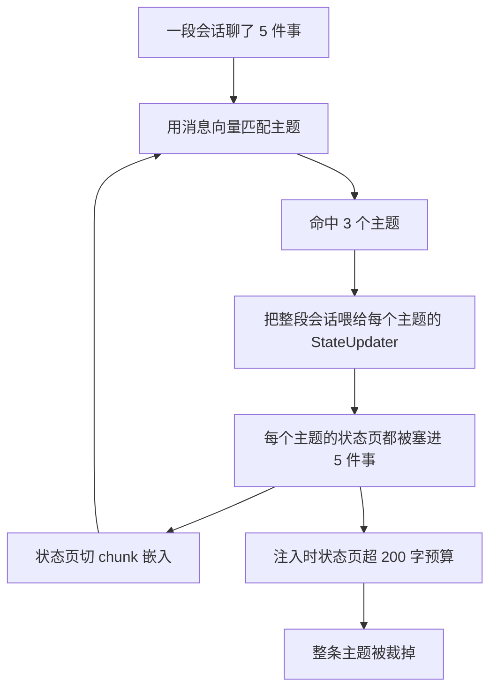
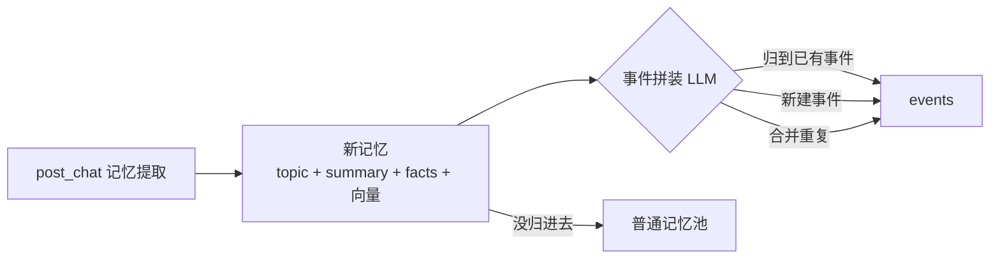
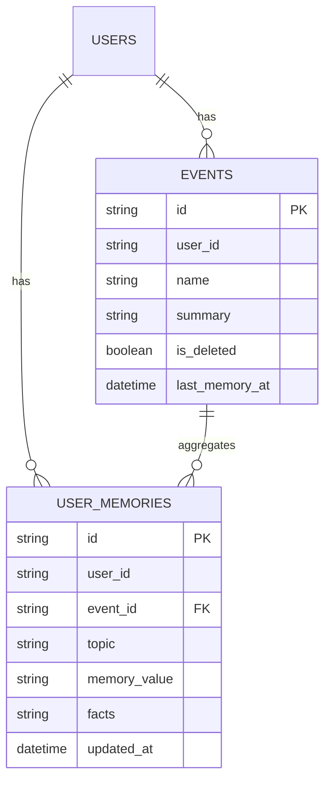
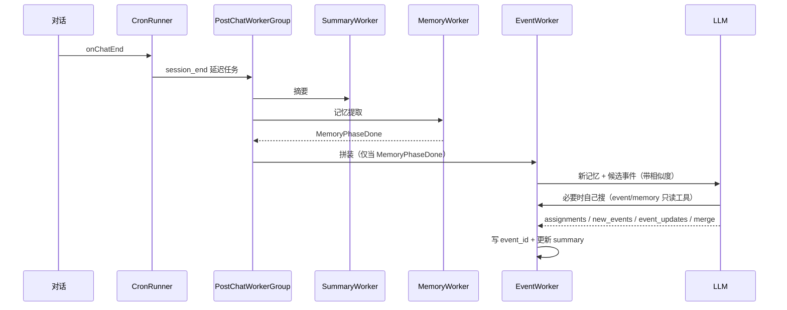
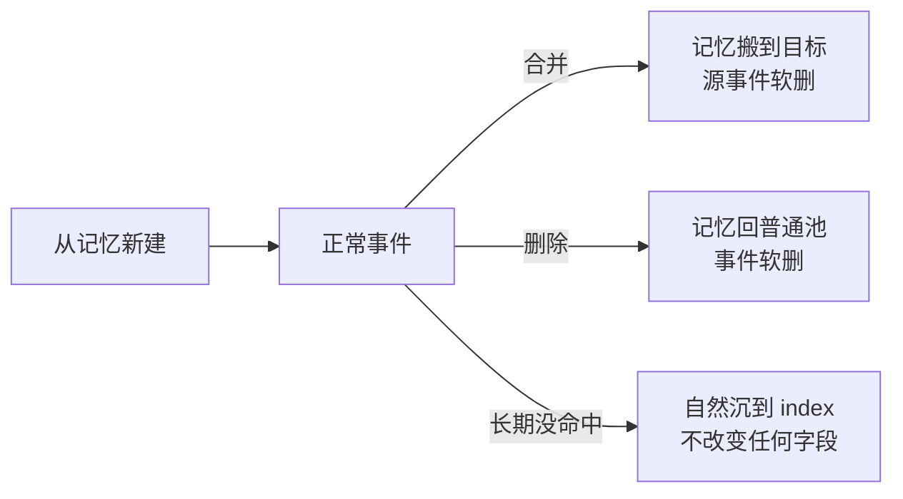
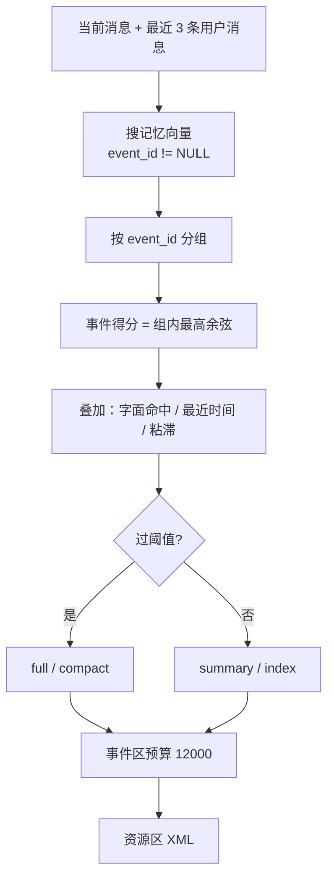
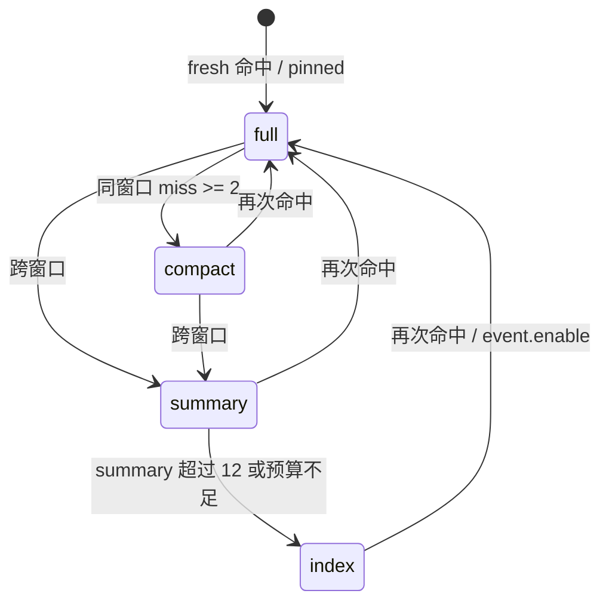
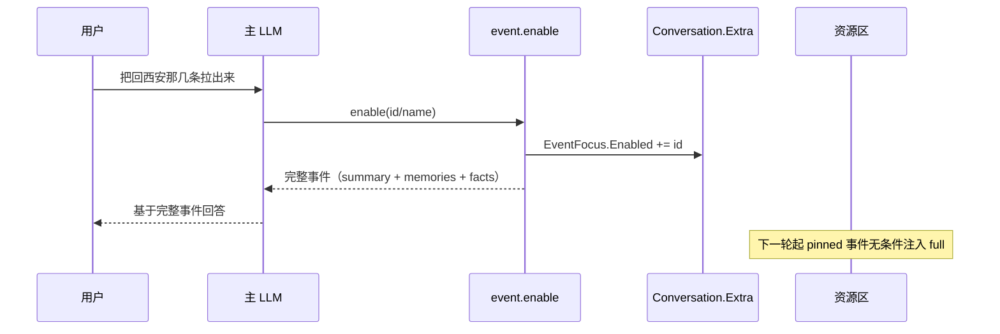
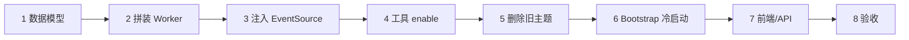

# 事件系统（Event）技术方案 · 人话版

> 一句话：把碎片化的记忆，按「现实里的一件事」聚起来；聊天时把相关事件连同它的记忆一起注入，让 agent 拿到完整上下文，而不是一件事的碎片。

- 状态：设计定稿，待实施
- 日期：2026-11-04
- 相关文档：`docs/design/memory-note-rework/`、`docs/design/post-chat-worker-group.md`、`docs/design/phase-15/theme-sensing-v2.md`（旧主题方案，本文替代）

估算（开工·回溯）：12 面 / 5 缝（3 需探针）/ 3 次真机往返 / 3 个待拍决定 · ~8–14h
估算（定稿）：13 面 / 4 缝（2 需探针）/ 2 次真机往返 / 1 个待拍决定 · ~10–14h

---

## 0. 术语表

| 词 | 意思 |
|---|---|
| 记忆 | `user_memories` 里的一条：topic + summary + facts + 向量 |
| 普通记忆 | 没有归到任何事件的记忆（`event_id IS NULL`） |
| 事件 | 一簇记忆 + 一个名字 + 一句当前摘要；现实里持续存在的一件事 |
| 拼装 | session 结束后，把新记忆归到已有事件 / 新建事件 / 合并重复 |
| 注入 | 聊天时把相关事件（摘要 + 记忆）放进资源区 |
| 形态 | 事件在资源区里的四种样子：full / compact / summary / index |
| pinned | 被 LLM 主动钉住的事件，每轮都按 full 注入 |

---

## 1. 为什么要做

### 1.1 旧主题的三个毛病

1. **主题是「领域」，不是「事件」**  
   92 个主题里，`睡眠管理` / `睡眠追踪`、`求职准备` / `求职备战` / `面试准备` / `具身面试`、`运动管理` / `健身` / `居家健身` / `跑步` / `骑行习惯` / `羽毛球` / `户外漫步` / `户外徒步`……同义分裂非常严重。

2. **状态页变成垃圾桶**  
   `具身面试` 的状态页里写的是「回西安准备（驾考/打包/告别/租房）」；`购房规划` 里是驾照、打包、告别、租房；`小程序` 里也是回西安台账。  
   原因：post-chat 拿整段会话文本匹配主题，命中后把整段会话喂给状态页，一个会话谈 5 件事，5 个主题都被塞进 5 件事。

3. **注入被预算掐死**  
   `budget_topic: 200` 字符，而 `<topics>` 块头描述本身 163 字符，加 XML 开销后任何带状态页的主题都超过 200，被整条裁掉。  
   实测：2026-10-01 以来 1670 条用户消息，只有 20 条带 `<topics>` 块（1.2%）；11 月 179 条里只有 1 条。

### 1.2 旧系统是怎么把自己越弄越脏的



> 人话：旧系统不是「没调好」，是实体定义、更新方式、注入预算三层同时错了。修旧主题不如换实体。

---

## 2. 新模型：事件 = 记忆的聚合

### 2.1 核心原则

- **事件不碰原始消息**，只从记忆长出来。
- **一条记忆最多属于一个事件**；没归进去的记忆照旧单独注入。
- 事件**不是任务**：不要求目标、完成条件、scope、参与方字段。
- **一层**，不做父子层级；不做习惯/兴趣。
- 拼装失败或没跑，记忆照旧注入——事件只是增强层，不是依赖。



> 人话：记忆是碎片，事件是把碎片按「同一件事」收进一个盒子；盒子上贴名字和一句现状。聊天时把盒子整个递给 agent，而不是只递一片碎片。

### 2.2 事件长什么样

```xml
<event id="..." title="驾照考取" updated="2026-11-03">
  <summary>科三 11-03 两把均败；cj 科四 88 分未过。科三补考 11-14/11-17，cj 科四 11-10。</summary>
  <memories>
    <memory id="..." date="2026-11-03" topic="学习计划">科三两把均败：靠边线距离过远、四档降二档空挡滑行。</memory>
    <memory id="..." date="2026-11-03" topic="学习计划">cj 科四 88 分，差一题未过，补考 11-10。</memory>
    ...
  </memories>
</event>
```

- 事件的「正文」就是它聚合的那些记忆，不另存一份 Content。
- `summary` 是派生视图，用来快速看现状；记忆才是完整档案。
- 未定的事**写在 summary 里**（如「科三补考 11-14/11-17 待定」），不另设待确认字段——见 §4.4。

---

## 3. 数据模型

### 3.1 表

```go
// server/internal/model/event.go
type Event struct {
    ID           string     `gorm:"primaryKey;size:36"`
    UserID       string     `gorm:"size:36;not null;index"`
    Name         string     `gorm:"size:100;not null"`
    Summary      string     `gorm:"type:text"`
    IsDeleted    bool       `gorm:"default:false" json:"-"` // 软删除标记；与注入无关，只影响列表与工具查询
    LastMemoryAt *time.Time
    CreatedAt    time.Time
    UpdatedAt    time.Time
}
```

**没有状态位。** 不存 active/ended/merged：

- `ended` 砍掉：我们刻意去掉了 done_when，系统没有可靠判据判断「结束」，猜错就是永久静默隐藏；旧事件靠 `last_memory_at` 衰减 + fresh 阈值 + index 上限自然沉底。
- `merged` 不是状态，是「这个事件被并进另一个了」的结果——实现方式是记忆搬家 + 源事件软删，不留别名（见 §5.3）。

`IsDeleted` 用显式 bool 而不是 `gorm.DeletedAt`：后者会自动过滤所有查询，等于偷偷参与每条 SQL；这里的语义只是「代表删除了」。

记忆表加一个可空字段：

```go
// server/internal/model/user_memory.go
EventID *string `gorm:"size:36;index" json:"event_id,omitempty"` // 为空 = 普通记忆；非空 = 已归到某个事件
```

### 3.2 关系图



### 3.3 为什么不再要 Content / facts 表

- 记忆已经是 LLM 蒸馏过的、带日期和 topic 的碎片；再存一份 Content 就是重复。
- 事件的完整信息 = 它的记忆集合；`event.get` 直接返回这些记忆（含 facts）。
- 不拆 facts 表、不建每条事实向量：单用户、事件量 20-30、记忆量 1000+，内存里按 `event_id` 分组足够。

> 人话：以前是「一个事件一篇作文，作文越写越乱」；现在是「一个事件一个文件夹，里面是原始记忆卡片，外加一张便签写现状」。

---

## 4. 拼装：session 结束后，把新记忆收进盒子

### 4.1 时序



### 4.2 严格等记忆提取完

`PostChatWorkerGroup` 是顺序执行，把 `EventWorker` 放在 `MemoryWorker` 后面，再加一个显式握手：

```go
type SessionSnapshot struct {
    ...
    MemoryPhaseDone bool // MemoryWorker 跑完（含跳过）才置 true
}
```

- MemoryWorker 结束时置 `MemoryPhaseDone = true`。
- MemoryWorker 报错 → 不置 done，EventWorker 直接跳过并记日志。**不用半成品记忆拼事件。**
- MemoryWorker 被配置关闭 → 也置 done；EventWorker 仍然处理本次 session 里 inline 写入的记忆。
- EventWorker 输入 = `updated_at >= session_start` 的记忆，**不设 5 条上限**；超过 40 条才分批，但仍然全部处理。

> 为什么时间戳够用：`updated_at` 有三个写入点，全部自动——创建（`autoCreateTime`）、`UserMemoryRepo.Update`（改写内容）、`BatchUpdateConfirm`（召回确认）。GORM 对 `Updates(map)` 也会补 `AutoUpdateTime`（`callbacks/update.go` 的 map 分支），所以老记忆被重新召回或改写时 `updated_at` 一定会变。实测：10 月以来被确认过的 129 条记忆，`updated_at` 100% 落在确认当天或之后。
>
> 所以「老记忆慢慢恢复」不需要任何额外机制：用户重新聊到某件事 → 相关记忆被召回确认 → `updated_at` 更新 → 下一次 session_end 自动进入拼装。
>
> `WrittenMemoryIDs` 不需要：`MemoryPhaseDone` 保证「等记忆写完」，时间戳保证「范围」。

> 人话：记忆是拼装的原料，原料没备齐就不开工。记忆提取器的 `memory_max_per_session=5` 是另一个旋钮；事件拼装这边不设上限。

### 4.3 拼装：ReAct + 最终 JSON

单次调用只看得见注入的候选，事件一多就漏，容易重复建。改成**有限步的 ReAct**：先注入候选省掉大部分搜索，模型不确定时再自己搜。

**复用现成的 `MiniReAct`**，照 `agent/profile_worker.go::runColdStartReAct` 那套：跑完 → `result.FinalContent` 解析 JSON。不新写循环。

**注入候选**（代码算好）：

- 用新记忆的向量对事件记忆做 max 余弦，取 top 10；
- 再补「最近 7 天有更新」的事件；
- 每条带 `id / name / summary / 记忆数 / last_memory_at / sim=0.82`。

**给的工具**（独立「拼装注册表」，**全部只读**）：

| 工具 | 用途 |
|---|---|
| `unified_search`（memory + event 域） | 候选里没有、怀疑是同一件事时自己搜 |
| `event.get` | 想看某个候选的完整记忆再判断是否重复 |

> 阶段 2 先只挂 `unified_search`（且 event 域还没接），`event.get` 与 event 域检索在阶段 4 补齐；在此之前 prompt 明确告诉模型「只能搜记忆、看不到事件全文」。

**关键性质：循环全程只读**，所有写库都在 `FinalContent` 解析后一次性做。循环失败/超轮次 = 什么都不发生，记忆留在普通池，安全。

**成本控制**（prompt 硬规则）：

- 候选里有 `sim ≥ 0.75` 且明显同一件事 → 直接分配，**不许搜**；
- 只有「像事件但候选都不匹配」或「怀疑两个事件重复」才允许搜；
- `MaxIterations: 6`（含强制收敛轮），`MaxToolResult: 2000`。

**输出**：

```json
{
  "assignments": [{"memory_id": "...", "event_id": "..."}],
  "new_events": [{"name": "驾照考取", "summary": "...", "memory_ids": ["..."]}],
  "event_updates": [{"event_id": "...", "summary": "..."}],
  "merge": [{"from": "...", "into": "..."}]
}
```

规则：

- 一条记忆只归一个事件；归不进去且不是事件性质的，**不分配**，留在普通记忆池。
- 只有真实事件才建；偏好、习惯、兴趣、一次性任务、纯情绪、任务过程不建。
- 事件名用用户自己的说法，尽量具体；不搞标题黑名单，不强制 goal/done_when。
- 没新记忆 → 不调用 LLM。
- `FinalContent` 解析失败 → 本轮不写库，只记日志；记忆留在普通池，下个 session 重试。

#### 4.3.1 创建前硬校验（防重复建）

prompt 规则靠模型自觉，再加一道代码闸：

1. 事件名归一化（小写、去标点空格）后与现有事件完全一致 → **拒绝创建**；
2. 新事件的 `name + summary` 嵌入与现有事件 summary 的余弦 ≥ **0.88** → **拒绝创建**；
3. 嵌入调用失败 → **拒绝创建**（fail-closed，记忆留普通池下轮重试），不做「跳过语义查重」的降级。

拒绝就**不建**，这些记忆留在普通池，下个 session 自然重试。宁可不建，也不建错的。

阈值定高是故意的：误判「该建但不让建」的代价只是记忆晚一轮归位；误判「不该建但建了」的代价是长期两个事件并存。

校验只在 `IsDeleted = false` 的事件里做——已删的同名事件不该拦住新建。

### 4.4 summary 怎么维护

- 拼装时对每个被改动的事件，输入旧 summary + 新记忆，输出新 summary（≤200 字）。
- 200 字是硬上限：`EventRepo.UpdateSummary` 统一截断，拼装与 `event.update` 共用同一口径。
- summary 是「当前状态」，不是完整历史；完整历史在记忆里。
- **未定的事就写在 summary 里**（如「科三补考 11-14/11-17 待定」）。不设单独的 pending 字段：它只有拼装时能写、对话里的回答进不来，会过期变成反复追问；summary 每次有新记忆都会重写，已定的自然被覆盖。
- 记忆被 record loop 更新（改 summary/facts）→ 事件的 summary 可能过期；EventWorker 看到 `updated_at` 变化的记忆时，把对应事件加入 `event_updates` 重算。
- 记忆被删 → 事件少一条；下次该事件被触及时重算 summary。

### 4.5 失败降级

- EventWorker 失败只记日志，不影响记忆写入和普通记忆注入。
- 拼装不出来的记忆继续留在普通记忆池，照旧注入。
- 事件只是「更好」，不是「必须」。

---

## 5. 维护：长期不丢

### 5.1 没有状态，只有「在不在」



- 不存在 `active/ended/merged` 字段。一个事件「还活着」就是没被软删。
- 「这件事结束了」不靠状态位表达：`last_memory_at` 不再更新，注入时自然降权、沉到 index；记忆还在，随时可以 `event.get` 拉出来。
- **没有每日维护任务**：merge / delete 只由 session 拼装或用户显式操作触发。

### 5.2 不丢的保证

- 事件不复制记忆内容，只持有 `event_id`；记忆更新/删除自动反映。
- summary 可以重写，但记忆不动；就算 summary 写漏了，`event.get` 还能读到完整记忆。
- 同一 session 重试不会重复写：按记忆 ID 幂等（同一记忆不会被分配两次）。

> 人话：以前是「每次更新重写一篇作文，越写越短、越写越歪」；现在是「卡片只增不减，便签可以重写」。

### 5.3 merge 与 delete：记忆搬家，事件软删

两种操作都**先处理记忆，再动事件**，否则记忆会变成两边都不注入的隐形数据（`MemorySource` 只注入 `event_id IS NULL`，`EventSource` 只按 `event_id` 分组——挂在已删事件上的记忆两边都不进）。

```
merge(from, into):
  1. 校验：同 user、from != into、两者都未软删、同一批里 target 不能同时是 source（禁止链）
  2. UPDATE user_memories SET event_id = into WHERE event_id = from
  3. into 的 summary 由本次 finalize 的 event_updates 给（缺了下轮补，不阻断）
  4. UPDATE events SET is_deleted = true WHERE id = from
  全在一个事务里；重复 merge 同一条是幂等的

delete(id):
  1. UPDATE user_memories SET event_id = NULL WHERE event_id = id
  2. UPDATE events SET is_deleted = true WHERE id = id
```

| 操作 | 记忆去哪 | 结果 |
|---|---|---|
| `merge` | 搬到目标事件 | 内容不丢，目标 summary 重写 |
| `delete` | 退回普通池 | 记忆照旧单独注入，不再作为整体反复出现 |

- **不留别名**：源事件软删后，任何还持有旧 ID 的地方（pinned 列表、上一轮 XML 的 `PrevEventRefs`、工具参数）**找不到就跳过**，自愈；pinned 列表里的悬空 ID 顺手剔除。
- `event.get` / `event.enable` 传已删 ID → 返回「事件已删除」，而不是「不存在」。
- 不做恢复（undo）：记忆已经搬走或回池，恢复只能恢复空壳。

**什么情况下会 merge**：主要是「切太细」（先建了 `科三考试`，后来建了 `驾照考取`）和「时间久了两个事件收敛成一件」——这两类创建时看不出来，只能事后修。创建时的同名/同义重复由 §4.3.1 的硬校验先挡掉。

---

## 6. 注入：聊天时把相关事件递过去

### 6.1 总流程



- **不另建事件向量索引**：复用记忆向量，搜到记忆后按 `event_id` 分组。
- 能命中记忆，就基本能命中事件；阈值和记忆检索保持一致（0.5 左右）。
- 字面命中：事件名/summary/记忆里的关键词、日期、金额。
- 最近时间：`last_memory_at` 越近，权重越高；很久没更新的降权。

### 6.2 记忆源拆分

| 源 | 注入什么 |
|---|---|
| `MemorySource` | 只查 `event_id IS NULL` 的普通记忆 |
| `EventSource` | 查 `event_id IS NOT NULL` 的记忆，按事件聚合注入 |

- 没来得及聚合的记忆照旧单独注入。
- 已聚合的记忆只通过事件注入，避免同一段内容在 memory 块和 event 块重复。
- **注入路径不检查 `IsDeleted`**：被删除的事件的记忆已经退回 `event_id IS NULL`（§5.3），被合并的事件的记忆已经搬走，两者都不会出现在事件分组里。软删标记只服务列表和工具查询。
- 事件没匹配上时，它的记忆不单独注入；但因为匹配用的是同一批记忆向量，能命中记忆就基本能命中事件。

### 6.3 四种形态

| 形态 | 内容 | 大约字数 | 什么时候 |
|---|---|---|---|
| `full` | summary + 最多 20 条记忆 | ~2300 | fresh 命中 / pinned |
| `compact` | summary + 2 条记忆 | ~350 | 同窗口连续 2 轮没命中 |
| `summary` | 只放 summary | ~150 | 跨窗口 carried / 长期没命中 |
| `index` | 只有标题，放在索引行 | ~8 | summary 名额满 / 预算不足 |

> `full` 的 20 条按 `updated_at DESC` 取最近 20 条，不做相似度排序。20 是暂定值，冷启动看分布后再调。

### 6.4 形态状态机



- 同窗口里，之前是 full，连续 2 轮没再命中 → compact。
- 跨窗口 → summary-only，不带记忆，标注「上一窗口延续」。
- 长期没命中**不按轮数硬丢**；只有 summary 超过 12 个、或预算不足时，才降到 index。
- index 里的标题一直保留（最多 25 个），LLM 仍知道它存在，可 `event.get` / `event.enable` 拉回来。
- 只有事件被软删（合并或删除），或 index 超过 25 个，才从资源区彻底消失（仍可 `event.search` 搜到）。

### 6.5 优先级与降级

```
pinned（≤3，full）
  > fresh 命中（full）
  > 同窗口 sticky（full/compact）
  > 跨窗口 carried（summary）
  > index（标题）
  > 移出资源区
```

- 超上限/超预算时，从优先级最低的开始降：index 先于 summary，summary 先于 compact，compact 先于 full；同形态内按分数降序、`last_memory_at` 旧的先降。
- `miss` 只驱动同窗口的 `full → compact`（连续 2 轮未命中），不参与跨形态的降级排序；`summary → index` 只由 summary 数量上限和预算触发。
- pinned 不被降级，除非用户 `event.disable`；预算兜底（per-type 与总预算）同样不降不丢 pinned，全是 pinned 时接受超预算。
- `full → compact → summary → index → 移出` 是降级顺序，不是按时间一刀切。

### 6.6 pinned：LLM 主动钉住



- `event.enable` 把事件 ID 写进 `Conversation.Extra.EventFocus.Enabled`（用现成的 `UpdateExtraField` 事务读改写）。
- 工具结果直接返回完整事件，LLM 当场就有内容，不用等下一轮。
- 下一轮起 EventSource 无条件注入它，标记 `pinned="1"`，跨窗口保留。
- 最多同时钉 3 个；`event.disable` 取消。
- 事件被合并/删除后，pinned 列表里的旧 ID **加载不到就跳过**（不写别名表）。跳过本身不占注入名额；旧 ID 会在下一次 `event.enable` 写入时顺手剔除，避免白占 3 个名额。

### 6.7 预算

| 项 | 初始值 | 说明 |
|---|---|---|
| pinned | 3 | 走 full |
| full | 4 | 含 pinned；每件最多 20 条记忆 |
| compact | 6 | summary + 2 条记忆 |
| summary | 12 | 只 summary |
| index | 25 | 只标题 |
| 事件区预算 | 12000 字符 | 所有事件形态合计 |
| 普通未聚合记忆 | 1000 字符 | 从 600 提上来，补笔记的空 |
| 笔记 | 0 | 不注入 |
| 最近对话块 | 约 1000-2000 字符 | 保持现状，计入总预算 |
| 资源区总预算 | 15000 字符 | 事件 + 普通记忆 + 最近对话 |

> 最近对话块的行为**不改**：新窗口首条注入，之后随资源区一直携带。DB 实测连续 7 轮都是同一组 6 条消息，确实每轮都占上下文，所以计入 15000。

典型占用：

- 3 full（60 条记忆）≈ 6900
- 1 compact ≈ 350
- 6 summary ≈ 900
- 15 index ≈ 120
- 普通记忆 1000
- 最近对话 1500
- 合计 ≈ 10770，离 15000 有余量

### 6.8 笔记不再注入

- 主检索源里去掉 `NoteSource`，资源区不再出现 `<notes>` 块。
- `note` 的 quota/budget 设为 0；旧 XML 里的 notes 解析后直接丢弃。
- `unified_search` 的 note 域保留（LLM 主动查笔记时还能用），只是不再被动注入。

### 6.9 最近对话块的语义

现状块头已经写了「上个窗口最近的对话……供了解背景」，每条消息带 `date`，都早于 `<current_datetime>`，当前输入在最后的 `<user_query>`。语义上 LLM 能区分。

可选的小改进（未拍板）：把描述改成「本次会话开始之前的最近对话，仅供背景，不是用户当前输入」。只改字符串，不动携带行为。

### 6.10 跨窗口 carried 怎么传、资源区怎么配合

**状态不落库**：carried/sticky 不写 DB，从上一条 user 消息的 XML 里解析。

```go
// WindowResult 增加 PrevEventXML（新 session 也保留，资源区用的 PrevUserXML 仍按旧行为置空）
// retrieval.SearchOptions 增加 PrevEventRefs / PinnedEventIDs / IsNewSession
PrevEventRefs []EventRef // {ID, Mode, Miss}
```

- `computeWindowSize` 现在在 `IsNewSession` 时把 `PrevUserXML` 置空，资源区就断了。
- 事件层不跟这个走：另存一份 `PrevEventXML`（新 session 也带），无论是不是新 session，都从**上一条 user 消息的 XML** 解析 `<event id mode miss>`，由 orchestrator 填进 `SearchOptions.PrevEventRefs`。
- 同一 session 内：按上一轮的 `mode/miss` 继续 full/compact。
- 跨 session（`IsNewSession`）：只注入 summary，标记 `mode="summary" carried="上一窗口"`；如果新 session 里 fresh 命中，立刻升回 full。
- 长期没命中不按轮数硬丢；只有 summary 超过 12 个、或预算不足时，才降到 index。
- `PrevEventRefs` 里的事件如果已被合并/删除，**加载不到就跳过**（不做别名解析、不做去重）。
- **跳过检索（短输入「继续」「好的」等）或事件源报错时，原样携带上一轮事件**：同窗口保留原形态；跨窗口时 pinned 事件保持 full + 原记忆（`PinnedEventIDs` 由 `RunRequest` 传入，这条路径也读得到），其余 full/compact 降为 summary carried（index 保持 index，避免变成没有 summary 的空壳）。不携带的话本轮 XML 写回 DB 后，下一轮就解析不到事件，粘滞链会断。这条路径不查 DB：删除/合并发生后如果紧接着一条短消息，该事件会多残留一轮，下一轮 EventSource 正常跑时自愈。
- 字面命中用「事件名是当前消息的子串」判断（中文无空格，不做分词）；命中给 `threshold + 0.1` 的保底分。

**资源区配合**：

- event 类型在 `MergeResourceZone` 里**以本轮 EventSource 返回的集合为准**，不再从 prev 里捞旧事件（跳过检索时由 orchestrator 显式携带，见上）。粘滞由 EventSource 自己解析 `PrevEventRefs` 实现，控制权集中在一处。
- event 超预算时**先降级再丢弃**：从优先级最低的那条开始 `full→compact→summary→index`，index 再降就移出；不整条硬丢。
- `budgetTypePriority` 把 event 放到最后（最不容易被总预算砍）。
- 这样不会出现「prev 里旧事件占着 quota、EventSource 想换换不掉」的问题。

---

## 7. 工具

### 7.1 `event` 工具组

| 函数 | 作用 |
|---|---|
| `list` | 列出未删除的事件（id、name、last_memory_at、记忆数）；可选 `include_deleted` |
| `get` | 返回 summary + 全部记忆（含 facts）；已删事件也返回详情，用 `is_deleted=true` 标注（记忆已回池，memories 为空） |
| `search` | 语义/关键词搜事件和记忆 |
| `enable` | 钉住事件；工具结果返回完整事件；写 `Conversation.Extra` |
| `disable` | 取消钉住 |
| `update` | 用户明确说「记一下」时手动追加/修正：改名、改 summary、把记忆 ID 追加到事件 |
| `delete` | 软删事件，记忆退回普通池 |
| `merge` | 合并重复事件：记忆搬到目标，源事件软删 |

> 路由命名待定：**不要用 `/api/events`**——活动埋点已有 `POST /api/events/batch`，主库新表 `events` 也和埋点库 `events.db` 的 `events` 表同名。阶段 7 再定（如 `/api/event-threads`）。

### 7.2 `unified_search`

- 原来的 `theme` 域换成 `event` 域。
- 语义搜索：以**聚合记忆向量**为主 + 事件名字面命中（summary 没有自己的向量）。
- 关键词搜索：事件名、summary、记忆文本；记忆侧只取最近 `top_k × 4`（上限 100）条命中记忆，属近似召回。

> 人话：LLM 不用再翻聊天记录找某件事；`event.get` 一次给全，`event.enable` 让它在后续几轮一直留在上下文里。

### 7.3 拼装用的只读注册表

拼装 ReAct 用**独立注册表**（照「反思注册表」的做法，`mailbox` 就是这么只给反思用的），只放：

- `unified_search`（整个工具放行，实际可查 memory / note / summary / event / history；只读、无害）
- `event.get`

不注册 `event` 写函数。这样「循环只读」是**结构保证**，不是靠 prompt 自觉。注册表在 `appinit/agents.go` 里建，和主对话注册表互不影响。

---

## 8. 破坏性迁移

### 8.1 总流程



### 8.2 新增

- `server/internal/model/event.go`
- `server/internal/service/event_repo.go`
- `server/internal/agent/event_worker.go`
- `server/internal/agent/event_assembler.go`（ReAct 拼装 + 创建前硬校验）
- `server/internal/agent/retrieval/event_source.go`
- `server/internal/tool/event.go`
- `server/internal/tool/event_query.go`（拼装注册表用的只读子集：`list` / `get` / `search`）
- `server/internal/controller/event.go`
- `server/cmd/event-bootstrap/main.go`（一次性）
- 迁移 SQL：建 `events` 表、给 `user_memories` 加 `event_id`

### 8.3 删除

阶段 5 已删除（旧主题不再进入主对话）：

- `agent/retrieval/theme_source.go`
- `tool/theme_search.go`
- `controller/theme.go` + `/api/themes` 路由
- 前端 `ThemeView.vue` + `/themes` 路由 + 功能菜单入口
- 主检索源里的 `themeSource` 与 `theme` 加权 modifier
- `ctxflow` 的 `TypeTheme` 块 / topic 配额与预算 / 旧 XML 的 `<topics>` 解析
- 配置 `retrieval.theme`、`resource_zone.budget_topic` / `quota_topic`
- 重放配置里的 `theme` 检索参数

**保留代码但已停写**：`theme_discover.go`、`theme_analyst.go`、`theme_verifier.go`、`theme_embedder.go`、`theme_chunker.go`、`theme_store.go`、`state_updater.go`、`state_worker.go`、`tool/theme.go`、`model/theme_state.go`、`service/theme_state_repo.go`、`get_topic_stats` / `get_topic_detail`。

停写方式（运行时不接线，代码留待统一删除）：

- post-chat 组摘掉 `StateWorker`（不再按 session 更新状态页）；
- 反思注册表不再注册 `theme_analyst` / `theme_discoverer` / `theme` 管理工具；
- 每日回顾不再 `expire` 活跃主题、不再跑主题发现，只写一条 trace 记录节拍。

> 人话：旧主题从「主对话可见」退成「只读历史」。状态页只剩监控/调试读取，没有任何写入路径；等确认不需要回看后再删这批代码。

### 8.4 旧数据

- 旧主题数据**不迁移**；`theme_states` 停读写，用 dump 回放验证后删除。
- 旧 theme 向量/chunk 一次性清理（`cmd/entity-gc` 或专用脚本）。
- 用户已确认支持破坏性更新。

### 8.5 Bootstrap 冷启动

**只跑重构后的记忆**：`source IN ('post_chat','inline')`。

| 分组 | 条数 | 创建时间 | 平均长度 | topic 数 |
|---|---|---|---|---|
| 重构后（`post_chat` + `inline`） | **412** | 2026-09-24 → 11-03 | 85 字 | 86 |
| 存量（`conversation`） | 777 | 2026-05-15 → 09-22 | 66 字 | — |

切点很干净：09-22 之后没有 legacy，09-24 之后全是新数据。用重构后的记忆是因为事件边界从低质量碎片里长出来一定更差；存量 777 条继续当普通记忆注入，只有被 record loop 改写/确认后才会进入后续拼装（见 §4.2）。

- 输入：412 条（`memory_value` + topic + tags + facts + 时间），按 `created_at` 正序分批；
- 每批 40 条 → **11 批**，全 Flash（不再有 Pro 分支），约 5 分钟；
- 游标文件 `server/data/event-bootstrap.cursor`，断点可续；**不能靠 `event_id IS NULL` 判断进度**（模型故意不分配的记忆永远是 NULL，会无限重跑）；
- 每批走**同一个 `EventAssembler`**，不写第二套 prompt / 逻辑——冷启动跑通即生产路径跑通；
- 全部跑完后做一次**结构复盘**：输入全部事件（id / name / summary / 记忆数 / 首末日期），输出 `merge` + `rename`，专门修「切太细」（如 `科一报名` / `科三考试` / `科四` 该并成 `驾照考取`）；
- `--limit N` 试跑、`--reset` 清空重跑（清 `event_id` + 删 events）。

**为什么必须有结构复盘**：按时间正序，事件名是用最早那条记忆命名的，之后只会越来越不像；所以 `event_updates` 要支持 `name`，复盘阶段靠它改名。

预期：冷启动只覆盖 9 月下旬以来的事（回西安、求职、AI 开发、记账、技术调研/决策/文档写作）；5-8 月的事（日本行、驾照、早期租房）不会出现，等被重新聊到时恢复。

---

## 9. 配置

```yaml
retrieval:
  event:
    freshness_decay: 0.01
    threshold: 0.5        # 事件得分阈值（复用记忆相似度）
    limit: 20             # 记忆召回乘数（chunk=limit*8 / 全量=limit*2），不是事件条数上限
  resource_zone:
    budget_event: 12000   # 事件区字符预算
    budget_memory: 1000   # 普通未聚合记忆
    budget_note: 0        # 笔记不注入
    budget_chars: 15000   # 资源区总预算
    quota_event_full: 4
    quota_event_compact: 6
    quota_event_summary: 12
    quota_event_index: 25
    quota_event_pinned: 3 # event.enable 钉住上限
    event_memories: 20    # full 形态每个事件附带的记忆条数
event_assembly:
  candidate_top: 10       # 注入给拼装的候选事件数
  dedupe_sim: 0.88        # 创建前同名/同义校验阈值
  max_iterations: 6       # ReAct 总轮数（含强制收敛轮）
  batch_size: 40          # 单批新记忆条数，超出分批但仍全部处理
```

> 数字先按上面跑，冷启动和真实对话看分布后再调。

---

## 10. 观测与验收

### 10.1 每轮日志

```
[event] inject: user=u1 active=12 fresh=2 selected=7 (full/compact/summary/index=2/1/3/1)
[resource_zone] budget trim: total 9300→7200 chars; per-zone map[event:5200 memory:800 ...]→...; selected=[event:e1 ...]; dropped=[...]
```

- `[event] inject`：`active` 是未删除事件数，`fresh` 是本轮向量/字面命中的事件数，`selected` 是最终注入数；括号里是各形态数量。`fresh` 经常 0-1 说明匹配或聚合有问题。
- `[resource_zone] budget trim`：`total` 是资源区总字符变化，`per-zone` 是各子区（event/memory/note/...）字符变化，`dropped` 是被降级/丢弃的条目。

重点看：

1. 每轮事件区实际字符 p50 / p90 / max（看 `per-zone` 里的 `event`）；
2. 各形态数量分布；
3. fresh 命中数；
4. 降级次数（频繁说明预算/上限太紧）。

日志同时写进 `message.extra` 的检索 trace，方便 replay 对照。

### 10.2 冷启动指标

基数 = 412 条重构后记忆（`source IN ('post_chat','inline')`）。

- 生成多少个事件（预期 15-30，明显更多 = 切太细）；
- 每个事件聚合多少条记忆（p50 / p90 / max）——直接决定 `full` 的 20 要不要调；
- 有多少事件超过 20 条记忆；
- **412 条里有多少条最终没进任何事件**（预期 40-70%，习惯/偏好/一次性任务本来就不该进）；
- 事件名两两相似 > 0.9 的对数（应为 0）；
- 单事件时间跨度 > 3 个月的数量（多 = 伞状事件复发）；
- 抽查 10 个事件的 summary 是否只含本事件内容（旧系统最重的病，结构上应为 0）；
- 抽查 20 条未分配记忆，判断「宁可不建」的尺度对不对；
- `旅行计划`（59 条）/ `技术调研`（27 条）这两个大 topic 各裂成几个事件，是不是该拆/该并。

### 10.3 注入验收

人工标 40 条 query（正例 + 负例）：

- 正例（冷启动后真实存在的事件）：回西安/打包/告别 → 回西安；面试/投简历 → 求职；技术调研/选型 → 技术调研；写文档/HTML → 文档写作。
- 负例：睡眠、饮酒、记账（习惯，不该进事件）；纯任务指令（改 HTML）；闲聊。

> 5-8 月的存量事件（日本行、驾照考取）在冷启动里不存在，等被重新聊到恢复后再补测。

指标：

- top-1 / top-2 命中率；
- 误注入率；
- 事件 summary 里出现其他事件事实的比例（结构上应为 0，抽查确认）。

### 10.4 真机验收

- 聊回西安 → 注入对应事件 full，summary + 最近记忆完整；
- 聊求职 → 注入求职事件，不出现「回西安」的内容；
- 聊睡眠 → 不注入事件（习惯）；
- 说「把回西安那几条拉出来」→ `event.enable` 返回完整事件，后续几轮一直有；
- 新 session 说「继续」→ carried 事件 summary-only 出现，标注「上一窗口延续」；
- 手动合并两个同义事件 → 目标 summary 含两边内容、记忆条数等于两者之和，源事件从列表消失；
- 删除一个事件 → 列表里不见，它的记忆退回普通记忆块照旧注入（不是消失）；
- 提一件 5-8 月的事（如驾照）→ 冷启动没有该事件，先按普通记忆注入；相关记忆被改写/确认后，下一次 session_end 长出事件。

---

## 11. 实施拆分

| 阶段 | 内容 | 关键文件 |
|---|---|---|
| 1 数据模型 | `events` 表 + `user_memories.event_id` + repo | `model/event.go`、`model/user_memory.go`、`service/event_repo.go`、迁移 SQL |
| 2 拼装 Worker | 握手 + ReAct 拼装 + 创建前校验 + 写库 | `agent/event_worker.go`、`agent/event_assembler.go`、`agent/post_chat_group.go`、`agent/memory_worker.go` |
| 3 注入 | EventSource + 资源区 event 块 + 预算 | `agent/retrieval/event_source.go`、`agent/ctxflow/blocks.go`、`ctxflow/resource_zone.go`、`agent/orchestrator.go` |
| 4 工具 | event 工具组 + enable/disable/merge/delete + 拼装只读注册表 + unified_search | `tool/event.go`、`tool/event_query.go`、`tool/unified_search.go`、`appinit/agents.go` |
| 5 删除旧主题 | 停注入、摘主对话工具/API/UI；反思侧主题状态机暂留 | `appinit/agents.go`、`appinit/tools.go`、`appinit/router.go`、`config/config.go`、`ctxflow/`、`front-end/` |
| 6 Bootstrap | 一次性冷启动 + 指标 | `cmd/event-bootstrap/main.go` |
| 7 前端/API | ThemeView → EventView、`/api/events` | `controller/event.go`、`frontend/src/views/ThemeView.vue`、router |
| 8 验收 | 单测 + 冷启动 + 真机 | `*_test.go`、dump 回放 |

---

## 12. 风险与开放问题

1. **`full` 的 20 条是暂定值**：冷启动看分布后再调；如果多数事件都超过 20 条，可能需要 30 或按事件类型区分。
2. **事件边界靠 LLM 判断**：没有 goal/scope 字段，伞状事件（「回西安准备」）可能重新出现。缓解：拼装 prompt 要求「一条记忆只归一个事件」+ 创建前硬校验 + merge；用户可手动 `delete` / `merge` / `update`。
3. **事件完全依赖记忆质量**：记忆没提取到的细节，事件也不会有。记忆提取器关闭时，没有新事件，但普通记忆仍注入。
4. **跨窗口 carried 会累积**：靠 summary 12 / index 25 的上限控制；pinned 3 是显式逃生口。
5. **成本**：资源区 15000 字符 ≈ 10k tokens/轮，比现在高不少；用分布日志回调。拼装改 ReAct 后每个 session_end 多 1-2 次 LLM 调用（靠「`sim ≥ 0.75` 直接分配」压住）。
6. **最近对话块重复**：从第二条消息开始，recent 块和历史窗口是同一批消息，重复费 token。本次不改；以后要省 token 再动。
7. **旧主题数据不迁移**：已有 92 个主题的「状态页」知识不会进新系统，只能从记忆重新长。用户已确认接受。
8. **创建校验的 0.88 是拍的**：可能误拒该建的新事件（伞状事件与子事件 summary 余弦本来就高）。冷启动时专门看被拒次数。
9. **存量 777 条记忆不进事件**：只作为普通记忆注入；被重新召回/改写后（`updated_at` 更新）会自动进入后续拼装。代价是 5-8 月的事（日本行、驾照）在事件层暂时缺席，收益是不让低质量碎片污染事件边界。

---

## 13. 已否决的方案（避免后人重走）

| 方案 | 否决原因 |
|---|---|
| 保留 theme，只调阈值/预算 | 实体是「领域」不是「事件」，状态页污染无法从结构上解决 |
| 事件要求 goal / done_when | 太窄，排除了「家庭责任焦虑」这类没有完成条件的持续事态 |
| scope / participants 字段 | 增加维护复杂度，鲁棒性下降 |
| 父子层级 | 无限可分，LLM 维护会劣化；先一层 |
| 独立 facts 表 + 每条事实向量 | 单用户数据量不需要；记忆已经是原子单位 |
| 每日维护任务 | session 结束增量足够；减少一个会劣化的后台状态机 |
| 标题黑名单 | 用户明确不要；靠拼装 prompt + merge 控制 |
| 笔记继续注入 | 笔记正在退役，且是噪声；`unified_search` 保留主动查 |
| 事件 `pending_questions` 字段 | 只有拼装时能写、对话里的回答进不来，没有回写闭环；过期后会变成反复追问已答过的问题。未定项写进 summary 即可 |
| `status = active / ended / merged` | 注入由相关度 + 新近度决定，不由状态位决定；`ended` 没有可靠判据（刻意去掉了 done_when），猜错等于永久静默隐藏 |
| `merged_into` 别名 / 读时解析合并链 | 旧 ID 只存在于 pinned 列表、上一轮 XML、工具参数三处，找不到就跳过即可自愈；维护别名表和链解析是纯成本 |
| 硬删除事件 | 用 `is_deleted` 软删，保留行；但删除时必须把记忆退回普通池，否则记忆两边都不注入，变成隐形数据 |
| 拼装用单次 LLM 调用 | 事件多了候选装不下，容易重复建；改成有限步 ReAct，候选先行 + 只读工具兜底 |
| 冷启动跑全量 1189 条 | 777 条是重构前的低质量碎片（66 字 vs 85 字），事件边界会变差；只跑 `source IN ('post_chat','inline')` 的 412 条 |
| 用 `last_confirmed_at` 判断记忆该不该重新拼 | 冷启动要的是「重构后的记忆」，`source` 才是精确边界；`last_confirmed_at` 会把存量一起捞进来，且它没有读取方（与 `updated_at` 重复）。运行时恢复直接看 `updated_at` |
| 最近对话块只注入首轮 | 用户明确不改这部分；保持现状并计入预算 |


---

## 后续变更

- 2026-11-04 阶段 5：旧主题只从主对话链路移除（注入源、`theme_search`、`/api/themes`、前端页面、`ctxflow` 的 topic 块与预算、`retrieval.theme` 配置）。
- 2026-11-04 追加：反思侧也停写状态页——post-chat 摘掉 `StateWorker`，反思注册表不再注册主题工具，每日回顾只留 trace。`ThemeState` 仅剩监控/调试读取，代码保留待统一删除。
