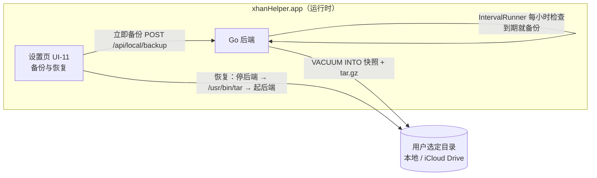
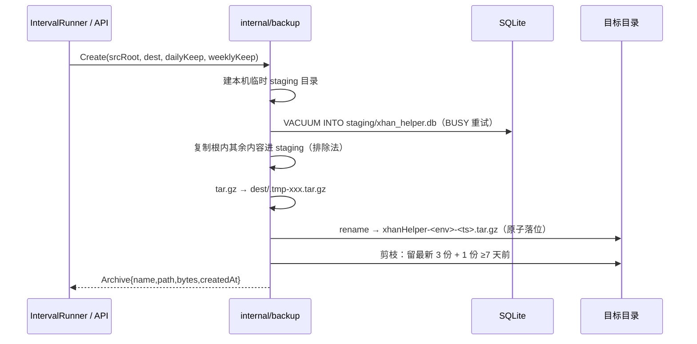
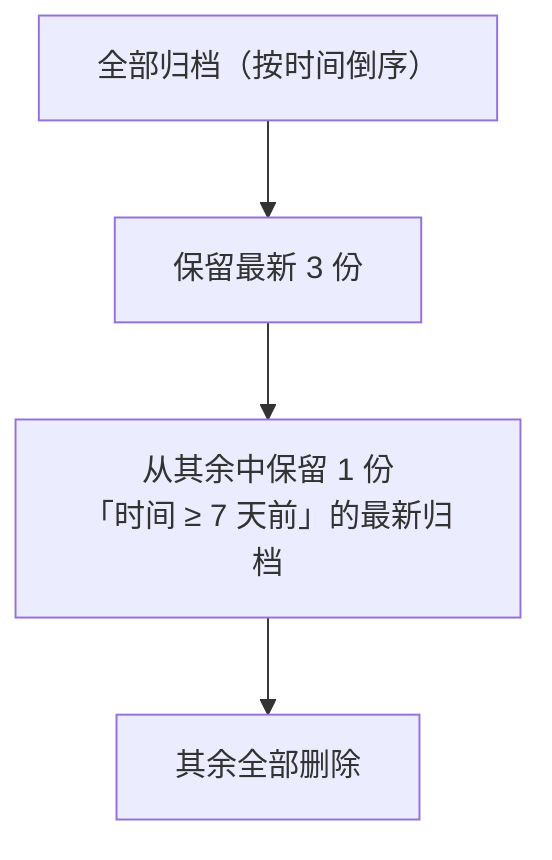
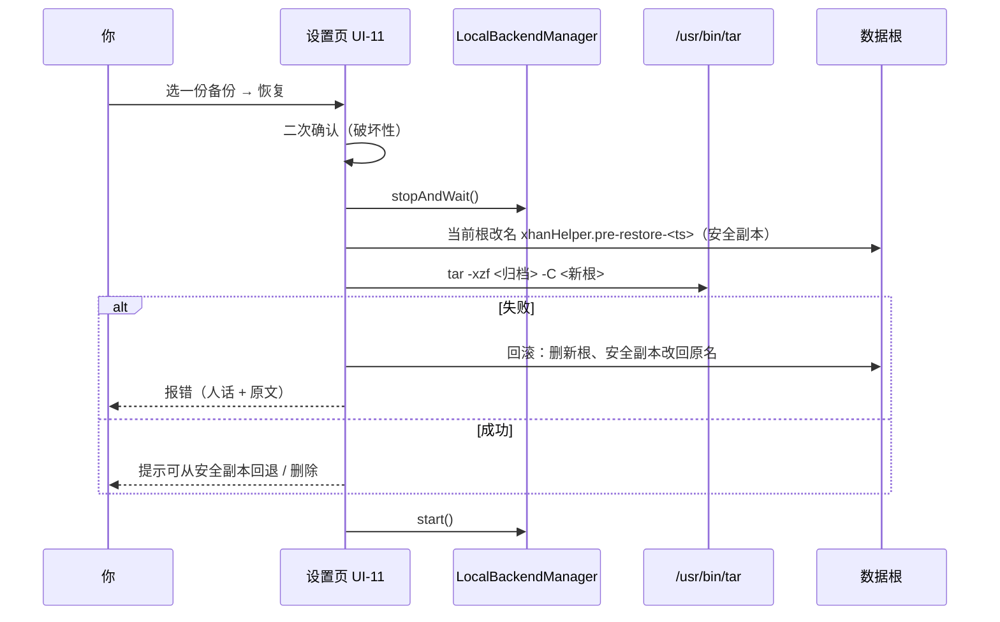

# 本地数据备份与恢复

> 一句话目标：**每 N 天自动把本地数据根整体打包放到你指定的目录（可以是 iCloud Drive），保留最近 3 次 + 1 份一周前的，需要时一键恢复。**

---

## 估算

- 开工粗估：`11 面 / 5 缝（2 条需先建探针）/ 4–5 次真机往返 / 0 个待拍决定` → **~10–18h**
- 估算（定稿）：`7 面 / 4 缝（2 条需先建探针）/ 3–4 次真机往返 / 0 个待拍决定` → **~6–10h**
  - 定稿较开工下调：按 ponytail 砍掉 manifest、`GET /backups` 端点、Go restore 子命令、settings JSON 文件、Swift 调度器与 SwiftPM 新 target（详见第十一节决定表）。
  - 上限留给两条探针（`VACUUM INTO` 在活动库上的行为、写 iCloud 路径）若踩坑。

---

## 零、人话：这功能到底解决什么

数据现在全在你 Mac 上（[local-sqlite 设计](../local-sqlite/design.md) 第 4 期后，云端那套已退居 iOS 客户端用）。本机数据没有任何异地副本，遇到手滑删库 / 换机 / macOS 重装 / 磁盘坏，就是全没。

Time Machine 能兜一部分，但不承诺「按天留几份、能放 iCloud、能一键挑一份恢复」。本功能补这三件事：

1. **自动备份**：每 N 天一次，把整个数据根打成一个文件，放到你选的目录（含 iCloud Drive）。
2. **自动清理**：只留最近 3 次 + 1 份「≥ 7 天前」的，旧的自动滚掉。
3. **一键恢复**：挑一份备份 → 确认 → app 先把当前数据整体另存为安全副本，再解包换入，重启后端。

**两条上限：**

- **只有 app 运行时才会备份**（Go 子进程随 app 生死）。关机 / 退出期间不跑，下次启动补检查。
- **恢复是破坏性的**（替换整个数据根），靠「安全副本 + 二次确认」兜底。

---

## 一、现状与目标

### 现状

| 项 | 值 |
|---|---|
| 数据根 | `~/Library/Application Support/xhanHelper/`（dev 是 `xhanHelper-dev/`），`LocalPaths.dataRoot` 定义 |
| 根内内容 | `xhan_helper.db`（当前 752MB）、`images/`、`favicons/`、`history.json`、`bookmarks.json`、`local_results/`、`tool_output/`、`workspace/`，及历史文件 `*.pre-migrate-*` / `*.pre-restore-*` |
| 库引擎 | `mattn/go-sqlite3`（真 SQLite，cgo），`journal_mode=delete` |
| 进程 | Go 后端由 app 拉起（`LocalBackendManager`），数据全由它读写；只有 app 运行时活着 |
| 沙盒 | **无 entitlements、未沙盒** → Go 子进程可写任意用户目录，含 iCloud Drive |
| 压缩实测 | 752MB 的库 `gzip -c` → 225MB |

### 目标



### 非目标

- 不做增量 / 差异备份（每次全量）。
- 不做云厂商对象存储直传（走文件系统，iCloud 由系统同步）。
- 不做关机期间调度（不引 launchd）。
- 不做「精简备份」（剔除调试字段 / 审计表）——留作将来可选项（第九节）。
- 不做跨设备同步 / 备份冲突合并。
- 不动 `CronRunner`（见第十二节技术债）。

---

## 二、备份引擎

### 2.1 为什么不能直接 `cp` 数据库

库是 `journal_mode=delete` 的**活动库**，Go 随时在写。直接复制主库文件 = 别人还在改文档时你去复印，可能印到半句话（不一致快照）。正解是让 SQLite 自己导出一张一致快照：

```sql
VACUUM INTO '/tmp/staging/xhan_helper.db'
```

- 在读事务里完成，**源库不受影响**、不需要停服务；
- 输出是**已整理（free page 回收）**的库，顺带压缩；
- 目标文件必须不存在（staging 是全新临时目录，天然满足）；
- 与后台 worker 抢锁可能 `SQLITE_BUSY` → 退避重试（`busy_timeout` + 有限重试）。

### 2.2 流程



### 2.3 打包内容与排除

归档**顶层直接镜像数据根**（便于恢复时 `tar -xzf` 到根）：

```
xhan_helper.db            ← VACUUM INTO 的一致快照
images/  favicons/  local_results/  tool_output/  workspace/
history.json  bookmarks.json
（将来根内新增的文件自动带上——按「排除法」而非白名单）
```

**排除清单**：

| 排除项 | 原因 |
|---|---|
| 活的 `xhan_helper.db` 及 `-journal` / `-wal` / `-shm` | 用快照替代，侧车无意义 |
| `*.pre-migrate-*` / `*.pre-restore-*` | 历史备份文件，不是当前数据 |
| 目标目录（`dest`） | 若在根内直接**拒绝配置**，否则无限套娃 |
| `xhanHelper-*.tar.gz` / `.tmp-*` | 归档本身与半成品 |

### 2.4 命名与原子落位

`xhanHelper-<env>-<yyyyMMdd-HHmmss>.tar.gz`，`env` = `prod` / `dev`（来自 `cfg.Server.LocalEnv`）。

- 先在**本机临时目录** staging，`tar.gz` 写到目标目录内的 `.tmp-` 名，最后 `rename` 落位：避免 iCloud 同步到半成品；
- 时间戳进入文件名，剪枝无需打开文件即可排序；
- 冲突（同秒）→ 追加序号。

---

## 三、保留策略（3 次 + 1 周）

按时间倒序排列所有归档（只看**本 env** 前缀，dev / prod 互不删）：



- 周备锚点随时间自然前滚。
- 不足 7 天（刚启用）时周备为空，不报错。
- 默认 `daily_keep=3` / `weekly_keep=1`，可配。
- **按实际备份时间戳算，不要求每天真有一份**：哪怕一周只开一次机，也得到「最近 3 次 + 1 份 ≥7 天前」。

> 4 份约 900MB（当前体积）。目标选 iCloud 前确认空间。

---

## 四、调度：`async.IntervalRunner`（每小时检查，到期就跑）

**不用固定「每天 3:00」时刻表，也不用 `CronRunner`。** 复用通用周期调度器 `async.IntervalRunner`（`internal/async/interval.go`，已有 `llm_io_retention` / `debug_json_retention` 两个消费者、带单测）：

```go
if cfg.Backup.Enabled {
    fn := func(ctx context.Context) {
        defer func() {
            if r := recover(); r != nil {
                log.Printf("[backup] panic: %v", r) // 备份是数据安全任务，panic 不能让它静默停摆
            }
        }()
        backup.RunIfDue(ctx, cfg) // 判到期 + 带超时/BUSY 退避
    }
    go async.NewIntervalRunner("local_backup", time.Hour, fn).RunImmediately().Start(agents.BGCtx)
    monitor.Register("local_backup", backup.Stats) // 可选：补 IntervalRunner 缺的可见性
}
```

- **1 小时 tick + `RunIfDue` 判「最新归档 ≥ interval_days」**，`RunImmediately` 负责启动补检查（频繁重启不强制备份，到期才跑）；
- 单例 / 防重叠由 `IntervalRunner` 内建（single-flight）；
- **只受 `backup.enabled` 控制**，不挂 `disable_background_tasks`（用户显式开就该跑）。

### 4.1 睡眠 / 关机怎么办（不会「错过就没了」）

| 情形 | 行为 |
|---|---|
| 合盖（睡眠） | 进程冻结、定时器不跑；**醒来第一轮检查**发现超期 → 立刻补跑 |
| 退出 app / 关机 | 进程没了；**下次打开 app** `RunImmediately` 立刻判到期 → 补跑 |
| 唯一真漏 | 从此不再打开 app（或数据目录不可达） |

因为判据是「最新归档时间 vs 现在」，**睡多久、错过几轮 tick 都无所谓**，醒来/下次启动必补。这也正是放弃固定「3:00」的原因：定点时刻表在睡眠下依赖平台时钟语义、关机必漏，还得额外写补跑。

---

## 五、HTTP 接口

只有一个端点，仅本地模式（`cfg.Server.LocalSingleUser`）注册，走现有 Bearer 认证。

### `POST /api/local/backup`

无请求体（读 `cfg.Backup`）。响应 200：

```json
{ "archive": { "name": "xhanHelper-prod-20260925-030000.tar.gz",
               "path": "/dest/xhanHelper-prod-20260925-030000.tar.gz",
               "bytes": 235916919, "created_at": "2026-09-25T03:00:00+08:00" } }
```

错误：400（未启用 / dest 非法 / dest 在根内）、500（快照或打包失败，带原因）。同步执行，UI 出 spinner。

> **列表不设端点**：Swift 直接读目标目录（`FileManager` 拿名称/大小/时间）。少一个 handler。

---

## 六、设置与配置

设置走**配置段 + 环境变量非空覆盖**（照抄 `llm.base_url/model` 的同款机制），改完点「保存并重启后端」生效：

```yaml
# conf/config.yaml（base，默认关）
backup:
  enabled: false
  dest: ""
  interval_days: 1
  daily_keep: 3
  weekly_keep: 1
```

| env（Swift 注入） | 覆盖 |
|---|---|
| `XHAN_BACKUP_ENABLED` | enabled |
| `XHAN_BACKUP_DEST` | dest |
| `XHAN_BACKUP_INTERVAL_DAYS` | interval_days |
| `XHAN_BACKUP_DAILY_KEEP` | daily_keep |
| `XHAN_BACKUP_WEEKLY_KEEP` | weekly_keep |

Swift 侧存 UserDefaults（`xhan_backup_*`），经 `LocalBackendDiagnostics.childEnvironment` 传出（非空才传）。

> 取舍：改设置要重启后端（几秒）。备份设置一年改两次，可接受；要免重启再加 JSON 文件，先不做。

---

## 七、恢复

恢复不能在 HTTP 里做（要替换后端正在用的库）。**纯 Swift 编排 + 系统 `/usr/bin/tar`**：



- **用系统 `tar` 而非 Go 子命令**：原生工具，省掉 `main.go` 入口分发 + `restore.go` + `binaryURL` 暴露 + 跨语言 tar 布局定义。
- `// ponytail: 未防归档路径穿越（自产归档，威胁模型可接受）；恢复前已停后端保证无写入者。`
- 归档校验：`tar -tzf` 列表里须含 `xhan_helper.db`，否则拒绝。
- env 提示：文件名前缀与当前 env 不符时弹「你正在把 dev 备份恢复到 prod，确认？」。
- 兼容 Swift 调用外部进程的既有先例（`ShellToolProvider`）。

### 7.1 安全副本（可回退 / 可删 / 自动限 3 份）

安全副本 = 数据根父目录（`~/Library/Application Support/`）下的整根目录 `xhanHelper.pre-restore-<ts>`（dev 为 `xhanHelper-dev.pre-restore-<ts>`）。

- **从磁盘发现，不靠内存**：UI 每次刷新扫描该前缀目录并按时间倒序列出。此前只把路径存在 `@State` 里，**app 一重启就再也找不到、无法回退**——这是必须修的点。
- **可从安全副本恢复**：`restoreFromSafety` 校验副本含 `xhan_helper.db` → 当前根改名成新安全副本 → 选中副本改名回数据根 → 失败回滚。与从归档恢复对称（一个解包、一个改名），同样保留当前状态。
- **自动留最近 3 份**：每次恢复成功（归档 / 安全副本两条路径）后 `pruneSafety` 只留最新 3 份，其余删除；也可在列表里手动删某一份。
- 归档列表同样支持手动删除。

---

## 八、实现清单

### Go

新增 `server/internal/backup/`：
- `backup.go`：`Archive`、`Create(srcRoot, dest, env string, dailyKeep, weeklyKeep int) (Archive, error)`、`List(dest, env string) ([]Archive, error)`、`prune(...)`、`RunIfDue(ctx, cfg) (Archive, error)`、`Stats()`。
- `backup_test.go`：tar 往返可解包、剪枝（日/周边界）、排除规则、env 前缀隔离。

改：
- `server/internal/config/config.go`：加 `BackupConfig`（`Config` 顶层字段 `backup`）+ `applyBackupEnvOverrides`（在 `resolveEnvVars` 里调用）。
- `server/cmd/xhan-helper/main.go`：`cfg.Backup.Enabled` 时挂 `IntervalRunner` + `monitor.Register`。
- `server/internal/controller/local_backup.go`（新）：`POST /api/local/backup` handler。
- `server/internal/appinit/router.go`：本地模式注册该路由（handler 需要 `cfg` + dataRoot）。

### Swift

新增：
- `xHelperMac/LocalBackupSection.swift`（UI-11：开关 / 目录选择 / 间隔 / 日周保留 / 立即备份 / 归档列表 + 删除 / 恢复 / 安全副本列表 + 恢复 + 删除）。
- `Shared/Services/LocalBackup.swift`：设置读写；归档与安全副本的列目录 / 解析 / 删除；恢复编排（`restore(archive:)` / `restoreFromSafety`）与 `pruneSafety`。

改：
- `Shared/Services/LocalBackendDiagnostics.swift`：`childEnvironment` 加 `XHAN_BACKUP_*`（读 UserDefaults）。
- `xHelperMac/App.swift`：插入 `LocalBackupSection`（⚠️ 入口文件在 `swiftc -typecheck` 盲区，需你在 Xcode 确认编译）。
- `Shared/Services/LocalBackendManager.swift`：若恢复需要读 `binaryURL` 也不用了（走 tar）；仅确认可停可起即可。

### 文档

- 本文件。

---

## 九、风险与取舍

| 风险 | 说明 | 应对 |
|---|---|---|
| 活动库快照 | `VACUUM INTO` 与后台 worker 抢锁可能 `SQLITE_BUSY` | `busy_timeout` + 有限重试；仍失败则本次跳过并记日志，不产半成品 |
| iCloud 写路径 | 非沙盒按绝对路径写；iCloud 可能把文件变 dataless | 归档单文件 + 原子 rename；恢复时系统按需下载，UI 给等待提示 |
| 恢复破坏性 | 解包失败 / 选错 | 先整根 rename 安全副本；失败回滚；二次确认 + env 校验 |
| 调度 | 只在 Go 进程运行时跑 | 已接受；睡眠醒来 / 下次启动补检查（第四节） |
| panic 停摆 | `IntervalRunner` 不 recover，`fn` panic 会静默停摆 | `fn` 内 `defer recover + log` |
| 卡死 | `fn` 不返回会让后续轮永远 skip | `fn` 带 ctx 超时；`VACUUM INTO` 有上限 |
| 体积 | 4 份 ≈ 900MB | 列表显总占用；将来可选「精简模式」（剔除 `messages.request_json`/`xml_context`/`reasoning` 与审计表，实测可降约 50–60%） |
| 入口文件盲区 | `xHelperMac/App.swift` 是 `@main`，typecheck 覆盖不到 | 该文件改动由用户在 Xcode 编译确认 |
| 多环境并发 | dev / prod 指向同一目录 | 归档名带 env，剪枝只处理自己前缀 |
| 安全副本占盘 | 每次恢复把整根另存，累加（prod 每份约 750MB） | 自动只留最近 3 份 + 列表可手动删 |

---

## 十、分期与验收

| 期 | 内容 | 验收 |
|---|---|---|
| **P1 引擎** | `internal/backup` + config + 调度接线 + API + 单测 | `go build ./... && go test ./...` 全绿；app 运行时 curl `POST /api/local/backup` 产出可 `tar -tzf` 的归档，剪枝正确 |
| **P2 备份 UI/调度** | Swift `LocalBackupSection` + env 注入 + 插入设置页 | `swiftc -typecheck`（macOS）干净 + `swift test` 绿；真机手动备份成功、列表可见；间隔临时调小验证到点触发；dev / prod 各一次不串 |
| **P3 恢复** | Swift 恢复编排（停/起 + tar + 安全副本 + 回滚） | 真机恢复成功、数据完好；坏归档被拒且原数据不损；安全副本生成、重启后仍在、可从其恢复、自动留 3 份且可删；归档可手动删 |

---

## 十一、已拍板决定

| # | 决定 | 结论 |
|---|---|---|
| 1 | 备份范围 | **整个数据根**（排除法，新增根内文件自动带上） |
| 2 | 保留结构 | **最近 3 次 + 1 份 ≥7 天前**；按实际时间戳算，不要求每天一份 |
| 3 | 节奏 | 每 N 天一次（默认 1 天），**每小时检查、到期就跑** |
| 4 | 调度器 | `async.IntervalRunner`（通用那套），**不塞 `CronRunner`** |
| 5 | 设置机制 | `backup:` 配置段 + `XHAN_BACKUP_*` 非空覆盖；改完重启后端 |
| 6 | 接口 | 只加 `POST /api/local/backup`；列表由 Swift 读目录 |
| 7 | 恢复方式 | 纯 Swift 编排 + 系统 `/usr/bin/tar`；整根安全副本 + 失败回滚；**不做 Go 子命令** |
| 8 | 归档格式 | 单文件 `tar.gz`，顶层镜像数据根，原子 rename 落位；**无 manifest**（文件名带 env + `tar -tzf` 校验） |
| 9 | 调度前提 | 仅 app 运行时；睡眠/退出后下次机会补跑；不引 launchd |
| 10 | 恢复安全 | 恢复前整根另存 `xhanHelper.pre-restore-<ts>`，失败自动回滚 |
| 11 | 安全副本 | 父目录下整根目录；**从磁盘发现**（重启仍在）、**可从其恢复**、自动**留最近 3 份**且可手动删；归档亦可手动删 |

---

## 十二、技术债（本次不做，记账）

**两套周期调度并存**：`CronRunner`（`agent/`，领域调度器，手写 ticker + `select` + hook-status + `nextDailyDelay` 每日时刻表）与 `async.IntervalRunner`（通用最小版），另有 `async.Queue.Start` 第三个手写 ticker。重复属历史遗留。

- **本功能不新增机制**：用 `IntervalRunner`（通用那套的第 3 个消费者）。
- **统一路径（将来）**：给 `IntervalRunner` 加可选 `DailyAt []string`（把 `nextDailyDelay` 挪进 `async`）+ 状态回调，再逐个把 `CronRunner` 的循环带测试迁移。现在动反思调度器零收益、有回归风险，故不做。
