# 本地部署 + SQLite

> 把现在跑在阿里云上的 Go 服务，改成「跑在你 Mac 上、数据存本地」，并且用**双击 app** 的方式启动它。

---

## 估算

- 开工粗估：`9 面 / 8 缝 / 5–8 次真机往返 / 4 个待拍决定` → **20–36h**
- 估算（定稿）：`27 面 / 10 缝（2 需先建探针）/ 9–12 次真机往返 / 2 个待拍决定` → **~28–50h**

第 3 期（数据迁移）单独估：

- 第 3 期开工：`5–6 面 / 4–5 缝（3 条需先建探针）/ 3–4 次真机往返 / 3–4 个待拍决定` → **~4–9h**
- 第 3 期估算（定稿）：`4 面 / 3 缝（2 条需先建探针）/ 2 次真机往返 / 0 个待拍决定` → **~3–5h**

第 4 期（dev/prod 双环境隔离）单独估：

- 第 4 期开工：`5 面 / 4 缝（2 条需先建探针）/ 2 次真机往返 / 4 个待拍决定` → **~4–7h**
- 第 4 期估算（定稿）：`7 面 / 5 缝（2 条需先建探针）/ 2 次真机往返 / 0 个待拍决定` → **~5–8h**

> 第 4 期定稿较开工上调：砍掉「导出/导入 zip」一整块（−2 面、−1 往返、−1.5GB 磁盘），但新增用户提议的 **env 校验**机制（token 前缀 + 中间件 + 启动交叉断言）与 **Swift 侧数据根统一**（8 处硬编码），净增面数。

> 定稿较粗估上调，因范围扩大：首次配置引导、启动提速与错误上报、驻留生命周期、dev/prod 双 build 隔离、本地单用户 + Touch ID 解锁、整套 UI 设计面（UI-1~UI-10）、SwiftPM 预览靶。跨语言 + 动像素，修正式结果 ×1.5。

---

## 零、一句话目标

**双击一个 Mac app，它自动启动你熟悉的那套 Go 后端，数据存在 Mac 本地；关掉窗口它继续在后台跑，显式退出才关掉后端。**

---

## 一、心智模型：app 只是「启动器」

这一段是全文的地基。读懂这段，后面就没有新概念了。

**你现在是这样跑后端的：**

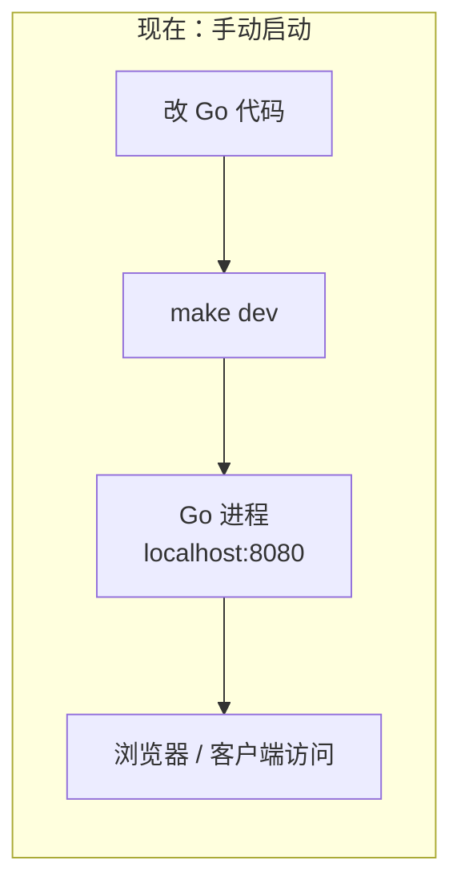

**改造后是这样：**

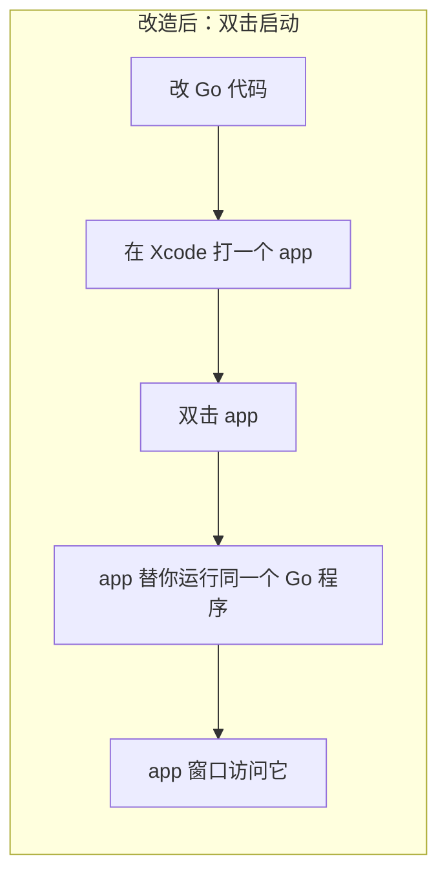

**关键结论，请务必记住：**

1. **Go 代码基本不动**，它还是那个 HTTP + SSE 服务，还是监听一个端口。
2. **Mac app 不会把 Go 编译进 Swift**，也不会用某种奇怪的桥接去调 Go 函数。它只是像 `make dev` 一样，**帮你把这个独立的 Go 程序启动起来，关 app 时把它关掉**。
3. app 和 Go 之间**用 HTTP 通信**——和你现在前端连后端完全一样，没有新协议、没有黑魔法。
4. **这个 HTTP 只能本机访问，绝不能通过网络访问**（见下方安全底线）。

> ⚠️ **安全底线：HTTP 只监听回环地址 `127.0.0.1`。**
> 这是本地模式与云端模式最本质的区别：云端**必须**对外（iOS 客户端要连），本地**绝不能**对外。只要 Go 监听的是 `0.0.0.0`（或 `:port`），同一个 Wi-Fi / 局域网里的任何人就能直接打到你的后端——读聊天记录、账单、记忆，甚至触发工具。绑定回环后，只有你这台 Mac 上的进程能连，局域网看不见这个端口。
>
> 注意：**当前代码不满足这条**。`Serve`（`appinit/router.go:143`）用的是 `":" + port`，等于监听所有网卡；具体改法见第五节改动点 2。

所以「Swift 内嵌 Go」的准确说法是：**Swift app 负责启动 / 停止那个 Go 程序**。「内嵌」指的是**打包**（把 Go 程序放进 app 这个文件夹里一起分发），不是把代码合并。

---

## 二、现状 vs 目标

### 现状（云端）

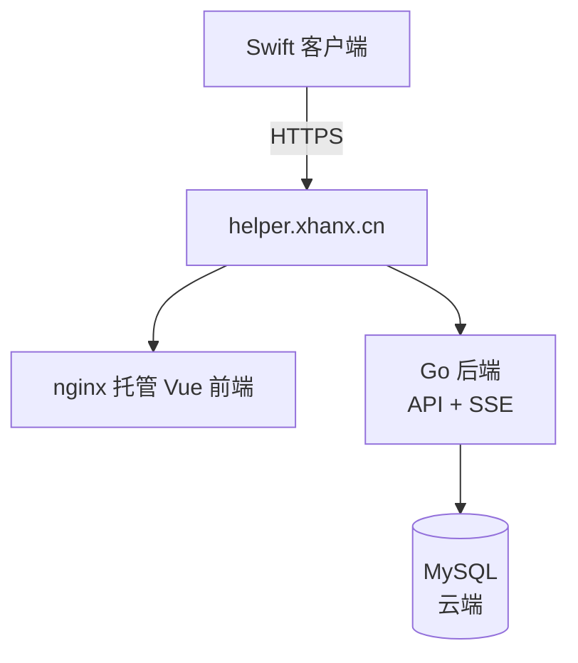

- 后端跑在阿里云，数据在云端 MySQL。
- 客户端通过一个写死的 URL（`helper.xhanx.cn`）连后端。
- 前端由 nginx 托管，**Go 不负责托管前端**。

### 目标（本地）

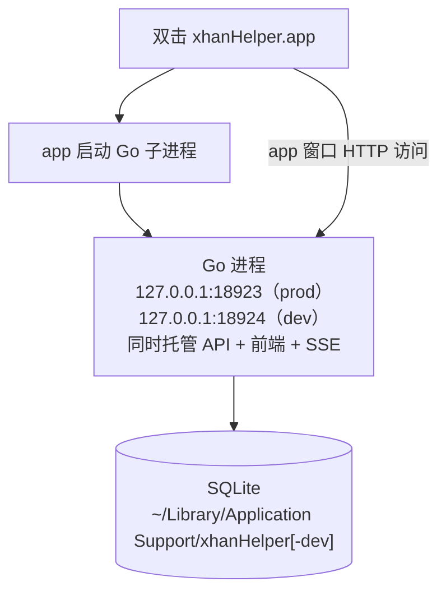

- 后端跑在你 Mac 上，数据存本地 SQLite。
- 客户端连 `127.0.0.1`（本机）。
- **Go 要顺带托管前端**（这次目标新增的能力）。
- **本地也分 prod / dev 两套**（见第八节）：同一份 app、按构建分（`Debug` → dev / `Release` → prod），bundle id 也分家（`xhanx.cn.xHelperMac.dev` / `xhanx.cn.xHelperMac`），不同数据根 / 端口 / 日志，可同时开着；dev 是**空库**，与 prod 无数据路径。

两种形态**共用同一份 Go 代码**，靠配置和环境变量切换。云端部署能力保留（iOS 客户端将来仍需要它）。

---

## 三、改完之后，一次「双击」到底发生了什么

### 首次安装（还没有密钥）

1. 你双击 `xhanHelper.app`。
2. app 读 Keychain：**没有** LLM / Embedding 密钥 → **不启动后端**，先弹「首次配置」窗口（见改动点 8）。
3. 你填入两个密钥（model / base_url 已预填默认值，改不改随意）；点「测试连接」验证通过后落 Keychain（**按当前环境分家存**，dev / prod 各存各的项；传统钥匙串不按 app 分区，无需 access group）。
4. 之后走下面的「日常启动」。

### 日常启动

1. 你双击 `xhanHelper.app`。
2. app 从 Keychain 取密钥，确定端口（prod `18923` / dev `18924`；被占就报错，SQLite 本就是单实例）。
3. app 启动 **Go 子进程**，告诉它三件事：
   - 用哪个端口；
   - 配置文件去哪读（`XHAN_CONF_DIR` = app 里打包的 `conf/`）；
   - 密钥与可选覆盖项（LLM / Embedding key、model、base_url）——通过环境变量传进去（等同于你现在的 `server/.env`）。
4. Go 连库 + AutoMigrate，**就绪后立刻监听 HTTP**（不等向量 warmup 跑完）。
5. app 轮询 `GET /api/health`：先 `starting`（后端活了、warmup 还在后台跑），后 `ready`。**窗口在 `starting` 就能开**——最初几秒记忆/语义检索可能不全，随后自动补齐。
6. app 的窗口把 API 地址设成 `http://127.0.0.1:18923`，之后所有请求都打到这里。
7. 正常使用（聊天、工具、后台记忆/摘要……）。
8. 你点红 X **只关窗口**：app 驻留，Go 与后台任务继续跑（见改动点 9）。
9. 你显式退出（Cmd+Q / 右键「退出」）→ app 停掉 Go 子进程 → 后台任务停止。**下次启动时会自动补跑没做完的延迟任务**（见第十节）。

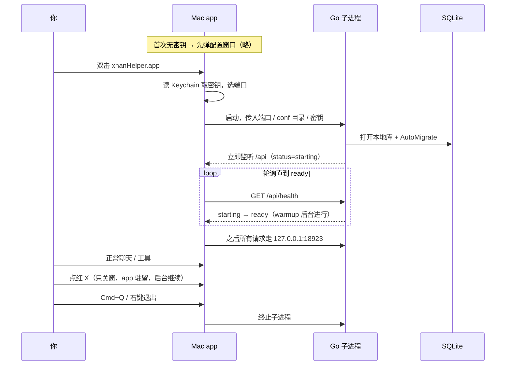

> **为什么要「父进程看门狗」**：如果 app 崩溃、但 Go 子进程没被正常关掉，它会变成孤儿进程赖在端口上。所以 Go 启动时记下父进程 PID，定时检查「父进程还活着吗」，不活着就自己退出。

> **为什么窗口能秒开**：现在的启动是「warmup 跑完才监听」，向量越多越慢（memory/note 还是全量 + 逐条 embed）。改成「先监听、warmup 挪后台、空库直接跳过」后，HTTP 就绪时间基本只剩连库 + AutoMigrate。

---

## 四、数据放哪：为什么不是 `server/data/`

现在后端的数据在仓库的 `server/data/`（`data/xhan_helper.db`、`data/images/`）。这是**服务器/开发环境的习惯**，不是 Mac 的习惯。

Mac 上，一个应用自己的数据有官方指定位置：

| 内容 | 放哪 | 说明 |
|------|------|------|
| SQLite 库 | `~/Library/Application Support/xhanHelper/xhan_helper.db` | Apple 指定「应用创建、用户不直接管理」的数据 |
| 图床 | `~/Library/Application Support/xhanHelper/images/` | 与库同目录，便于整体备份；从云端迁移时图片**不搬**（见第七节） |
| 日志 | `~/Library/Logs/xhanHelper/` | Apple 约定的日志位置 |

> **dev 用平行的一套**（见第八节）：根目录换成 `~/Library/Application Support/xhanHelper-dev/` 与 `~/Library/Logs/xhanHelper-dev/`，与 prod 物理分开，互不可见。

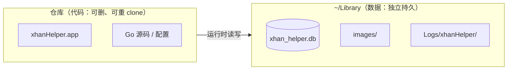

**为什么比 `server/data/` 好：**

- 不会被 `make clean`、`git clean -xdf`、重装仓库、移动目录**误删**。
- Time Machine 默认会备份 `~/Library/Application Support`。
- 代码和数据彻底分开——**删掉整个仓库重新 clone，数据都还在。**

**绝对不要放 `~/Library/Caches/`**：那是「可再生成数据」的位置，系统可能随时清理，而数据库不可再生。

**好消息（不用改代码就能做到）：** 配置加载器在读取 YAML 时，会对**整个文件**做 `${VAR}` 展开（`config.go:325`）。所以配置里直接写：

```yaml
db:
  driver: sqlite
  database: ${HOME}/Library/Application Support/xhanHelper/xhan_helper.db
storage:
  image_dir: ${HOME}/Library/Application Support/xhanHelper/images
```

`${HOME}` 会展开成你的用户目录。**不需要任何 Go 代码改动。**

**唯一要补的一小段代码：** 现在程序只会给图床目录建文件夹（`init_infra.go:37`），**不会给数据库文件建父目录**。App Support 子目录不存在时，SQLite 打不开文件。需要在 `InitDB` 里补一句 `os.MkdirAll(filepath.Dir(dbPath), 0o700)`。约 3 行。

---

## 五、改动点，逐个说清楚

每个改动点先说「为什么需要」，再说「改哪里」。全貌：

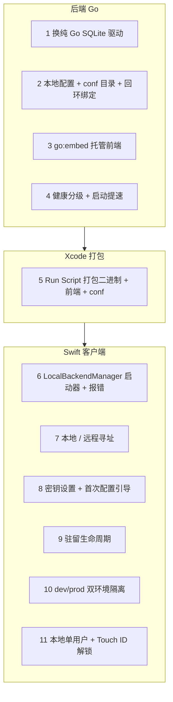

### 1. 换掉 SQLite 驱动（去掉 cgo）

- **为什么**：现在用的驱动 `mattn/go-sqlite3` 依赖 C 编译器（cgo）。本地跑没问题，但要做成能分发的 app（同时支持 Apple 芯片和 Intel 芯片）会很麻烦。换成纯 Go 的 `glebarez/sqlite`（API 和现在的 `gorm.io/driver/sqlite` 一样，是 drop-in 替换）后，可以轻松编出双架构版本。
- **顺带修复**：现在 `make build-linux`（`Makefile:235`）交叉编译出的 Linux 二进制里，SQLite 是**运行时不可用**的（cgo 被禁用，只剩一个会报错的桩）。换纯 Go 驱动后这个隐患一起消失。
- **改哪里**：`go.mod` 依赖；`service/db.go:13`；以及约 30 个 `_test.go` 的 import。机械改动，靠全量 `go test ./...` 兜底。

### 2. 本地配置 + conf 目录 + 回环绑定 + App Support 路径

- **为什么**：需要一份「用 SQLite、指向 App Support」的配置，且不影响现有云端/开发配置；同时 app 要能告诉 Go「配置在哪、密钥是什么」。
- **conf 目录可指定**：`loadFile("conf/config.yaml")` 现在相对**进程 CWD**，app 拉起子进程时 CWD 不确定。加一个 `XHAN_CONF_DIR` 环境变量（默认 `conf`，保持现状），`loadFile` 用它拼路径。
- **回环绑定（安全底线，见第一节）**：`Serve`（`appinit/router.go:143`）现在用 `":" + port` 组地址，等于监听 `0.0.0.0`，所有网卡可达。给 `ServerConfig` 加 `host` 字段（`config.go:141`），`Serve` 改用 `net.JoinHostPort(host, port)`；本地配置写 `host: 127.0.0.1`。`host` 为空时保留现在的 `:port` 行为，**云端配置不受影响**。
- **密钥走 `${VAR}`、可选项走「非空覆盖」**：`os.Expand` 对**未设置**的变量展开成空串，所以两条路分开——
  - 密钥（`LLM_API_KEY` / `EMBEDDING_API_KEY`）继续用 `${VAR}` 占位符：没填就该报错（`validate` 已拦）。
  - 可选项（base_url / model）**不能**用占位符（会被空串冲掉默认值），改为 YAML 里写真实默认值 + Go 里「非空才覆盖」的一等 env：`if v := os.Getenv("XHAN_LLM_BASE_URL"); v != "" { cfg.LLM.BaseURL = v }`（model 同理）。约 6 行。
- **改哪里**：`XHAN_CONF_DIR`（`config.go` 的 `loadFile`）；`ServerConfig` 加 `host`；`Serve` 用 `net.JoinHostPort`（`appinit/router.go:143`）；`Load()` 加可选项非空覆盖；新增 `conf/config.local.yaml`（`host: 127.0.0.1` + `driver: sqlite` + `${HOME}/...` 路径）；`init_db.go` 补建库父目录；`Makefile` 加 `local-build` / `local` 目标。

### 3. 让 Go 托管前端（`go:embed`）

- **为什么**：本地模式下没有 nginx，前端得由 Go 自己发。生产构建的 API 基址本来就是空的（`.env.production` 里 `VITE_API_BASE=`），走相对路径，Go 托管后 `/api` 天然同源，**前端代码不用改**。
- **改哪里**：
  - 构建时把 `front-end/dist`（约 1.6MB）拷进 `server/internal/web/dist`（加入 `.gitignore`）。
  - 新增一个用 `//go:embed all:dist` 把文件编进二进制的小包。
  - `router.go` 加静态路由 + SPA fallback（找不到的路径回落到 `index.html`，否则前端路由刷新会 404）。
- **注意**：这打破了现有「生产前端由 nginx 独立托管、Go 不 serve dist」的约定。**这是本地模式专属**，云端部署仍可用 nginx（Go 托管只是多一条路，不影响）。
- **门控**：`registerEmbeddedFrontend` 仅在 `server.local_single_user` 为真时注册——避免云端二进制在误跑过 `embed-frontend` 后也对外 serve SPA 回落；`make clean` 会清空 `internal/web/dist`（保留 `.gitkeep`，`go:embed all:dist` 仍可编译）。
- **回落有边界**：只对「非 API、非 `/images`、无扩展名」的 GET 路径回落 `index.html`；缺失的 JS/CSS（带扩展名）与目录请求一律 404，避免把丢资源渲染成 HTML、避免目录列表。

### 4. 健康分级 + 启动提速

- **为什么**：app 要能「窗口秒开」并知道后端状态；现在启动被同步 warmup 拖慢，且唯一的健康接口需要认证（`router.go:155`）。
- **健康分级**：新增无认证 `GET /api/health`，返回 `{status: "starting" | "ready", warmup: {...}}`。`starting` = HTTP 已就绪、warmup 还在后台跑；`ready` = warmup 完成。app 在 `starting` 就能开窗口。
- **HTTP 先监听**：把 `WarmupAll` 与各组 warmup 从启动路径挪到 `Serve` 后的后台 goroutine。
- **空库跳过**：本地全新库 0 行，warmup 直接跳过，秒开。
- **顺带优化 warmup**：逐条 `GetByEntity` 改批量；各组并行；冷库缺失向量改成**懒补**（首次检索时补），不在启动时同步 embed。
- **改哪里**：`appinit/agents.go:39-47`（warmup 调用点挪后台 + 就绪标志）；新增 `GET /api/health`（`router.go`，无认证组）；`retrieval/entity_source.go` 的 N+1 改批量。
- **本地模式失败要致命**：`AutoMigrate` 现在**失败只打日志、照样启动**（`init_db.go:65`）。本地模式带坏库运行没意义，改为致命并报错。

### 5. Xcode 工程：打包 Go 二进制 + 前端 + conf

- **为什么**：app 要能带着这些东西一起分发，双击就有。
- **改哪里**（`xHelperMac` target）：
  - 新增 `scripts/bundle-backend.sh`（**可脱离 Xcode 独立跑**：`scripts/bundle-backend.sh /path/to/x.x.app`，用于验证脚本本身）；Run Script 阶段只是调它。
  - 脚本依次：`make build-frontend` → `make local-build`（Go 二进制内嵌前端）→ 把 `xhan-helper` + `conf/{config.yaml,config.local.yaml}` 拷进 `Contents/Resources/`。
  - **关键工程设置**：**仅 `xHelperMac` target 的两个配置**设 `ENABLE_USER_SCRIPT_SANDBOXING = NO`（否则沙箱挡住脚本跑 npm/go），**项目级保持 `YES`**（不替 iOS target 放宽文件系统访问）；脚本内补 `PATH=/opt/homebrew/bin:…`（Xcode Run Script 的 PATH 很干净，找不到 brew 的 npm/go）。
  - **增量跳过（省构建时间）**：阶段设 `alwaysOutOfDate = 1`（每次都跑，避免 Xcode 依赖分析误判「输出还在」而漏编），但**脚本内部判增量**——上次成功打包后写一个 stamp 到 `DERIVED_FILE_DIR`，下次若 `server/`、`front-end/` 下没有比 stamp 更新的源文件（排除 `node_modules`/`dist`/`logs`/`data`）就秒退。只改 Swift 时不再重编后端。
  - **两个逃生口**（User-Defined 构建设置，**不能用 scheme 的环境变量**——那只作用于 Run 动作、不进 Build）：`SKIP_BUNDLE_BACKEND=1` 跳过打包、`FORCE_BUNDLE_BACKEND=1` 忽略增量强制重编。
  - **依赖守卫**：`front-end/node_modules` 不存在时明确报错提示 `npm ci`，不让 npm 抛一脸错。
  - **嵌套二进制签名**：macOS 要求 app 里**每一个可执行文件**都单独签名，包括这个 Go 子进程；脚本内用 `codesign --force --sign "$EXPANDED_CODE_SIGN_IDENTITY"`，无签名身份时**打 warn 明示跳过失（有意降级）**。**第 5 期**公证前再补 `--options runtime --timestamp`。这是本期最容易踩的坑（详见第十节）。

打包完的 app 内部其实就是一个文件夹，长这样：

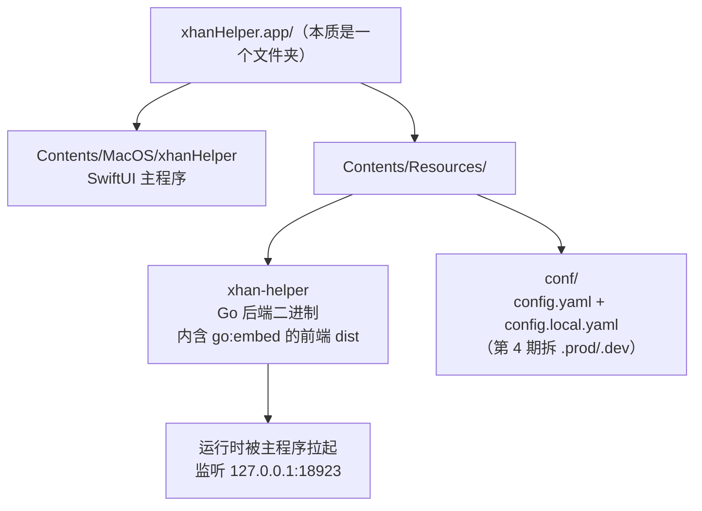

### 6. Swift：`LocalBackendManager`（启动器本体）

- **为什么**：这是「app 只是启动器」这条心智模型的落地。
- **改哪里**：新增一个 Swift 类，负责：
  - 选端口 → `Process` 启动 Go 子进程（项目里 `FileSystemToolProvider+Glob.swift` 已有调用外部进程的先例，不是从零发明）；
  - 把密钥 / 端口 / `XHAN_CONF_DIR` / 可选覆盖项通过环境变量传进去；
  - **捕获子进程 stdout/stderr**（`Pipe`）→ 写 `~/Library/Logs/xhanHelper/`；
  - 轮询 `/api/health`，区分 `starting` / `ready`；
  - **监控提前退出**：健康没 ready 就 exit → 弹人类可读报错（退出码 + 最后 N 行日志），区分「端口占用 / 密钥非法 / 库打不开 / 迁移失败」，并给「重新配置」入口；
  - app 退出时终止子进程。
  - **父进程看门狗（Go 侧，已实现）**：`appinit/watchdog.go` 在包初始化时记下 `os.Getppid()`；本地模式下每 5s 检查一次，app 崩溃被托孤（ppid→1）即自发 SIGTERM 走 `Serve` 的优雅关闭，避免孤儿进程赖在端口上。云端/开发模式不启用（父进程语义不同，贸然退出会误伤）。
  - **密钥来源（2B-3 已完成）**：只认 `LocalSecretsStore`（Keychain）。**不回退进程环境变量**——否则 scheme / shell 里的 `LLM_API_KEY` 会把 `isConfigured` 顶成 true，症状是「清了密钥也回不去首次配置」；且构建期注入密钥会把明文 key 留在 scheme 文件里。密钥一律设置页手填。
  - `XHAN_LLM_MODEL` / `XHAN_LLM_BASE_URL` 是**出方向**（Swift → Go 子进程），走「非空才覆盖」（Go 侧 `applyLLMEnvOverrides`，已在 2B-3 补齐），与上面的入方向读取无关。
  - **Touch ID 门（2B-4 已完成）**：`LocalAuthService` 管 token 生命周期；启用时 `State.locked` → UI-10 解锁后才拉进程。DEBUG 默认跳过（可用 `xhan_touch_id_debug` 临时打开）。


### 7. Swift：本地 / 远程寻址

- **为什么**：现在 Release 版的地址写死云端 URL（`DeviceManager.swift:20-27`）。**macOS app 改为本地模式**，iOS 仍连云端。
- **改哪里**：`DeviceManager` 的 `baseURL` / `webBaseURL` 在 macOS 下指向本机端口（prod `18923` / dev `18924`，随 build 决定）；放宽几个 WebView 的导航白名单（`BrowsePanelView.swift:127`、`MessageDebugPanelView.swift:57`）允许 `127.0.0.1` / `localhost`。
  - **白名单要落到 `127.0.0.1:18923`**：本地模式下监控看板 / 消息调试面板打开的是 `http://127.0.0.1:18923/...`，当前白名单只有 `localhost:5173` / `helper.xhanx.cn`，漏了本地端口面板直接空白。
  - **token 注入**：前端已读 `window.XH_BRIDGE.token`（`front-end/src/stores/auth.js:21`），2B 必须把本地 token 塞进 `XHWebViewBridge.makeConfiguration` 的 dictionary，否则 SPA 路由守卫会跳 `/login`。浏览器直开 `127.0.0.1:18923` 没有 token 通道（暂无登录流程），本期不做。
- **注意**：`baseURL` 全项目被引用约 149 处，但都**集中经过 `DeviceManager`**，所以只需改这一处源头。**云端部署能力保留**（iOS 仍走 `helper.xhanx.cn`）。

### 8. Swift：密钥设置 + 首次配置引导（Keychain）

- **为什么**：Release 版没有 `server/.env`；且 Go 的 `validate` 缺 `LLM_API_KEY` 就 `log.Fatal`——**没有 key 后端根本起不来**，所以填 key 必须发生在拉起 Go **之前**，只能是 Swift 侧原生界面。
- **首次配置窗口**：启动时 Keychain 无密钥 → **不拉后端**，弹配置窗口：DeepSeek LLM key + Ark Embedding key（`SecureField`）；model / base_url 预填默认值。带「测试连接」按钮（存前各发一个最小请求验证），通过才落 Keychain。配置窗口未完成就关 → 主窗口停在「未配置」空态 + 「去配置」入口。
- **设置页**：加「模型与密钥」分区，**Release 也可见**（现有服务器地址分区是 `#if DEBUG`）。含两个 key、`model`（一个字段，deepseek 家族）、base_url（留空=默认）、「清除密钥」。
- **Keychain 共享**：~~两个 build 不同 bundle id，Keychain 默认不互通；配**共享 access group**（`keychain-access-groups` entitlement），一次填两边都能用。~~
  > **已消解（第三轮 review）**：传统登录钥匙串不按 app 分区，同机同用户两个 build 天然共享（跨 bundle id 顶多弹一次授权）→ 不需要 access group（该 entitlement 需付费账号）。**第五轮起密钥按环境分家**（dev / prod 各存各的项），仍无需 access group。
- **只支持 deepseek 家族**：provider 锁死 `deepseek`；embedding 只放开 key，base_url / model 锁死（Ark + doubao-embedding）。
- **改哪里**：新增 Keychain 封装 + 首次配置视图 + 设置分区（不引 access group）。

### 9. Swift：驻留生命周期（关窗不退出）

- **为什么**：希望关掉窗口后后台任务（记忆/摘要/主题/延迟任务）继续跑；现在点红 X 是 `windowShouldClose → NSApp.terminate`（`xHelperMac/App.swift:311`），直接退出。
- **做法（单进程驻留，方案 A）**：`windowShouldClose` 改为只关窗口、不终止；红 X 后 dock 留点，Cmd+Q / 右键「退出」才真退，Go 随之停止。
- **为什么不拆进程**：SQLite 单写者，HTTP 进程与 worker 进程同写一个 `.db` 会锁竞争甚至损坏。单进程内 `CronRunner` 已能满足「关窗后继续」。
- **改哪里**：`xHelperMac/App.swift` 的 `windowShouldClose` / `applicationShouldTerminate`。

### 10. dev / prod 双环境隔离（第 4 期定稿：同一 app，按构建分环境；2026-11-14 起 Debug 改用独立 bundle id，见 §8.1 注）

- **为什么**：开发时能随手折腾数据，但**绝不允许 dev 碰 prod 数据**。
- **同一 app 身份，按构建配置分**：`Debug` → dev、`Release` → prod；数据根 / 端口 / 日志 / `APP_ENV` / conf 随之不同（见第八节表格）。不建第二套 scheme / `.xcconfig`。**（2026-11-14 修订：`Debug` 改用独立 bundle id `xhanx.cn.xHelperMac.dev`，见 §8.1 注）**
- **dev 是空库**：自动建 `me`，数据自己长 —— **不做 prod→dev 的 zip 导出/导入**（原意想定已砍，用户 2026-09-24 拍）。
- **三层拦截**（第八节 8.2）：物理隔离（两个 conf + `LocalPaths`）→ 启动交叉断言（`local_env` ↔ `APP_ENV` ↔ 数据根 ↔ token 前缀，不符致命）→ 请求层 env 校验（`Bearer <env>:<random>` 前缀不符 → 403）。
- **改哪里**：`conf/config.local.dev.yaml`（新）+ `config.local.yaml` 加 `local_env`；Go `config.ServerConfig.LocalEnv` + `appinit` 断言 + `middleware.LocalAuth.Env`；Swift `LocalPaths`（新）+ 8 处数据根硬编码 + `LocalKeychain.Account` token 项 + `LocalAuthService` token 生成 + `LocalBackendDiagnostics.childEnvironment` + 3 处 18923 白名单；`scripts/bundle-backend.sh` 按 `$CONFIGURATION` 选 conf；`Makefile` 加 `make local-dev`。

### 11. 本地单用户 + Touch ID 解锁（取代账号密码）

- **为什么**：本地是单用户，再让人记用户名/密码没意义，门交给 Touch ID。但**不能删 `user_id`**——28 张表都按它归属，删了要全库重构、还砸云端/iOS 共用代码。所以做法是「**身份隐形**」：用户后台自动存在，你永远看不见它，门用指纹。
- **本地单用户模式（Go）**：配置 `server.local_single_user: true` + `local_token`。**身份锚点是「库里的用户」**——DB 在数据根里（`~/Library/Application Support/xhanHelper/`，在 app bundle **之外**），跨 app 重装存活，不靠配置里的名字。`EnsureLocalUser` 启动时：库里有且仅有一个用户就用它（迁移进来的 xhan `33333333-…` 原样认领）；空库才新建（默认名 `me`）；多于一个视为未剪枝，**直接致命**要求剪枝。`middleware/auth.go` 加本地分支：Bearer 等于本地 token 时注入该 `user_id`；并把用户 UUID 塞进 `admin_users`（内存里）——**不硬编码任何 UUID / 用户名**。
- **三个场景都自洽**：① 迁移回来 → 库里带 xhan → 认领；② 给别人装 → 空库 → 建 `me`（phase 5 换首启提示）；③ 不断更新/删除重装 → 数据根不动、DB 还在 → 同一用户。token 由 app 每次生成经 env 传、**后端只比对不存储** → 重装换了新 token 照样连。
- **本地 token（app 生成）**：首启生成随机 `localToken` 存 Keychain，拉起 Go 时经 env `XHAN_LOCAL_TOKEN` 传入，请求带它。**全程不涉及用户名/密码**。
- **Touch ID 门（Swift）**：~~token 存成「需生物识别才能读」的 Keychain 项（`SecAccessControl` + `.userPresence`）。读它（换 token）天然触发指纹——**指纹即解锁**。~~
  > **已变更（第三轮 review）**：item 级生物 ACL 需付费 entitlement（实测 -34018），改为**传统钥匙串普通项 + app 层指纹门**（`unlock()` 先 `authenticate()` 再读/建 token）。触发时机：启动 / 从后台回前台 / 空闲 15 分钟；指纹失败**允许退系统密码兜底**（避免把自己锁外面）；**DEBUG build 跳过**（开发时不弹）。
- **本地 refresh 直通**：本地 token 不在 `user_tokens` 表、也无过期概念，`/api/auth/refresh` 见到中间件打的 `local_auth` 标记直接返回成功——否则前端 30 分钟心跳拿 401 会主动登出（`front-end/src/stores/auth.js:75-85`）。`/api/auth/change-password` 在本地模式会失败（无旧密码），无害，不处理。
- **改哪里**：`middleware/auth.go` 本地分支；`config` 加 `local_single_user` / `local_username`（可选，仅空库新建用）/ `local_token`；`DeviceManager` token 存储 UserDefaults → Keychain；新增 `LocalAuthService`（LAContext）；UI-1 / UI-5 / UI-10 相应调整。

---

## 六、分期与验收

原则：**先让本地后端能独立跑起来（验证数据层），再内嵌进 app，最后才迁数据、做环境隔离。** 每期都能单独验证，避免一次性动太多。

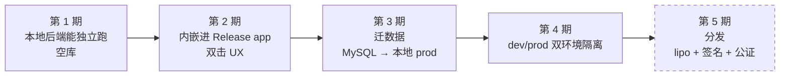

### 第 1 期 — 本地后端能独立跑（空库）

**你会看到什么**：敲 `make local`，后端在本地起来（SQLite、App Support 路径、只监听 `127.0.0.1`），HTTP 秒起、warmup 后台跑；用现有的 Debug 客户端连 `localhost` 能聊天、工具能用、后台任务有日志。

- 改动点 1、2、4（后端侧）。
- 验收：`go build ./... && go test ./...` 全绿；`make local` 起服务；`lsof -iTCP -sTCP:LISTEN -P | grep <port>` 只显示 `127.0.0.1`；Debug 客户端手动连上跑一轮聊天。
- **不包含**：前端 embed、app 内嵌、数据迁移、dev/prod 隔离。

### 第 2 期 — 内嵌进 Release app（双击 UX）

**你会看到什么**：在 Xcode 打个 Release app，首次双击弹配置窗口填密钥 + 启用 Touch ID；之后双击即用（**指纹解锁，无账号密码**），窗口秒开，数据落在 `~/Library/Application Support/xhanHelper/`；红 X 只关窗、后台继续；Cmd+Q 后 `lsof` 无残留。

- 改动点 3、5、6、7、8、9、11。
- 验收：首次配置 → Touch ID 解锁 → 聊天通；健康 `starting → ready` 可见；故意填错 key / 占端口 → 弹出人类可读报错；红 X 驻留、Cmd+Q 真退；前端面板（浏览/调试）可用（分享先不做）；**token 注入失败（`XHAN_LOCAL_TOKEN` 为空）时后端拒绝启动并报错，不退化成无认证**（`EnsureLocalUser` 对空 token 返回 error）。

> **2B 实现状态（已真机验收 ✅）**：2B-1 打包链路 ✅ / 2B-2 启动器 + 寻址 + 看门狗 ✅ /
> 2B-3 Keychain + UI-1 首次配置 + UI-5 模型与密钥 ✅ / 2B-4 Touch ID（UI-10）+ 驻留（UI-9）✅ /
> 2B-5 WebView 白名单 + token 注入 + UI-6 本地服务页 ✅。
> 遗留（不阻塞 2B）：前端「测试连接」直连 provider（DeepSeek + Ark），未走本地后端。
>
> **review 处置（第二轮）**：
> ① 修「`.locked` 态自动起进程 × 手动解锁」双起（`start()` 只进锁定不再偷跑 + `isResolving` 重入闸）；
> ② 锁屏补到 Settings scene，`LocalLockController.unlock()` 加 `isAuthenticating` 重入闸；
> ③ Keychain 读**真失败**改走错误态（不再当「没解锁」）并给「关闭 Touch ID 并重置凭据」逃生口；
> ④ `XHAN_LLM_*` 覆盖同步到 `llm_bg`（否则换供应商后后台 400/404）；
> ⑤ 驻留态 Cmd+Q 把主窗口叫回来挂退出确认 sheet（不再静默放行）；
> ⑥ `biometricsAvailable` 改 `.deviceOwnerAuthenticationWithBiometrics`（无指纹硬件不再开锁屏）；
> ⑦ 设置页补 Touch ID 开关；
> ⑧ 非 https 的 base_url 直接拒绝「测试连接」。
> 未改：白名单里显式 `127.0.0.1:18923`（设计要点，去重已由 `contains` 兜住）；驻留无条件生效（本分支本地优先）。
>
> **review 处置（第三轮，真机暴露）**：首次配置点「继续」毫无反应。查 `~/Library/Caches/com.xhan.xhanHelper/logs/current.log` 定性：
> `Keychain 写入失败 llm_api_key：OSStatus -34018`（`errSecMissingEntitlement`）→ 保存静默失败 → `isConfigured` 仍 false → `start()` 静默 return。
> **根因**：原实现用 `kSecUseDataProtectionKeychain` + `kSecAttrAccessControl`（生物 ACL），二者都要求 app 带
> `application-identifier` / `keychain-access-groups` entitlement；该 entitlement 只随描述文件下发 → **需要付费开发者账号**。
> 探针实测（`/tmp` 一次性脚本，4 组 add/read）：传统钥匙串普通项 `add=0` 可用；传统钥匙串 + ACL、DP 钥匙串（±ACL）**全部 -34018**。
> **决定（用户拍板，零成本路线）**：
> ① `LocalKeychain` 去掉 DP keychain 与 ACL，回到传统登录钥匙串普通项；
> ② 指纹门改由 **app 层**把守——`LocalBackendManager.unlock()` 先 `authenticate()` 再读/建 token，`LocalLockController` 管运行期重锁；
> ③ **access group 不需要**：两个 build 同机同用户，传统钥匙串不按 app 分区即可共享（跨 bundle id 顶多弹一次授权），原「dev/prod 共享密钥」诉求自然满足 → 第 4 期无需为此加能力（**第五轮又改为密钥按环境分家**，见决定表 #16）；
> ④ 写操作不再静默：`LocalKeychain.set` / `LocalSecretsStore.save` 返回 OSStatus，UI-1 / UI-5 失败时红字报出并阻止继续；
> ⑤ UI-1 布局修：顶部留 44pt 让开红绿灯 + 窗口收窄到 588 宽。
> 代价：token 无 item 级生物 ACL（别的本地进程读取需用户授权点击，非静默）；威胁模型（见风险表）仍可接受。
>
> **review 处置（第四轮，真机暴露）**：
> ① **UI-1 布局**最终形态：`ScrollView { VStack }` **顶部对齐** + `.padding(.top, 44)`，窗口 **588×650**（第三轮那版「垂直居中 + 620 高」已废）；
> ② **输入框提示**改 `prompt:`（框内灰字）——`TextField`/`SecureField` 首参是 label，在 `Form` + `LabeledContent` 里会被渲染成输入框右侧的行标签（像「框外挂了个值」，Base URL 还折行）；宽度 260/280 → 300；
> ③ **移除环境变量回退**：`LocalSecretsStore.load()` 只认 Keychain。scheme / shell 里的 `LLM_API_KEY` 会把 `isConfigured` 顶成 true 而界面显示「未配置」→ 症状是「清了密钥也回不去首次配置」；顺带清掉 scheme 里残留的明文 key（键名 `LLM_API_KEY1`，本就匹配不上，是死变量）；
> ④ **Touch ID 开关**：打开时先 `authenticate()` 过一遍指纹（`enableWithAuthentication`），失败/取消把开关弹回；设置页补 `#if DEBUG` 不弹指纹的提示（原来只有 onboarding 有）；
> ⑤ **测试连接反馈**改「图标 + hover」：`ProbeFailure{message 人话, detail provider 原文}`，界面只出图标、hover 才展开——原来那行红字把 Form 撑高、还常跑到离按钮很远的地方（如 Touch ID 卡片下面），且原始 JSON 会被 `lineLimit` 切半截；
> ⑥ **保存前强制测试**：设置页「保存并重启后端」与 onboarding「继续」都先测连接，通过才落盘（失败不存不重启，只亮红图标）；
> ⑦ **删手写 `applicationShouldHandleReopen`**：SwiftUI 的 `WindowGroup` 本就会恢复窗口，那只「第二只手」会和它各拉一个 → 偶尔出现**两个主窗口**（旧 NSWindow 有时还活着、有时已释放，所以不必现）；顺带治好点 Dock 弹出设置页；
> ⑧ **清除密钥 → 跳回首次配置**：`isConfigured` 变 false 时关掉设置等普通窗口 + 把主窗口叫到前面，否则清完 key 还杵在设置页里。

### 第 3 期 — 数据迁移（MySQL → 本地 prod）

**你会看到什么**：把线上 MySQL 里 **xhan 的数据**搬到本地 prod 的 SQLite（其余用户剪掉）。

**已拍决定（开工前）**

1. **迁移源**：每次重新 `make db-pull` 拉一份最新 dump（导进本地 MySQL `xhan_helper_test`），不用旧文件；
2. **瘦身**：**先全量搬**（`llm_call_ios` / `reflection_*` 等审计表照搬）。要瘦以后在 SQLite 上就地 `UPDATE`/`DELETE`，不必重跑 MySQL 那一趟；
3. **落地**：**一条命令自动化**，工具直接写 app 数据根，不手动拷文件；
4. **目标库**：现有本地 prod 库（1MB 测试数据）**丢弃**，drop/recreate（工具先把旧文件改名为备份）。

**工具 `cmd/mysql2sqlite`**

- 源与目标都走现成的 `config.Load()`：`APP_ENV=dev` → 源（本地 MySQL）；`APP_ENV=local` → 目标（`~/Library/Application Support/xhanHelper/xhan_helper.db`）。**不硬编码任何路径/DSN**，跟随配置漂移。工具不调 LLM，`Load()` 里 `llm.api_key` 的非空校验用假值绕过。
- 建表复用 `app.InitDB()`（AutoMigrate 全部模型）→ schema 与 app 永远一致；源侧只 `service.NewDB()`（**只读**，不迁移源库）。
- 逐表搬：表清单 = 源库实际表 ∩ `app.AllModels()`；按 `FindInBatches` 分页读 + 批量写，`Omit(clause.Associations)` + `SkipHooks`（拷贝要原样，不要 hook 与嵌套保存）。源库里不在 `AllModels` 的表（mailbox/mission 等已下线残留）打印后跳过。
- 剪枝：`PRAGMA table_info` **运行时发现**带 `user_id` 的表（不手维护清单）→ `DELETE ... WHERE COALESCE(user_id,'') <> <xhan UUID>`；`users` 按 `username` 剪。
- 对账：逐表打印「源（剪枝后应有）vs 目标」行数，不一致直接列出；再抽样关键表（messages / user_memories / notes / bills / embeddings）+ 校验 `users` 只剩 1 个（否则 app 的 `EnsureLocalUser` 会直接致命）。
- 安全闸：目标库文件存在先改名 `*.pre-migrate-<ts>` 备份；检测 `18923` 端口有监听（app 在跑）→ 拒绝并提示先退出 app。

**验收**：xhan 的关键表行数对账一致、其余用户行数为 0；抽样几条消息/记忆/账单在客户端显示正常；向量检索可用；warmup 提速后窗口仍秒开。

### 第 4 期 — dev/prod 双环境隔离

**你会看到什么**：同一个 app，**Debug 构建 = dev（沙盒）、Release 构建 = prod（真身）**；两个能同时开着、数据根 / 端口 / 日志全分开；dev 是**空库**（自动建 `me`），数据自己长，**不碰任何线上数据、也不复制 prod 数据**；dev 若被指去 prod 后端，会被 **403 踢掉**。

**已拍决定（2026-09-24，开工前）**

1. **同一 app 身份**：不建第二套 bundle id / scheme / xcconfig —— Swift 侧用现成的 `#if DEBUG`，Go 配置在 Run Script 里按 `$CONFIGURATION` 选。**（2026-11-14 撤销「同一 bundle id」这一半：Debug 改用 `xhanx.cn.xHelperMac.dev`，`#if DEBUG` 分环境不变）**
2. **`APP_ENV` 命名**：`local` = prod（现有 `config.local.yaml` 不动）、`local.dev` = dev（新增 `config.local.dev.yaml`）→ 迁移工具、`make local`、既有文档零改动。
3. **dev 数据**：空库起步 + 自动建 `me`；**不做导出/导入 zip**（UI-8a/8b 砍掉）、不从线上 / prod 拷数据，磁盘增量≈0。
4. **密钥与 token 都分家**：LLM / Embedding 密钥、`model` / `base_url` 覆盖项均按环境分家（钥匙串 account `llm_api_key_dev` / `_prod`、`embedding_api_key_dev` / `_prod`；UserDefaults key 加 `_dev` / `_prod` 后缀）——在 dev 里换供应商 / key / 模型不动到 prod；本地 token 同样分家（`local_token_dev` / `local_token_prod`）。旧版共享项保留为一次性迁移源。
5. **env 校验（用户提议）**：本地 token 形如 `<env>:<random>`，后端校验前缀不匹配即 403 → 堵住「dev 经逃生口写 prod」这条唯一泄漏路径。
6. **dev 视觉标识**（沿用 UI-7，落地形态见第八节）：Debug 构建 **Dock 图标右下角 `dev` 角标** + **顶栏胶囊簇左侧 `DEV` 徽标** + 显示名 `xhanHelper dev`。

**机制三层**

| 层 | 手段 | 兜住什么 |
|---|---|---|
| 1. 物理隔离 | 两个 conf（18924 + `xhanHelper-dev` 根）、Swift `LocalPaths`（`#if DEBUG`）、日志根分家 | 写错配置也指不到对方 |
| 2. 启动断言 | Go：`local_env` ↔ `APP_ENV` ↔ 数据根 ↔ token 前缀 四者配套，不符 `log.Fatalf` 退出；Swift 侧同款 assert | 配置/构建错配**炸在明处**，不静默写错库 |
| 3. 请求校验 | 中间件比对 `Bearer` 的 env 前缀 == 后端 `local_env`，不符 403 + 日志「客户端 env=X，后端 env=Y」 | 任何客户端（含前端面板、逃生口、别的本地进程）越界都进不来 |

**改动清单**

- **配置**：`conf/config.local.yaml` 加 `local_env: prod`；新增 `conf/config.local.dev.yaml`（`port 18924`、`xhanHelper-dev` 根、`image_dir` 同根、`local_env: dev`、`local_token: ${XHAN_LOCAL_TOKEN}`、`session_gap_minutes: 1`）。
- **Go**：`config.ServerConfig` 加 `local_env`（含 `applyOverrides` 非空覆盖）；`appinit` 启动断言；`middleware.LocalAuth` 加 `Env`，本地模式先校验前缀；`appinit/router_test.go` 跟随。
- **Swift**：新增 `LocalPaths`（根 / 日志根 / 端口 / env 名，`#if DEBUG` 决定）；改 8 处硬编码数据根（`FaviconStore` / `UserConfigStore` / `HistoryStore` / `BookmarkStore` / `DownloadHistoryStore` / `LocalToolResultStore` / `ToolOutputStore` / `LocalBackendManager` 日志根）；`LocalKeychain.Account` 加 per-env token 项；`LocalAuthService` 生成带前缀 token + 用对应 account；`LocalBackendManager.port`；`LocalBackendDiagnostics.childEnvironment` 的 `APP_ENV`；3 处写死 `18923` 的白名单改用动态端口（`XHWebView` / `BrowsePanelView` / `MessageDebugPanelView`）；`LocalBackendCoreTests` 断言。
- **打包 / 工具**：`scripts/bundle-backend.sh` 按 `$CONFIGURATION` 拷 `config.yaml` + 对应 local conf；`server/Makefile` 新增 `make local-dev`（`APP_ENV=local.dev`）。
- **撤掉**：UI-8a / UI-8b（导出 / 导入 zip）、prod→dev 数据复制、`.xcconfig`、第二套 scheme。（2026-11-14 补：Debug 的 bundle id 已独立，见 §8.1 注）

**验收**

1. **Debug 跑** → dev 起在 `18924`、数据根 `xhanHelper-dev`、空库自动建 `me`、聊天正常；看板 / 账单面板不白屏（白名单那条缝）。
2. **Release 跑**（Scheme → Run → Build Configuration = Release）→ prod 起在 `18923`、数据完好（44,860 条消息、笔记 991、账单 951 都在）。
3. 两个同时开：互不干扰；Dock 里能分清。
4. **泄漏测试**：dev 设置页把「服务地址」填 `http://127.0.0.1:18923` 重启 → 请求被 **403** 踢，后端日志有「客户端 env=dev，后端 env=prod」。

> **实现状态（2026-09-24 夜：代码已落；2026-09-25 真机验收完成）**
>
> - **Go 侧已自验**（`go build ./... && go test ./...` 全绿）：
>   `config.server.local_env` + `appinit.AssertLocalEnv` 四者配套断言 + `middleware.Auth` 的 env 前缀校验（403）
>   + 本地模式**不再回落 `user_tokens` 表**（越界请求连门都进不来）。真起 dev 后端实测：
>   dev token → `200`、prod token → `403 {"errMsg":"环境不匹配：本地服务为 dev"}`、同前缀错串 → `401`；
>   断言冒烟：dev conf 配 prod 前缀 token → `local_env=dev 要求 local_token 以 "dev:" 开头` 直接退出。
> - **配置 / 打包**：`conf/config.local.dev.yaml`（新增，自带全部本地项，因为 `config.local.yaml` 只在 `APP_ENV=local` 时加载）；
>   `config.local.yaml` 加 `local_env: prod`；`bundle-backend.sh` 按 `$CONFIGURATION` 选 conf；`make local-dev`。
> - **Swift 侧已写**（`swift test` 200 绿 + macOS/iOS `swiftc -typecheck` 干净）：
>   新增 `LocalPaths`（根 / 日志根 / 端口 / `APP_ENV` / conf 名）；8 处数据根硬编码全改（favicons / user-config / history / bookmarks / downloads / local_results / tool_output / workspace / 后端日志根 / 设置页展示）；
>   本地 token 按环境分家（钥匙串 `local_token_dev` / `local_token_prod`，值 `<env>:<random>`）；`childEnvironment` 的 `APP_ENV` 按构建；白名单端口动态；Debug 显示名 `xhanHelper dev`。
> - **dev 视觉标识（UI-7，已真机验）**：最初做的「窗口最上缘全宽 accent 细条」落在无标题栏窗口的拖拽 chrome 带上，读起来像渲染 bug → 改为三处：**Dock 图标右下角 `dev` 角标**（运行时给 `NSApp.applicationIconImage` 打角标，`AppDelegate.applyDevIconBadgeIfNeeded`，黑白角标不引色相）+ **顶栏胶囊簇左侧 `DEV` 徽标**（`TopBarView.devChip`，与胶囊同高、`appAccent` 16% 底）+ 显示名 `xhanHelper dev`（pbxproj Debug 配置 `INFOPLIST_KEY_CFBundleDisplayName`）。
> - **两处与定稿的偏差（都是被约束逼出来的，已加断言兜住）**：
>   ① 白名单写死 `18923` 实际只有 **1 处代码**（`XHWebView.frontendOrigins`，另 2 处是注释），已改动态端口；
>   ② `LocalPaths` / `ToolsDataRoot` / `LocalToolResultStore.dataRootName` 是**同一个决定的三个副本**——SwiftPM 不允许同一个文件进多个 target，tools 层与 LocalArtifacts 层各自留了一份；`LocalBackendManager.init` 启动时校验三者一致（`fatalError`，不用 `assert`——后者在 Release 被优化掉、漂移会静默）。
> - **第五轮（密钥分家，2026-09-25）**：原「密钥两环境共享」改为**按环境分家**（dev 换 key / 供应商会动到 prod，用户提出）。`LocalKeychain` 新增 `llmKeyDev` / `llmKeyProd` / `embeddingKeyDev` / `embeddingKeyProd`；`LocalSecretsStore` 的 `model` / `base_url` UserDefaults key 加 `_dev` / `_prod` 后缀；旧共享项（`llm_api_key` / `embedding_api_key`）当一次性迁移源——本环境缺失时复制进来并打 `xhan_key_migrated_<account>` 标记（否则「清除密钥」后下次 `load()` 又被迁回）。macOS Debug/Release、iOS `swiftc -typecheck` 干净 + `swift test` 200 绿；真机已验（见下条）。
> - **已真机验收完成（用户，2026-09-25）**：Dock 分得清（dev 角标）、顶栏 `DEV` 徽标可见；4 条验收（Debug dev 空库 / Release prod 数据完好 / 双开互不干扰 / 逃生口填 `127.0.0.1:18923` 收 403）已跑；密钥分家另验：Debug / Release 各存各的 key、互不影响。
> - **注意（已处置）**：若 Release 产物还是旧的（bundle 里 `conf/config.local.yaml` 不含 `local_env`），说明没重编 → 必须重新 Build 一次 Release 才算验过第 4 期。验收时已按此重编并验过。

### 第 5 期 — 分发（本次不做）

纯 Go 驱动已就位 → 双架构 lipo；Developer ID 签名 + 公证（你已有 `DEVELOPMENT_TEAM = NSJD2BRH7Z`）；朋友填自己的 key。

- **注意架构**：Release 的 app 是通用二进制（`ARCHS_STANDARD` = arm64 + x86_64；项目级 `ONLY_ACTIVE_ARCH` 只对 Debug 生效），而 `go build` 默认只出宿主架构 → 通用 app 里嵌的是单架构 Go 子进程。**本机/同架构机器无碍**；跨机分发前需 `GOARCH=arm64` + `GOARCH=amd64` 各编一次再 `lipo -create`。

---

## 七、数据迁移（MySQL → SQLite）

**先空库、后迁移**（先验证链路，再搬数据）。**只迁 DB，不迁图片**（旧图引用会 404，已接受）；**分享功能先不做**。

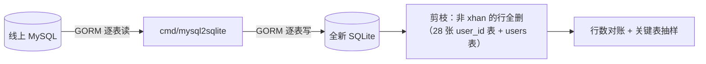

**为什么不能直接用 mysqldump**：现在 `data/mysqldumps/` 里的 dump 是 ~800MB–1GB 的 MySQL 语法 SQL，SQLite 不认识。与其解析它，不如写个小的 Go 工具：

- 新增 `cmd/mysql2sqlite`：用 GORM 从 MySQL 逐表读，用 GORM 往 SQLite 逐表写。
- **写全新 DB**（drop/recreate，不做增量合并）：避免「app 先跑建了随机 UUID 的 xhan，迁移再插线上 xhan（`33333333-…`）撞 username 唯一约束」。
- **优点**：复用 `model/` 里已有的结构体定义，不用担心字段对不上；批量插入，不需要在循环里逐条访问数据库。
- **剪枝（只留 xhan）**：全量搬完后遍历所有表，凡有 `user_id` 列的就 `DELETE WHERE user_id != <xhan 的 UUID>`，再 `DELETE FROM users WHERE username != 'xhan'`。列名靠 `PRAGMA table_info` 运行时发现，**不用手维护 28 张表清单**；剪枝时显式 `PRAGMA foreign_keys=OFF`（SQLite 默认即 off，钉死防驱动改默认），剪完可选跑孤儿清理。不带 `user_id` 的全局配置表保留。
- **关注点**：时间 / 空值 / 类型在两种数据库间的差异，靠「行数对账 + 关键表抽样」验证。
- **图片**：不搬。`ImageAsset` 行会留下但文件不存在，展示时 404（已接受）；后续由 TTL 清理自然淘汰。

**关于启动**：向量预热（`agents.go:41-47`：memory / note / history / summary / theme / chunk / tool / fact）过去是**同步阻塞**在 HTTP 之前的，memory/note 还是全量 + 逐条 embed。第 1 期改动点 4 把它挪到后台后，即便迁入大表，窗口也能秒开、warmup 在后台补齐。

---

## 八、dev / prod 双环境隔离

**目标**：开发时能随手折腾本地数据，而 **dev 绝不能碰 prod 数据**。

> **本节 = 第 4 期定稿（2026-09-24）。** 详细清单 / 验收见阶段划分区「第 4 期」段。

### 8.1 两条环境怎么分

**同一个 app**（同一份代码、同一份 scheme），靠**构建配置**分环境：**`Debug` → dev，`Release` → prod**。不建第二套 scheme / `.xcconfig`：Swift 侧用现成的 `#if DEBUG`，Go 侧 conf 在 `bundle-backend.sh` 里按 `$CONFIGURATION` 选。

**bundle id 自 2026-11-14 起分家**（`Debug` = `xhanx.cn.xHelperMac.dev`，`Release` = `xhanx.cn.xHelperMac`）：此前两者同 id，`UserDefaults` 域 / `WKWebsiteDataStore`（cookie、localStorage、缓存）/ TCC 授权全共享，dev 一次清 token 就能把 prod 的登录一起清掉 —— 见 `docs/bugs/067`。数据根 / 端口 / 日志 / `APP_ENV` 仍走 `LocalPaths`（`#if DEBUG`），与 bundle id 无关。

| | prod（真身） | dev（沙盒） |
|---|---|---|
| 构建 | **Release** | **Debug** |
| bundle id | `xhanx.cn.xHelperMac` | `xhanx.cn.xHelperMac.dev` |
| 数据根 | `~/Library/Application Support/xhanHelper/` | `~/Library/Application Support/xhanHelper-dev/` |
| 日志 | `~/Library/Logs/xhanHelper/` | `~/Library/Logs/xhanHelper-dev/` |
| 端口 | `18923` | `18924` |
| APP_ENV | `local` | `local.dev` |
| 配置 | `config.local.yaml` | `config.local.dev.yaml` |
| `local_env` | `prod` | `dev` |
| 数据 | 线上迁来的真身（`cmd/mysql2sqlite`） | **空库**，自动建 `me`，自己长 |
| 密钥 | 钥匙串 `llm_api_key_prod` / `embedding_api_key_prod` | 钥匙串 `llm_api_key_dev` / `embedding_api_key_dev`（含 model / base_url 覆盖项，UserDefaults 后缀分家） |
| 本地 token | 钥匙串 `local_token_prod` | 钥匙串 `local_token_dev` |

- **数据根 / 端口写死在各自的 conf 里**（不是运行时开关）→ **即使配置写错也指不到对方**；Swift 侧的数据根一律走 `LocalPaths`（`#if DEBUG` 决定），**禁止再写字面量 `"xhanHelper"`**。
- **可同时开着**：端口 / 数据根 / 日志 / bundle id 都分开，两个 app 并行互不干扰。

### 8.2 「dev 碰不到 prod」靠三层，不靠自觉

| 层 | 手段 | 兜住什么 |
|---|---|---|
| **1 物理隔离** | 两个 conf + `LocalPaths` + 日志根分家 | 正常路径下就是两个世界 |
| **2 启动断言** | Go：`local_env` ↔ `APP_ENV` ↔ 数据根 ↔ token 前缀 **四者配套**，不符 `log.Fatalf`；Swift 侧同款 assert | 配置 / 构建错配**炸在明处**，不静默写错库 |
| **3 请求校验** | 本地模式下，中间件比对 `Bearer` 的 **env 前缀** == 后端 `local_env`；不符 **403** + 日志「客户端 env=X，后端 env=Y」 | 任何客户端越界都进不来 |

**关于 env 参数（三层里的第 3 层）**：环境标签**落在本地 token 里**——token 形如 `<env>:<random>`（app 生成时带前缀，按 env 存不同钥匙串 account）。这样不必在十几个请求构造点各加一个 header：**token 是每个请求天然携带**的，连面板里（Vue 前端经 bridge 拿到同一个 token）的 API 调用也自动带上。后端先比前缀（不符 → 403 人话报错），再比整串（不符 → 401，用常量时间比较防时序泄露）。

这一层封住的正是唯一剩下的漏洞：**dev app 把「服务地址」逃生口填成 `http://127.0.0.1:18923`**（= prod 后端）。没有它，dev 的 UI 能连上 prod 后端并写 prod 数据；有了它，prod 后端看到 `Bearer dev:…` 直接 403。

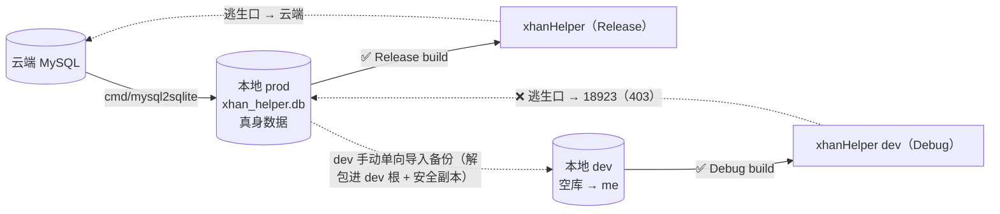

- **dev → prod 无数据路径**（不做 dev 导出）：dev 要测试数据就自己造，要真身数据才用 prod。
- **prod → dev 只读单向导入**（2026-09-30 解禁）：dev 可从文件选任意备份包（含 prod 归档），解包进 **dev 自己的数据根**并留安全副本；不触碰 prod 数据根。入口见 UI-8b。
- **dev 永远不能删 prod**：`LocalBackup.delete` / `deleteSafety` 按 env 硬拦（非本环境直接抛错，UI 也不显示「删除」按钮）；跨 env 前缀互不包含由 `LocalBackupIsolationTests` 钉住。
- **云端 → 本地 prod** 走第七节的 `cmd/mysql2sqlite`，是另一个方向，不冲突。
- ~~同 bundle id 的连带影响（已接受）：UserDefaults 域共享 → `xhan_server_url` 逃生口、`xhan_touch_id_enabled` 两环境通用（`model` / `base_url` 覆盖项**已按环境加后缀分家**，不在此列）。前者由第 3 层兜住（403），后者无所谓（DEBUG 本来就不弹指纹）。~~
  **已撤销（2026-11-14）**：`Debug` 改用独立 bundle id `xhanx.cn.xHelperMac.dev`，上面这些「共享」不再成立；那次共享还让 dev 清 token / 覆盖 token 直接影响到 prod，见 `docs/bugs/067`。

---

## 九、小词典：给后端开发者的 Mac 概念对照

| Mac 概念 | 一句话解释 | 后端类比 |
|----------|-----------|----------|
| **app / bundle** | `.app` 其实是个文件夹（`Contents/` 里装可执行文件和资源） | 一个自带目录结构的发布包 |
| **子进程** | app 启动的另一个独立程序 | `make dev` 启动的那个 Go 进程 |
| **`go:embed`** | 把静态文件编进 Go 二进制，运行时直接读 | 类似把前端 dist「烧」进可执行文件，不再依赖外部目录 |
| **codesign（签名）** | 给可执行文件盖章，证明它没被篡改 | macOS 的强制要求：app 里每个二进制都要盖章，否则不让跑 |
| **notarization（公证）** | 把签名后的 app 交给 Apple 审核存档 | 分发给别人时的额外一步，否则对方首次打开会被拦截 |
| **Keychain** | 系统提供的加密存储 | 存密钥的地方，比明文写在文件里安全 |
| **LaunchAgent / launchd** | macOS 的「开机自启/守护进程」机制 | systemd 的对应物。**本方案不用它**（你要的是双击 app） |
| **`~/Library/Application Support`** | 放应用自己数据的标准目录 | 相当于 Linux 上 `/var/lib/<app>` 的用户级版本 |
| **`~/Library/Logs`** | 放应用日志的标准目录 | `/var/log/<app>` 的用户级版本 |
| **Xcode Run Script** | Xcode 构建时执行的一段 shell | 类似 Makefile 里的一个 target，构建 app 时自动跑 |

---

## 十、风险与盲区

| 风险 | 说明 | 应对 |
|------|------|------|
| **嵌套二进制签名** | app 里的 Go 子进程必须单独签名，否则 Release 版公证/运行失败 | 第 2 期重点验证；用 Xcode 的 Code Sign On Copy 或单独 codesign 步骤 |
| **后端暴露到局域网** | 若绑定 `0.0.0.0`（现状 `:port` 就是），同 Wi-Fi 下任何人可直连后端读写数据 | 本地模式强制绑定 `127.0.0.1`（改动点 2），验收时用 `lsof -i:18923` 确认只监听回环 |
| **驱动替换面广** | 换纯 Go 驱动要动约 30 个测试文件 | 机械改动 + 全量 `go test ./...` 兜底 |
| **前端 embed 的构建顺序** | dist 必须在 Go 编译**之前**生成 | Run Script / Makefile 固定顺序；dist 目录 gitignore |
| **子进程生命周期** | 端口占用、app 崩溃后残留孤儿进程 | 固定端口 + 明确报错；父进程看门狗 |
| **Xcode 编译由你完成** | 项目约定 agent 不跑 `xcodebuild` | 我只能 `swiftc -typecheck` 自检；第 2 期每个改动都要你真机往返 |
| **App Store 的取舍** | 现在 app 没有沙盒，走 Developer ID 分发没问题；要上 App Store 则沙盒对「启动子进程」有硬约束，需重新设计 | 本期不做；分发给朋友时再决定 |
| **首次配置 UX** | 朋友首次打开必须先填 key，否则后端根本不启动 | 引导窗口 + 「测试连接」+ 未配置空态与「去配置」入口（改动点 8） |
| **可选项被空串冲掉** | `${VAR}` 对未设置变量展开成空串，会冲掉 base_url / model 默认值 | 可选项走「非空覆盖」而非占位符（改动点 2） |
| **秒开期检索不全** | warmup 挪后台后，最初几秒记忆/语义检索可能缺内存向量 | 已接受；`/api/health` 暴露 `starting/ready`，需确认检索侧能优雅降级 |
| ~~**Keychain 共享**~~ | ~~两个 build 共享密钥需 `keychain-access-groups`~~ | **已消解**：传统钥匙串不按 app 分区，同机同用户两个 build 天然共享（第三轮 review）；该 entitlement 需付费账号，不做 |
| **双 build 维护** | 两份 scheme / config / entitlements 要同步 | **已简化**：同一份代码，只按 `$(CONFIGURATION)` 选 conf（不再有两套 scheme）；2026-11-14 起 Debug 另用 bundle id `xhanx.cn.xHelperMac.dev`（见 §8.1 注） |
| **第 4 期前没有沙盒（Debug = 真身）** | 现在只有一个数据根：Xcode 跑 Debug 构建就是本地 prod —— 聊天、改数据**直接写真实库**，没有副本可退；想试「删表 / 重跑向量 / 换 embedding 模型」这类操作只能拿真身做 | 兜底：源库（本地 MySQL 副本）是静态的，`go run ./cmd/mysql2sqlite` **18 秒**可重建，且每次迁移前旧库改名备份；根治 = 第 4 期（Debug → `xhanHelper-dev` 沙盒，第八节） |
| **dev 经逃生口连 prod 后端** | dev 的「服务地址」若填 `127.0.0.1:18923`，UI 能连上 prod 后端写 prod 数据（非沙盒下同用户理论上也仍可读 prod 文件） | 路径硬编码 + 启动交叉断言 + **请求层 env 校验（token 前缀不符 → 403）**（第八节 8.2） |
| **Swift 侧数据根散落** | `"xhanHelper"` 字面量散在 8 个文件里，漏改一处就 favicons / history 串味（**不易察觉**） | 统一走 `LocalPaths`；改完 grep 全仓字面量 + 真机对拍两个根 |
| **预览靶材质失真** | `ImageRenderer` 离屏渲染材质/毛玻璃不可信 | 只信布局 / token；观感以 Xcode 真机为准（第十一节） |
| **剪枝留孤儿** | 按 `user_id` 删非 xhan，可能漏掉无 `user_id` 的关联表留下孤儿行 | 剪枝后跑一遍孤儿清理 + 关键表对账抽查（第七节） |
| **旧图 404** | 不迁图片，迁入的 `ImageAsset` 指向不存在的文件 | 已接受；后续 TTL 清理自然淘汰 |
| **Touch ID 不可用** | 无指纹硬件 / 指纹识别失败会把用户锁在外面 | app 层门用 `.deviceOwnerAuthentication`（指纹失败可退系统密码）；无生物硬件不开锁屏；DEBUG build 跳过 |
| **本地 token 面** | 甲方案后端只认 `localToken`，任何读到它的本地进程都能调 API | token 存传统钥匙串（**无 item 级生物 ACL**：该 ACL 需付费 entitlement，见第三轮 review）→ 别的 app 读取需用户授权点击；指纹门在 app 层 + 回环绑定；个人机子威胁模型可接受 |
| **后台任务只在 app 运行时跑** | 关窗驻留可继续，但显式退出 / 关机就停 | 已接受；下次启动自动补跑（见下） |

### 关于「合盖 / 关机后补跑」

**不需要额外写代码**，机制已经满足你的诉求：

- 延迟任务的处理逻辑查的是「到期时间 ≤ 现在」（`delayed_task_repo.go:31`），由一个 30 秒的定时器驱动。
- **合盖 = 睡眠**：进程还在内存里，唤醒后定时器恢复，30 秒内把积压的到期任务全部捞出处理。
- **关机重启**：重启后同样会捞出所有到期任务。
- （可选优化）现在重启后要等首次定时器触发（+30 秒），可以像归档任务那样在启动时立刻扫一次（`cron_runner.go:305` 已有先例）。

每日凌晨 3 点的主题发现按你的决定**保留现状**：睡眠时会补触发；只有「关机恰好跨过 03:00」会漏当天。

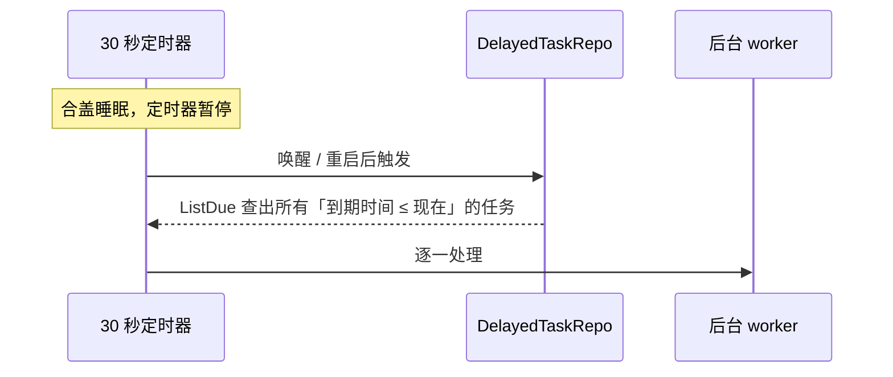

---

## 十一、UI 设计面与预览方式

需要设计的界面清单（`NEW` = 新增，`改造` = 在现有界面加）：

| # | 界面 | 触发时机 | 关键元素 | 基调 | 期 |
|---|------|----------|----------|------|----|
| **UI-1** | **首次配置（Onboarding）** `NEW` | 首次启动、Keychain 无密钥 | 欢迎头 / 两个 key / 高级区(model, base_url) / 测试连接 / **启用 Touch ID** / 继续 | Apple 设置助理级「高级感」；**单页**（高级区折叠）；**无账号密码** | 2 |
| **UI-2** | **启动·预热态** `NEW` | 后端 `starting→ready`；或 ready 但会话未载入完 | 轻量指示：「正在启动本地服务…」（**不显示预热**：warmup 已后台化、不挡窗口） | 克制、不挡操作；**主窗口内联** | 2 |
| **UI-3** | **后端启动失败弹窗** `NEW` | 子进程提前退出 / 健康超时 | 人话原因 + 退出码 + 日志折叠 + 「查看日志 / 重新配置 / 重试」 | 系统 Alert 或 sheet | 2 |
| **UI-4** | **未配置空态** `NEW` | 用户跳过 onboarding | 主窗口空态 + 「去配置」入口 | 复用 `ErrorStateView` 风格 | 2 |
| **UI-5** | **设置页「模型与密钥」** `改造` | 随时 | 两个 `SecureField` / model 下拉 / base_url / 清除密钥 /（测试连接）/「锁定·重新验证」 | 复用 `SettingsCard`+`KeycapView`；**Release 可见**；去掉「退出登录」 | 2 |
| **UI-6** | **设置页「本地服务」** `NEW` | 随时 | 后端状态、端口、数据根路径、日志入口、「重启后端」 | 复用 `SettingsCard` | 2 |
| **UI-7** | **dev 环境视觉标识** `改造` | dev build | **Dock 图标 `dev` 角标** + **顶栏 `DEV` 徽标** + 显示名 `xhanHelper dev` | 一眼可辨、不刺眼 | 4 |
| ~~**UI-8a**~~ | ~~prod「导出数据」~~ | — | **仍不做**：无 dev→prod 导出（见第八节 / 决定表 #10） | — | ~~4~~ |
| **UI-8b** | **dev「开发者数据」** `NEW` | 随时（仅 Debug） | 从文件导入备份（含 prod）/ 清除 dev 数据；导入解包进 dev 数据根 + 安全副本 | 复用 `SettingsCard`；仅 `LocalPaths.isDev` 可见 | 4 |
| **UI-9** | **驻留提示（可选）** `NEW` | 关窗后 app 仍活 | 首次关窗一句提示「仍在后台运行，⌘Q 退出」 | 可选，轻提示 | 2/4 |
| **UI-10** | **Touch ID 解锁门** `改造` | 启动 / 回前台 / 空闲 15min | 现有 `LoginMacView` → 指纹解锁（失败可退系统密码）；DEBUG 跳过 | 复用现有登录门壳，去掉账号密码 | 2 |

**可复用的现成件**：`ErrorStateView` / `MinimumLoadingView` / `InlineRetryBar`（`ErrorStateView.swift`）、`SettingsCard`+`KeycapView`（`SettingsStyle.swift`）、`GlassBackground`、顶栏 `CapsuleGroup`/`CapsuleButton`、设计 token（`appAccent` 等）。

**预览方式（原生 SwiftUI，不用 HTML）**：
- 真视图 + Xcode `#Preview`（你在画布复核，零漂移）。
- agent 自检走 SwiftPM `ImageRenderer` 预览靶（`swift run` 出 PNG）；**只信布局 / token，材质离屏不可信**。
- 拿不准的取值做应用内「UI 画廊」调试页，你构建后截图挑，选完正式视图直接复用。

---

## 十二、已拍板决定与遗留项

| # | 决定 | 结论 |
|---|------|------|
| 1 | 本地端口策略 | prod 固定 `18923`、dev `18924`；被占就报错（SQLite 单实例） |
| 2 | 生命周期 | 单进程驻留：红 X 只关窗，Cmd+Q / 右键退出才停后端（方案 A） |
| 3 | 密钥输入时机 | 首次启动弹配置窗口；密钥存传统钥匙串（不按 app 分区，dev/prod 各存各的项，**不需要 access group**——第三轮 review 修订，第五轮改为按环境分家）；**只认 Keychain、不回退进程环境变量**（第四轮修订） |
| 4 | 可改配置 | provider 锁死 deepseek；放开 `model`（一个字段）+ `base_url`；embedding 只放开 key |
| 5 | 启动补扫 | 是否加「启动即扫一次延迟任务」（可选，几行）——**遗留，未定** |
| 6 | 分发方式 | 本次不做。将来走 Developer ID（非 App Store）还是 App Store（沙盒，需重设计）——**遗留，未定** |
| 7 | 首次配置形态 | 单页（高级区折叠） |
| 8 | 启动态 | 主窗口内联指示（非独立 splash） |
| 9 | dev 视觉标识 | Dock 图标 `dev` 角标 + 顶栏 `DEV` 徽标 + 显示名 `xhanHelper dev`（第 4 期；原「窗口最上缘全宽细条」因像 bug 被换掉，见第八节） |
| 10 | dev 数据来源 | **空库自造**（自动建 `me`）为主。**dev 可选从文件导入备份**（含 prod 归档，2026-09-30 解禁）：解包进 dev 自己的数据根 + 安全副本，单向、不触碰 prod 数据；**仍无 dev→prod 导出** |
| 11 | dev / prod 怎么分 | **同一 app 身份**，按构建配置：`Debug` → dev（18924 + `xhanHelper-dev` + `local_env: dev`）、`Release` → prod（18923 + `xhanHelper` + `local_env: prod`）；不建第二套 scheme / `.xcconfig`（第 4 期定稿）。**2026-11-14 修订：`Debug` 改用独立 bundle id `xhanx.cn.xHelperMac.dev`**——同一身份导致 UserDefaults / Keychain / WebKit 数据全共享、dev 能改掉 prod 的登录态，见后续变更 |
| 12 | UI 预览方式 | 原生走 Xcode `#Preview` + SwiftPM `ImageRenderer` 预览靶；HTML 仅 Web 前端 |
| 13 | 本地身份 | 单用户、**隐形**：以「库里的用户」为锚点（唯一则认领、空库建 `me`、多则报错要求剪枝）；不钉 UUID / 用户名（可分发） |
| 14 | 访问门 | Touch ID：启动 / 回前台 / 空闲 15min；失败允许系统密码兜底；DEBUG 跳过；token 存传统钥匙串 + **app 层指纹门**（item 级生物 ACL 需付费 entitlement，第三轮 review 修订） |
| 15 | 迁移范围 | 全量搬 + 剪掉非 xhan（28 张 `user_id` 表）；写全新 DB；**不迁图片**（旧图 404）；**分享不做** |
| 16 | dev 密钥 / token | LLM / Embedding 密钥 + `model` / `base_url` 覆盖项**按 env 分家**（dev 换供应商 / key / 模型不动 prod；旧共享项一次性迁入本环境）；本地 token **按 env 分家**（钥匙串 `local_token_dev` / `local_token_prod`，值是 `<env>:<random>`）——env 校验的载体（第 4 期定稿，密钥分家为第五轮修订） |
| 17 | 拦越界请求 | 本地模式中间件校验 `Bearer` 的 env 前缀 == 后端 `local_env`，不符 **403**（不是加独立 header：token 天然被每个请求携带，连面板里的 Vue 调用也带） |
| 18 | 防错配 | 启动**交叉断言**：`local_env` ↔ `APP_ENV` ↔ 数据根 ↔ token 前缀 四者配套，不符 `log.Fatalf` / Swift `assertionFailure`（第 4 期定稿） |

---

## 后续变更

- 2026-11-05：`AutoMigrate` 失败策略统一为**所有环境 `log.Fatalf`**（不再只本地致命、云端只记日志继续）。schema 与代码不一致时拒绝启动，避免运行时才炸或写坏数据。影响文件：`server/internal/app/init_db.go`。
- 2026-11-14：**`Debug` 构建改用独立 bundle id `xhanx.cn.xHelperMac.dev`**（Release 仍是 `xhanx.cn.xHelperMac`），推翻第 4 期「同一 app 身份」的决定。起因：同身份让两个 build 共用 UserDefaults 域、`WKWebsiteDataStore`（cookie/localStorage/缓存）、TCC 授权，dev 侧一次 `verifyToken` 失败清登录就能把 prod 的 token 一起删掉（见 `docs/bugs/067`）。改在 `project.pbxproj` 的 macOS Debug 配置一行；`LocalPaths.scoped` 那套 key 后缀保留（无害，iOS 仍同身份）。代价一次性：dev 重新登录、重给麦克风/通知权限、调试域里的永久文件授权目录与内置浏览器登录态要重建（密钥项本来按环境分项，跨 build 读取最多弹一次钥匙串授权）、Xcode 自动签名需注册新 App ID。影响文件：`client/xHelper/xHelper.xcodeproj/project.pbxproj`、`Services/BrowserEngineRouter.swift`、`Services/LocalAuthService.swift`、`xHelperMac/LocalSettingsViews.swift`（调试域名的 `defaults write` 说明改指 `.dev`）。
