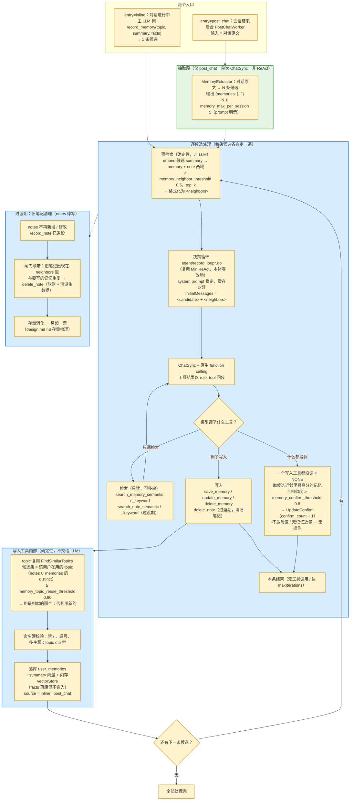

# 记录循环 — 总流程图

> 版本：v4｜日期：2026-09-23｜状态：设计定稿，待开发
>
> 上位：《记忆 / 笔记改造 · 设计文档》（`design.md`）§4.1–4.4；prompt 全文与工具 schema 见 `record-loop-prompt.md`；笔记退役见 `note-retirement.md`
> 覆盖：两个入口（`inline` / `post_chat`）、抽取段、逐候选决策循环、写入工具内的 topic 复用、过渡期的旧笔记清理
>
> v2 是「笔记 + 记忆两层」的版本；v3 改为**单一实体**（只写 `user_memories`）；v4 按 2026-09-23 补充决定改为**两段式**——抽取（单次调用出候选）+ 逐候选决策循环，理由见 `design.md` §4.1。

## 图

图例：黄=本批待做；绿=抽取段（复用现有 `MemoryExtractor`，改动其输出结构）；蓝=新建模块。

## 结构要点

1. **两段式：先抽取、再逐候选决策。** `post_chat` 的输入是对话原文，没有可嵌入的「一个点」——必须先抽取出 N 条候选，预检索才有 query。`inline` 天然有候选（主 LLM 给的参数），跳过抽取段直接进决策段。**这是「预检索」能成立的前提**（`design.md` §4.1）。
2. **决策循环逐候选跑**：每条候选一个独立的 `MiniReAct` 实例，`InitialMessages` 注入 `<candidate>` + `<neighbors>`。候选 N 落库后立即同步向量，对候选 N+1 的预检索可见（照 `fact_worker.go:24` 的注释）——否则批内两条相似候选会都判 ADD。
3. **决策 = 选哪个写入工具，不是吐 op 字段**：`save_memory` = ADD、`update_memory`（带 `target_id`）= UPDATE、`delete_memory` = DELETE；**一个写入工具都没调 = NONE**。NONE 只在「最高分记忆近邻的相似度 ≥ `memory_confirm_threshold` 0.80」时才算**再次确认**（`confirm_count + 1`）——相似度不够就不是同一条记忆被重申，不动它。
4. **走原生 function calling**：给工具定义、读 `msg.ToolCalls`（照 `FactDecider`，`fact_worker.go:483`）。`target_id` 必须落在近邻集合内（`idSet` 校验，`:484`）**且类型匹配**（`idType`），参数非法丢弃并记日志，不拿零值继续写库。
5. **预检索每条候选做一次（≥ 0.5，跨 memory + note 两域）**：省掉模型第一轮搜索；模型仍可调 `search_*` 追加。**关键词检索才是保留 ReAct 的理由**——它擅长**字面量**（人名、专有名词、日期、金额），语义检索不擅长。
6. **上限 5 条落在抽取段**：`memory_max_per_session`，`post_chat` 由抽取 prompt 明示 + 解析后截断；`inline` 是主 LLM 每次调用 1 条，不设跨调用计数。
7. **topic 复用是确定性逻辑，留在 `save_memory` 内部**：向量相似度不该让 LLM 复现。候选集限定「在用 topic」（notes ∪ memories 的 distinct），不用概念表全量——否则新 topic 可能被复用到已死的孤儿词上。**不拒绝**：≥ 0.80 就用最相似的，否则用新的。
8. **facts 落库但不嵌入**：只有 summary 进向量库，所以 summary 必须自足（不能靠 facts 才读得懂）。多条提取（每条各自嵌 summary）才是「检索面太窄」的解法。
9. **「记忆让位笔记」这条规则消失了**：同一张表，`inline` 刚写的记忆，`post_chat` 入口检索时自然看得到 → 判 `update` / NONE 即可。这是单实体化最大的简化。
10. **delete 是最后手段**：指令里独立成节，只有用户明确推翻才删；判不准就不动或走 `update_memory`。
11. **旧笔记清理靠闸门顺带**（阶段 1，零额外代码）：预检索跨域把旧笔记带进 `<neighbors>`，模型发现重复就 `delete_note`。**不设时间硬删**（会误杀长期结论），批量消化归「存量梳理」票。

## 与 design.md 的对应

| 图中模块 | design.md |
|---|---|
| 两个入口、抽取段、决策循环、工具集、上限、NONE | §4.2 |
| 为什么先抽取再决策（预检索的 query） | §4.1 |
| `record_memory` 接入主循环（inline 入口） | §4.3 |
| 写入工具内的 topic 复用（仅 `save_memory`，阈值 0.80） | §4.4 |
| 旧笔记停写与清理 | §5 + `note-retirement.md` |
| 配置项 | §6 |
