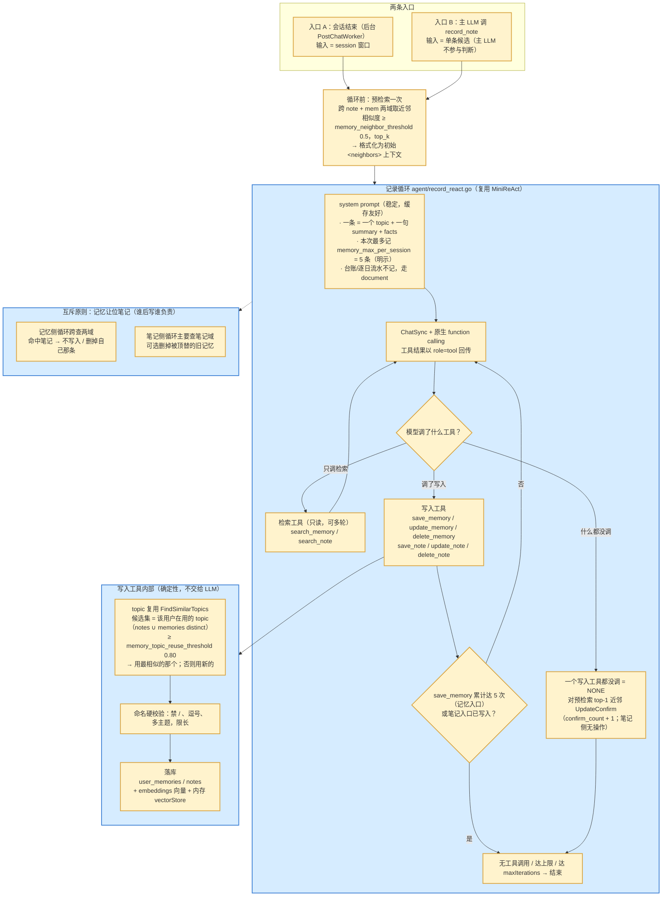

# 记录循环 — 总流程图

> 版本：v2｜日期：2026-09-23｜状态：设计定稿，待开发
>
> 上位：《记忆 / 笔记改造 · 设计文档》（`design.md`）§4.1–4.4（后续主体）
> 覆盖：入口 A 记忆（会话结束）/ 入口 B 笔记（`record_note` 内）、记录循环、写入工具内的 topic 复用
>
> v1 是「提取 → 决策闸门 → 执行」三段式；v2 按 2026-09-23 的决定改成**统一 ReAct 循环**（复用 `MiniReAct`）。

## 图

图例：黄=本批待做、蓝=新建模块。

## 结构要点

1. **一个循环，两个入口**：记忆（多条、后台）与笔记（单条、工具内）在循环前汇流，之后走同一套工具语义。
2. **提取 = 调 `save_*`，决策 = 选哪个写入工具**：不再有单独的提取 LLM 与 `{op: …}` JSON 输出；**一个写入工具都没调 = NONE**。
3. **走原生 function calling**：给工具定义、读 `msg.ToolCalls`（照 `FactDecider`，`fact_worker.go:483`）。`target_id` 必须落在近邻集合内（`idSet` 校验，`:484`），参数非法丢弃并记日志，不拿零值继续写库。
4. **循环前预检索一次（≥ 0.5）**：省掉模型第一轮搜索；模型仍可调 `search_*` 追加。阈值避免把无关记录塞进上下文。
5. **上限 5 条必须在 prompt 里明示**：`memory_max_per_session`，工具侧同时计数封顶（达到即返回错误提示逼收敛）。
6. **topic 复用是确定性逻辑，留在 `save_*` 内部**：向量相似度不该让 LLM 复现。候选集限定「在用 topic」（notes ∪ memories 的 distinct），不用概念表全量——否则新 topic 可能被复用到已死的孤儿词（如 `睡眠管理 追踪睡眠记录与优化实验` 这类复合垃圾名）上。**不拒绝**：≥ 0.80 就用最相似的，否则用新的。
7. **delete 不清 topic 概念行**：概念行跨笔记/记忆共享（`concept_embeddings` 唯一键 `(type,value,user_id)`），孤儿由 topic-merge 的孤儿 GC 兜底。见 `docs/bugs/017-vector-cleanup-on-delete.md` §边界。孤儿本身无害（不进检索、不进 topic-merge 报告），隔几周手动跑一次 `make topic-merge-apply`（末尾带 GC，幂等）即可。
8. **互斥是虚线旁路**，不是主流程节点——它是两条入口间的最终一致性约束。
9. **不做自搜索**：曾设想给决策器开 MiniReAct 自搜索，但它底层还是向量检索，搜出来的东西与已送入的近邻重复。**现在检索已作为循环内的显式工具**（`search_*`），不再需要额外一层。

## 与 design.md 的对应

| 图中模块 | design.md |
|---|---|
| 入口 A / 入口 B、记录循环、工具集、上限、NONE | §4.2 |
| 笔记接入（同循环，同步跑） | §4.3 |
| 写入工具内的 topic 复用（仅 `save_*`，阈值 0.80） | §4.4 |
| 互斥：记忆让位笔记 | §4.2 末段 |
| 配置项 | §6 |
