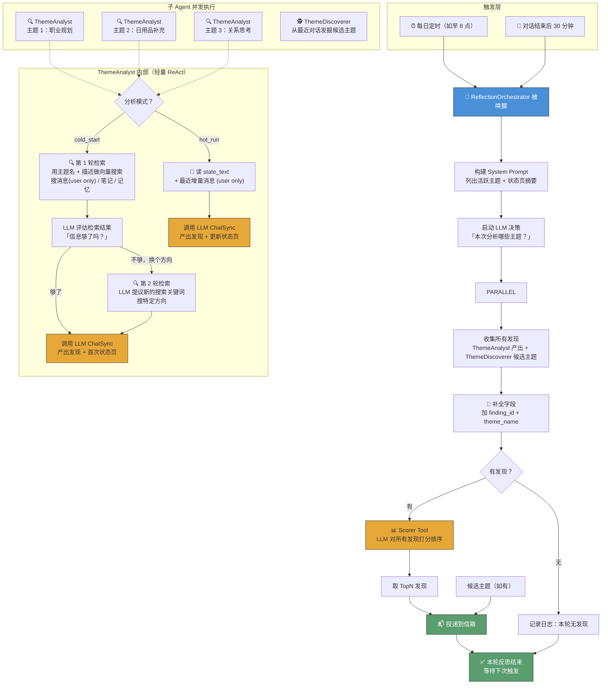

# Phase 6 — 反思 Agent：从被动响应到主动服务

> 日期: 2026-05-14 | 状态: 设计完成，待开发

---

## 一、动机与目标

### 1.1 当前能力边界

xhanHelper 目前是一个**纯被动**的 Agent：用户发消息 → Agent 回复。虽然已有记忆提取、笔记、向量检索等基础设施，但 Agent 从不会主动联系用户。

### 1.2 愿景

Agent 从被动响应者进化为主动服务者：

- **无事不谈**：生活中所有话题——琐事/关系/择业/职业规划——用户都跟 Agent 聊
- **记忆沉淀**：从对话中提取用户信息，向量化存储，未来可检索
- **主动笔记**：Agent 自主使用笔记工具记录有价值信息
- **主动提醒**：从账单/笔记/记忆中发掘规律（消费品补充周期、职业规划 roadmap 进展），主动投递提醒
- **外界感知**：接入外部信息源（新闻/技术动态），发现值得关注的信息后主动提醒
- **长期追踪**：对用户关注的领域（如某板块股票、某城市房地产）持续跟踪

### 1.3 MVP 范围

3 个预设主题 + 自动发现主题 + 打分机制 + 前端信箱。外部信息获取工具不在 MVP 内。

---

## 二、架构决策

以下为本次设计中的关键决策，逐层递进。

### 决策 1：触发器 — 服务端定时轮询 + LLM 决策

**结论**：后台 cron 定时拉起「反思循环」，将相关数据灌给 LLM，让 LLM 决策是否联系用户、说什么。不走事件驱动规则引擎路线（维护成本高）。

**理由**：ReAct 架构下 LLM 层层递进做决策，规则逐条编写难度大且不灵活。

### 决策 2：触达方式 — Web 前端信箱 + 红点徽标

**结论**：LLM 决策产出后投递到「信箱」（类似邮件收件箱），前端展示未读红点。用户主动查看，Agent 不实时推送。

**理由**：当前只有 Web 前端，无法像 Native App 一样做系统级推送。未来开发移动客户端时再接入 APNs 等实时通道。

### 决策 3：反思模式 — 启动 Agent 选主题 → 子 Agent 分析 → 打分 Agent 排序 TopN

**结论**：每次反思循环分三步：

1. **启动 Agent**（主 Orchestrator）：判断本次循环需要分析哪些主题，分发给子 Agent
2. **子 Agent**（ThemeAnalyst）：各自负责一个主题，产出发现
3. **打分 Agent**（Scorer）：汇总所有发现，评分排序，取 TopN 投递到信箱

### 决策 4：子 Agent 数据策略 — 向量检索 + 主题状态页

**结论**：两个数据来源配合使用：

| 场景 | 策略 | 说明 |
|------|------|------|
| 冷启动（新主题/首次分析） | 向量检索 | 用主题描述做 embedding 查询，从历史消息/笔记/记忆中拉 top-N 相关内容 |
| 热运行（已有状态页） | 状态页增量更新 | 每次分析后更新主题状态页，下次反思循环直接读状态页 + 最近新数据 |

**状态页**：每个主题维护一份 JSON 摘要，记录主题下的关键信息、进展、上次分析结论。反思循环时子 Agent 读状态页而非翻原始聊天记录，控制上下文大小。

### 决策 5：主题来源 — 预设 + 自动发现

**结论**：两层主题来源：

1. **预设主题**（MVP 3 个）：用户手动定义，稳固基本盘
2. **自动发现**（ThemeDiscoverer）：反思循环从最近对话/记忆/笔记中发掘候选主题，投递到信箱让用户确认

**不做**：对话中主动打断用户询问是否创建主题（体验差）。

### 决策 6：自动发现主题的边界机制

**结论**：

- **确认机制**：候选主题投递到信箱，用户可接受（触发 tool call 创建主题）或忽略；一定时间后自动 expire
- **去重与合并**：对已有主题和候选主题的向量表示做 K 聚类，距离聚类核心过近的候选主题自动过滤
- **淘汰机制**：用户手动关闭 / 长期未活动自动 archive；已关闭主题可被新事件唤醒（生活有周期性）
- **频率控制**：宁愿少发掘，一次最多提议 2-3 个候选主题

**可观测性要求**：所有聚类/去重/过滤决策须有日志，可在监控面板追溯。

### 决策 7：反思循环运行频率

**结论**：A + B 组合。

- **定时触发**：每天固定时间跑一次完整反思循环，生成当日简报
- **事件触发**：用户对话结束后 30 分钟延迟触发一次增量反思（信息最新鲜时）

### 决策 8：ReflectionOrchestrator 独立于 HTTP Server

**结论**：反思循环由 cron / 事件信号驱动，运行在独立 goroutine 中，不经过 Gin handler。与现有 Orchestrator 共享 LLM client、Registry、VectorStore 等依赖，但执行入口和生命周期完全独立。

**理由**：
- HTTP 驱动的 Orchestrator 受请求超时限制，反思循环可能需要较长时间
- 反思循环没有前端 SSE 消费者，输出目标不同（投递信箱 vs 流式返回）
- ReAct 的 Observe → Decide 循环在反思场景下需要更完整地实现

### 决策 11：ReAct 循环抽为公共组件

**结论**：`orchestrator.go` 的 ReAct 循环逻辑和 ThemeAnalyst 内部的轻量 ReAct 循环，抽取为共享组件，避免两份实现。公共组件提供：循环控制（最大轮次、终止条件）、工具执行、结果反馈。差异点（system prompt、可用工具集、输出目标）通过参数注入。

**注意**：公共组件接受独立的工具集参数（`map[string]Tool` 或轻量 Registry）。主 Orchestrator 传入完整工具集，ThemeAnalyst/ThemeDiscoverer 传入仅包含检索工具（`search_messages`/`search_notes`/`search_memories`/`get_bill_stats`）的小工具集。检索工具需要实现 `tool.Tool` 接口，内部封装 VectorStore + 各 Repo 的查询方法，但注册在独立的 Registry 实例中，不污染主工具注册表。

### 决策 9：子 Agent 形态 — Tool 接口实现

**结论**：ThemeAnalyst 和 Scorer 都实现 `tool.Tool` 接口。ReflectionOrchestrator 使用现有 ReAct 循环，将这些「内部 LLM Tool」作为普通工具调用。

**优势**：
- 复用现有 Registry / ExecuteByName 机制
- 主 Orchestrator 的 ReAct 循环无需改动——调 tool → 拿结果 → 给 LLM → 决定是否继续
- 新 sub-agent 加进来只需注册

### 决策 10：ThemeAnalyst 内部检索策略 — 轻量 ReAct + Role 过滤

**结论**：
- ThemeAnalyst 内部可以调检索工具（向量搜索消息/笔记/记忆，账单统计），形成一个轻量 ReAct 循环——搜 → 看结果 → 决定是否换个方向再搜 → 搜完分析
- 增量数据只喂 `role = user` 的消息，`tool` 和 `assistant` 角色不传入（噪音为主）
- 内部 LLM 调用上限设为 2-3 轮（检索 1-2 轮 + 分析 1 轮），不递归调用其他 sub-agent tool

**理由**：
- 纯代码检索只能固定用主题名做 query，无法动态调整检索方向。LLM 看了第一轮检索结果后可能发现意外线索，需要换关键词深挖
- user 消息是用户真实想法/状态/关注点，tool/assistant 消息是执行结果和回复，对主题分析价值低
- 检索工具属于数据访问层，不涉及其他 sub-agent，不会形成递归嵌套

---

## 三、数据模型

### 3.1 MailboxItem — 信箱消息

```go
type MailboxItem struct {
    ID        string    `gorm:"primaryKey;size:36" json:"id"`
    UserID    string    `gorm:"size:36;not null;index" json:"user_id"`
    Title     string    `gorm:"size:200;not null" json:"title"`
    Content   string    `gorm:"type:text" json:"content"`
    Type      string    `gorm:"size:30;not null" json:"type"` // "daily_brief" | "theme_finding" | "candidate_theme"
    Source    string    `gorm:"size:50" json:"source"`        // 来源主题名或 "system"
    IsRead    bool      `gorm:"default:false" json:"is_read"`
    IsArchived bool    `gorm:"default:false" json:"is_archived"`
    Metadata  *string   `gorm:"type:json" json:"metadata,omitempty"` // 附加数据
    CreatedAt time.Time `gorm:"autoCreateTime" json:"created_at"`
}
```

### 3.2 ThemeState — 主题状态页

```go
type ThemeState struct {
    ID          string    `gorm:"primaryKey;size:36" json:"id"`
    UserID      string    `gorm:"size:36;not null;index" json:"user_id"`
    Name        string    `gorm:"size:100;not null" json:"name"`
    Description string    `gorm:"size:500" json:"description"`
    Status      string    `gorm:"size:20;default:'active'" json:"status"` // active | archived | closed
    StateText   string    `gorm:"type:text" json:"state_text"`              // LLM 维护的状态摘要（自由文本）
    EmbeddingID *string   `gorm:"size:36" json:"embedding_id,omitempty"` // 向量索引（用于去重聚类）
    CreatedAt   time.Time `gorm:"autoCreateTime" json:"created_at"`
    UpdatedAt   time.Time `gorm:"autoUpdateTime" json:"updated_at"`
    LastRunAt   *time.Time `json:"last_run_at,omitempty"`
}
```

### 3.3 复用已有模型

- `ScheduledTask`（已定义，未启用）— 存储反思循环的 cron 调度配置
- `UserMemory` / `Note` / `Message` — 数据源，向量检索目标

---

## 四、⚠️ 提示词工程关键点

本系统的核心智能不靠代码逻辑，靠 LLM 的判断质量。以下 5 个 prompt 点是决定系统能否真正起效的关键瓶颈，需要持续调优。

### 4.1 🔴 ThemeAnalyst 分析 prompt（最关键）

**位置**：`internal/agent/theme_analyst.go` — ThemeAnalyst 内部的 LLM ChatSync 调用

**做什么**：给定一个主题（如「职业规划」「消费品补充」），LLM 阅读检索到的相关数据（冷启动路径）或状态页 + 最新增量数据（热运行路径），产出「值得提醒用户」的发现。

**为什么难**：
- 这是整个反射系统的**质量源头**——后面 Scorer 只能排序，不能无中生有
- LLM 面对的数据是碎片化的（几条聊天记录、几篇笔记、几个账单统计），需要**从碎片中拼出模式**，而不是简单复述数据
- 冷启动和热运行是两个完全不同的上下文结构，prompt 需要适应两种场景
- 输出格式需要结构化（标题 + 内容 + 置信度 + 紧急性），方便 Scorer 消费
- 最大的坑是「发现不了就说没有」——LLM 倾向于「即使没看到有价值的东西也硬编一个」，需要 prompt 明确允许返回空结果

**调优方向**：
- 少量高质量发现 > 大量平庸发现
- 明确告诉 LLM：如果数据中确实没有值得报告的事，返回 `{"findings": []}` 是正确的行为
- 每个发现必须附带引用（来自哪条数据），防止幻觉
- 冷启动时引导 LLM 识别「尚未形成规律但值得关注的早期信号」

---

### 4.2 🔴 状态页更新 prompt

**位置**：`internal/agent/theme_analyst.go` — ThemeAnalyst 分析完成后，更新 `ThemeState.state_json`

**做什么**：LLM 分析完主题后，产出一份新的 JSON 状态页，覆盖旧状态。下次分析时直接读这个而不是翻原始数据。

**为什么难**：
- **增量更新困境**：写太详细 → 状态页膨胀，几轮后超过上下文；写太简略 → 丢失关键细节，后续分析变成无源之水
- **信息衰减**：旧的规律要不要保留？「用户 3 个月前每周跑步」现在还有效吗？LLM 需要判断每条信息的时效性
- **结构化 vs 灵活**：不预设 schema（不同主题结构不同），但完全没有约束会让 LLM 写出的 JSON 不可解析或下游难使用
- 这是**自我强化循环**——如果状态页质量差，下一轮分析就差，状态页就会更差

**调优方向**：
- Prompt 中给出状态页的理想结构示例（但不强制）
- 要求 LLM 标注每条信息的时间戳和置信度衰减
- 对超过 N 天未更新的条目自动标记为 stale
- 状态页大小设硬上限（如 3000 tokens），超出时要求 LLM 优先保留最新/最重要的信息

---

### 4.3 🟡 Scorer 打分 prompt

**位置**：`internal/agent/scorer.go` — Scorer 内部的 LLM ChatSync 调用

**做什么**：收到所有 ThemeAnalyst 的发现后，对每条发现打分，排序取 TopN。

**为什么难**：
- 打分维度多且互相冲突：重要性（这事多大？）vs 时效性（现在说还是过两天说？）vs 可行动性（用户能做什么？）
- LLM 容易给所有发现打高分，区分度不够
- 不同主题的发现不可比——「该买水了」和「职业规划里程碑滞后了」怎么放在一个分数体系里？
- 用户每天看到的 TopN 决定了他们对系统的信任——如果 Top1 总是鸡毛蒜皮，用户会不再看信箱

**调优方向**：
- 强制分布：无论有多少候选，必须选出 Top 3，且必须给出每个的排序理由
- 打分维度精简到 2-3 个，每个维度给 1-5 分，总分自动计算
- 在 prompt 中嵌入历史评分案例（few-shot），校准 LLM 的判断标准
- 记录打分日志，后续可根据用户行为（点了哪些、忽略了哪些）反向调整

---

### 4.4 🟡 主题自动发现 prompt

**位置**：`internal/agent/theme_discover.go` — ThemeDiscoverer 的 LLM 调用

**做什么**：从最近 N 天对话/记忆/笔记中，识别用户可能长期关注的领域，提名为候选主题。

**为什么难**：
- **噪音控制是第一优先级**：用户聊了一次「腰酸」不代表需要追踪腰椎健康。LLM 天然倾向于过度联想，需要 prompt 强力约束
- 需要区分「一次性别闲聊」「短期关注」「长期追踪价值」三个层次——只有第三层才该被提名为主题
- 输出质量决定了用户的确认负担——一次提 10 个候选，用户直接无视；提 1 个精准的，用户觉得有价值
- 与已有主题的去重虽然是代码做的（K 聚类），但 LLM 提名的精准度决定了去重之后还剩什么

**调优方向**：
- Prompt 中明确三类不该提名的场景（附具体例子）
- 要求 LLM 给出提名理由，方便用户判断是否接受
- 设定高门槛：LLM 只有在相当确定时才提名，不确定时返回空

---

### 4.5 🟢 启动 Agent 主题选择 prompt

**位置**：`internal/agent/reflection.go` — ReflectionOrchestrator 的 ReAct 循环 system prompt

**做什么**：反思循环开始时，主 LLM 看到所有活跃主题及其状态页摘要，决定本次要分析哪些主题。

**为什么难**（相对前四个最轻）：
- 大部分时候应该全选，所以这个 prompt 的边际价值不高
- 难点在于「何时跳过」——某个主题上次分析后没有任何新数据，是否还要重新分析？
- 如果主题数量增长到 10+，需要做优先级排序

**调优方向**：
- 初期可以简单粗暴：全选所有活跃主题
- 后续如果主题多了，加入跳过逻辑：状态页更新时间 < N 小时且无新数据 → 跳过

---

## 五、核心技术机制

### 5.0 整体流程图



> 黄色节点：调用 LLM。绿色节点：工程操作（不调 LLM）。蓝色节点：入口。

### 5.1 主题自动发现流程

```
ThemeDiscoverer（定时/事件触发）
  → 从最近 N 天对话 + 记忆 + 笔记中提取候选主题关键词
  → 对候选主题做 embedding
  → 与已有主题的 embedding 做 K 聚类 / 余弦相似度对比
  → 距离 > 阈值的候选 → 投递到信箱（type: candidate_theme）
  → 距离 ≤ 阈值的候选 → 过滤，记录日志
  → 用户看到候选 → 接受（创建主题）或忽略
  → 超时未处理的候选 → expire
```

**关键约束**：
- 每次最多产出 2-3 个候选主题
- 所有聚类/去重决策可追溯至日志
- 候选主题在信箱中可闲置，超时自动 expire

### 5.2 反思循环完整流程

```
1. Cron / 事件信号 → 唤醒 ReflectionOrchestrator
2. 启动 Agent（主 LLM）接收 prompt：
   - 当前有哪些活跃主题（含状态页摘要）
   - 决定本次需分析哪些主题
3. 对每个选中主题，调用 ThemeAnalyst tool：
   - 冷启动路径：向量检索相关数据 → LLM 分析 → 产出发现
   - 热运行路径：读状态页 + 最近增量数据 → LLM 分析 → 更新状态页 + 产出发现
4. 收集所有发现，调用 Scorer tool：
   - LLM 对所有发现打分（重要性/时效性/可行动性）
   - 排序取 TopN
5. 投递 TopN 发现到 Mailbox
6. 若有候选主题，一并投递
```

### 5.3 主题状态页更新机制

每次 ThemeAnalyst 分析完成后，LLM 产出一份更新后的文本状态摘要，覆盖写入 `ThemeState.state_text`。状态页内容由 LLM 自行维护为自由文本而非结构化 JSON——不同主题的状态结构差异大（账单关注周期规律，职业规划关注里程碑进展，关系思考关注事件→反思→行动），统一 schema 反而会让 LLM 削足适履。

---

## 六、实现切分

### Round 1：反思循环核心（后端核心逻辑）

| 文件 | 操作 | 说明 |
|------|------|------|
| `internal/model/mailbox.go` | 新 | MailboxItem GORM 模型 |
| `internal/model/theme_state.go` | 新 | ThemeState GORM 模型 |
| `internal/service/mailbox_repo.go` | 新 | 信箱 DB CRUD |
| `internal/service/theme_state_repo.go` | 新 | 主题状态页 DB CRUD |
| `internal/agent/reflection.go` | 新 | ReflectionOrchestrator：独立 goroutine 入口，ReAct 循环 |
| `internal/agent/theme_analyst.go` | 新 | ThemeAnalyst：实现 Tool 接口，单个主题分析，内部可调一次 LLM |
| `internal/agent/scorer.go` | 新 | Scorer：实现 Tool 接口，汇总发现 + LLM 打分排序 TopN |
| `internal/agent/theme_store.go` | 新 | 状态页读写封装 |
| `internal/agent/theme_discover.go` | 新 | ThemeDiscoverer：候选主题自动发现 + K 聚类去重 |
| `internal/controller/mailbox.go` | 新 | 信箱列表/已读/归档 API |
| `internal/controller/theme.go` | 新 | 主题管理 API（创建/关闭/重新激活） |
| `internal/tool/mailbox.go` | 新 | MailboxTool：让 LLM 可投递消息到信箱 |
| `internal/tool/theme.go` | 新 | ThemeTool：让 LLM 可创建/关闭主题（确认候选主题时用） |

### Round 2：定时调度与事件触发

| 文件 | 操作 | 说明 |
|------|------|------|
| `internal/agent/cron_runner.go` | 新 | cron 调度器：每日定时 + 对话结束后 30 分钟延迟触发 |
| `server/cmd/xhan-helper/main.go` | 改 | 启动 ReflectionOrchestrator goroutine |

### Round 3：前端信箱

| 页面/组件 | 说明 |
|-----------|------|
| `MailboxView` | 信箱列表页，展示投递消息，未读红点徽标 |
| `MailboxItem` | 单条消息组件：标题/内容/类型标签/时间/已读状态 |
| 导航栏红点 | 全局导航上加信箱未读数 badge |

---

## 七、MVP 不做的

- 外部新闻/信息获取工具（后续单独设计）
- 移动端推送（等移动客户端）
- 对话内主动打断用户提议主题
- 主题自动发现超过 3 个候选/次
- ThemeAnalyst 递归调用其他 sub-agent
- Observations 变量追踪工具（P6 已有设计，单独实施）

---

## 八、后续演进方向

- 外部信息源接入（RSS / NewsAPI / Web Search tool）
- Scorer 升级：引入用户反馈信号（用户对过往提醒的响应）优化打分
- 移动端推送通道
- 定时简报可配置化（时间/频率/包含的主题）
- 状态页的向量化检索（让主题之间可以交叉引用）
